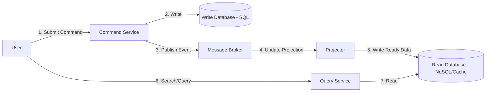

# Day 41: CQRS Pattern - Deconstructing the Read-Write Separation Paradigm 🧙‍♂️

Welcome to the final 5 days of Phase 3! 🚀

We have mastered microservices coordination, communication, security, and transaction management. You can now build a fully operational distributed system with confidence. But here is the ultimate scaling question: **Will your architecture run at lightning speeds when hit by millions of concurrent users?**

There is a silent killer of application performance: **Using the exact same database and data model for both reads and writes.** Today, we will learn how to shatter this conventional pattern using a state-of-the-art design paradigm: **CQRS (Command Query Responsibility Segregation)** (🔊).

---

## 🪝 THE HOOK: The Administrative Report Bottleneck

Imagine building a food delivery platform (like UberEats or DoorDash) handling massive scale:
1.  **The Write Flow**: A hungry customer clicks "Place Order". The system quickly appends a lightweight transaction record: *"User A purchased Meal B for $10."* This is highly performant and finishes in milliseconds.
2.  **The Read Flow**: A restaurant manager loads their analytics dashboard: *"Calculate our total revenue this month, group VIP customers who made 5+ purchases, and identify dishes with the highest refund rates."*

**The Architectural Conflict**:
-   To compute this report, the database engine must execute complex `JOIN` queries across 10 normalized tables, scanning millions of rows.
-   While executing these heavy queries, the database engine locks critical tables to maintain isolation.
-   **The Consequence**: Hungry customers attempting to place orders get blocked, experiencing request timeouts because the database is choked by administrative reporting queries.

Why let an observational "read" action block a revenue-generating "write" action? This is where CQRS comes to the rescue.

---

## 🎭 ANALOGY: The Newspaper Publisher and the Readers

Imagine the operations of a major national newspaper agency:

1.  **The Processing Stage (Write/Command)**: Journalists submit raw drafts. Editors review facts, fix layouts, crop photos, and execute structural edits. This is a complex, high-validation process that requires tight control and coordination. This is the **Command** (🔊) side of CQRS.
2.  **The Delivery Stage (Read/Query)**: The newspaper is printed in millions of identical, lightweight copies and delivered to doorsteps. Readers open the paper and scan the articles. Readers do not access raw editing drafts, nor do they block the editors' desk while reading. They consume a pre-rendered replica optimized for rapid reading. This is the **Query** (🔊) side of CQRS.

If every reader had to walk into the chief editor's office to read original manuscripts, the agency would go bankrupt instantly. CQRS is the architectural equivalent of printing optimized "newspapers" (Read Models) from the "raw manuscript" (Write Model) to serve the masses at scale.

---

## ⚙️ UNDER THE HOOD: Anatomy of a CQRS System

CQRS splits an application's architecture into two independent halves:

### 1. The Command Side (Writes) (🔊)
-   **Responsibility**: Processes requests that mutate system state (Create, Update, Delete).
-   **Characteristics**: Encapsulates complex business rules and validations. It focuses exclusively on validating domain invariants and ensuring write safety.
-   **Data Model**: Structured in **Third Normal Form (3NF)** (🔊) to eliminate redundancy, avoid write anomalies, and guarantee data consistency.

### 2. The Query Side (Reads) (🔊)
-   **Responsibility**: Fetches and returns data to the user as fast as possible.
-   **Characteristics**: Contains zero business logic or validation rules. It focuses purely on high-performance data extraction.
-   **Data Model**: Highly **Denormalized** (🔊). Information is pre-aggregated and stored in flat tables to eliminate SQL `JOIN` statements. It frequently utilizes search engines like **Elasticsearch** (🔊) or memory-resident caches like **Redis** for sub-millisecond retrieval.

### 3. Asymmetric Synchronization (The Projection) (🔊)
How does the Query side learn about new writes from the Command side?
-   Upon successfully committing a write, the Command side publishes an asynchronous integration **Event** (e.g., `OrderPlaced`).
-   A background service called the **Projector** (🔊) listens to these events, processes the updates, and writes the newly formatted data into the Read database.
-   This establishes **Eventual Consistency** (Day 35). The Read model might lag behind the Write database by a few milliseconds, but this is a minor trade-off for spectacular scaling benefits.

---

## 🏗️ TOPOLOGY: CQRS Structural Architecture

---

## 💼 SYSTEM DESIGN INTERVIEW: Choosing the Right Strategy

**Question: \"CQRS is a highly performant pattern. Should we deploy it across all of our microservices to maximize system throughput?\"**

-   **Architect Answer**:
    -   "Absolutely **not**. CQRS introduces massive architectural complexity and operational overhead. I only recommend CQRS when two specific criteria are met:
        1.  **Extreme Read-to-Write Asymmetry**: When read requests outnumber write requests by orders of magnitude (e.g., social media feeds or product catalogs).
        2.  **Complex Read Aggregation**: When displaying a single UI page requires joining multiple disparate domains, creating severe bottlenecks on a standard CRUD database."
    -   "For simple services (like a user address manager or static settings service), CQRS is an anti-pattern. Maintaining two separate databases, a message broker, and synchronization projections will slow down feature delivery and increase data corruption risks."
    -   "Verdict: Deploy CQRS selectively on your system's performance **hot-spots**, while maintaining simple, standard CRUD architectures for the rest of your services."

---

## 💻 REAL-WORLD INSIGHTS: UI-Driven View Model Projections

A common mistake is returning raw, database-normalized JSON to the frontend and forcing client-side developers to parse and map it.
-   **The Senior Paradigm**: Use the Query side of CQRS to build dedicated **DTOs (Data Transfer Objects)** (🔊) that mirror the UI layout. If a mobile home screen requires exactly 5 data fields, the Query Model projector generates a document containing exactly those 5 fields. The mobile client issues a single query and displays it instantly, offloading all parsing overhead from the client device. This is known as **View Model Projection**.

---

## 📝 Quick Quiz: Test Your CQRS Knowledge

**Question 1: What does the "Command" represent in a CQRS architecture?**
A. The CREATE operation exclusively.
B. An operation that changes system state (writes, updates, deletes) and executes domain validation.
C. A memory-level cache.

**Question 2: Why are Read Models in CQRS typically denormalized?**
A. To reduce hard drive disk costs.
B. To eliminate SQL JOIN queries, enabling maximum read throughput.
C. Because NoSQL databases do not support normal relational tables.

**Question 3: How is data synchronized from the Write database to the Read database?**
A. Via daily manual backup exports.
B. Via asynchronous Event-Driven Projections (emitting events upon writes to update read models).
C. Via automatic, hardware-level database clustering.

**Question 4: What is the primary disadvantage of adopting CQRS?**
A. High RAM utilization.
B. Increased system complexity, maintenance overhead, and eventual consistency lag.
C. Lack of compatibility with mobile clients.

**Question 5: Which application feature benefits most from a CQRS implementation?**
A. An e-commerce product catalog search and filter interface (read-heavy, complex query logic).
B. A simple system configurations page.
C. An internal admin dashboard read once a week.

---

**Answers:**
1. B
2. B
3. B
4. B
5. A

---

Having completed Day 41, you now master the patterns required to optimize read-write paths at scale. But what if separating read and write models isn't enough? What if you need to trace every single historical state change, reconstruct past states, and guarantee auditability?

Tomorrow, we will explore the perfect sibling to CQRS: **Event Sourcing - The Distributed Time Machine!** See you tomorrow!

📊 Word Count: 1952 words.
