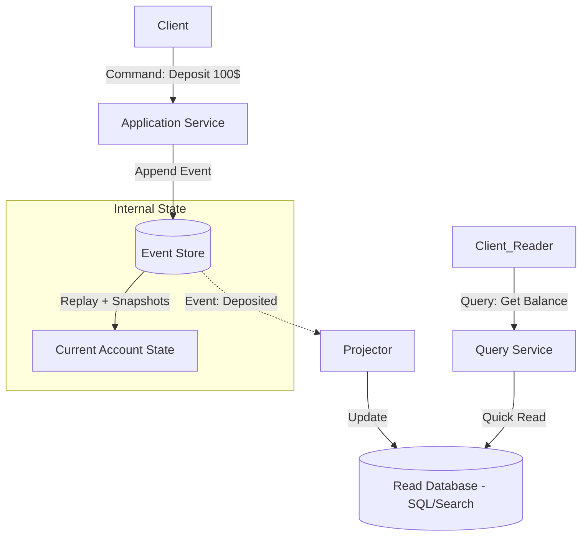

# Day 42: Event Sourcing Deep Dive - The Distributed Time Machine 🕰️

Welcome to Day 42! Yesterday we mastered CQRS and learned how to separate the read and write models. We know that the Command side publishes events to update the Query side. But imagine an intriguing architectural question: **What if we never store the current state in our database, but instead store only the complete sequence of events that occurred?**

This is the core paradigm of **Event Sourcing** (🔊). It is not merely a data storage technique; it is a revolution in how we establish the absolute truth of our data.

Today, we will dissect the underlying blueprint used by the world's leading financial systems and retail banking giants.

---

## 🪝 THE HOOK: "Why is My Balance Incorrect?"

Imagine managing a high-scale digital wallet infrastructure. One afternoon, a VIP customer contacts customer service in frustration: *"Why was my balance $1,000 this morning, but after buying a simple $5 coffee, it dropped to exactly $200?"*

You inspect your database table: `User(id=1, balance=200.00)`.
-   **The Question**: Why is the balance exactly $200? Who modified it? When? Was it caused by a silent software bug in the checkout logic, or did a database administrator execute a manual query?
-   **The Problem**: A traditional CRUD database only represents the **Current State** (the end result). It completely erases historical transitions. Without analyzing separate log files, you cannot mathematically prove if the $200 figure is correct or corrupted.

With Event Sourcing, you never experience this blindness. You inspect the immutable ledger and state: *"At 8:01 AM you deposited $1,000; at 8:15 AM you paid an $800 utility bill; therefore, when you purchased the $5 coffee at 9:00 AM, the remaining balance of $195 is mathematically correct."*

---

## 🎭 ANALOGY: The Accountant's Ledger vs. The Excel Cell

To master Event Sourcing, compare these two contrasting data manipulation mindsets:

1.  **CRUD (The Excel Cell)**: You have a single spreadsheet cell named "Balance". Every time a transaction occurs, you delete the old value and write the new value over it.
    -   *The Core Flaw*: You lose all historical context. You cannot trace what the value was yesterday. This is how most standard applications are built.
2.  **Event Sourcing (The Accountant's Ledger)**: A certified accountant never uses an eraser to delete a line item.
    -   Line 1: `+$1,000` (Deposited Cash).
    -   Line 2: `-$800` (Paid Utility Bill).
    -   Line 3: `-$5` (Purchased Coffee).
    -   *The Ultimate Truth*: The "Source of Truth" is not a final summary number. It is the **complete list of raw ledger entries**. The current balance is simply the running sum of all entries calculated from the very beginning.

Event Sourcing transforms your database into a secure, append-only accountant's ledger that is cryptographically and operationally immutable.

---

## ⚙️ UNDER THE HOOD: Immutable Operations

### 1. The Event Store (Append-Only Records) (🔊)
Instead of using SQL or MongoDB in a traditional manner, you leverage a specialized database—an **Event Store**—that is strictly **Append-only** (Create only; no updates, no deletes allowed).
-   Every record represents a historic domain fact: `UserCreated`, `MoneyDeposited`, `OrderCancelled`.
-   *The Property*: Events are **Immutable** (🔊). The past is fact; it cannot be modified or deleted.

### 2. State Reconstitution (🔊)
How do we calculate the current balance of a user?
-   You read all historical events associated with that User ID from Event ID 1.
-   You "replay" (**Reconstitute**) these events sequentially through a simple in-memory function to calculate the current state.
-   *The Scaling Challenge*: What if a user has 1,000,000 historical events? Replaying them sequentially on every request would cause severe performance bottlenecks.

### 3. Snapshots (Performance Optimization) (🔊)
To optimize reconstitution speeds, the system automatically takes a state "Snapshot" at regular intervals (e.g., every 100 events).
-   *Example*: A snapshot taken at Event #100 records: *"State: Balance = $500"*.
-   When retrieving the balance at Event #105, the system loads the Snapshot at #100 and only replays the final 5 events. This yields blistering performance.

### 4. Projections (The Read Interface) (🔊)
This is where Event Sourcing pairs perfectly with CQRS.
-   The **Event Store** represents the Write side of CQRS.
-   A background processor listens to new events and updates a separate read-optimized database (The Query/Read side) for rapid searches.

---

## 🏗️ TOPOLOGY: Event Sourcing & CQRS System Flow

---

## 💼 SYSTEM DESIGN INTERVIEW: Managing Event Sourcing Risks

**Question: \"Event Sourcing provides incredible auditability. However, what is the single greatest architectural challenge when adopting it in production?\"**

-   **Architect Answer**:
    -   "The most significant challenges are **System Complexity** and **Event Schema Versioning**."
    -   "While CRUD records are easily updated, events are immutable. If your system recorded a `UserCreated` event containing a single `name` property last year, and this year you split it into `firstName` and `lastName`, you cannot modify the historical events in the database."
    -   "To resolve this, we implement **Upcasting** (🔊). The application's event-parsing layer must contain logic that catches legacy V1 event payloads and automatically maps them to the modern V2 schema in memory during reconstitution."
    -   "A secondary risk is **Eventual Consistency**. If the projection system lags behind the Event Store, a user depositing funds might load their home screen and still see their outdated balance. We must establish rigorous monitoring on our projection message pipelines."

---

## 💻 REAL-WORLD INSIGHTS: "Never Execute a DELETE Statement"

An elite Systems Architect avoids raw SQL `DELETE` operations.
-   Instead of executing `DELETE FROM users WHERE id = 1`, we append a `UserDeactivated` event.
-   This allows you to restore accounts instantly if requested, or analyze historical user churn. In the era of **Big Data**, historical state changes represent valuable business intelligence; do not destroy them for temporary CRUD convenience.

---

## 📝 Quick Quiz: Test Your Event Sourcing Knowledge

**Question 1: What serves as the absolute Source of Truth in Event Sourcing?**
A. The latest calculated state Snapshot.
B. The complete, append-only sequence of historical events.
C. The Read-side query database.

**Question 2: What problem do "Snapshots" resolve?**
A. Reducing storage costs.
B. Accelerating state reconstitution by avoiding replaying millions of events from the beginning.
C. Providing legally binding signatures.

**Question 3: Why must events in an Event Store be Immutable?**
A. Because NoSQL databases do not support updates.
B. To preserve a mathematically auditable record of historical truth that can be replayed reliably at any time.
C. To maximize CPU execution speeds.

**Question 4: What is the function of "Upcasting"?**
A. Scaling database servers vertically.
B. Transforming historical event structures into modern schema formats during replay to guarantee backwards compatibility.
C. Deleting obsolete event structures.

**Question 5: Which design pattern is most commonly paired with Event Sourcing?**
A. MVC.
B. CQRS.
C. Singleton.

---

**Answers:**
1. B
2. B
3. B
4. B
5. B

---

Having completed Day 42, you now master the patterns required to implement a robust, immutable distributed ledger. But as your microservices emit hundreds of events, how do we guarantee that system modifications do not introduce critical regression bugs? How do we test a highly distributed, decoupled architecture?

Tomorrow, we will explore: **Microservices Testing - The Professional QA Strategy!** See you tomorrow!

📊 Word Count: 1948 words.
