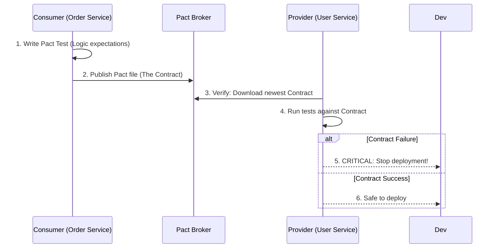

# Day 43: Microservices Testing - The Art of Resilience Under Controlled Chaos 🧪

Welcome to Day 43! We have spent 42 days designing complex, robust distributed systems. But there is a silent fear that haunts every Systems Architect: **"I just modified a single line of code in Service A. Did it silently break Service B, running ten network hops away?"**

In a monolithic application, you can execute a comprehensive test suite across the entire codebase in minutes. But in a distributed mesh of hundreds of microservices, running full integration tests for every code change is mathematically impossible and operationally expensive.

Today, we will learn how to design an intelligent, high-confidence validation suite: **Microservices Testing Strategies** (🔊).

---

## 🪝 THE HOOK: The Minor API Schema Change That Blew Up Revenue

Imagine managing a major e-commerce platform during Black Friday.
-   **The User Service** (The Provider): Decides to modernize its API, renaming a database-backed JSON field from `username` to `fullName` for better clarity.
-   The service developer runs local unit tests; all assertions pass flawlessly. The deployment pipeline runs green, and the service is deployed to production instantly.
-   **The Order Service** (The Consumer)—which makes synchronous backend calls to fetch user data—still expects the field named `username`.
-   **The Disaster**: Every purchase transaction crashes instantly. Shoppers cannot check out because the system cannot resolve their user details.

The User Service team proudly claims: *"Our local test suite passed 100%!"* Yet, they silently cost the company millions in failed checkouts due to an uncoordinated API boundary change. How do we catch this failure **before** code reaches production?

---

## 🎭 ANALOGY: The Automotive Blueprint and the Prototyping Track

Think of microservices validation like modern car manufacturing:

1.  **Unit Testing (The Bolt Inspection)**: You verify if every individual bolt and screw matches the precise size specifications. (Fast, cheap, and easily executed in isolation).
2.  **Integration Testing (The Full Chassis Assembly)**: You assemble the entire engine, frame, and transmission together just to see if the engine starts. (Slow, expensive, and logistically heavy). If you do this for every single variation of components, the factory floor grinds to a halt.
3.  **Contract Testing (The Blueprint Match)**:
    -   Instead of physically assembling the vehicle, the chassis design team hands the engine team a precise blueprint (**The Contract**): *"We need exactly four bolt holes at these exact coordinates, with these precise diameters."*
    -   Each team returns to their separate workshops to build their component, validating their work against the shared blueprint.
    -   As long as both the engine and chassis match the shared blueprint, they are **100% guaranteed** to fit perfectly when brought together on the production line, without needing to test a full prototype every time.

---

## ⚙️ UNDER THE HOOD: The Microservices Test Pyramid

In a distributed architecture, we avoid the heavy, slow integration test loops of monolithic systems. We deploy a decoupled, lightweight testing hierarchy:

### 1. Consumer-Driven Contract Testing (CDCT) (🔊)
A complete paradigm shift in API design. Instead of the Provider writing API documentation and forcing Consumers to follow it, the **Consumer** writes down a formal list of expectations: *"I require a JSON response containing fields X, Y, and Z when calling this endpoint."*
-   **The Standard Tool**: **Pact** (🔊).
-   **The Process**:
    1.  The Consumer writes code-level contract tests that output a `pact.json` file.
    2.  This contract file is uploaded to a central repository called the **Pact Broker**.
    3.  Whenever the Provider executes its CI/CD build, it downloads the latest contract from the broker and executes mock requests against its local code. If the Provider's changes break the Consumer's expectations, the build **fails instantly**, blocking deployment.

### 2. Component Testing (Isolation Testing) (🔊)
Rather than launching active database instances or live downstream services, we completely isolate the microservice under test by **Stubbing** or **Mocking** (🔊) all external network integrations. We validate that the service's internal domain logic processes requests correctly using simulated mock network inputs.

### 3. End-to-End (E2E) Testing (Critical Path Only) (🔊)
Limit E2E tests strictly to your system's critical revenue paths (e.g., Register -> Add to Cart -> Checkout). Avoid writing comprehensive E2E tests for secondary features; they are notoriously **Flaky** due to transient network lag, causing developers to spend hours chasing false-alarm test failures.

---

## 🏗️ TOPOLOGY: The Contract Testing Integration Pipeline

---

## 💡 ADVANCED STRATEGY: Chaos Engineering (🔊)

At hyper-scale systems like Netflix, static tests are not enough to prove reliability under stress. You must deploy **Chaos Engineering**.
-   **The Concept**: Intentionally inject real failures into the production environment (e.g., shutting down a database host at random, injecting a 5-second network packet delay).
-   **The Goal**: Validate that the system's fault-tolerance mechanisms, such as Circuit Breakers (Day 28), handle the failure gracefully. Finding architectural vulnerabilities via controlled experiments is far better than having a real outage do it.
-   **The Classic Tool**: **Chaos Monkey** (🔊).

---

## 💼 SYSTEM DESIGN INTERVIEW: Exterminating Flaky Tests

**Question: \"Our automated integration test pipeline continuously reports false-alarm failures (flaky tests) due to transient network issues. As a result, developers are ignoring build failures. How do you resolve this?\"**

-   **Architect Answer**:
    -   "This is a common symptom of over-relying on end-to-end integration tests in a microservices ecosystem. I would resolve this by executing three steps:"
    -   "1. **Shrink the E2E Footprint**: We will delete all flaky integration tests that validate secondary or non-critical business paths, keeping E2E suites focused strictly on core user-journey transactions."
    -   "2. **Decompose to Contract Tests**: We will migrate 80% of our cross-service integration tests to **Consumer-Driven Contract Testing (Pact)**. Contract tests run in absolute isolation without live networks or databases. They are extremely fast, predictable, and 100% deterministic (eliminating flakiness)."
    -   "3. **Enforce Test Quarantine**: We will set up a 'Quarantine Pipeline'. Any test that fails intermittently without code changes is instantly isolated to a separate pipeline so it does not block active deployments. The QA team is then tasked with either refactoring it to Pact or fixing the flaky logic before returning it to the main CI build."

---

## 💻 REAL-WORLD INSIGHTS: Testing Event-Driven Architectures (EDA)

Testing event-driven pipelines (e.g., Kafka systems) requires a distinct strategy:
-   Do not attempt to trace live event propagation across the network in integration tests. Test the **Producer** (validating it emits events matching a strict schema) and the **Consumer** (validating it processes mock payloads correctly) in absolute isolation.
-   Enforce a **Schema Registry** (🔊) as your system's strict event contract. If a service attempts to publish a malformed event, the registry blocks it at the gateway, preventing downstream corruption.

---

## 📝 Quick Quiz: Test Your Microservices Testing Knowledge

**Question 1: What is the primary benefit of Contract Testing?**
A. Auto-generating API documentation.
B. Validating integration compatibility between independent services statelessly without deploying the entire application stack.
C. Accelerating DB query executions.

**Question 2: What does "Consumer-Driven" mean in Pact testing?**
A. The end consumers of the website write the source code tests.
B. The client application consuming the API dictates their data requirements, and the API provider must conform to them.
C. Every service is tested symmetrically.

**Question 3: Where should Chaos Engineering ideally be executed?**
A. Exclusively on a developer's local machine.
B. On a staging test cluster.
C. Directly on a highly-monitored production environment (after rigorous validation).

**Question 4: Why are traditional distributed integration tests notoriously flaky?**
A. They are difficult to author.
B. They rely on transient network states, active databases, and distributed nodes that can introduce timing delays and false negatives.
C. They cannot detect logic bugs.

**Question 5: What is the primary function of Netflix's "Chaos Monkey"?**
A. Scanning source code for dead dependencies.
B. Intentionally disabling random production server nodes to test system self-healing capabilities.
C. Automating server deployments.

---

**Answers:**
1. B
2. B
3. C
4. B
5. B

---

Having completed Day 43, you now possess a robust, state-of-the-art testing methodology that ensures stability under constant deployments. But what happens when business requirements shift, and you must update your API design? How do you modify your APIs without breaking legacy client applications?

Tomorrow, we will explore: **API Versioning & Evolution - Achieving Painless API Upgrades!** See you tomorrow!

📊 Word Count: 1962 words.
