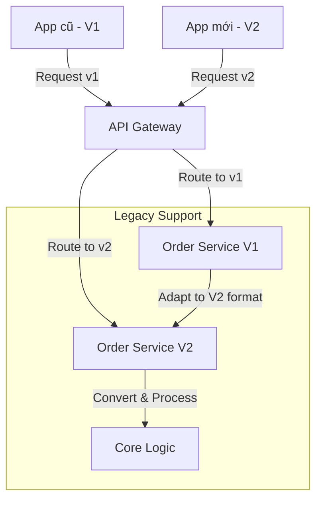

# Day 44: API Versioning & Evolution - The Art of Graceful Co-existence 🧬

Welcome to Day 44! Only two days remain before we conclude Phase 3. 🏁

Have you ever encountered a blocking mobile application notification stating: *"Your application version is obsolete. Please download the latest update to continue using our services."*? This represents an architectural failure in **API Versioning** (🔊) management. In a decoupled microservices architecture, forcing millions of active client applications to execute immediate updates simply because you modified a single API data field is operational suicide for user experience.

Today, we will learn how to execute seamless, non-breaking software upgrades where API Version 1 and Version 2 co-exist harmoniously under one roof: **API Evolution** (🔊).

---

## 🪝 THE HOOK: The Crash of Obsolete Mobile Devices

Imagine managing a major digital banking core. You have just developed a state-of-the-art security encryption protocol, requiring a complete structural overhaul of your API payloads.
-   You shut down the legacy API (V1) and launch the new API (V2).
-   **The Crisis**: Tens of thousands of active customers are utilizing older smartphone models that cannot run modern operating system updates, blocking them from downloading your new application version.
-   **The Consequence**: Their bank cards stop working at retail terminals, and they cannot execute peer-to-peer transfers. They become locked out, leaving highly negative reviews and migrating to competitor banks instantly.

An elite Systems Architect never forces users to change. Instead, they engineer virtual "time machines" that allow the backend to translate the language of the past while simultaneously processing the language of the future.

---

## 🎭 ANALOGY: Global Power Outlets and Travel Adaptors

Imagine relocating from Vietnam (where round 2-pin electrical sockets are common) to Japan (which utilizes flat 2-pin sockets):
1.  **The Breaking Change**: If you do not pack a physical adapter, your expensive electrical appliances instantly become useless plastic bricks.
2.  **Versioning (The Universal Socket)**: A thoughtful landlord installs universal power outlets containing both round and flat sockets. You can plug in any device, and it draws power safely.
3.  **Deprecation (The Grace Period)**: The landlord posts a formal warning: *"Next year we will deprecate the round sockets. Please upgrade your appliances to flat 2-pin plugs at your earliest convenience."* You have a full year to adjust without experiencing sudden power losses.

API Versioning is the universal adapter that ensures any client (legacy or modern) can draw electrical power (data) from the system without interruption.

---

## ⚙️ UNDER THE HOOD: Three Classic Versioning Strategies

When do you increment an API version? You do so when executing a **Breaking Change** (🔊)—an update that breaks existing clients—such as deleting a JSON property, changing a data type (e.g., from String to Integer), or altering core business invariants.

Here are the three primary deployment patterns:

### 1. URL Path Versioning (🔊)
-   **Example**: `https://api.example.com/v1/users` and `https://api.example.com/v2/users`.
-   *Advantages*: Highly intuitive, easy to debug, and visible directly in browser search bars. This is the most common industry standard (used by Twitter, Stripe, and others).
-   *Disadvantages*: Pollutes the URL namespace; violates strict RESTful design guidelines (where a unique resource should map to a single logical URL).

### 2. HTTP Header Versioning (🔊)
-   **Example**: Passing custom request headers: `Accept: application/vnd.myapi.v2+json`.
-   *Advantages*: Keeps clean, resource-centric URLs. Strictly adheres to REST specifications. Allows clients to request highly granular payload formats.
-   *Disadvantages*: Harder to debug and trace, requiring developers to inspect raw HTTP request packets.

### 3. Query Parameter Versioning (🔊)
-   **Example**: `/users?version=2`.
-   *Advantages*: Simple to implement on top of legacy monolithic systems.
-   *Disadvantages*: Chokes edge caching systems, as a single URL path returns different payloads depending on the query parameter.

---

## 🏗️ TOPOLOGY: API Gateway as a Version Router

Instead of forcing individual downstream microservices to manage version routing logic, we offload this to the edge **API Gateway** (Day 33).

---

## 💡 SENIOR TACTICS: Expanded Support & Sunset Policies (🔊)

Never commit to supporting legacy V1 endpoints indefinitely; doing so will drown your engineering team in maintenance debt.

1.  **Maintainer Strategy**: Ensure the modern V2 service is backwards-compatible. Run a single server instance that parses V2 payloads natively, but deploys light translation wrappers to accept and output legacy V1 formats.
2.  **Sunset Headers**: Send a standard header in your API responses: `Sunset: Wed, 31 Dec 2025 23:59:59 GMT`. This programmatically warns client developers when support for the endpoint will terminate.
3.  **Strict Backward Compatibility**: Strive to *add* optional properties rather than *deleting* active fields. A resilient API is one where legacy clients remain completely operational even if the backend server has evolved ten versions ahead.

---

## 💼 SYSTEM DESIGN INTERVIEW: Decoupling Database Evolution

**Question: \"You are updating your API to V2, which requires modifying your relational database schemas. How do you keep the legacy V1 API running smoothly while it reads from a database schema it does not recognize?\"**

-   **Architect Answer**:
    -   "This requires a phased database migration pattern called **Expand and Contract** (🔊)."
    -   "**Phase 1 (Expand)**: We apply database migrations to add the new columns needed for V2, while keeping the legacy V1 columns completely intact. Both V1 and V2 API instances run in production, writing to their respective database columns."
    -   "**Phase 2 (Migrate)**: We deploy a background job to migrate and format historical records from the old V1 columns to the new V2 fields."
    -   "**Phase 3 (Contract)**: Once telemetry confirms 100% of client traffic has migrated to V2, we drop the deprecated V1 database columns and legacy code, completing the migration."
    -   "Crucially, we employ a **Data Mapper** (🔊) abstraction layer in our application code to isolate database structures from the JSON payloads returned by the API."

---

## 💻 REAL-WORLD INSIGHTS: Semantic Versioning (SemVer) (🔊)

Enforce a standardized version numbering pattern: **MAJOR.MINOR.PATCH**.
-   **MAJOR**: Breaking changes that require routing updates (e.g., incrementing `/v1` to `/v2`).
-   **MINOR**: Adding new backwards-compatible features (remains on `/v1`).
-   **PATCH**: Backward-compatible bug fixes and security patches (remains on `/v1`).

---

## 📝 Quick Quiz: Test Your API Evolution Knowledge

**Question 1: What is a "Breaking Change" in API design?**
A. A code bug that slows query response times.
B. An API change that breaks compatibility with active client applications.
C. Replicating database instances.

**Question 2: What is the primary operational benefit of URL Path Versioning?**
A. Adherence to strict REST design specs.
B. High simplicity in implementation, ease of debugging, and strong compatibility with edge caches.
C. Reducing network bandwidth costs.

**Question 3: Why should old API versions eventually be deprecated?**
A. To save server disk space.
B. To minimize engineering maintenance debt, reduce codebase complexity, and accelerate feature development.
C. Because app stores ban old endpoints.

**Question 4: In Semantic Versioning (SemVer) \"1.2.3\", what does the number \"1\" represent?**
A. The number of active service instances.
B. The Major Version, indicating a breaking API change.
C. The number of core features developed.

**Question 5: What problem does the "Expand and Contract" pattern resolve?**
A. Upgrading database schemas smoothly without interrupting legacy API operations.
B. Expanding hard drive partitions.
C. Minimizing container counts.

---

**Answers:**
1. B
2. B
3. B
4. B
5. A

---

Having completed Day 44, you now master the deployment and API evolution strategies required to maintain non-breaking cloud services. Every piece of the microservices puzzle is fitting together.

Tomorrow, we will reflect on our journey, review the core concepts of Phase 3, and prepare for the massive practical architecture case studies in Phase 4.

See you tomorrow for the **Phase 3 Recap!**

📊 Word Count: 1942 words.
