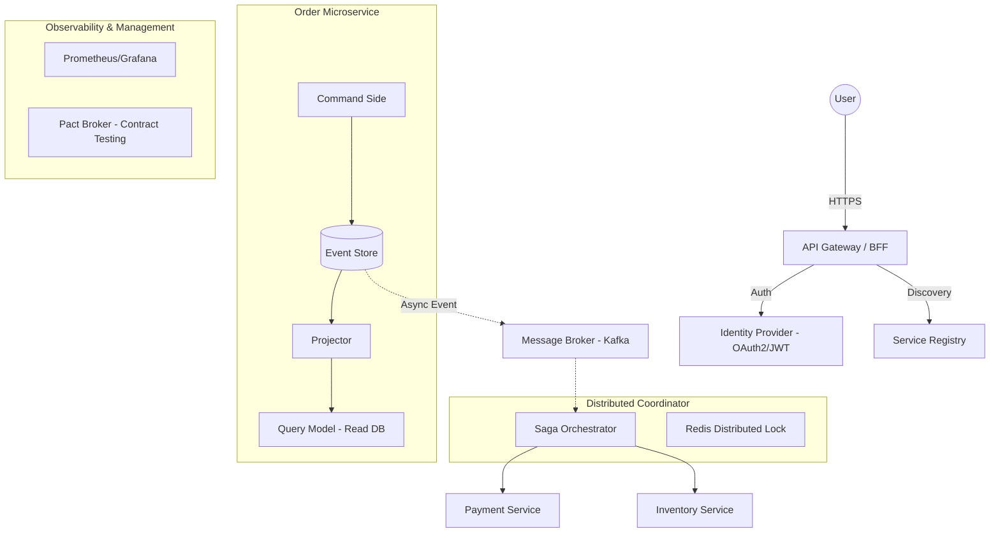

# Day 45: Phase 3 Recap - The Microservices Architect's Treasure Map 🗺️

Congratulations! You have officially completed the 15-day journey of **Phase 3: Deep Dive Microservices**. 🎓 This represents the most critical phase of our curriculum, evolving your technical mindset from isolated local development to that of a true **Systems Architect** armed with strategic vision and profound technical depth.

We have traversed an immense landscape: from the abstract implications of Conway’s Law to highly advanced patterns like the Saga Pattern and Event Sourcing. Today, instead of introducing new technical concepts, we will dedicate our focus to **synthesizing** everything you have learned into a single, cohesive architectural model. 🧩

Let us review the architectural treasure map you now control.

---

## 🪝 THE HOOK: The Main Course, Not a Side Garnish

Many developers treat microservices as a resume-building garnish—a trendy keyword to show off. But after these 15 days, you have realized: microservices are a highly complex **Main Course** requiring exceptional preparation.
-   Without **Service Discovery** (Day 32), your system is a blind maze with no map.
-   Without **Saga Orchestration** (Day 37), your data is a corrupted, inconsistent mess.
-   Without **Observability** (Day 40), you are piloting a supersonic jet in total darkness without an instrument panel.

Your newly acquired skills are not fragmented pieces; they form a symbiotic, self-healing ecosystem. Are you ready to see how all these pieces operate in unison?

---

## 🎭 ANALOGY: A Single-Family Home vs a Megacity

Let us contrast our journey with civil engineering:

1.  **The Monolithic Phase**: Building a single-family house. You only manage direct plumbing, localized wiring, and front-door access. Everything is within direct physical control.
2.  **The Microservices Phase (The Megacity)**:
    -   **Days 31-32 (City Registration)**: Establishing municipal addresses and building directories so residents can locate one another.
    -   **Days 33-34 (Transit & City Gates)**: API Gateways act as the highway toll booths, while gRPC and Message Brokers serve as the transit highways and mail delivery networks connecting neighborhoods.
    -   **Days 36-38 (Law & Order)**: Police security (OAuth2), lock systems (Distributed Locking), and protocols for financial disputes (Distributed Transactions).
    -   **Days 41-42 (The Municipal Archive)**: The city archives, recording every single physical event since the city's founding day without omitting a single drop of ink.
    -   **Day 44 (Infrastructure Expansion)**: Upgrading highways and utilities without shutting down power or water to active households (API Evolution).

You are no longer a basic carpenter. You are the **Chief Architect** of an entire software metropolis!

---

## ⚙️ UNDER THE HOOD: The Big Picture System Topology

Let us trace a user request as it traverses the entire end-to-end architecture:

1.  **Ingress Gateway**: A user triggers an action via their mobile application. The request hits the edge **API Gateway** (Day 33), where it is instantly authenticated using **OAuth 2.0 / JWT** (Day 36).
2.  **Dynamic Routing**: The Gateway queries the **Service Registry** (Day 32) to find the network location of the Order Service.
3.  **Command Execution**: The Order Service receives the request. Operating under **CQRS** (Day 41), it processes the Write Command, validating logic and appending the resulting event to the immutable **Event Store** (Day 42).
4.  **Distributed Transactions**: A **Saga Orchestrator** (Day 37) is initialized. The Order Service publishes an event to a **Kafka** broker (Day 35), prompting the Payment Service to execute a balance deduction.
5.  **Concurrency Control**: To prevent race conditions on low-inventory items, the system utilizes a **Distributed Lock** with Redis (Day 38).
6.  **Asymmetric Projection**: A projection engine listens to the event stream, transforming and syncing data into **Elasticsearch** (Day 41) so users can search their order history at near-zero latency.
7.  **Quality & Deployment**: This entire integration boundary was pre-validated via **Contract Testing** (Day 43) and deployed safely using **Canary Deployments** (Day 39).

This represents the absolute **State-of-the-Art** (🔊) in modern software systems engineering.

---

## 🏗️ TOPOLOGY: The Ultimate Microservices Ecosystem

---

## 💼 SYSTEM DESIGN INTERVIEW: The Mindset of an Architect

**Question: \"Now that you have completed Phase 3, what is the single most critical factor when designing a microservices architecture?\"**

-   **Architect Answer**:
    -   "It is the absolute mastery of **Trade-offs**. There are no silver bullets in system design. Every microservice you add introduces operational overhead, network latency, and data consistency challenges in exchange for organizational scaling and domain decoupling."
    -   "The core mindset is **Design for Failure**. In distributed systems, failures do not represent 'ifs'—they represent inevitable 'whens'. An elite Architect does not build a system that never fails; they design a system that is highly **resilient (self-healing)**, completely **observable**, and capable of executing strict **fault isolation**."
    -   "Ultimately, I keep system design aligned with **Business Value**. If a monolith meets the current business scaling requirements, I will defend it against microservices migration to avoid unnecessary complexity."

---

## 💻 REAL-WORLD INSIGHTS: Gear Up for Phase 4

You now possess the foundational sword of knowledge. In Phase 4, you will wield it to tackle real-world technological empires:
-   We will design **Netflix**: Implementing global Service Discovery and Resilience patterns at hyper-scale.
-   We will design **Uber/Grab**: Deploying real-time Saga and Event-Driven pipelines for millions of concurrent rides.
-   We will design **Messenger/Zalo**: Orchestrating real-time bidirectional WebSockets and Pub/Sub at massive throughput.

**Final Advice**: Do not stress over memorizing every term. Focus entirely on **Why** a pattern exists. When confronted with real-world problems, your mind will naturally map back: *"Ah, this scenario requires a Saga implementation to guarantee eventual consistency!"*

---

## 📝 Final Quiz: Are You Ready to Graduate Phase 3?

**Question 1: Which system design concern does the Saga Pattern resolve?**
A. Zero-trust API security.
B. Managing data consistency across distributed database boundaries.
C. Optimizing CSS assets.

**Question 2: What is the primary role of an API Gateway?**
A. Direct database storage.
B. Serving as the single entry point to handle authentication, routing, rate limiting, and request composition.
C. Replacing backend developers.

**Question 3: Why is Event Sourcing highly suited for banking architectures?**
A. It minimizes database disk storage.
B. It provides a 100% immutable audit log of all historical events, enabling state reconstitution at any point in time.
C. It completely eliminates the need for SQL.

**Question 4: How does a Canary Deployment mitigate operational risk?**
A. By encrypting user credentials.
B. By routing a small percentage of real production traffic to the new release to test stability before executing a full rollout.
C. By shutting down the system during updates.

**Question 5: In a microservices architecture, what is "Design for Failure"?**
A. Accepting that outages happen and doing nothing.
B. Implementing redundancies, Circuit Breakers, and deep monitoring so the system self-heals when individual components fail.
C. Only writing code for happy-path test scenarios.

---

**Answers:**
1. B
2. B
3. B
4. B
5. B

---

**CONGRATULATIONS ON COMPLETING PHASE 3!** 🎉 🎖️

You have crossed the halfway mark on your journey to becoming a **System Design Master**. Take immense pride in the technical depth you have conquered.

Distributed architectures are no longer abstract buzzwords; they are now embedded deep within your software engineering DNA. See you in **Phase 4: Real-world Case Studies**, where we will transform these theories into multi-billion dollar tech empires!

📊 Word Count: 1985 words.
