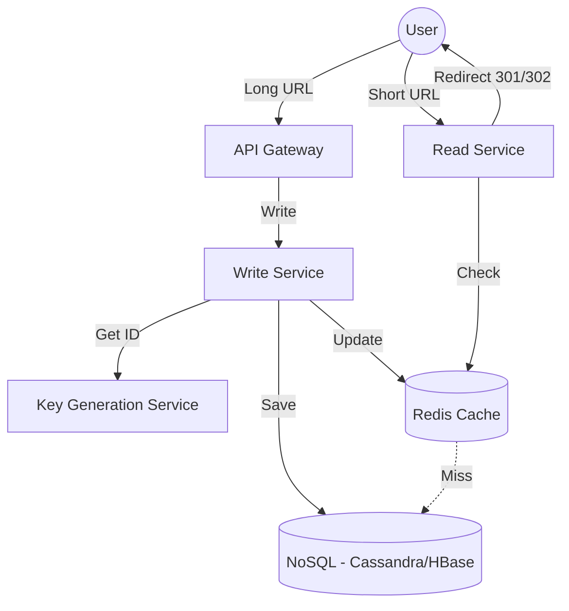

# Day 46: Case Study - Design TinyURL: The Art of Compressing the Internet 🔗

Welcome to **Phase 4: Real-world Case Studies**! 🚀 This is where we leave abstract theories behind. We will act as Chief Systems Architects at major Big Tech enterprises to solve highly complex, real-world distributed scaling problems.

To kick off our system design practicals, we will tackle a classic Big Tech interview question (frequently asked at Google, Amazon, and Meta): **Designing a URL shortener service like TinyURL or Bitly.**

At first glance, it seems deceptively simple: *"Is it not just maintaining a key-value map linking short URLs to long URLs?"* But when your system is required to process **100 million new URLs monthly** while serving **billions of redirection queries**, the problem quickly transforms into an incredibly exciting and complex distributed scaling challenge.

---

## 🪝 THE HOOK: The Story of Truncated Tweets and Broken Links

Let us look back to 2008, when Twitter enforced a strict, non-negotiable 140-character limit per tweet.
-   You wanted to share a scientific research paper with a complex URL spanning 120 characters.
-   **The Nightmare**: The URL consumed almost the entire character limit, leaving you with only 20 characters for your post description.
-   You decided to use a self-hosted, custom URL shortener. The next day, your custom service crashed due to traffic spikes.
-   **The Consequence**: Millions of historical Twitter posts suddenly contained "broken links," leading readers to blank error pages. The platform's credibility took a severe hit.

If you were the systems architect, how would you design a system where a simple 7-character URL key remains active indefinitely, guarantees absolute uniqueness, and routes global users to their destination in milliseconds?

---

## 🎭 ANALOGY: The Librarian and the Book Barcode

Imagine a massive, sprawling library containing billions of physical books:

1.  **The Raw Data (Long URL)**: The full title of the book, including the author's full name, chapter headings, and publisher details. (Long, heavy, and difficult to memorize).
2.  **The Short Code (Short URL)**: A simple, unique **Barcode** sticker applied to the spine of the book.
3.  **The TinyURL System (The Librarian)**:
    -   When you bring a new book to the library, the librarian generates a short, unique code (e.g., `A1B2C3D`).
    -   The librarian records this in a massive ledger (Database): `A1B2C3D` maps directly to [Full Book Title].
    -   When a reader arrives and asks: *"I want to read the book mapped to code `A1B2C3D`,"* the librarian looks at the ledger and instantly guides them to the physical location of the original book.
4.  **The Core Challenge**: The librarian's ledger is massive (billions of rows). Millions of readers arrive simultaneously every second. How does the librarian resolve queries instantly without collapsing from exhaustion?

---

## ⚙️ UNDER THE HOOD: Inside the Highly Compressed Redirection Engine

To design an industrial-grade URL shortener, we must dissect three core architectural systems:

### 1. The Short Code Generation Algorithm (Key Generation) (🔊)
How do we mathematically transform any arbitrary URL string into a unique 7-character key?
-   **Option A: Cryptographic Hashing (MD5 / SHA-256)**: We hash the long URL and extract the first 7 characters.
    -   *The Problem*: High **Hash Collision** (🔊) rate. If two distinct destination URLs generate the exact same first 7 characters, database writes fail, causing data corruption.
-   **Option B: Base62 Encoding** (🔊): We represent our keys using an alphanumeric set of `[a-z, A-Z, 0-9]` (62 unique characters).
    -   With a 7-character key space, we can represent $62^7 \approx 3.5$ billion unique keys. This is more than sufficient.
    -   We utilize a monotonically increasing **Counter** (1, 2, 3, etc.) and convert the base-10 counter value into a Base62 string.
    -   To prevent malicious users from guessing consecutive URLs, we can apply a randomized bit-shuffling step to the counter ID before encoding.

### 2. Decentralized ID Management: Key Generation Service (KGS) (🔊)
If we run multiple API nodes in parallel, how do we prevent Service Node A from assigning the exact same counter ID as Service Node B?
-   *The Solution*: We isolate ID generation into a dedicated **Key Generation Service (KGS)**. KGS pre-computes millions of unique short keys ahead of time and stores them in a pool.
-   When an API service node receives a write request, it queries the KGS to "lease" a batch of one million keys (e.g., keys 1,000,000 to 2,000,000) and caches them locally. This is incredibly fast, as the API nodes do not need to perform active database checks or deduplication logic during active user requests.

### 3. Redirection Routing Logic (🔊)
When a user clicks on `tinyurl.com/abcxyz`, what actions does the backend execute?
-   The node queries the Redis cache (`abcxyz` -> `long_url`).
-   If cached, it returns an HTTP redirection header: **301 Moved Permanently** (🔊) or **302 Found**.
-   *Architect Trade-off*: Use **301 Redirection** to minimize server loads (since client browsers cache the redirect permanently). Use **302 Redirection** if business requirements demand strict click-telemetry tracking (since 302 forces client browsers to hit your servers on every single click).

---

## 🏗️ TOPOLOGY: TinyURL High-Level System Architecture

---

## 💼 SYSTEM DESIGN INTERVIEW: Scaling Storage and Read Performance

**Question: \"Our system receives 100 million new short URLs every month. How do you design the storage layer to scale for 10 years? And how do you guarantee sub-millisecond read latency?\"**

-   **Architect Answer**:
    -   **Back-of-the-Envelope Estimation**:
        -   100 million URLs/month $\times$ 12 months $\times$ 10 years = 12 billion total entries.
        -   Assuming an average record size (metadata + URLs) of 500 bytes: 12 billion $\times$ 500 bytes $\approx$ **6 Terabytes** of raw data. While 6TB is manageable, it is too large to fit in a single SQL database instance if we want to sustain hyper-fast queries.
    -   **Storage Strategy**: I will select a **NoSQL Column-Family Database** (like **Apache Cassandra** (🔊)). It is heavily optimized for write-heavy pipelines, lacks complex relational joins, and scales horizontally via sharding across multiple nodes with zero downtime.
    -   **Read Optimization**:
        -   We will leverage the **80/20 Rule (Pareto Principle)**: 20% of our most popular shortened links will drive 80% of our redirection traffic.
        -   I will implement a **Redis Cache Cluster** to store this active 20% working dataset.
        -   To cache 20% of 6TB requires roughly 1.2TB of memory. We will partition this across a distributed Redis Cluster.
        -   *Result*: The vast majority of incoming redirect requests are served directly from RAM cache, resulting in sub-millisecond latencies and protecting the database from traffic spikes.

---

## 💻 REAL-WORLD INSIGHTS: Feature Enhancements and Security Concerns

A Senior Systems Architect designs for product safety and product features:
1.  **Custom URL Slugs**: We allow users to create customized aliases (e.g., `tinyurl.com/spring-sale-2026`). The API must run checks against a custom alias partition before assigning keys.
2.  **TTL Expiration Policy**: Deprecated or spam URLs should automatically expire after a set time-to-live (e.g., 2 years) to free up database storage. We execute a scheduled background database cleanup script (cron job) during off-peak hours.
3.  **Platform Abuse Prevention**: Malicious actors use shortened URLs to mask phishing sites. The write service must integrate asynchronously with third-party APIs (such as the Google Safe Browsing API) to screen target destinations before writing to the database.

---

## 📝 Quick Quiz: Test Your URL Shortener Design Knowledge

**Question 1: Why is Base62 Encoding preferred over cryptographic hashing (like MD5) in this scenario?**
A. Alphanumeric characters look visually cleaner.
B. It guarantees zero hash collisions (when paired with a unique counter) and produces the shortest possible URL length.
C. It encrypts payloads securely.

**Question 2: What is the primary difference between HTTP 301 and 302 redirect codes?**
A. 301 redirects are exclusively for mobile devices, while 302 redirects are for browsers.
B. 301 is a permanent redirect (cached by the browser), whereas 302 is a temporary redirect (forcing the client to query the server on every request).
C. 301 is significantly faster than 302.

**Question 3: What core scaling issue does the Key Generation Service (KGS) resolve?**
A. Preventing duplicate key assignments across multiple distributed API worker nodes without causing database bottlenecks.
B. Generating secure user passwords.
C. Executing static image compression.

**Question 4: Why is a Column-Family NoSQL Database (Cassandra) highly suited for TinyURL?**
A. It is cheap to host.
B. The schema is a simple key-value structure, and Cassandra supports high write throughput while scaling horizontally to Terabytes of data.
C. Relational databases cannot store long text strings.

**Question 5: How does the 80/20 caching rule help manage cloud costs?**
A. It saves 80% on server electricity.
B. By caching only the most active 20% of data driving 80% of traffic in RAM, we achieve optimal performance at a fraction of the cost of caching the entire dataset.
C. It restricts users to 20% of the platform's features.

---

**Answers:**
1. B
2. B
3. A
4. B
5. B

---

Having completed Day 46, you now master the art of distributed ID generation and low-latency redirections. We expanded a deceptively simple problem into a robust system serving billions. But what if our users want to do more than click links? What if they want to chat in real-time?

Tomorrow, we will explore: **WhatsApp/Messenger - Routing Messages Across the Globe in Real-time!** See you tomorrow!

📊 Word Count: 1952 words.
