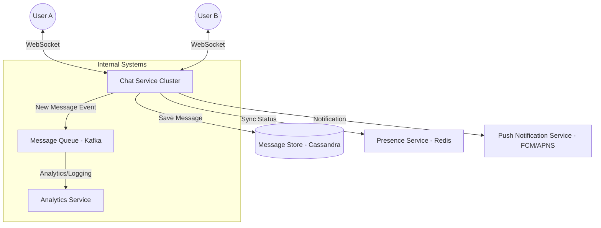

# Day 47: Case Study - Design WhatsApp: Connecting Billions in a Blink 💬

Welcome to Day 47! Yesterday, we learned about data compression with TinyURL. Today, we step into the world of absolute immediacy (**Real-time**).

Imagine sending a crucial \"I love you\" message to your partner.
-   If that message is delayed by 10 minutes: the emotion has cooled down.
-   If the messages arrive out of order (e.g., \"Do you love me?\" arrives after \"No!\"): an emotional disaster occurs.
-   If the message is lost entirely: you will be in trouble for a week.

Designing a chat application for 10 users is a basic classroom coding exercise. Designing one for **2 billion active users** processing hundreds of billions of messages daily like WhatsApp is an exquisite art of distributed consistency and high-performance scaling.

---

## 🪝 THE HOOK: The Dreaded Double Checkmark and Server Blackouts

Imagine New Year's Eve. Billions of global users simultaneously press \"Send\" to deliver holiday wishes.
-   **Traditional Chat Service**: Relies on standard HTTP requests. Servers crash under the weight of opening millions of concurrent connection requests.
-   **The Nightmare**: You send a message, and the loading spinner rotates endlessly. You have no idea if the recipient got it. The legendary double checkmarks disappear.
-   The central database chokes under a massive query bottleneck because every client is continuously polling: *"Are there any new messages for me?"*

How do you design a system that maintains an "always-open" duplex network connection without melting your servers? How do you ensure messages are reliably delivered the exact millisecond a user recovers network connectivity?

---

## 🎭 ANALOGY: The Postal Box vs the Open Hotline

Imagine delivering messages using two distinct communication models:

1.  **The Postal Run (HTTP Long Polling)**: Every 5 minutes, you run to the post office and ask: *"Do I have mail?"* The clerk answers: *"No."* You run back home. Five minutes later, you run back and ask again.
    -   *The Problem*: You exhaust your energy (draining your phone's battery) and the clerk gets exhausted (overloading servers with empty queries). If mail arrives at 12:01, you will not receive it until your next run at 12:05. This introduces high **Latency**.

2.  **The Open Hotline (WebSocket)**: You and the post office run a dedicated, permanent telephone wire between your homes, keeping the receiver off the hook.
    -   Whenever mail arrives, the post office simply speaks into the line, and you hear it instantly.
    -   You never need to waste energy checking manually. Both parties maintain a **Persistent Connection** (🔊).

WhatsApp is a massive orchestration engine managing millions of these persistent "hotlines" simultaneously.

---

## ⚙️ UNDER THE HOOD: The Heart of a Real-time Messaging System

To serve a global population at scale, we must orchestrate the following components:

### 1. Persistent Connections via WebSockets (🔊)
Instead of REST APIs (HTTP), messaging systems rely on the **WebSocket** protocol.
-   After an initial TCP **Handshake**, the connection is held open. The server can push data down to the client asynchronously without waiting for a client request.
-   *The Scaling Challenge*: A standard Linux server holds roughly 65,000 active connections due to port limitations. To manage millions of active connections, we must deploy a massive **Chat Service Cluster** and execute deep Kernel tuning.

### 2. Message Service & Storage (🔊)
What happens when you send a message to User B, but User B is **Offline**?
-   The message must be persisted to a temporary **Message Store**.
-   The moment User B re-establishes a WebSocket connection, the server pulls the pending messages from the store and pushes them to User B's device.
-   *Database Selection*: A Column-Family NoSQL Database like **Apache Cassandra** (🔊) or **HBase** is the standard choice. Why? Because chat messages represent high-frequency, time-series writes requiring massive, zero-downtime storage scaling.

### 3. Presence Service (Online/Offline Status) (🔊)
How does the app know your friend is \"Online\" or \"Last Seen 5 minutes ago\"?
-   The client application sends a lightweight network packet—a **Heartbeat** (🔊)—to the server at set intervals (e.g., every 30 seconds). The server writes this to a fast key-value store: `User A: Online` with a TTL.
-   If the server misses a heartbeat for 30–60 seconds, it transitions the user's status to \"Offline\".
-   *Architect Tip*: To conserve bandwidth, do not broadcast status changes to a user's entire friend list. Only broadcast presence status when a user actively opens a chat window with a specific friend.

---

## 🏗️ TOPOLOGY: WhatsApp High-Level System Architecture

---

## 💼 SYSTEM DESIGN INTERVIEW: Guaranteeing Message Order and Read Receipts

**Question: \"In a highly distributed environment, how do you guarantee that messages arrive in the correct chronological order? And how do you implement high-performance Read Receipts (the blue ticks) without choking the database?\"**

-   **Architect Answer**:
    -   **Message Ordering**: We cannot rely on the client device's clock because they can drift or be altered. We also cannot use a global database auto-incrementing ID as it creates a centralized database write bottleneck. Instead, we use a **Sequence ID per Conversation**. Every unique dialogue between User A and User B increments a localized sequence ID (e.g., `msg_1`, `msg_2`, `msg_3`). The client app uses this sequence ID to sort the chat display, ensuring messages are sorted correctly even if they arrive out-of-order due to network jitter.
    -   **Read Receipts (Ticks)**: This represents a sequence of event transitions:
        1.  **Sent (Single Gray Tick)**: The message reaches the Chat Service.
        2.  **Delivered (Double Gray Tick)**: The recipient client acknowledges receiving the payload (Server receives an ACK packet from the recipient).
        3.  **Read (Double Blue Tick)**: The recipient opens the chat window (The client emits a `read_event` packet to the server).
    -   To optimize throughput, we do not emit an ACK packet for every single message. If a user receives 10 messages, we send a single ACK for the last message ID, programmatically confirming delivery for all preceding messages.

---

## 💻 REAL-WORLD INSIGHTS: Group Chats at Massive Scales

Group chats introduce severe scaling challenges. If a group contains 1,000 active users, a single message written by one member translates to 1,000 distinct downstream network deliveries.
-   *The Senior Approach*: We deploy a **Fan-out on Delivery** (🔊) model. We write the group message exactly *once* in a shared group table. When a group member establishes an active connection, the server pulls the latest group message pointer and pushes the message down to that user. This saves massive database disk space, though it shifts processing logic to the active chat servers.

---

## 📝 Quick Quiz: Test Your Real-Time Messaging Knowledge

**Question 1: Why is WebSocket superior to HTTP Long Polling for real-time messaging?**
A. It is less expensive to host.
B. It establishes a single, bi-directional (full-duplex) TCP connection, enabling instant server pushes without the overhead of continuously re-opening HTTP handshakes.
C. It is inherently more secure.

**Question 2: Where should user Presence data (Online/Offline) be stored to maximize throughput?**
A. A relational SQL Database cluster.
B. Flat server log files (.txt).
C. An in-memory database like **Redis**, as heartbeats trigger high-frequency writes requiring instant reads.

**Question 3: How does the system handle messages when a user is completely offline?**
A. The message is dropped.
B. The server persists the message in a temporary Message Store and triggers a **Push Notification** via APNS (Apple) or FCM (Google).
C. The sender's client is blocked until the recipient re-connects.

**Question 4: Why is Apache Cassandra highly suited for persisting chat history?**
A. It is optimized for full-text search.
B. It supports ultra-high write speeds, scales horizontally, and its column-family model aligns perfectly with time-ordered message histories.
C. It is owned by Meta.

**Question 5: Why is a system-wide Global Auto-Incrementing ID avoided in messaging databases?**
A. It creates a centralized write bottleneck at the database layer when handling billions of messages per second.
B. The integer range would quickly exhaust.
C. Alphanumeric IDs are easier to sort.

---

**Answers:**
1. B
2. C
3. B
4. B
5. A

---

Having completed Day 47, you now understand how to keep billions of users connected and active in real-time. But users do not just want to chat privately; they also want to browse social updates. How do you serve a timeline containing posts from hundreds of friends in under a second?

Tomorrow, we will explore: **Twitter Feed - The Art of Distributing Information at Scale!** See you tomorrow!

📊 Word Count: 1968 words.
