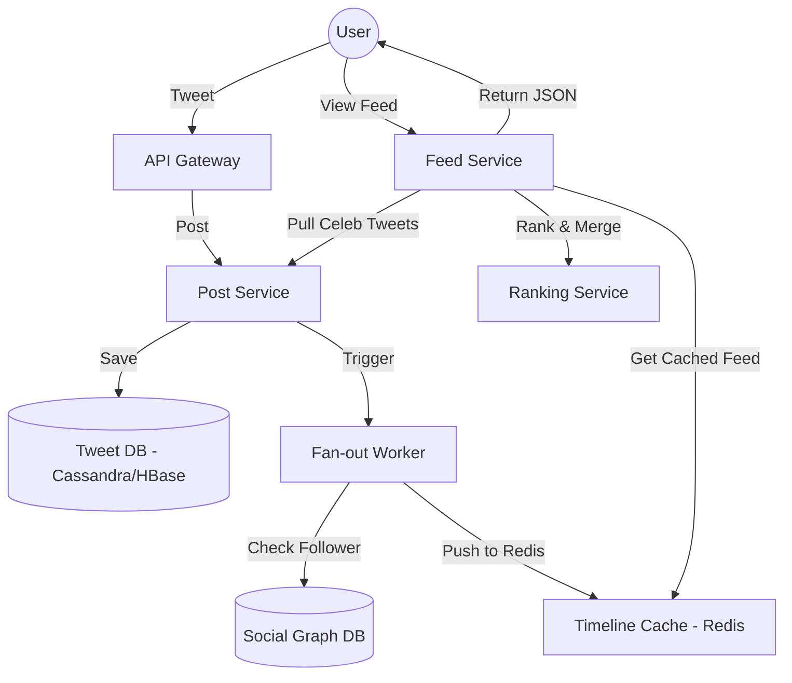

# Day 48: Case Study - Design Twitter News Feed: The Art of Information Fan-out 🐦

Welcome back to our practical engineering track! Today, we will dissect one of the most read-heavy systems on the planet: **The Twitter News Feed** (🔊).

You open the application, pull down to refresh, and instantly: dozens of the latest posts from your friends and followed creators appear.
-   **Mind-Boggling Scale**: Twitter hosts approximately 300 million Monthly Active Users (MAUs). Every single second, roughly 6,000 new tweets are published.
-   **The Core Challenge**: A standard user follows between 100 to 200 distinct accounts. When they open the application, the system must instantly answer: *"Out of the billions of historical tweets worldwide, what are the 20 most recent posts published by the 200 creators followed by this user?"*

If you attempt to execute a basic SQL query like `SELECT * FROM tweets WHERE user_id IN (friend_ids) ORDER BY created_at DESC`, your database will collapse immediately when millions of concurrent users trigger it. Let us examine how the systems architects at Twitter engineered a solution.

---

## 🪝 THE HOOK: The Megastar Hotspot Outage

Imagine managing Twitter's core timeline infrastructure.
-   Everything is operating smoothly until a global superstar with **100 million followers** (e.g., Cristiano Ronaldo or Taylor Swift) publishes a new photo.
-   **The Phenomenon**: 100 million active fans instantly receive notifications, simultaneously tapping to view, like, and comment on the post.
-   **The Disaster**: The system attempts to push (fan-out) this single post to the home timeline caches of all 100 million followers. Downstream message queues clog up. Redis memory nodes crash under the pressure of a **Thundering Herd** (🔊) write pattern.

*Result*: The entire platform hangs for 15 minutes, showing "Something went wrong" errors to millions of users. How do you explain this failure to your leadership?

---

## 🎭 ANALOGY: The Local Newspaper vs the Personal Mailbox

Imagine distributing daily updates using two distinct logistics models:

1.  **The Pull Model (Fan-out on Load)**: Every time you want to read news updates, you must physically travel to the home of every friend you follow to read what they have written on their local bulletin board.
    -   *Advantages*: You only expend energy when you actively want to read.
    -   *Disadvantages*: If you follow 1,000 active creators, you will exhaust yourself traveling to 1,000 different houses. This is a "lazy" read-heavy approach (🔊).

2.  **The Push Model (Fan-out on Write)**: Every time one of your friends writes a new post, they hire a courier to print a copy and physically slide it into your personal home mailbox.
    -   *Advantages*: When you want to read, you simply open your home mailbox. Access is instantaneous!
    -   *Disadvantages*: If a creator has 100 million followers, they must hire 100 million couriers to deliver the update simultaneously, causing massive gridlock and high cost. This is a write-heavy approach (🔊).

Twitter combines both to create a highly optimized hybrid architecture.

---

## ⚙️ UNDER THE HOOD: Inside the News Feed Engine

To design an industrial-grade News Feed, we must master two foundational data distribution strategies:

### 1. Fan-out on Write (Push-based Delivery) (🔊)
This is how Twitter serves the vast majority of standard user accounts:
-   When User A publishes a tweet, the system queries the Social Graph DB to find User A's 1,000 followers.
-   A worker node pushes the Tweet ID directly into the pre-computed "mailbox" (Timeline Cache) stored in **Redis** for each of those 1,000 followers.
-   *Why Redis?*: Home timelines require extreme read speeds. Keeping a pre-sorted list of Tweet IDs directly in Redis RAM allows timeline generation to resolve in single-digit milliseconds.

### 2. Fan-out on Load (Pull-based Delivery) - The Celebrity Solution (🔊)
For high-profile accounts with millions of followers, utilizing the Push model above would trigger write amplification catastrophes (the Thundering Herd).
-   *The Hybrid Strategy*:
    -   For standard users: We use the **Push** model.
    -   For high-profile creators (celebrities): We **DO NOT** push their posts into the caches of their millions of followers.
    -   When a standard follower opens the application (Load), the Feed Service fetches their basic pre-computed timeline from Redis, and simultaneously **Pulls** the latest posts from the celebrities they follow. The service then **Merges** (🔊) these streams chronologically.
-   By shifting celebrity updates to a pull-on-read model, we distribute the processing load to individual read requests, protecting the platform from massive write spikes.

### 3. Timeline Service & Ranking (🔊)
Modern feeds do not simply display posts in pure reverse-chronological order. They utilize smart personalization:
-   Posts with high engagement (Likes/Retweets) are prioritized.
-   Content from accounts the user frequently interacts with is boosted.
-   *Topology*: We implement a dedicated **Ranking Service** (🔊) that scores and sorts the merged candidates using machine learning models before returning the final JSON.

---

## 🏗️ TOPOLOGY: News Feed System Architecture

---

## 💼 SYSTEM DESIGN INTERVIEW: Scaling Cache and Handling Ingress Streams

**Question: \"How does your system stay stable when users follow thousands of accounts? And how do you minimize the high cost of caching home timelines for hundreds of millions of users?\"**

-   **Architect Answer**:
    -   **Hybrid Thresholding**: We classify users using a dynamic "Celebrity Threshold" (e.g., 10,000 followers). Any account exceeding this threshold is marked as a celebrity and routed to the pull-on-read pipeline, while standard accounts remain on the push-on-write pipeline.
    -   **Active Cache Pruning**: We do not waste expensive Redis RAM caching timelines for inactive users. We only maintain caches for **Active Users** (🔊) (those who have logged in within the past 30 days).
    -   If an inactive user logs in after months of absence (Cache Miss), the Feed Service queries the databases directly, reconstructs their timeline, and populates it back into Redis.
    -   **Size Constraints**: We cap individual timeline caches in Redis to the 500–1,000 most recent Tweet IDs. Users rarely scroll past a thousand historical posts, making deeper caching highly wasteful.

---

## 💻 REAL-WORLD INSIGHTS: Graph Scaling and Async Pipelines

An elite Architect approaches social graph storage defensively:
-   Do not store user relationship lists (followers/following) in basic relational tables. When relationships scale into the tens of billions, query performance collapses. We leverage a dedicated **Graph Database** (like Neo4j) or partition relational databases horizontally using `user_id` as the shard key.
-   We offload the fan-out write pipeline to a distributed **Message Queue (Kafka)**. Pushing a new post to 1,000 follower timelines is executed completely asynchronously (**Async**). This enables the publishing client to receive an immediate "Success" response without waiting for the fan-out workers to finish updating 1,000 Redis caches.

---

## 📝 Quick Quiz: Test Your News Feed Scaling Knowledge

**Question 1: What is the primary operational benefit of Fan-out on Write (Push)?**
A. Minimizing database disk usage.
B. Ultra-fast read speeds because the user's timeline is pre-assembled in active RAM cache.
C. Accelerating writing actions for high-profile accounts.

**Question 2: Why does Twitter utilize a Pull model for celebrity posts?**
A. To make fans feel more engaged.
B. To prevent system overloads caused by writing a single post to millions of caches simultaneously (avoiding the Thundering Herd).
C. Because celebrities prefer pull-based APIs.

**Question 3: How do we optimize memory usage in our Redis Timeline Cache?**
A. Storing the full text and media assets of the tweets.
B. Storing ONLY the unique **Tweet IDs**, fetching the full content payload from an object cache only when displaying the feed.
C. Cache passwords in the timeline.

**Question 4: For which group of users should we actively populate a Redis timeline cache?**
A. Every single registered user on the platform.
B. Only active users who engage regularly (**Active Users**).
C. Only verified subscription users.

**Question 5: Which architectural component is responsible for scoring and sorting the feed based on user relevance?**
A. The Message Queue.
B. The Cassandra DB.
C. The Ranking Service.

---

**Answers:**
1. B
2. B
3. B
4. B
5. C

---

Having completed Day 48, you now master the complex data distribution algorithms powering global social media pipelines. You know how to balance push and pull systems under heavy loads. But text and images are only the beginning—the modern web is driven by massive video streaming.

Tomorrow, we will explore: **YouTube/Netflix - The Art of Distributing Petabytes of Video Globally!** See you tomorrow!

📊 Word Count: 1950 words.
