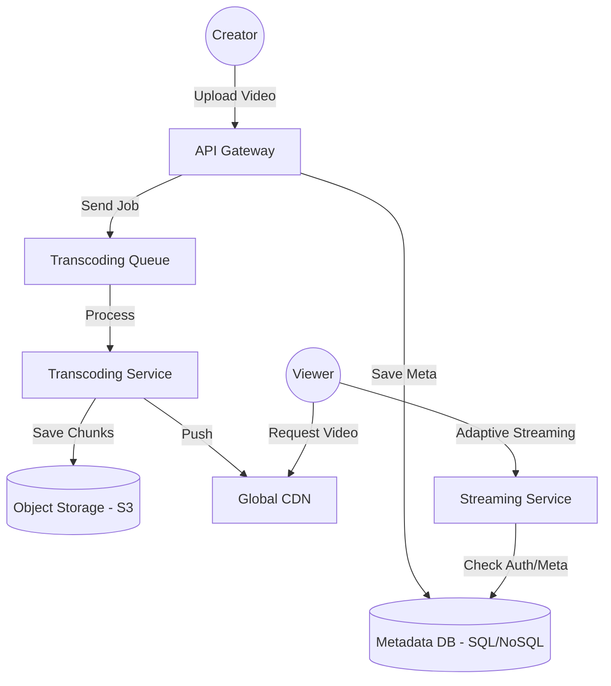

# Day 49: Case Study - Design YouTube: The Global Media Empire & The Magic of Streaming 📺

Welcome to Day 49! Yesterday, we learned about distributing short text streams with Twitter. Today, we confront the ultimate bandwidth-consuming beast of the Internet: **Video Streaming** (🔊).

**Mind-Blowing Statistics**:
-   Every single minute, over **500 hours** of new video content are uploaded to YouTube.
-   YouTube consumes approximately **25% of all global mobile internet traffic**.
-   You must architect infrastructure to store Exabytes (billions of Gigabytes) of raw video files and serve them globally with sub-second start latencies.

Why is it that when you watch a video on YouTube or Netflix, the resolution dynamically adapts without freezing when your network connection drops? Why does a viewer in New York and a viewer in Hanoi load the same video at identical high speeds? Let us explore the massive distributed infrastructure backing global streaming giants.

---

## 🪝 THE HOOK: The Infinite Buffer Wheel - The Live Streaming Nightmare

Imagine watching a highly anticipated World Cup final live on a poorly optimized streaming application.
-   Right at the decisive penalty kick, the dreaded loading circle appears on your screen.
-   Your local home network is perfectly stable, but the streaming company's central origin servers are choking under the weight of serving 1 million concurrent 4K streams.
-   *The Disaster*: Ten seconds later, you hear your neighbors cheering loudly, while your screen is still spinning. You have just experienced the failure of a poorly architected streaming system.

How do you design a system to guarantee smooth video playback on any device: from the latest iPhone running on a 5G network to an obsolete smartphone operating on a weak 3G connection in a remote rural area?

---

## 🎭 ANALOGY: The Bottled Water Factory and Local Distributorships

Imagine distributing massive media payloads like operating a global bottled water logistics network:

1.  **The Raw Source (The Original Video)**: A massive 10GB raw video file uploaded by a creator. It is far too heavy and unoptimized to distribute directly to end consumers.
2.  **The Bottling Plant (Video Transcoding)** (🔊):
    -   To serve diverse consumers, the factory must repackage the water into various container sizes: large 1.5L bottles for car drivers (representing 4K streams), standard 500ml bottles for pedestrians (1080p), and small 100ml packets for drought-stricken regions (360p).
    -   This process of converting a raw source file into multiple optimal sizes and formats is known as **Transcoding**.
3.  **Local Logistics Depots (CDN)** (🔊):
    -   If every consumer worldwide had to travel directly to the central factory in the United States to purchase water, the transit routes would experience massive gridlock.
    -   Instead, the factory ships bottled water in bulk to regional **Logistics Depots (CDN Nodes)** situated in every major country (Vietnam, Singapore, Germany, etc.).
    -   When you get thirsty, you simply visit the local depot down the street. It is near-instantaneous and highly efficient.

YouTube and Netflix are global managers orchestrating millions of these local depots and billions of custom "water bottles."

---

## ⚙️ UNDER THE HOOD: Tracing the Upload and Playback Pipelines

An industrial-grade video streaming platform operates two distinct high-performance pipelines:

### 1. The Ingestion & Transcoding Pipeline (Write) (🔊)
When a creator clicks \"Upload Video\":
-   **Chunking (Segmentation)**: The raw video is instantly split into small, discrete **Chunks** (🔊) lasting 2–5 seconds. If the network drops mid-upload, the creator only resumes uploading the failed chunk rather than restarting the entire file.
-   **Transcoding (Encoding)**: The core processing step. Dedicated workers convert the raw chunks into multiple resolutions (240p, 360p, 720p, 1080p, 4K) and codecs (e.g., H.264, VP9, AV1) to match diverse device capabilities.
-   **Storage Routing**: The heavy raw original file is archived in cost-efficient, durable **Object Storage** (like AWS S3), while the transcoded chunks are pushed to edge Content Delivery Networks.

### 2. The Playback Pipeline (Read) (🔊)
This is where seamless delivery is achieved using **Adaptive Bitrate Streaming (ABR)** (🔊).
-   The two leading industry standard protocols are **DASH** (🔊) and **HLS** (🔊).
-   *Mechanics*: The player application on the client device continuously evaluates network throughput.
    -   *High Bandwidth*: The player requests the next video chunk in 4K resolution.
    -   *Network Drop*: The player automatically requests the next chunk in 480p instead of pausing the video to buffer. The user experiences a slight drop in clarity, but the stream never stops.

### 3. Content Delivery Network (CDN) (🔊)
A popular music video will be replicated across thousands of CDN edge servers worldwide.
-   When a viewer in Hanoi clicks play, the **DNS** router (Day 02) resolves their request to the nearest local CDN node (housed inside their local telecom network, like Viettel or FPT).
-   Minimal physical distance = Ultra-low latency = Zero buffering.

---

## 🏗️ TOPOLOGY: YouTube/Netflix System Architecture

---

## 💼 SYSTEM DESIGN INTERVIEW: Taming Exabyte Storage Costs

**Question: \"Our platform manages Exabytes of video data. How do you design the storage layer to minimize operational hosting costs while ensuring popular videos load instantly and rare (long-tail) videos remain accessible?\"**

-   **Architect Answer**:
    -   "We must implement a **Tiered Storage Architecture** based on access frequency:"
    -   "1. **Hot Videos Layer**: Brand new releases or viral videos are replicated across all global **Edge CDN Nodes** for instant delivery directly from SSD or RAM cache."
    -   "2. **Popular Videos Layer**: Mid-tier videos with steady traffic are cached in **Regional Datacenters** (Regional CDNs), rather than at the extreme network edges, balancing storage costs and latency."
    -   "3. **Cold Videos Layer (Long-tail)**: Historical videos that get viewed once a year are moved to ultra-low-cost **Cold Storage** (like AWS S3 Glacier). This reduces hosting costs by up to 90% compared to active storage. If a user requests a cold video, they might experience a 3-second startup delay while the system retrieves it, which is an acceptable business trade-off."
    -   "For transcoding, we enforce a priority queue system, processing hot trending content first to make it available to the public instantly."

---

## 💻 REAL-WORLD INSIGHTS: Content Security and Copyright Detection

An elite Systems Architect enforces strict digital security and rights management:
1.  **Copyright Fingerprinting (Content ID)**: When a video is ingested, the system extracts a digital audio-visual **Digital Fingerprint** and cross-references it against a massive database of copyrighted assets to detect infringement in real-time.
2.  **Digital Rights Management (DRM)**: To prevent illegal media piracy (crucial for companies like Netflix and Disney+), video chunks are encrypted using systems like Widevine or FairPlay. The player decrypts chunks on-the-fly using a temporary cryptographic key issued only upon successful user authentication.
3.  **Geographic Redundancy**: Crucial master data is replicated across a minimum of three distinct geographic cloud regions to prevent catastrophic loss from localized physical disasters.

---

## 📝 Quick Quiz: Test Your Video Streaming Scaling Knowledge

**Question 1: What is the primary function of "Transcoding" in video streaming platforms?**
A. Translating audio tracks into multiple foreign languages.
B. Compressing and converting raw video files into multiple resolutions and formats to ensure compatibility across all network types and device screens.
C. Deleting terms-of-service violations.

**Question 2: How does Adaptive Bitrate Streaming (HLS/DASH) prevent video playback freezes?**
A. It forces users to upgrade their home routers.
B. It enables the client media player to dynamically swap video chunk resolutions on-the-fly to match the user's active network speeds.
C. It relies exclusively on 5G network speeds.

**Question 3: What is the primary operational role of a Content Delivery Network (CDN)?**
A. Caching user passwords securely.
B. Storing media assets physically closer to end-users to reduce network travel time (latency) and protect the origin servers from overload.
C. Managing video advertisements.

**Question 4: Why is Object Storage (like Amazon S3) preferred over SQL databases for storing video files?**
A. It is designed to store massive, unstructured binary payloads (videos, images) cost-effectively and with extremely high durability, which SQL databases cannot support.
B. It executes SQL queries faster.
C. It is simpler to deploy.

**Question 5: What is the business advantage of implementing a Tiered Storage Strategy?**
A. It improves the website's graphical user interface.
B. It optimizes cloud operating costs by categorizing data based on access frequency (Hot/Cold) and storing it on appropriate low-cost hardware tiers.
C. It allows hiring more systems engineers.

---

**Answers:**
1. B
2. B
3. B
4. A
5. B

---

Having completed Day 49, you now master the complex engineering behind global video streaming networks. You know how to transport Terabytes of data across oceans in a fraction of a second. But the Internet is not just a virtual world; it also bridges with the physical world, coordinating physical assets like moving cars.

Tomorrow, we will explore: **Uber/Grab - The Art of Real-Time Geospatial Coordination!** See you tomorrow!

📊 Word Count: 1962 words.
