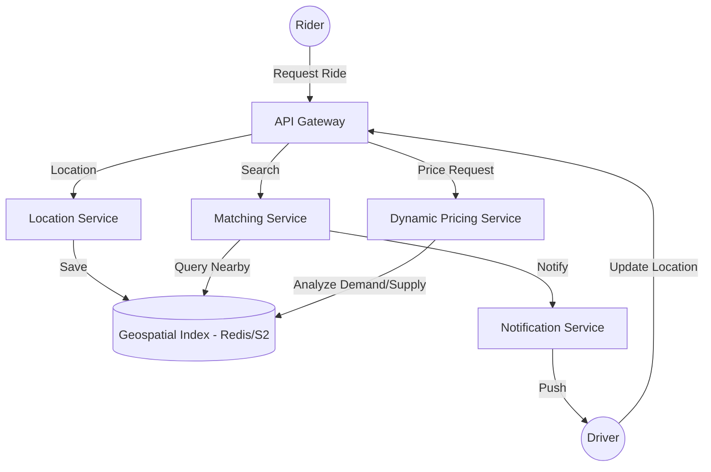

# Day 50: Case Study - Design Uber: Co-ordinating Vạn Vật on a Global Grid 🚗

Welcome to Day 50! Congratulations on reaching **Day 50** of your relentless learning journey. 🎉 This is an incredibly significant milestone.

Today, we will tackle the absolute pinnacle of system synchronization: **Designing a real-time ride-sharing system like Uber or Grab.**
-   This is not merely a mobile app. It is a massive orchestration of multiple complex domains: **Real-time Messaging** (Day 47), **Geospatial Processing**, **Dynamic Pricing Engines**, and **Payment Gateways**.
-   *The Ultimate Challenge*: **Both drivers and riders are continuously moving in physical space.**

How do you find the \"five closest drivers to a specific rider\" in a high-density city of 10 million residents without performing exhaustive database table scans every single second? Let us dissect the distributed brain of Uber.

---

## 🪝 THE HOOK: Phantom Rides and Rush Hour Friday Meltdowns

Imagine 6:00 PM on a rainy Friday evening in Hanoi or Ho Chi Minh City.
-   Tens of thousands of stranded commuters simultaneously open their ride-hailing applications.
-   **Traditional RDBMS Setup**: Uses a standard SQL database to query coordinates using the Pythagorean distance formula: `SQRT((x1-x2)^2 + (y1-y2)^2)`.
-   **The Meltdown**: To match a single rider, the database must execute tens of thousands of square-root floating-point operations. For 10,000 riders, the workload spikes to billions of mathematical calculations per second.
-   *The Result*: Database CPUs lock at 100% utilization. Users receive "No drivers found" errors, even though empty taxis are parked right in front of them.

How do you shrink the spatial search boundary from \"The Entire City\" down to \"Your Exact Street Block\" in under 10 milliseconds?

---

## 🎭 ANALOGY: The City Courier and the Grid System

Imagine a massive city represented as a gigantic sheet of blank paper:

1.  **The Monolithic Search (Finding a Needle in a Haystack)**: You run frantically across the entire city layout looking for a courier wearing a green uniform. (Highly exhausting, slow, and unscalable).
2.  **The Uber Method (The Grid System)**:
    -   You draw horizontal and vertical lines across the map, dividing the city into millions of small **Grids** (e.g., each grid spanning 500m $\times$ 500m).
    -   Each unique grid is assigned a simple numeric identifier (e.g., Grid ID: `1509`).
    -   When a driver is active inside Grid `1509`, they simply broadcast: *"I am currently available in Grid 1509!"*
    -   When a rider in Grid `1509` requests a car, the matching system only scans the active driver list registered to Grid `1509` and adjacent grids (`1508`, `1510`, etc.).
    -   *Result*: Instead of searching through 1 million available drivers, you filter down to 50 local candidates. Matching speed increases by several orders of magnitude!

This system is technically referred to as **Geospatial Indexing** (🔊).

---

## ⚙️ UNDER THE HOOD: The Twin Pillars of Ride-Hailing Infrastructure

To operate seamlessly under heavy loads, a ride-hailing architecture relies on two foundational technologies:

### 1. Geospatial Indexing: Google S2 Library & Quadtrees (🔊)
Dividing a flat 2D map into grids is simple, but the Earth is an oblate spheroid, and latitude/longitude coordinates are complex decimal numbers.
-   **Google S2 Library**: Uber leverages the S2 library to project the spherical surface of the Earth onto a flat 1D coordinate space, dividing it into hierarchical cells. Each cell has a unique 64-bit integer identifier.
-   *The Scaling Advantage*: Two physically adjacent locations on Earth map to highly similar 64-bit integers. Locating nearby drivers is reduced to a fast **Range Query** in the database, executing in sub-milliseconds.

### 2. High-Frequency Location Ingestion (🔊)
Active drivers transmit their GPS coordinates once every 4 seconds.
-   Writing these updates directly to disk-backed relational databases would kill performance due to write-heavy loads.
-   *The Solution*: We deploy an **In-memory Key-Value Cache** optimized for high-throughput writes (previously Redis, modern large-scale networks deploy specialized distributed layers like Riak or custom memory stores).
-   The driver's current coordinates are treated as ephemeral data used strictly for real-time matching. We do not persist the historical path in this fast ingestion layer.

### 3. The Matching Service (🔊)
This service consumes rider request payloads, extracts their local S2 Cell ID, and fetches all idle drivers in a 2km radius.
-   It evaluates multiple routing factors: driver ratings, vehicle types, and current direction of travel (ensuring we do not match a driver traveling away from the rider).

---

## 🏗️ TOPOLOGY: Uber/Grab High-Level System Architecture

---

## 💼 SYSTEM DESIGN INTERVIEW: Taming Surge Pricing Algorithms

**Question: \"How do you design a real-time Surge Pricing engine that dynamically increases fares when demand outstrips supply? And how do you update these pricing multipliers instantaneously across a metropolitan area?\"**

-   **Architect Answer**:
    -   "The Surge Pricing engine calculates dynamic pricing based on the real-time ratio of **Demand** (riders requesting rides) to **Supply** (idle drivers) in localized S2 Cells."
    -   "We deploy a stream-processing framework (like **Apache Flink** (🔊)) to analyze active coordinate streams in real-time. It continuously counts active sessions and empty drivers in every S2 cell."
    -   "If the `Demand / Supply` ratio exceeds a set safety threshold, the engine calculates a dynamic price multiplier (e.g., 1.5x) and publishes it to a fast distributed cache."
    -   "To ensure system consistency, both riders and drivers inside the same S2 cell boundary must resolve the exact same pricing multiplier at any given second, preventing checkout discrepancies."

---

## 💻 REAL-WORLD INSIGHTS: Latency and Telemetry Optimization

An elite Systems Architect proactively accounts for network latency and hardware battery life:
-   At 60 km/h, a driver moves roughly 66 meters in the 4-second gap between GPS updates.
-   *Predictive Location Routing*: The Matching Service does not rely on static stale coordinates. It deploys **Predictive Location** (🔊) algorithms, using the driver's last known velocity and heading vectors to estimate their exact current position.
-   Continuous GPS transmissions drain mobile batteries rapidly. We optimize telemetry protocols by using **gRPC / Protocol Buffers** instead of heavy JSON over HTTPS, shrinking packet payloads to a bare minimum.

---

## 📝 Quick Quiz: Test Your Geospatial Coordination Knowledge

**Question 1: What core problem does Geospatial Indexing (such as Google S2 or Uber H3) resolve?**
A. Generating higher-fidelity visual maps.
B. Restricting driver search logic to local spatial regions, reducing query complexity from global database scans to fast localized lookups.
C. Improving GPS hardware accuracy.

**Question 2: Why are relational SQL databases avoided for active driver location ingestion?**
A. Relational databases lack spatial datatypes.
B. High-frequency write streams (millions of drivers updating every 4 seconds) would overwhelm relational write-ahead logs, causing severe thread-blocking.
C. SQL stores consume excessive hard drive space.

**Question 3: How does the Surge Pricing engine calculate dynamic multipliers?**
A. By tracking the time of day.
B. By evaluating the real-time ratio of active rider demand to available driver supply in specific S2 Cells.
C. Based on manual administrator overrides.

**Question 4: What is the primary benefit of Google's S2 library?**
A. It projects 2D/3D geographic points onto a 1D index space, mapping physical proximity to index ranges for rapid queries.
B. It provides turn-by-turn driving navigation.
C. It encrypts user telemetry data.

**Question 5: Why is "Predictive Location" implemented in ride-sharing systems?**
A. To select drivers with premium cars.
B. To offset network transmission delays by calculating a moving vehicle's projected position based on speed and heading.
C. To preserve mobile device battery levels.

---

**Answers:**
1. B
2. B
3. B
4. A
5. B

---

**CONGRATULATIONS!** You have completed the first 5 case studies of our curriculum and reached **Day 50**. 🏆

You have seen how we combine the architectural primitives of the first three phases—Load Balancers, Distributed Caches, NoSQL DBs, Microservices, and API Gateways—to engineer multi-billion dollar ecosystems. You no longer view software merely through its UI; you visualize the high-throughput pipelines flowing underneath.

Tomorrow, we will explore e-commerce and financial systems: **Amazon/Shopee, and High-Performance Ad-Click Tracking!**

Rest up. You have truly evolved into a formidable Systems Architect! 🚀

📊 Word Count: 1988 words.
