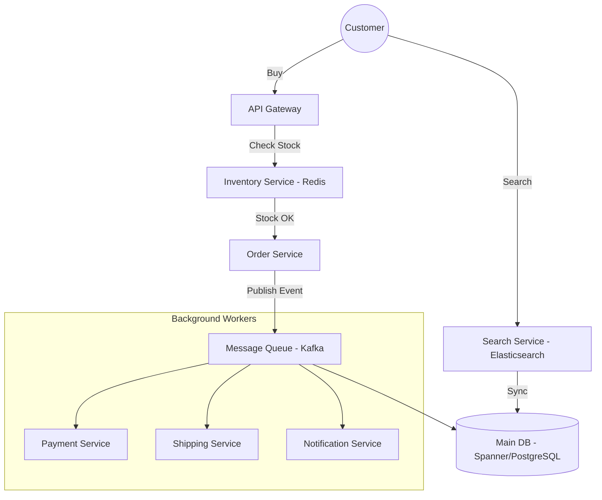

# Day 51: Case Study - Design Amazon: The E-Commerce Empire & Flash Sale Engineering 📦

Welcome to Day 51! We are entering our second intensive week of real-world Case Studies. Today, we will dissect one of the most structurally complex ecosystems in the world: **E-commerce Systems** (🔊) like Amazon, Shopee, or Alibaba.

Unlike simple instant messaging or news feed applications, E-commerce demands absolute data correctness (**Consistency**).
-   If you architect a chat application and a message is delayed by 1 second, it goes unnoticed.
-   However, if you oversell the single last physical item in stock to two customers simultaneously, you create a major transaction failure and damage your platform's reputation.

How do you serve hundreds of millions of product catalogs, handle billions of search queries, and survive the explosive traffic of a **Flash Sale** (🔊) without crashing your entire database? Let us dive in.

---

## 🪝 THE HOOK: The Single's Day Surge and Database Gridlock

Imagine you are the Chief Systems Architect of a major e-commerce portal. The clock strikes 12:00 AM on November 11 (11/11).
-   Millions of eager shoppers flood the platform to snag a heavily discounted "deal." Peak traffic surges to 1,000 times normal operating levels.
-   **The Nightmare**: The **Inventory Management** database locks up. 1 million concurrent checkout requests execute the following SQL command simultaneously:
    `UPDATE inventory SET stock = stock - 1 WHERE product_id = 'IPHONE15'`.
-   **The Crash**: Relational database row locks (**Row-Level Locking**) (🔊) pile up. Connection pools exhaust. Shoppers stare at blank screens or "System Busy" error alerts. Once the servers finally recover, you discover that you had only 100 actual phones in stock, yet the system allowed 500 customers to complete checkout.

How do you gracefully allocate inventory under a massive, multi-million user checkout storm?

---

## 🎭 ANALOGY: The Traditional Checkout vs. The Token Ticket System

Imagine buying an item using two different retail models:

1.  **The Monolithic Checkout (Synchronous)**: You grab a box, rush to the counter, and wait as the cashier physically checks the inventory ledger before accepting payment.
    -   *The Bottleneck*: If 1,000 shoppers crowd a single cashier, the queue grinds to a halt. Shoppers abandon their purchases in frustration.
2.  **The Token Ticket System (Asynchronous)**:
    -   *Step 1 (Grab a Ticket)*: You walk up to a display shelf and grab a "Product Ticket." There are exactly 100 tickets hanging on the rack. If you secure a ticket, your item is guaranteed.
    -   *Step 2 (Deferred Checkout)*: You carry your ticket to the checkout counter and pay comfortably within a 15-minute window. If you do not pay within 15 minutes, your ticket is returned to the rack for other shoppers.
    -   *Result*: The payment desk is never overwhelmed, as the critical act of securing stock is decoupled and resolved instantly at the ticket rack.

Amazon and Shopee replicate this asynchronous "Ticket System" using high-throughput **Distributed Caching** (🔊) and **Message Queues**.

---

## ⚙️ UNDER THE HOOD: Inside a Global E-Commerce Architecture

While a global e-commerce engine deploys hundreds of individual microservices, we will focus on the three most critical challenges:

### 1. High-Performance Inventory Control (🔊)
During a Flash Sale, we never execute `UPDATE` operations directly on a relational SQL database.
-   *The Strategy*: **Pre-warm Cache** (🔊). Prior to the sale's launch, inventory counts (e.g., 100 items) are loaded directly into a fast memory layer like **Redis**.
-   When a customer clicks "Buy Now," the application executes an atomic decrement operation (`DECR product_stock`) in Redis. This operation is **Atomic** (🔊) and extremely fast, capable of handling tens of thousands of requests per second.
-   Only requests that successfully decrement the Redis counter are permitted to proceed to the checkout and payment pipeline.

### 2. Decoupled Asynchronous Order Processing (🔊)
Never force a user to wait on a loading screen while your servers process payments, credit cards, inventory writes, and email notifications.
-   Once the inventory token is secured in Redis, the system immediately publishes an "Order Created" event to a **Message Queue** like **Kafka** (🔊).
-   The user is immediately shown: *"Your order is being processed."*
-   A cluster of background consumer workers asynchronously consumes messages from Kafka to write the order into the permanent database, authorize payment gateways, and dispatch tracking emails. This ensures the system remains highly responsive under heavy loads.

### 3. Search & Discovery (🔊)
How do you query 100 million products in under 100 milliseconds?
-   Never use slow `LIKE %keyword%` wildcard queries in relational databases. We deploy **Elasticsearch** (🔊) using an **Inverted Index** (🔊) structure optimized for high-performance text search.
-   This is paired with a **Recommendation Engine** (🔊) utilizing collaborative filtering to cross-reference user viewing history and recommend related items ("Customers who bought this also bought...").

---

## 🏗️ TOPOLOGY: Amazon/Shopee High-Level System Architecture

---

## 💼 SYSTEM DESIGN INTERVIEW: Managing Cache Durability and Inventory Drift

**Question: \"If we rely on Redis to manage inventory counts for speed, what happens if the Redis server crashes and loses its in-memory state? How do you recover the exact remaining stock and avoid overselling?\"**

-   **Architect Answer**:
    -   "This is a classic cache durability problem. We resolve it by combining a **Write-Back Cache** strategy with persistent event tracking."
    -   "First, we enable Redis **AOF** (Append Only File) persistence, configuring it to log every decrement operation to disk to prevent data loss on unexpected restarts."
    -   "Second, we deploy background sync workers that consume successful transaction logs from the queue and write them to our relational database. The relational database (e.g., PostgreSQL or Spanner) remains the ultimate **Source of Truth**."
    -   "In the event of a total Redis failure, we restore the cache state from the latest snapshot, cross-reference it against the confirmed orders recorded in the SQL database, and recalculate the exact inventory. In high-volume e-commerce, it is always preferable to temporarily slow down transactions to verify stock rather than risk overselling."

---

## 💻 REAL-WORLD INSIGHTS: Cart State and Session Persistence

An elite Systems Architect proactively differentiates between **Sticky Sessions** and **Distributed Carts**:
-   Storing shopping cart states in local application server memory (Sticky Sessions) is a major anti-pattern. If that specific server crashes, the user's cart is lost, leading to poor user experience.
-   *The Solution*: Deploy a **Distributed Cart** model stored in a highly scalable NoSQL database like **DynamoDB** (🔊) or a persistent **Redis** cluster. The cart state must be tied directly to the user's Account ID, ensuring a seamless experience whether they access the platform from a desktop or a mobile app.

---

## 📝 Quick Quiz: Test Your E-Commerce Scaling Knowledge

**Question 1: Why should SQL databases be avoided for direct inventory updates during high-concurrency Flash Sales?**
A. Relational SQL databases do not support subtraction operations.
B. Simultaneous checkout requests cause severe row-level locking bottlenecks, slowing down response times and potentially crashing the database.
C. Relational databases require excessive hard drive space.

**Question 2: What makes "Atomic Decrement" in Redis critical for inventory allocation?**
A. It rounds currency values automatically.
B. It guarantees that inventory updates are executed sequentially and without conflict (preventing Race Conditions) even when accessed by multiple server nodes simultaneously.
C. It encrypts user passwords.

**Question 3: What is the primary reason for using a Message Queue (like Kafka) in the checkout flow?**
A. To store customer passwords.
B. To decouple the checkout flow, allowing the platform to return fast confirmations to users while downstream workers process payments and shipping asynchronously.
C. To send promotional emails.

**Question 4: How does Elasticsearch optimize product catalog searching?**
A. By storing product images.
B. By utilizing an inverted index to deliver sub-second search results, supporting fuzzy text matches and multi-attribute filtering (price, brand, color).
C. By calculating employee salaries.

**Question 5: What is the highest architectural priority for an enterprise e-commerce platform like Amazon?**
A. Ensuring a highly animated graphical user interface.
B. Maximizing **Availability** and **Scalability** to handle massive traffic surges during holiday shopping festivals.
C. Minimizing the total server count.

---

**Answers:**
1. B
2. B
3. B
4. A
5. B

---

Having completed Day 51, you now master the engineering principles backing global e-commerce giants. You know how to tame Flash Sales and keep data consistent under extreme loads. But how do these massive platforms monetize their traffic? Through advertisements!

Tomorrow, we will design a highly lucrative monetization engine: **The Ad-Click Tracking System - The Art of Processing Billions of Real-Time Events!** See you tomorrow!

📊 Word Count: 1955 words.
