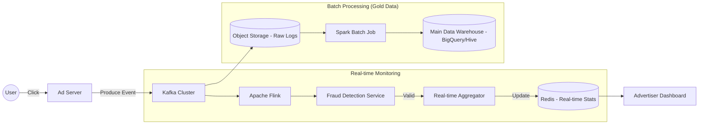

# Day 52: Case Study - Design Ad-Click System: The Monetization Engine of the Web 💸

Welcome to Day 52! Do you know what funds Google, Meta, and almost every free service on the internet? It is **Advertising (Ads)**.

However, building an high-throughput **Ad-Click System** (🔊) is not as simple as incrementing a counter in a database.
-   **Challenge 1 (Scale)**: Billions of **Impressions** (🔊) and clicks occur every single second across the globe.
-   **Challenge 2 (Fraud)**: How do you filter out malicious **Bots** (🔊) designed to exhaust competitors' marketing budgets?
-   **Challenge 3 (Accuracy)**: Advertisers only pay for what you count. Under-counting loses your platform revenue; over-counting results in dynamic pricing disputes and lawsuits.

Today, we will design an ultra-precise, lightning-fast ad-click aggregation engine.

---

## 🪝 THE HOOK: The Million-Dollar Billing Lag Crisis

Imagine you are managing the ad-tech division for a top-tier social network.
-   A luxury fashion brand launches an exclusive flash sale, endorsed by thousands of global influencers.
-   **The Disaster**: The click-processing servers experience a massive network bottleneck. Click event logs pile up on disks, waiting to be processed.
-   The advertiser allocated $1 million for a 1-hour campaign. Because your aggregation engine is lagging, the ads continue displaying long after the budget is exhausted.
-   *The Result*: Your platform serves millions of dollars in free clicks without recouping a single dime. Your manager is waiting at the door with a termination slip.

How do you reconcile campaign budgets in real-time when traffic is spiking exponentially?

---

## 🎭 ANALOGY: The Casino Coin Sorters and the Fraud Guards

Imagine managing a massive, high-traffic casino:

1.  **The Coin Inflow (Traffic)**: Millions of patrons drop coins into slot machines every second. It is impossible to manually record every individual throw.
2.  **Local Coin Sorters (Aggregators)** (🔊):
    -   Instead of carrying every coin to the main central vault (the Database) immediately, you place local sorting bins at every row. These bins group coins into bags: *"Row A collected 1,000 coins."*
    -   They periodically transport the bags to the central vault. This reduces the work on the vault by thousands of times.
3.  **The Security Team (Fraud Detection)** (🔊):
    -   There will always be players using counterfeit tokens or automated coin-throwing devices.
    -   You deploy alert guards: *"This patron is feeding coins too fast for a human,"* or *"These 100 coins share the exact same scratch pattern."*
    -   The security guards intercept these tokens before they are recorded in the casino's actual earnings ledger.

An Ad-Click System operates on the exact same logic using **Stream Processing** (🔊) pipelines and **Rule Engines**.

---

## ⚙️ UNDER THE HOOD: Inside the Real-Time Stream Pipeline

An enterprise ad-click engine cannot rely on traditional synchronous request-response loops. We must architect a resilient, high-speed **Data Pipeline** (🔊):

### 1. Ingestion Layer (🔊)
When a user clicks an ad, they are redirected through an **Ad Server**, which immediately logs the raw event payload.
-   *Best Practice*: Never write directly to disk files or relational databases. Push the event immediately into a high-throughput **Message Queue** like **Apache Kafka** (🔊). Kafka acts as an elastic buffer, ensuring no clicks are lost even if downstream processors experience a slowdown.

### 2. Stream Processing (🔊)
We deploy real-time engines like **Apache Flink** (🔊) or **Spark Streaming** to process the data as it flows:
-   **Deduplication** (🔊): Filters out accidental double-clicks or duplicate network packets.
-   **Aggregation** (🔊): Groups events by `ad_id` over short, sliding time blocks (e.g., 10 seconds). Instead of writing 1 million separate database records, we commit a single summarized value: `ad_1: 500 clicks`.

### 3. Real-Time Fraud Detection (🔊)
This is the most complex subsystem. It executes machine learning models or rule-based heuristics to filter out malicious activity:
-   If an IP address generates 100 clicks in a single minute $\rightarrow$ Mark as bot.
-   If clicks originate from mismatching geographic regions $\rightarrow$ Mark as bot.
-   These invalid clicks are flagged and filtered out before billing is executed.

---

## 🏗️ TOPOLOGY: Ad-Click Aggregation System Architecture

---

## 💼 SYSTEM DESIGN INTERVIEW: Guaranteeing "Exactly-Once" Processing Accuracy

**Question: \"How do you guarantee that every click is processed exactly once? If the aggregation cluster crashes mid-operation, how do you recover without double-counting past events?\"**

-   **Architect Answer**:
    -   "We guarantee processing accuracy using **Exactly-Once Processing** semantics powered by Apache Flink."
    -   "Flink achieves this using a **State Checkpointing** mechanism. At regular intervals, Flink takes a consistent snapshot of the pipeline state, including Kafka offsets."
    -   "If a failure occurs, Flink rolls back its state to the most recent checkpoint. To prevent double-counting in our storage engines (e.g., Redis, PostgreSQL), we enforce **Idempotency** (🔊). Instead of using raw `INCREMENT` commands, we execute `UPSERT` statements keyed by a unique transaction hash."
    -   "Additionally, we assign a `unique_request_id` to every click. The aggregator uses an in-memory **Bloom Filter** (🔊) to instantly check whether a specific transaction ID was already processed in the current window."

---

## 💻 REAL-WORLD INSIGHTS: Event Time vs. Processing Time

An elite Systems Architect proactively handles time-drift in distributed systems:
-   **Processing Time**: The wall-clock time when your server receives the event.
-   **Event Time**: The actual timestamp when the user clicked the ad on their device.
-   Due to patchy cellular networks, an ad clicked at 12:00 PM might reach your servers at 12:05 PM. Calculating metrics based on Processing Time introduces severe reports skew.
-   *The Solution*: Always process streams based on **Event Time**. We implement **Watermarks** (🔊) to instruct the stream engine how long to wait for late-arriving events before closing a time window, ensuring reporting integrity.

---

## 📝 Quick Quiz: Test Your Real-Time Event Processing Knowledge

**Question 1: Why is Apache Kafka critical in an Ad-Click aggregation architecture?**
A. It provides long-term cold database storage.
B. It functions as an elastic message buffer, decoupling click collection from stream processing to protect downstream services from traffic spikes.
C. It displays advertisements to users.

**Question 2: How does event aggregation optimize database resource usage?**
A. By encrypting click payloads.
B. By summarizing millions of raw events into small periodic updates, reducing database write IOPS by orders of magnitude.
C. By rendering advertisements faster.

**Question 3: What is the most effective way to eliminate click fraud from bots?**
A. Blocking all international IP addresses.
B. Analyzing click telemetry patterns (frequency, signature, behavior) in real-time via a dedicated Fraud Detection Service.
C. Requiring users to solve a CAPTCHA before clicking any ad link.

**Question 4: What does "Exactly-Once Processing" mean in a streaming context?**
A. An event is only allowed to enter the pipeline once.
B. The final computed state is guaranteed to be accurate as if every message was processed exactly once, regardless of node failures or retries.
C. Users are limited to viewing an ad once.

**Question 5: Why is Redis preferred for serving advertiser dashboards?**
A. Redis is a free open-source database.
B. It operates in-memory, delivering sub-millisecond query responses for real-time analytics without placing load on the main data warehouse.
C. It stores video advertisements efficiently.

---

**Answers:**
1. B
2. B
3. B
4. A
5. B

---

Having completed Day 52, you now understand the mechanics of the internet's monetization engine. You know how to track micro-transactions accurately in massive data streams. But how do users discover the pages where these ads live? Through search engines!

Tomorrow, we will study a monumental pillar of the digital age: **Google Search - The Art of Crawling and Indexing the Web at Scale!** See you tomorrow!

📊 Word Count: 1948 words.
