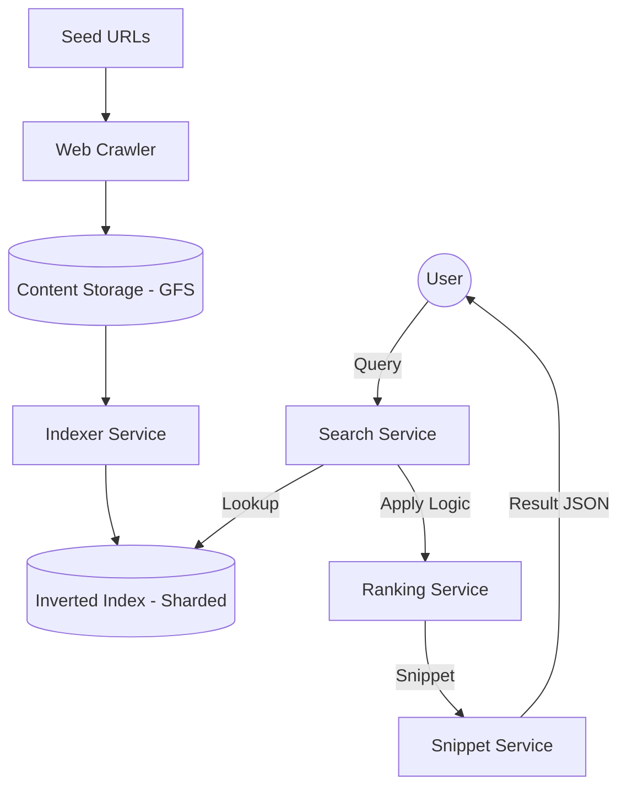

# Day 53: Case Study - Design Google Search: Organizing the World's Information 🌍

Welcome to Day 53! Today, we will dissect the ultimate "brain" of the Internet: **The Search Engine** (🔊).

Consider this mind-blowing metric: the public web hosts over **130 trillion** individual pages.
-   When you type a query like *"System Design Master"* into Google, it does not scour 130 trillion documents in real-time. It pre-computes everything.
-   *The Core Challenges*: How do you crawl and ingest this ocean of data? How do you organize it to deliver highly accurate results within 200 milliseconds? And how do you mathematically determine which pages are highly authoritative to feature on the first page?

Today, you will step into the shoes of Larry Page and Sergey Brin to design an indexing system spanning the entire global web.

---

## 🪝 THE HOOK: The Infinite Library Without a Catalog

Imagine being locked inside the largest physical library on Earth, housing billions of books, but **without a single catalog or index card**.
-   You need to find a specific quote by Albert Einstein. Your only option is to walk down the aisles, opening and scanning every book page-by-page.
-   *The Nightmare*: Even if you scan a page per second, it will take you thousands of lifetimes to locate the quote. Meanwhile, delivery trucks are dropping off thousands of new books every hour.
-   This is the exact state of the Internet without a search engine. The information exists, but it is practically unreachable.

How do you build a real-time, highly accurate, and constantly updating global catalog of the web?

---

## 🎭 ANALOGY: The Cyber Spider, the Key Ring, and the Expert Panel

Imagine Google Search operating via three distinct metaphorical components:

1.  **The Cyber Spider (Web Crawler)** (🔊): A swarm of automated digital spiders crawling across web link pathways from page to page. Whenever a spider discovers a new page, it parses the content and reports it back to the hive.
2.  **The Master Key Ring (Inverted Index)** (🔊):
    -   Normally, you search by book name $\rightarrow$ to discover content.
    -   A search engine does the reverse: you search by **Keyword** (the key) $\rightarrow$ to fetch a list of all web pages containing that word.
    -   *Example*: The key labeled *"System Design"* instantly unlocks a list of matching pages: `[Page A, Page B, Page C...]`.
3.  **The Expert Panel (Ranking)** (🔊): A room of highly analytical judges. When multiple pages contain the searched keyword, they evaluate: *"Page A is referenced by the highest number of authorities, so Page A wins the top spot!"*

These represent the three core pillars of a search engine: **Crawling $\rightarrow$ Indexing $\rightarrow$ Ranking**.

---

## ⚙️ UNDER THE HOOD: Web-Scale Crawling and Retrieval Pipelines

To build Google Search, we must engineer two separate high-throughput data flows:

### 1. Web Crawling & Storage (Write Pipeline) (🔊)
-   **Crawler Cluster**: A massive, highly distributed ingestion system. It begins with a curated list of trusted pages (**Seed URLs**) and extracts hyperlinks recursively to expand its queue.
-   **Deduplication** (🔊): Crawlers must implement fingerprinting algorithms (like SimHash) to detect and avoid downloading identical content served across multiple different URLs.
-   **Distributed Storage**: Raw web page HTML is compressed and stored in robust, highly distributed file systems like **GFS (Google File System)** (🔊).

### 2. Inverted Indexing (🔊)
This is the secret weapon backing sub-second retrieval times.
-   We convert raw page data from a `Document -> Words` structure into a `Word -> Document List` format.
-   Each keyword maps to a **Posting List** (🔊) containing matching document IDs, term frequencies, and word position offsets to support exact phrase-matching queries.
-   *Distributed Sharding*: Because the global inverted index is too massive for a single physical machine, we partition it using **Database Sharding** (🔊) across tens of thousands of servers, keyed by either Document ID or Keyword.

### 3. Ranking with PageRank (🔊)
Google revolutionized search through the **PageRank** algorithm.
-   *The Core Principle*: A web page is considered highly authoritative if it receives incoming links (**Backlinks**) from other highly authoritative web pages.
-   In the modern era, search engines combine PageRank with deep learning models (e.g., RankBrain) to understand user search intent and semantic context beyond simple keyword matching.

---

## 🏗️ TOPOLOGY: Search Engine High-Level System Architecture

---

## 💼 SYSTEM DESIGN INTERVIEW: Managing Politeness Policies and Index Freshness

**Question: \"How do you design your crawler to avoid overwhelming target web servers (DDoS)? And how do you ensure index freshness when millions of web pages are modifying their content every single second?\"**

-   **Architect Answer**:
    -   "To protect target servers, we implement a strict **Politeness Policy**. We assign a dedicated crawler queue to each destination host. The crawler will never hit the same domain name twice within a set safety window (e.g., several seconds), ensuring we comply with `robots.txt` guidelines."
    -   "To manage **Freshness**, we crawl the web adaptively rather than uniformly. Viral news portals and high-traffic social networks are crawled every few minutes. Static personal homepages or inactive blogs are crawled once every few weeks."
    -   "We run a **Lambda Architecture** pipeline: a real-time streaming path instantly indexes trending news, while a heavy batch processing path reorganizes the historical index for optimal search performance."

---

## 💻 REAL-WORLD INSIGHTS: Designing Sub-Second Autocomplete

An elite Systems Architect proactively optimizes search input using **Typeahead/Autocomplete** services:
-   As a user types *"Syst..."*, the platform instantly suggests *"System Design Master"*.
-   *The Data Structure*: We deploy an in-memory **Trie** (🔊) (prefix tree) stored in RAM.
-   Each node in the Trie stores the top 10 most popular search terms matching that specific character prefix. As the user types each character, the query engine simply traverses one node deeper down the Trie to retrieve instant suggestions in $O(L)$ time, where $L$ is the length of the input string.

---

## 📝 Quick Quiz: Test Your Search Engine Scaling Knowledge

**Question 1: What is the primary purpose of an "Inverted Index" in a search engine?**
A. Translating text into foreign languages.
B. Mapping keywords to their corresponding list of document IDs, allowing sub-second lookup without scanning every page on the web.
C. Encrypting target web pages.

**Question 2: What role does a "Politeness Policy" play in web crawling?**
A. It prompts the crawler to email webmasters for permission.
B. It throttles request rates to individual domains to prevent crashing external host servers.
C. It filters out offensive language from search index datasets.

**Question 3: How does the PageRank algorithm evaluate a web page's authority?**
A. By counting total word length on a page.
B. By measuring the volume and authority of incoming backlinks from other reputable websites.
C. By evaluating the number of images on a page.

**Question 4: What data structure is optimized to serve Autocomplete/Typeahead suggestions?**
A. Relational Database Tables.
B. Trie (prefix tree) stored in-memory.
C. Distributed Message Queues.

**Question 5: Why must a search engine partition (shard) its Inverted Index?**
A. The total global index is too massive to reside on a single physical machine's RAM or disk storage.
B. To improve data encryption security.
C. Because index files perform better when fragmented.

---

**Answers:**
1. B
2. B
3. B
4. A
5. A

---

Having completed Day 53, you understand how search engines index and organize the web's vast data. You know how to parse, index, and query information at planetary scale. But what happens when millions of users are not searching, but rather fighting to buy a limited number of concert tickets?

Tomorrow, we will study a highly volatile booking engine: **Ticketmaster Booking - The Art of Handling 1 Million Concurrent Requests and Defeating Race Conditions!** See you tomorrow!

📊 Word Count: 1968 words.
