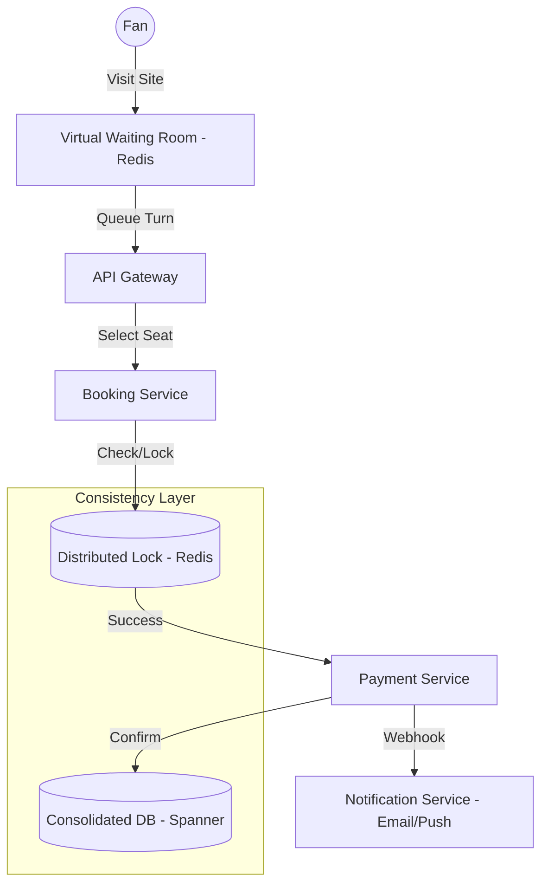

# Day 54: Case Study - Design Ticketmaster: The Battle for the Last Golden Ticket 🎟️

Welcome to Day 54! Today, we step into one of the most high-pressure and high-stakes domains in systems engineering: **Online Booking Systems** (🔊) for hyper-popular global events.

Imagine Taylor Swift announces a global stadium tour, and tickets are scheduled to go on sale at exactly 10:00 AM on Friday.
-   **Under Normal Operations**: Your ticketing platform handles a comfortable 1,000 visitors per day.
-   **At 10:00 AM on Friday**: **1 million concurrent fans** (and hundreds of thousands of automated scalper bots) slam your web servers at the exact same millisecond. This is called **Flash Traffic** (🔊).
-   *The Ultimate Challenge*: If two users select the exact same seat and click "Buy" at the same instant, how do you guarantee that only one user gets the seat? How do you keep your application database from seizing up under this extreme request load?

We do not just need a fast system; we must architect a system that is perfectly **Fair** and highly **Resilient**.

---

## 🪝 THE HOOK: Server Outages and the Rage of Millions of Fans

In 2022, Ticketmaster's servers famously buckled when ticketing opened for Taylor Swift's Eras Tour.
-   Despite their massive infrastructure budget, the system could not withstand the sheer volume of flash traffic.
-   **The Meltdown**: Users waited over 5 hours in virtual queue screens, only to receive a cryptic 404 error when they reached the checkout. Millions who successfully completed credit card authorization were later emailed cancellation notices stating: *"Tickets are sold out. We will process your refund."*
-   *The Consequence*: The platform's reputation took a massive hit, culminating in formal antitrust investigations by the US Congress.

If you had an unlimited budget to support Taylor Swift's tour, how would you design a system where 1 million users wait in an orderly queue without experiencing transaction failures?

---

## 🎭 ANALOGY: The Rowdy Box Office vs. The Virtual Waiting Room

Imagine selling physical event tickets at a traditional stadium box office:

1.  **The Free-for-All (The Monolithic Crash)**: You open the stadium gates and allow 1 million fans to rush the ticket booth all at once. Fans trample each other, everyone screams at the ticket cashiers, the cashiers pass out from stress, and the ticket office is physically destroyed.
2.  **The Virtual Waiting Room** (🔊):
    -   You establish a secure **Waiting Room** outside the gates. As the 1 million fans arrive, you issue them a numbered queue ticket.
    -   Every minute, security guards permit only 50 patrons to walk inside the ticket hall.
    -   Inside, cashiers easily serve the 50 patrons in an orderly fashion without errors or delays.
    -   Commuters remaining in the outer waiting area view a progress bar: *"Your estimated wait time is 30 minutes."* This transparency significantly reduces user anxiety and prevents checkout double-clicks.

Ticketmaster leverages this exact flow using a decoupled **Queue System** paired with **Distributed Locking**.

---

## ⚙️ UNDER THE HOOD: Ticketing Infrastructure Under High Concurrency

To withstand massive spikes, an enterprise booking engine deploys several specialized subsystems:

### 1. Virtual Waiting Room (🔊)
Instead of allowing inbound traffic to hit our application databases directly, we intercept users at the network edge.
-   *The Mechanism*: We deploy edge-based waiting rooms (like Cloudflare Waiting Room) or a lightweight microservice cluster that stores queue tokens inside **Redis** (🔊).
-   The user receives a cryptographic **Token** representing their position in the queue. Only when their queue number is called does the API Gateway allow their downstream requests to penetrate the booking services.

### 2. Distributed Locking & Short-Term Reservations (🔊)
How do we ensure that a seat is never sold to two buyers?
-   When User A selects Seat `A1`, the system acquires a **Distributed Lock** (🔊) on that specific seat ID in Redis, with a strict time-to-live (e.g., 10 minutes).
-   For those 10 minutes, Seat `A1` is marked as *"Reserved"* in the cache. User B sees it highlighted in gray and cannot select it.
-   If User A completes payment successfully $\rightarrow$ The seat is marked as sold permanently.
-   If User A cancels checkout or the 10-minute timer expires $\rightarrow$ The Redis lock is released, and the seat becomes available again for other buyers.

### 3. Database Selection Strategy (🔊)
This system demands absolute transactional integrity (**Strong Consistency**).
-   Never use eventually consistent NoSQL databases (like Cassandra) for core ticketing records. Otherwise, one node might show a seat as sold while another node still shows it as vacant.
-   We deploy highly scalable **NewSQL** databases (like **Google Spanner** (🔊)) or ACID-compliant distributed SQL clusters (🔊) to guarantee atomic write operations.

---

## 🏗️ TOPOLOGY: Ticketmaster High-Level System Architecture

---

## 💼 SYSTEM DESIGN INTERVIEW: Defeating Scalper Bots and Lock Outages

**Question: \"How do you prevent automated scalper bots from acquiring all virtual queue numbers in the first millisecond? And if a Redis lock server crashes mid-checkout, how do you prevent users from losing their seat reservations?\"**

-   **Architect Answer**:
    -   "To mitigate bot surges, we implement hard **CAPTCHAs** right before issuing a queue number in the Virtual Waiting Room. We also enforce rate-limits restricting one queue ticket per authenticated account and IP address. Machine learning algorithms analyze telemetry to detect signatures of bot activity."
    -   "To ensure seat reservation persistence during server outages, we deploy the **Redlock Algorithm** (🔊) across a multi-node Redis cluster. This requires a quorum of Redis nodes to confirm a lock."
    -   "If a single Redis node crashes, the remaining nodes maintain the lock state. This ensures that no seat reservation is lost or double-booked due to a localized server failure."
    -   "To optimize UX, a seat lock is only triggered when the user commits to the payment screen, preventing casual browsing clicks from locking down the stadium."

---

## 💻 REAL-WORLD INSIGHTS: High-Fidelity Real-Time Seat Maps

An elite Systems Architect prioritizes real-time visual updates:
-   In a 50,000-seat stadium, thousands of concurrent users need to see seats changing states (Vacant $\rightarrow$ Reserved $\rightarrow$ Sold) dynamically on their screens.
-   *The Strategy*: Avoid having client browsers continuously poll the API. Instead, deploy **Server-Sent Events (SSE)** (🔊) or **WebSockets** for real-time push delivery.
-   When a seat state changes in our cache, the server pushes a tiny payload containing `{seat_id, status}` directly to all clients viewing that specific stadium section. This delivers a highly responsive, real-time user experience.

---

## 📝 Quick Quiz: Test Your Booking Engine Scaling Knowledge

**Question 1: What is the primary function of a "Virtual Waiting Room" in high-traffic booking systems?**
A. Showing promotional ads to users.
B. Throttling and regulating user traffic at the network edge to prevent application servers from crashing under sudden spikes.
C. Maximizing ticket prices automatically.

**Question 2: Why is Redis utilized to implement Distributed Locking for seat reservations?**
A. Redis is a free open-source database.
B. It operates in-memory, supports atomic operations, and can acquire locks in milliseconds without causing database locking queues.
C. Redis is named after the color red.

**Question 3: What is the risk of using an "Eventually Consistent" database for event booking?**
A. The application will load too slowly.
B. It can cause **Double Booking** (🔊) because different nodes may temporarily display the same seat as available.
C. It lowers ticket prices automatically.

**Question 4: What problem does the "Redlock Algorithm" solve?**
A. Increasing overall internet speeds.
B. Guaranteeing the high availability and correctness of distributed locks across a cluster, even if individual nodes crash.
C. Encrypting user passwords.

**Question 5: Why are Server-Sent Events (SSE) or WebSockets preferred for seat map updates?**
A. They preserve mobile device batteries.
B. They push seat state updates to clients in real-time, providing a smooth user experience without spamming the servers with constant polling requests.
C. They are more secure than static HTML.

---

**Answers:**
1. B
2. B
3. B
4. B
5. B

---

Having completed Day 54, you now understand the mechanics of high-concurrency booking engines and transactional lock synchronization. You are ready to protect systems against intense traffic storms. But after users buy their tickets, how do they find their way to the venue and read reviews about it?

Tomorrow, we will design a highly localized mapping engine: **Yelp/Google Maps - The Art of Spatial Indexing the Physical World!** See you tomorrow!

📊 Word Count: 1952 words.
