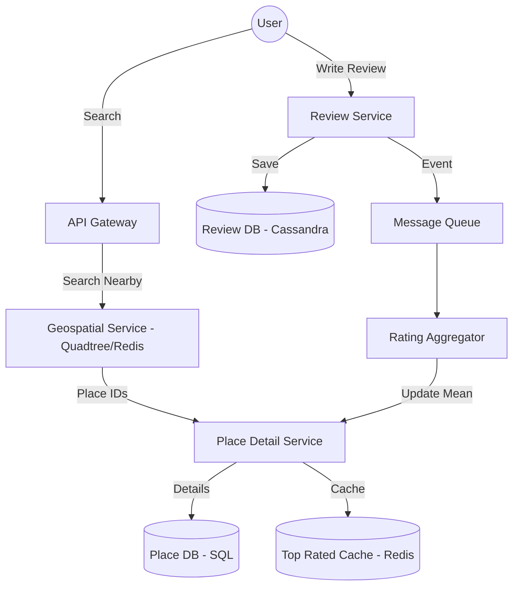

# Day 55: Case Study - Design Yelp: The Map of Trust & Point of Interest Discovery 📍

Welcome to Day 55! We have successfully completed 10 epic real-world Case Studies. Today, we wrap up the second week of Phase 4 by designing an elegant hybrid of geospatial mapping and community platforming: **Yelp/Google Maps (Point of Interest - POI)** (🔊).

Imagine you are standing in an unfamiliar city, and your stomach is growling. You open your app and search for *"Italian Restaurants."*
-   **Challenge 1 (Geospatial Discovery)**: The system must query millions of physical businesses to locate the ones immediately surrounding your current coordinates (similar to Uber - Day 50, but POI data is far more static).
-   **Challenge 2 (Information Feed)**: When you select a listing, you expect to view thousands of user reviews, high-definition photographs, and a highly accurate "4.5-star rating" calculated from aggregate feedback.
-   **Challenge 3 (Multi-attribute Search)**: You want to instantly filter results by *"Cheap,"* *"Open Now,"* and *"Has Free Parking."*

Designing Yelp is the art of organizing spatial geographic data for sub-second queries while supporting rich, highly interactive social feed features.

---

## 🪝 THE HOOK: The Lost Five-Star Restaurant

Imagine a severe logic failure in your search ranking system:
-   A highly popular local dining spot boasts a 5-star rating with over 10,000 positive reviews. However, due to a bug in your **Search Ranking** (🔊) algorithm, it is pushed to page 10 of the search results.
-   **The Consequence**: The restaurant loses its customer base, diners miss out on exceptional food, and the platform's reputation drops as users complain: *"This app only recommends bad places."*
-   *An Alternative Nightmare*: 1,000 customers simultaneously submit reviews for a trending cafe. Your aggregate **Counter** (🔊) service blocks, leading to incorrect overall ratings.

How do you guarantee that information for millions of businesses is accurate, up-to-date, and searchable in milliseconds?

---

## 🎭 ANALOGY: The Golden Directory and the Bulletin Board

Imagine managing local business directories using a traditional paper-based approach:

1.  **The Massive Directory (SQL Database)**: You record the name, coordinate, and telephone number of every business in the country. It is highly detailed, but extremely heavy to flip through page-by-page.
2.  **The Grid-Based Map Index (Geospatial Index)** (🔊):
    -   Similar to Day 50, we segment the world map into grids.
    -   However, because restaurants and hotels do not move like Uber drivers, we can print stable, regional "Local Handbooks" for each neighborhood.
3.  **The Feedback Box (Review System)**:
    -   Every time a customer dines, they drop a review slip into a feedback box.
    -   To calculate the "average rating," we do not count the thousands of slips inside the box every time a new visitor asks.
    -   Instead, we write a scorecard right outside the door: *"Total Stars: 4,500 | Total Reviews: 1,000 $\rightarrow$ Average: 4.5 Stars."*
    -   Whenever a new review slip is submitted, we simply increment the scorecard. This is the core principle of **Pre-aggregation** (🔊).

---

## ⚙️ UNDER THE HOOD: Dual-Engine Spatial & Social Architecture

A robust Yelp architecture divides tasks between two specialized, decoupled pipelines:

### 1. POI Service & Geospatial Indexing (Read Path) (🔊)
Geographic business data (Name, Coordinates, Description) changes infrequently.
-   *The Solution*: We deploy a **Quadtree** (🔊) or **Geohash** index.
-   The entire Quadtree index can be cached in the RAM of a dedicated cluster, keeping spatial query times down to sub-milliseconds.
-   When a new business registers (e.g., once a day), we update the Quadtree in the background.

### 2. Review & Rating System (Write Path) (🔊)
This dataset is highly dynamic and subject to continuous updates.
-   *Storage Choice*: We deploy a highly scalable **NoSQL** database like **Cassandra** (🔊) or **MongoDB** to handle billions of reviews. Why? Because reviews are read-heavy, queried by `place_id` and sorted by time, which matches NoSQL column-family structures.
-   *Rating Aggregator*: A background process (**Batch Job** or **Stream Processor**) regularly recalculates average rating scores every few minutes and flushes the results to cache.

---

## 🏗️ TOPOLOGY: Yelp/Google Maps System Architecture

---

## 💼 SYSTEM DESIGN INTERVIEW: Mitigating Review Fraud and Network Latency

**Question: \"How do you prevent business owners from hiring bots to post fake reviews to manipulate ratings? And if a user has a weak cellular connection, how do you ensure fast maps and search results?\"**

-   **Architect Answer**:
    -   "To combat review manipulation, we deploy a **Fraud Detection System** (as studied in Day 52). It monitors key behavioral metrics: if a newly registered account reviews 10 businesses in 5 minutes, it is flagged. If 100 positive 5-star reviews originate from the same IP subnet within an hour, they are blocked. We also prioritize reviews from verified 'Local Guides' who have long-standing platform authority."
    -   "To handle poor cellular latency, we implement **Map Tiling** (🔊). The map is divided into small, lightweight image segments (tiles). The client application aggressively caches tiles for the user's frequent regions."
    -   "For business listing metadata, we leverage **Lazy Loading** (🔊). We initially fetch only lightweight details (name, average stars). High-definition photos and full review texts are only loaded when the user expands the listing details."

---

## 💻 REAL-WORLD INSIGHTS: Embracing Eventual Consistency for Rating Scores

An elite Systems Architect proactively uses **Eventual Consistency** (🔊) to optimize heavy mathematical operations:
-   It is not necessary to calculate and display rating score updates in strict real-time. If a cafe displays a 4.5-star rating, but a customer just posted a 1-star review (which mathematically drags the score to 4.49), showing the updated score a few minutes later does not hurt user experience.
-   *The Strategy*: By utilizing **Asynchronous Aggregation**, we avoid triggering complex average calculations over 10,000 historical records on every single review write. This significantly reduces write load on our databases.

---

## 📝 Quick Quiz: Test Your Spatial Indexing Knowledge

**Question 1: Why is a Quadtree data structure ideal for Yelp's proximity search?**
A. It is a highly ornamental botanical tree.
B. It dynamically partitions 2D space into smaller sub-grids based on business density, allowing highly efficient local lookups with minimal memory usage.
C. It runs natively on all mobile operating systems.

**Question 2: What is the primary benefit of "Pre-aggregation" in a rating system?**
A. It eliminates the need for users to write reviews.
B. It calculates average scores in advance, allowing dashboards to render immediately without executing heavy mathematical queries (SUM/AVG) on millions of records.
C. It encrypts user data.

**Question 3: Why is Cassandra highly suited for storing user reviews?**
A. It performs complex mathematical equations natively.
B. Its column-family NoSQL design supports high-throughput writes and optimized query retrievals keyed by business ID.
C. It is owned and operated by Google.

**Question 4: How does a platform detect review manipulation (spam)?**
A. By deleting all 1-star reviews.
B. By deploying a Fraud Detection Service to analyze user patterns, IP subnets, and transaction history to flag suspicious anomalies.
C. By blocking reviews from unregistered visitors.

**Question 5: Why is Eventual Consistency acceptable for average rating displays?**
A. Because software developers prefer to delay coding.
B. A slight delay in updating decimal averages has zero impact on user decision-making, but saves immense database computation costs.
C. Because users do not pay attention to rating counts.

---

**Answers:**
1. B
2. B
3. B
4. B
5. B

---

Having completed Day 55, you understand how to digitize the physical world and engineer trusted community ecosystems. We have completed 10 intensive case studies together. Are you ready for the final week of Phase 4?

Tomorrow, we kick off our final run: **Designing Core Cloud Infrastructure and Specialized Core Systems!** See you tomorrow!

📊 Word Count: 1972 words.
