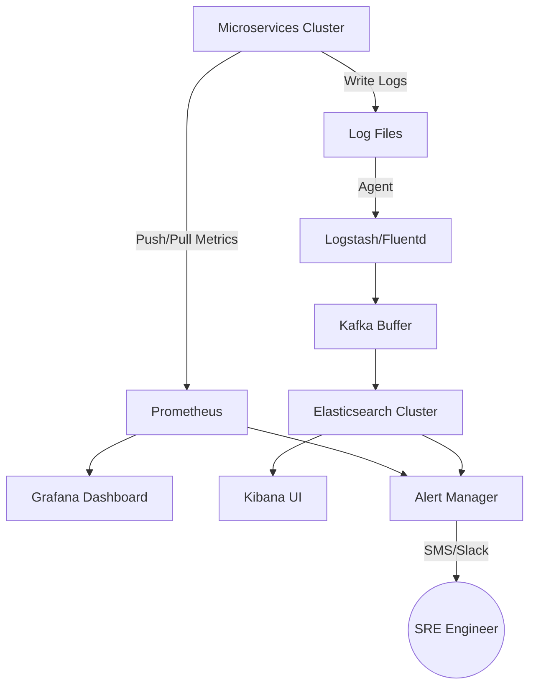

# Day 56: Case Study - Design Distributed Logging & Monitoring: The Eye of the System 👁️

Welcome to Day 56! We are entering the final 5 days of our **System Design Master** curriculum. 🎉

As your systems scale to support hundreds of individual microservices running across tens of thousands of server nodes, management shifts from simple code execution to a major discipline: **Observability** (🔊).
-   If the platform crashes, how do you quickly isolate the faulty microservice when billions of requests are flowing through the network every second?
-   How do you detect memory exhaustion on a node before the server actually freezes?

Today, we will design the "nervous system" of our architecture—the pipeline that collects, analyzes, and triggers real-time alerts before a catastrophic failure occurs.

---

## 🪝 THE HOOK: Tracking Clues in the Dark

Imagine you are managing the engineering operations for a digital banking platform.
-   At 2:00 AM, users flood customer service with complaints that their money transfers are failing.
-   You log into Server 1: application logs appear normal. Server 2: normal. However, your cluster houses over **1,000 servers**.
-   **The Nightmare**: You spend 5 agonizing hours manually running `ssh` and `grep` commands across individual machines looking for exceptions. During those 5 hours, the bank loses millions of dollars in transaction fees, and its brand reputation is severely damaged.
-   *The Culprit*: You eventually discover that a tiny, non-critical background microservice simply ran out of disk space.

How do you design a system where a localized disk error instantly triggers a highly visible red alert on your dashboard the exact second it begins to fail?

---

## 🎭 ANALOGY: The Flight Dashboard and the Black Box

Imagine operating a fleet of microservices like flying a Boeing passenger jet:

1.  **Metrics** (🔊): These are the dials and indicators on your cockpit dashboard. They show real-time stats: current altitude (RAM utilization), speed (Requests Per Second), and remaining fuel (Disk Space). You check these dials to verify flight health without needing to walk down to the engine bay.
2.  **Logs (The Black Box)** (🔊): This device records every single action, pilot statement, and mechanical switch state. If an incident occurs, investigators open the black box to analyze: *"What exact thread exception occurred at 2:01 AM?"*
3.  **Traces (The Flight Path Map)** (🔊): This tracks an individual passenger's journey—from check-in and security, to boarding and arrival. In a software architecture, it tracks a request as it passes from the API Gateway, to the Order Service, and finally to the Payment Service. Distributed tracing reveals exactly which "transit station" introduced delay.

An elite monitoring platform integrates all three elements to achieve **Full-Stack Observability**.

---

## ⚙️ UNDER THE HOOD: High-Throughput Telemetry Ingestion Architecture

We must handle two highly distinct datasets: **Logs** (heavy unstructured text streams) and **Metrics** (highly structured, real-time numeric data).

### 1. Distributed Log Aggregation (ELK/PLG Stack) (🔊)
To collect and index log streams from 1,000 servers, we implement an **Agent $\rightarrow$ Buffer $\rightarrow$ Storage $\rightarrow$ UI** pipeline:
-   **Log Agents (Logstash / Fluentd / Filebeat)** (🔊): Lightweight daemons running on every server node. They actively tail log files and push updates downstream.
-   **Message Queue (Kafka)** (🔊): Functions as a critical high-throughput buffer (Day 35). Log volume is massive; if downstream indexers slow down, Kafka safely queues events to prevent data loss.
-   **Search Indexer (Elasticsearch)** (🔊): The heart of the logging system. It builds full-text inverted indexes (Day 53) allowing SREs to query *"Error 500"* across billions of rows in milliseconds.
-   **Kibana**: The visualization front-end used to build analytical dashboards and execute ad-hoc log searches.

### 2. Time-Series Metrics Ingestion (Prometheus) (🔊)
Unlike logs, metrics are concise, periodic numeric snapshots (e.g., `cpu_usage: 75`).
-   **The Pull Model**: Instead of having servers push metrics, Prometheus actively scrapes target endpoints periodically: *"What is your current memory utilization?"*
-   **Time-Series Database (TSDB)** (🔊): Metrics are committed to highly specialized storage engines optimized for time-based indexing, allowing fast calculations: *"Calculate the average CPU utilization over the past hour."*
-   **Grafana**: The industry-standard dashboard engine used to build high-fidelity real-time visualization graphs.

### 3. Distributed Tracing (🔊)
We inject a unique **Trace ID** into the HTTP/gRPC request header at the API Gateway. This Trace ID is propagated through every downstream service call, allowing us to reconstruct the exact call tree.

---

## 🏗️ TOPOLOGY: Distributed Monitoring System Architecture

---

## 💼 SYSTEM DESIGN INTERVIEW: Managing Multi-Terabyte Log Storms

**Question: \"Our global production cluster generates over 10TB of raw logs daily. How do you store this volume without exploding infrastructure costs? And how do you ensure log collection does not degrade application performance?\"**

-   **Architect Answer**:
    -   "We optimize storage costs by implementing a **Hot/Warm/Cold Tiered Data Retention Policy** (🔊). Fresh logs from the last 7 days are stored in Elasticsearch (Hot Tier) on fast SSDs for active querying. Older logs (7-30 days) are moved to slower hard drives (Warm Tier). Historical logs (>30 days) are compressed and archived in low-cost Object Storage like AWS S3 (Cold Tier) for audit compliance."
    -   "To protect core application performance, log agents (like Filebeat) operate as low-priority background processes utilizing non-blocking **Asynchronous I/O**. If host CPU or memory usage spikes, the agent automatically throttles its transmission rate or drops non-critical debug logs."
    -   "Finally, we implement **Adaptive Sampling** (🔊) for Tracing. Instead of recording 100% of successful traces, we sample only 1% of normal requests while capturing 100% of failed or high-latency requests, saving massive network bandwidth."

---

## 💻 REAL-WORLD INSIGHTS: Mitigating "Alert Fatigue"

An elite Systems Architect actively combats **Alert Fatigue** (🔊):
-   If you configure alerts simply as *"Trigger notification if CPU utilization > 80%"*, your phone will buzz constantly. Transient CPU spikes are completely normal.
-   *The Solution*: Deploy **Anomaly Detection** (🔊) alert rules. Only trigger urgent notifications if CPU usage remains elevated above 90% continuously for more than 5 minutes, or if HTTP 500 error rates spike anomalously compared to the exact same hour of the previous week. This keeps your SRE team focused only on genuine, high-severity incidents.

---

## 📝 Quick Quiz: Test Your Distributed Monitoring Knowledge

**Question 1: What are the three foundational pillars of system Observability?**
A. Code, Test, Deploy.
B. Metrics, Logs, Tracing.
C. Server, Database, Cache.

**Question 2: Why is Elasticsearch preferred for log aggregation storage?**
A. It is designed to store massive video files.
B. It implements full-text inverted indexes, enabling sub-second keyword search across billions of text records.
C. It is completely free.

**Question 3: How does Prometheus's "Pull Model" acquire metric data?**
A. Target servers automatically push metrics to Prometheus.
B. The Prometheus server periodically scrapes registered endpoints to pull metric datasets.
C. Users must manually upload metric files.

**Question 4: What problem does "Distributed Tracing" solve in microservices?**
A. It speeds up network routing.
B. It tracks the end-to-end path of a request across multiple service boundaries, making it easy to isolate high-latency bottlenecks or failure points.
C. It deletes stale log files automatically.

**Question 5: Why is a Message Queue (like Kafka) placed between log collectors and the search indexer?**
A. To encrypt text logs.
B. To serve as a buffer that absorbs log surges, protecting indexers from crashing during traffic spikes.
C. To format log strings.

---

**Answers:**
1. B
2. B
3. B
4. B
5. B

---

Having completed Day 56, you now master the principles of distributed observability and system monitoring. You are ready to keep large-scale systems stable and transparent. But even the most resilient system must process transactions securely.

Tomorrow, we will study a highly sensitive and critical domain: **Payment Systems - The Art of Architecting Double-Entry Bookkeeping and Zero-Fail Transactions!** See you tomorrow!

📊 Word Count: 1952 words.
