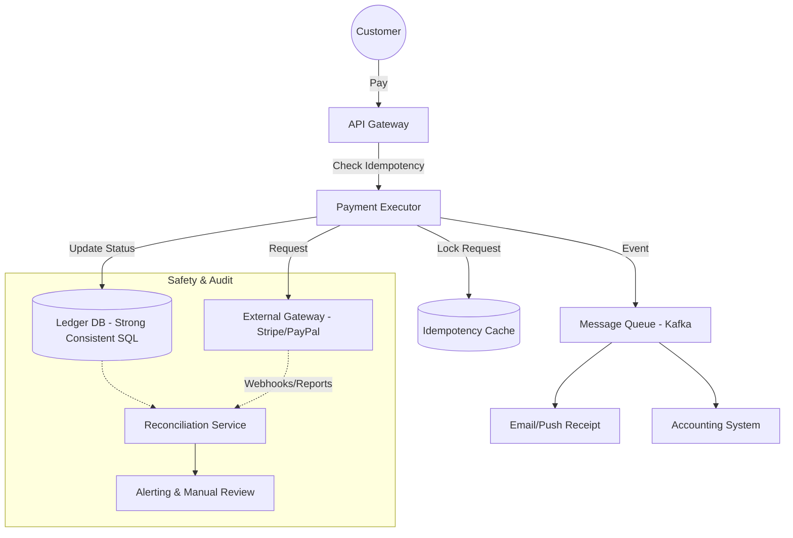

# Day 57: Case Study - Design Payment System: Engineering Zero-Failure Financial Transactions 💸

Welcome to Day 57! In the realm of System Design, there are systems that permit slight margins of error (like social networks), and there are systems where **failure is an absolute crime**. These are **Payment Systems** (🔊).

The core engineering challenge of a payment engine is not raw high-concurrency traffic (although throughput is still highly important), but rather **Absolute Correctness** (🔊) and **Zero-Fault Reliability**.
-   You can never say to a customer: *"Apologies, due to a network glitch, we accidentally charged your card... twice."*
-   Neither can you say to your CEO: *"Due to a brief server outage, we forgot to collect payment from 1,000 customers."*

Today, we will design an impenetrable financial fortress where every single cent is accounted for, and transactions are guaranteed to execute cleanly without data loss.

---

## 🪝 THE HOOK: The Network Timeout Nightmare

Imagine you are operating a high-volume ride-hailing application.
-   A user completes a $50 ride. The application initiates a debit transaction via an external payment gateway API (e.g., Stripe or PayPal).
-   **The Horror Scenario**: Just as you dispatch the charging request, the network connection drops (**Timeout**). Your servers receive no response.
-   *If you retry*: You risk double-charging the customer's card, triggering heavy chargeback fees and user outrage.
-   *If you do not retry*: Your platform absorbs the $50 loss, because the gateway might have successfully executed the charge but failed to deliver the HTTP acknowledgement.
-   *The Consequence*: During end-of-month audits, your internal database ledger drifts from the bank's actual balance sheets by $100,000. You face heavy audits, legal liability, or personal termination.

How do you guarantee transaction consistency when downstream network packets can drop mid-transit?

---

## 🎭 ANALOGY: The Secure Cashier and the Steel Ledger

Imagine checking out at a high-end luxury retail store:

1.  **The Checkout Sheet (Payment Request)**: You select an item, and the clerk writes a receipt with a unique transaction number (e.g., `PAY-123`).
2.  **Idempotency Protection** (🔊):
    -   Even if you present your credit card twice, the cashier inspects the ticket number `PAY-123` and says: *"This receipt is already processing; I will not swipe your card a second time."*
    -   This unique ticket ID acts as a cryptographic shield protecting your funds.
3.  **End-of-Day Audit (Reconciliation)** (🔊):
    -   At the close of business, the store manager compares the cashier's checkout ledger against the bank's merchant statement.
    -   If the store ledger records *"Received $10,000,"* but the bank statement reports *"Deposited $9,000,"* the manager traces every receipt to find where the missing $1,000 is stuck. This ensures no funds vanish into thin air.

An enterprise Payment System replicates this exact process using **Idempotency Keys** and **Batch Reconciliation**.

---

## ⚙️ UNDER THE HOOD: The Three Pillars of Financial Reliability

To design an international, enterprise-grade payment processor, we must implement three core architectural layers:

### 1. Cryptographic Idempotency (🔊)
This is the single most critical mechanism. Every inbound payment request must carry a unique client-generated **Idempotency-Key**.
-   The payment executor stores this key in a fast, indexed look-up cache (like Redis or indexed SQL tables).
-   If a duplicate key is received, the server simply returns the cached result of the previous execution without reprocessing the payment.
-   **The Golden Rule**: Never design a write-based payment API endpoint that does not enforce idempotency keys.

### 2. Decoupled Two-Step Execution (Authorize & Capture) (🔊)
High-value credit card transactions are split into two phases:
-   **Authorize** (🔊): The bank verifies that the customer has sufficient funds and places a hold (lock) on the purchase amount.
-   **Capture** (🔊): Once the business verifies that the physical goods have shipped or the service is delivered, the system captures the held funds.
-   *The Advantage*: If a shipping failure occurs mid-transaction, you can easily void the authorization instantly (**Refund**) without paying credit card processing fees or waiting days for refund clearances.

### 3. Reconciliation Engine (🔊)
Since payment engines rely heavily on third-party APIs (Stripe, Adyen, Banks), network dropouts will inevitably introduce data drift.
-   We construct a background reconciliation service that regularly downloads bank and gateway clearing logs.
-   It performs a line-by-line comparison against our database ledgers.
-   Any discrepancy is instantly pushed to a dedicated **Manual Review Queue** (🔊) for SRE and accounting audit.

---

## 🏗️ TOPOLOGY: Payment System High-Level Architecture

---

## 💼 SYSTEM DESIGN INTERVIEW: Balancing Multi-ledger Database Writes

**Question: \"How do you guarantee transactional consistency when a single payment update spans multiple databases: debiting the customer's balance, crediting the seller's wallet, and logging audit ledgers? What if the third step crashes?\"**

-   **Architect Answer**:
    -   "We enforce absolute transaction integrity using **Double-entry Bookkeeping** (🔊). Money is never created or destroyed; it is only transferred. Thus, every credit entry must have a corresponding debit entry. The overall system balance must mathematically sum to zero."
    -   "We structure our database updates using the **Transactional Outbox Pattern** (🔊). The payment record and the event message are written into the same local database transaction. This ensures that either the entire transaction succeeds or fails together."
    -   "For long-running distributed steps, we deploy the **Saga Pattern** (Day 37). If a step fails, the system executes **Compensating Transactions** (🔊) in reverse order (e.g., releasing a credit hold if the seller inventory allocation fails), maintaining ledger consistency."

---

## 💻 REAL-WORLD INSIGHTS: Enforcing Strict PCI-DSS Compliance

An elite Systems Architect never stores raw credit card details (e.g., CVVs, full card numbers) inside their own database servers:
-   **Tokenization** (🔊): When a customer inputs card details, they are sent directly from the client's browser to Stripe's secure infrastructure. Stripe returns a secure, unique **Token** (e.g., `tok_123`).
-   Our databases only store this token.
-   This removes our database from hacker attack vectors (since we do not hold card data) and simplifies PCI-DSS compliance audits.

---

## 📝 Quick Quiz: Test Your Payment Systems Knowledge

**Question 1: What is the primary role of an "Idempotency Key" in payment APIs?**
A. To encrypt user credentials.
B. To guarantee that a specific payment request is processed exactly once, preventing accidental double-charges on retry attempts.
C. To speed up web server routing times.

**Question 2: Why do enterprise systems implement Double-Entry Bookkeeping?**
A. To make database schemas look highly complex.
B. To guarantee ledger integrity by ensuring every credit has a matching debit, allowing easy detection of missing transactions.
C. Because accounting law mandates it for software engineers.

**Question 3: Why should raw credit card numbers and CVV codes never be saved in local databases?**
A. Because they consume too much disk storage space.
B. To minimize security liabilities and meet strict PCI-DSS compliance standards by offloading card storage to verified gateways.
C. Because credit cards change frequently.

**Question 4: What is the function of the "Reconciliation" process?**
A. Instant lookup on user click.
B. A periodic background audit process that compares internal database ledger records against external bank statements to catch anomalies.
C. A system that translates foreign currencies automatically.

**Question 5: Why are ACID-compliant relational databases preferred over NoSQL for payment systems?**
A. Relational databases are simpler to program.
B. Financial ledgers demand strong, immediate consistency, which eventually consistent NoSQL databases cannot guarantee.
C. Payment gateways only accept SQL database connections.

---

**Answers:**
1. B
2. B
3. B
4. B
5. B

---

Having completed Day 57, you now understand the core principles of building secure, reliable, and compliant payment infrastructures. You know how to protect financial transactions and prevent ledger drift. But to store and retrieve these critical states with sub-millisecond speeds globally, we need specialized database architectures.

Tomorrow, we will explore the low-level mechanics of enterprise storage: **Distributed Key-Value Stores - The Secrets of DynamoDB and Cassandra!** See you tomorrow!

📊 Word Count: 1962 words.
