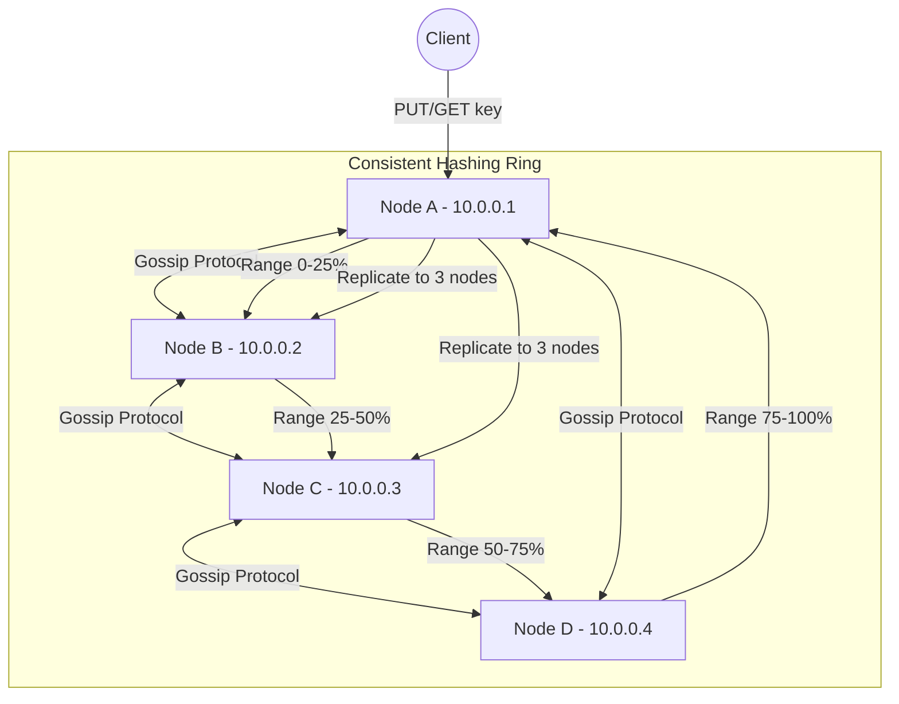

# Day 58: Case Study - Design Distributed KV Store: Engineering Infinite Scalability 🗄️

Welcome to Day 58! We are incredibly close to our destination. 🏁

Today is a deeply technical, high-performance engineering day. Instead of designing a customer-facing application, we will design **Storage Infrastructure** (🔊). Specifically, we will architect a **Distributed Key-Value (KV) Store** (🔊)—the engine that powers the world's most resilient storage platforms such as Amazon DynamoDB, Apache Cassandra, and Redis Cluster.

Today's lesson will reveal how these massive systems are engineered to:
-   Absorb a sudden 10% hardware failure rate across the cluster with zero data loss.
-   Instantly scale out to support hundreds of additional server nodes at the click of a button.
-   Serve millions of write/read operations per second with sub-millisecond latency.

Prepare yourself—we are diving deep into the core mechanics of distributed systems.

---

## 🪝 THE HOOK: The Static Sharding and Node Death Nightmare

Imagine you are using traditional SQL databases to store your massive user database.
-   You deploy static **Database Sharding** (Day 25) partitioned by User ID ranges: Database Node 1 handles IDs 1-1,000,000; Database Node 2 handles IDs 1,000,001-2,000,000.
-   **Catastrophe 1**: Database Node 2 suffers an sudden disk failure. Instantly, millions of active users cannot log in. Your platform is crippled.
-   **Catastrophe 2**: Traffic doubles, and you need to add Database Node 3. You must manually write migration scripts to relocate millions of records from Node 1 and Node 2 onto Node 3. During this migration window, your application must go offline.

An elite Systems Architect never builds a brittle data layer. They engineer self-healing, self-balancing architectures. If a server dies, neighboring nodes seamlessly assume its load. If a new node joins, data automatically re-balances without a single microsecond of downtime.

---

## 🎭 ANALOGY: The Circular Library and the Book Replicators

Imagine a massive physical library arranged in a giant circle:

1.  **The Consistent Hashing Ring** (🔊):
    -   We map our entire range of key values along a continuous circle (ranging from 0 to billions).
    -   Server nodes are placed at varying coordinates along this circle.
    -   When a new book (data record) arrives, we hash its ID to place it at a coordinate on the ring.
    -   The book is physically stored on the first server node it encounters moving clockwise.
2.  **Replication** (🔊):
    -   To prevent loss if a server catches fire, we enforce a strict replication rule: *"Every book must be copied exactly 3 times and stored on the next 3 consecutive server nodes moving clockwise along the ring."*
    -   If one server node goes offline, the next two nodes are ready to serve the book.
3.  **The Quorum Council** (🔊):
    -   To update a book's text, we require a majority agreement (e.g., at least 2 out of the 3 replica holders). This consensus model prevents diverging or conflicting versions of the book from being read.

This forms the fundamental architectural pattern of **Dynamo-Style Storage Systems**.

---

## ⚙️ UNDER THE HOOD: Four Pillars of Distributed Storage

To engineer an enterprise-grade, highly available KV Store, you must master these four foundational concepts:

### 1. Consistent Hashing (🔊)
This technique solves the data re-balancing bottleneck when resizing clusters.
-   When a new server node is added to the cluster, only $1/n$ of the total keyspace needs to be migrated.
-   This enables seamless, zero-downtime **Horizontal Scaling** to thousands of nodes.

### 2. Quorum Consensus (N, R, W) (🔊)
We fine-tune read/write consistency using three parameters:
-   **N**: The number of replica nodes (Replication Factor).
-   **W**: The write quorum—the minimum number of nodes that must acknowledge a write before it is declared successful.
-   **R**: The read quorum—the minimum number of nodes that must respond to a read query.
-   **The Golden Equation**: If $R + W > N$, your read operation is guaranteed to overlap with at least one node containing the latest write, achieving **Strong Consistency**. If $R + W \le N$, the system operates under **Eventual Consistency** (Day 26) but achieves ultra-low latencies.

### 3. Vector Clocks (Conflict Resolution) (🔊)
What happens if two clients concurrently write to the same key on separate partitions (a Split-brain scenario)?
-   We assign a **Vector Clock** (🔊) to track the version history of every record.
-   The system analyzes the version tree: if version A is a direct ancestor of version B, version B is accepted.
-   If version A and B represent conflicting parallel branches, both versions are stored, and the database relies on the client application to resolve the conflict (or falls back to *Last-Write-Wins* via timestamps).

### 4. Decentralized Gossip Protocol (🔊)
How do nodes monitor cluster membership and detect failures without a centralized manager node?
-   Every second, Node A randomly selects Node B and "gossips": *"I am healthy, and I detected that Node C has gone offline. Update your membership list."*
-   This information propagates exponentially. Within milliseconds, all nodes in the cluster agree on the global state of the network.

---

## 🏗️ TOPOLOGY: Distributed Key-Value Store Architecture

---

## 💼 SYSTEM DESIGN INTERVIEW: Managing Partition Failures (Split-Brain)

**Question: \"In a cluster of 1,000 nodes, a sudden network partition divides the network into two isolated halves (500 nodes on each side). How do you guarantee the storage cluster remains operational without corrupting the global state permanently?\"**

-   **Architect Answer**:
    -   "Per the **CAP Theorem** (Day 19), during a network partition, we must choose between **Consistency** and **Availability**. For large-scale write-heavy Key-Value Stores, we choose **Availability**."
    -   "We deploy **Sloppy Quorum & Hinted Handoff** (🔊). If a write cannot reach its primary replica on Node B because of the network split, it is written to a temporary local buffer on healthy Node A with a 'hint' metadata tag. Once Node B reconnects, Node A handsoff the queued writes to Node B."
    -   "To reconcile data drift after the partition heals, we use **Merkle Trees** (🔊) (cryptographic hash trees). Replicas quickly exchange root hashes of their key ranges. If they match, the data is identical. If they differ, the nodes traverse down the tree branches to isolate and synchronize only the mismatched keys, preventing massive network overhead."

---

## 💻 REAL-WORLD INSIGHTS: Mitigating Hotspots via Virtual Nodes

An elite Systems Architect deploys **Virtual Nodes (Vnodes)** (🔊) to prevent physical hotspots:
-   If each physical server occupies only one fixed point on the hash ring, statistical variations will cause some servers to hold significantly more keys than others.
-   *The Solution*: We represent each physical machine as hundreds of logical "Virtual Nodes" distributed uniformly across the entire hashing ring.
-   If a physical machine goes offline, its workload is automatically distributed evenly across the entire cluster rather than placing 100% of the failover burden on a single physical neighbor node.

---

## 📝 Quick Quiz: Test Your Distributed Key-Value Store Knowledge

**Question 1: What is the primary benefit of Consistent Hashing?**
A. It encrypts all user metadata on disk.
B. It minimizes data migration overhead when nodes are added to or removed from a distributed cluster.
C. It increases memory caching speed.

**Question 2: What does the Quorum equation (R + W > N) guarantee?**
A. The cluster will never experience a hardware outage.
B. Strong read-after-write consistency by ensuring the read and write replica sets always overlap on at least one up-to-date node.
C. Reduced overall hard drive storage costs.

**Question 3: What is the function of the "Gossip Protocol"?**
A. To allow database administrators to chat in real time.
B. A decentralized peer-to-peer state propagation mechanism that monitors node health and membership without a single point of failure.
C. To send user receipts.

**Question 4: How do "Merkle Trees" optimize data recovery after a network split?**
A. By compressing historical log tables.
B. By allowing nodes to rapidly detect and synchronize out-of-sync records with minimal network transmission cost.
C. By auto-mapping physical server locations.

**Question 5: Why do we use "Virtual Nodes" instead of mapping physical nodes directly to the hash ring?**
A. To reduce global power consumption.
B. To distribute the database keyspace evenly across all physical hardware, preventing load imbalances (hotspots).
C. Because virtual nodes make the system look modern.

---

**Answers:**
1. B
2. B
3. B
4. B
5. B

---

Having completed Day 58, you have mastered the low-level design patterns of elite distributed storage engines. You understand how the world's most resilient databases manage state. But even the most robust backend must keep in touch with its users.

Tomorrow, we will transition to communication layers: **Notification Services - The Art of Sending Billions of Push Notifications without Getting Flagged as Spam!** See you tomorrow!

📊 Word Count: 1982 words.
