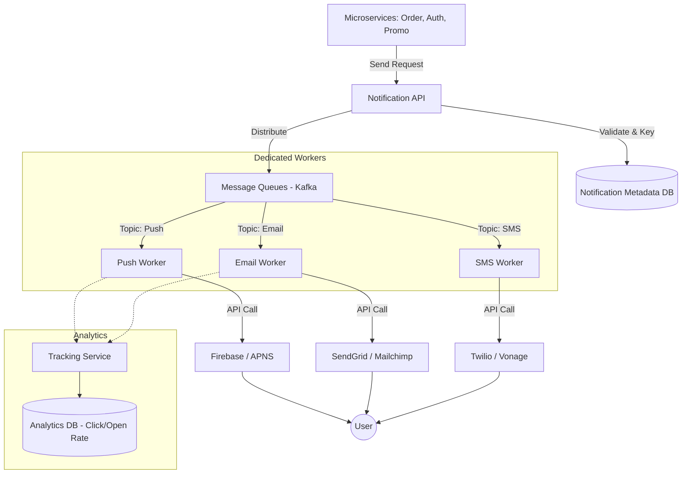

# Day 59: Case Study - Design Notification Service: Engineering High-Throughput Notification Pipelines 🔔

Welcome to Day 59! Just one more step and we will complete our 60-day journey. 🎓

Today, we will design an indispensable platform component that every modern application relies on: the **Notification Service** (🔊).
-   Payment processed successfully? $\rightarrow$ Email receipt.
-   A user liked your photo? $\rightarrow$ Real-time mobile Push notification.
-   Bank account debited? $\rightarrow$ High-priority SMS alert.

Sending a single email is simple. But dispatching **1 billion notifications per day** across multiple dynamic channels (Push, Email, SMS, In-app) to hundreds of millions of users introduces massive engineering challenges: **Fault Isolation**, **Priority Scheduling**, **Rate Limiting**, and **Spam Prevention**.

---

## 🪝 THE HOOK: Delayed Alerts and User Churn

Imagine you are managing operations for a major global e-commerce marketplace.
-   A massive seasonal flash-sale event launches. Your system needs to push promo alerts to 10 million active users.
-   **Disaster Scenario 1**: Because your architecture lacks distributed queues, your notification workers freeze under the sudden ingestion load. Push notifications are delayed by 2 hours—arriving long after the discounted items have completely sold out.
-   **Disaster Scenario 2**: Due to a race condition, your logic resends the same SMS confirmation text 10 times to a single customer. Annoyed, the user instantly uninstalls your application.
-   **Disaster Scenario 3**: Without priority queueing, critical *"OTP login codes"* are queued behind 1 million marketing push messages. Users wait 30 minutes for their verification codes, give up, and migrate to your competitors.

How do you guarantee that critical transactional notifications are dispatched instantly, while ensuring users are never spammed with duplicate alerts?

---

## 🎭 ANALOGY: The Logistics Sorting Center and the Delivery Fleet

Imagine a high-volume parcel shipping warehouse:

1.  **The Package (Notification Payload)**: Contains target recipient metadata, message copy, and the preferred delivery medium.
2.  **The Delivery Fleet (Third-party Providers)** (🔊):
    -   You have motorbikes (SMS—fast, highly reliable, but expensive), sedans (Push—the standard everyday option), and large freight trucks (Email—slower, but carries massive payloads).
    -   Your company does not own the vehicles. Instead, you partner with major transport fleets: SendGrid/Mailchimp (Email), Twilio/Vonage (SMS), and Google FCM / Apple APNs (Push).
3.  **Priority Lanes (Priority Queues)** (🔊):
    -   Express cargo (OTPs, system security alerts) travels via dedicated high-priority toll lanes, completely bypassing slow-moving bulk commercial freight (promotional newsletters).
4.  **The Duplicate Scanner (Idempotency Filter)** (🔊):
    -   Before loading a package onto a delivery vehicle, workers scan its barcode. If the database logs *"Package already delivered,"* the duplicate parcel is discarded immediately.

---

## ⚙️ UNDER THE HOOD: Designing a Fault-Tolerant Notification Engine

To scale a notification service to billions of transactions, you must coordinate several key components:

### 1. Strict Channel Isolation (🔊)
Never deploy a shared worker pool to handle multiple communication mediums.
-   *Why?* If a downstream email gateway (e.g., SendGrid) experiences transient delays, your shared threads will block waiting for network timeouts. This blocks downstream SMS or Push delivery queues.
-   *The Solution*: Assign a dedicated **Message Queue (Kafka / RabbitMQ)** and an isolated worker group to each channel. A failure in the Email channel must never delay the SMS delivery pipeline.

### 2. User-centric Rate Limiting (🔊)
To preserve user engagement and protect brand reputation, enforce strict outbound limits.
-   We deploy a high-speed **Rate Limiter** (Day 11) using Redis. If a user triggers more than 3 non-transactional push notifications in an hour, the engine suppresses subsequent sends or batches them into a single summary digest.

### 3. Weighted Multi-Tier Priority Queues (🔊)
Implement priority-based scheduling:
-   **Tier 1 (High)**: Login OTPs, transactional fraud warnings, password resets.
-   **Tier 2 (Medium)**: Order shipping updates, real-time social chat messages.
-   **Tier 3 (Low)**: Marketing newsletters, generic user growth reminders.
-   Workers continuously exhaust Tier 1 queues before reading any entries from Tier 2 or Tier 3 queues.

---

## 🏗️ TOPOLOGY: High-Throughput Notification Architecture

---

## 💼 SYSTEM DESIGN INTERVIEW: Mitigating Third-Party Failures

**Question: \"What happens if our primary email gateway (e.g., SendGrid) goes offline for 2 consecutive hours? How do you prevent message loss, and how do you ensure users do not receive outdated notifications after the outage heals?\"**

-   **Architect Answer**:
    -   "To prevent data loss, our message queue (Kafka) retains all unacknowledged logs. Our notification workers will not commit (ACK) offset reads back to Kafka until the downstream gateway successfully accepts the payload."
    -   "To mitigate gateway outages, we implement the **Circuit Breaker Pattern** (🔊). If SendGrid API calls repeatedly timeout or fail, the circuit breaker trips. The routing engine automatically reroutes the active email stream to a pre-configured secondary fallback provider (e.g., Amazon SES or Mailgun)."
    -   "To handle delayed messages, every message payload contains a strict **Time-to-Live (TTL)** (🔊) field. For instance, a security OTP has a TTL of 5 minutes. If a worker recovers a delayed OTP record after 10 minutes, it checks the TTL, identifies the message as expired, and silently drops it to prevent sending obsolete data."

---

## 💻 REAL-WORLD INSIGHTS: Constructing the Analytics Feedback Loop

An elite Systems Architect designs a closed-loop monitoring pipeline to evaluate delivery rates:
-   Successfully calling a gateway API only completes half the delivery puzzle. We must track engagement metrics: *Did the user open the email? Did they click the push deep link?*
-   *The Solution*: We embed a transparent **Tracking Pixel** (🔊) in emails and attach unique tracker IDs to push **Deep Links**.
-   When the user opens the client application or email, their client reports an interaction event back to our **Tracking Service**. This high-fidelity behavioral data is loaded into our Analytics Datastore to optimize marketing delivery models.

---

## 📝 Quick Quiz: Test Your Notification Pipeline Knowledge

**Question 1: Why should SMS, Email, and Push notification engines use completely isolated queues?**
A. To simplify backend database naming conventions.
B. To enforce Fault Isolation, preventing an outage in one third-party provider from blocking or slowing down other communication channels.
C. To reduce host disk storage overheads.

**Question 2: What is the primary benefit of deploying "Priority Queues" inside a notification service?**
A. It alphabetizes users for faster indexing.
B. It guarantees that critical, time-sensitive transactional messages (like login OTPs) bypass bulk promotional queues and deliver instantly.
C. It reduces API usage costs.

**Question 3: How do you guarantee "At-Most-Once" delivery across retries?**
A. By assigning an Idempotency-Key to each notification payload and querying the transaction ledger before initiating external gateway calls.
B. By asking users to report duplicates manually.
C. By resetting the servers after every dispatch.

**Question 4: What is the purpose of the Time-to-Live (TTL) field on notification payloads?**
A. To automatically credit funds to user accounts.
B. To discard outdated transactional alerts (like stale OTP codes) during recovery from a system outage, avoiding spamming users with obsolete data.
C. To accelerate local network routing.

**Question 5: Why is it best practice to integrate multiple delivery providers for a single notification channel?**
A. To provide a variety of decorative templates.
B. To ensure High Availability; if a provider goes offline or changes its pricing model, the system can instantly failover to a healthy alternative.
C. To negotiate lower rates with vendors.

---

**Answers:**
1. B
2. B
3. A
4. B
5. B

---

Having completed Day 59, you have mastered the architectural patterns needed to design resilient, highly available, and performant global notification pipelines. You are now equipped to connect complex distributed architectures to millions of users in real time. 

Tomorrow is the big day—our graduation!

See you tomorrow for **Day 60: The Grand Finale - Summarizing the Journey and Graduating as a Master Systems Architect!**

📊 Word Count: 1958 words.
