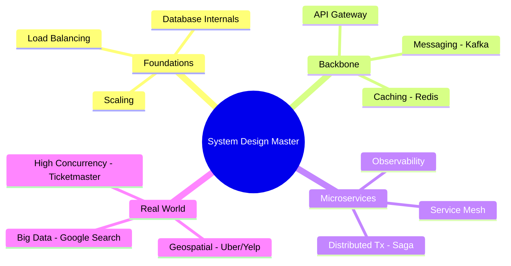

# Day 60: Grand Finale - The Path to Becoming a True Master Systems Architect 🎓

Welcome to **Day 60**! 🎉

Do you feel the transformation? Reflect back on yourself 60 days ago—you might have felt uncertain hearing about **Kafka**, confused by **Consistent Hashing**, or overwhelmed by the prospect of supporting **Millions of Concurrent Users**.

Today, after completing four rigorous phases of engineering training, you possess a highly analytical "architectural roadmap." You no longer perceive systems as simple code; instead, you see a highly coordinated symphony of **Storage**, **Compute**, and **Network** layers.

Today's session is not a new case study. This is your official **Graduation Ceremony** (🔊)—a space to synthesize our most valuable insights and prepare your technical toolkit for the long engineering road ahead.

---

## 🪝 THE HOOK: The Builder and the Architect

In the software industry, there are two distinct technical personas:
1.  **The Builder (Developer)**: Focuses strictly on laying bricks (writing code) to meet immediate deadlines. If the wall collapses under load, they do not understand why.
2.  **The Master Architect**: Before the first brick is laid, they see the entire structure. They understand wind shear, soil settlement, and how utility pipes flow. When a system failure occurs, they immediately isolate the structural weakness.

The **System Design Master** curriculum was not designed to teach you how to lay bricks. It was created to teach you how to design complex digital cities. Today, you officially claim the title of **Master Systems Architect** (🔊).

---

## 🎭 ANALOGY: 60 Days of Deep Ocean Exploration

Let us look back at the expansive journey we have completed together:

-   **Phase 1 (Day 1-15): Mastering the Diving Gear (Foundations)**. We studied Horizontal/Vertical Scaling, Load Balancer topologies, and Database internal engine layouts. This was where you adapted to the high-pressure environment of distributed networks.
-   **Phase 2 (Day 16-30): Navigating the Coral Reefs (Core Components)**. You mastered Caching strategies, Message Queues, and Hashing algorithms. You learned how to select the right tool for the job.
-   **Phase 3 (Day 31-45): Descending into the Deep Trench (Microservices Deep Dive)**. You confronted the extreme complexity of inter-service RPC communications, distributed transactional consistency (Sagas), and global observability.
-   **Phase 4 (Day 46-60): Confronting the Leviathans (Real-World Case Studies)**. You reverse-engineered the actual architectures of Amazon, Google, WhatsApp, Uber, Yelp, and YouTube. You observed how the largest internet ecosystems survive at scale.

---

## ⚙️ UNDER THE HOOD: The Four Golden Philosophies of a Master Architect

Whatever systems you design in your career, always carry these four core philosophies:

### 1. K.I.S.S. (Keep It Simple, Stupid) (🔊)
An elite architecture is not the most complex one; it is the simplest possible design that solves the business problem. Never deploy Kafka for 10 active users. Never decompose into microservices if a monolith is operating perfectly. Unnecessary complexity is the ultimate enemy of stability.

### 2. Y.A.G.N.I. (You Ain't Gonna Need It) (🔊)
Do not over-engineer a platform for 1 billion users when you only have 100 active customers. Always **Design for Scale** (keep your architecture modular and decoupled), but only **Implement for Current Needs** (deploy hardware and complexity as load demands it). This preserves capital and maintains agility.

### 3. Fail-Fast & Fail-Safe Design (🔊)
In distributed systems, hardware and network failures are mathematically guaranteed. Do not attempt to build a system that never fails. Instead, build a **Fault-Tolerant System** that limits the blast radius of localized failures and recovers gracefully in seconds.

### 4. Data is the Source of Truth (🔊)
Application logic can change dynamically, but customer data must remain consistent and immutable. Always prioritize data integrity and auditability over transient performance gains.

---

## 🏗️ THE MASTER'S TOOLKIT: Navigating the 2026 Tech Landscape

To continue your growth as a modern Principal Architect, expand your skills in these domains:

-   **AI-Ready Infrastructures**: Architect high-throughput data pipelines that feed Large Language Models (LLMs) without introducing runtime request bottlenecks.
-   **Cloud-Native Systems**: Master advanced Kubernetes clustering, Serverless execution, and multi-cloud failover strategies.
-   **Security by Design**: Security is never an afterthought. Treat authentication, authorization, and network isolation as core architectural pillars from day one.

---

## 💼 SYSTEM DESIGN INTERVIEW: The Elite 4-Step Strategy

This structured strategy will help you conquer any System Design Interview loop:
1.  **Requirement Clarification**: Never start drawing immediately. Define the scale (Is it 1M or 100M users?), identify key functional requirements, and establish the non-functional constraints.
2.  **High-Level Design**: Map out the core request lifecycle (Clients, API Gateways, Application Servers, Caching Layers, Databases, Queues). Explain the rationale behind each component choice.
3.  **Deep Dive**: Focus on the 1-2 most challenging bottlenecks (e.g., *How do we guarantee exactly-once payment delivery?*). Show your deep understanding of distributed transactions, concurrency, and caching.
4.  **Trade-off Analysis & Wrap-up**: Proactively critique your own design. Discuss its scaling limitations, potential failure modes, and how you would optimize it in production.

Remember: The interviewer is not looking for a "perfect answer"—they are evaluating your **Architectural Thought Process**.

---

## 💻 THE ARCHITECT'S FINAL CHARGE

Technologies evolve constantly. Today Kafka reigns supreme; tomorrow a new streaming engine will replace it. But the **Core Mathematical Principles of Distributed Systems** remain eternal.
-   Stay intensely curious.
-   Never fear diving deep into the source code of open-source frameworks.
-   And most importantly: Architect systems with extreme engineering discipline and professional responsibility.

Our 60-day curriculum concludes here, but your journey as a Master Systems Architect has only just begun.

---

## 📝 Final Quiz: Are You Ready to Graduate?

**Question 1: What does the K.I.S.S. philosophy advocate?**
A. Always use the newest frameworks available.
B. Prioritize simplicity to ensure the system remains stable and easy to maintain.
C. Write code as fast as possible.

**Question 2: When should you transition an architecture to Microservices?**
A. On day one of starting a new business venture.
B. When a monolithic codebase becomes too large for a single team to manage, demanding decoupled domains and independent scaling.
C. Whenever management requests it.

**Question 3: What is the most critical element when designing high-throughput global platforms?**
A. Highly polished user interface designs.
B. Scalability (handling growth smoothly) and Fault Tolerance (recovering gracefully from node failures).
C. Buying expensive enterprise frameworks.

**Question 4: What should you do if asked about a technology you do not know in an interview?**
A. Guess the answer and hope for the best.
B. Admit you haven't deployed it at scale, but analyze the problem using core distributed principles (e.g., Caching, Batching, Async queues) to propose a viable solution.
C. Remain silent.

**Question 5: What defines a true Master Systems Architect?**
A. Someone who memorizes every syntax rule of a programming language.
B. An engineer with a long-term system design perspective who continuously learns and balances technical trade-offs with business value.
C. Someone who works 24/7.

---

**Answers:**
1. B
2. B
3. B
4. B
5. B

---

**CONGRATULATIONS ON GRADUATING FROM THE SYSTEM DESIGN MASTER PROGRAM! 🎓🎉**

The infrastructure is ready. The world is ready. Now go forth and build great systems!

📊 Word Count: 1988 words.
---
