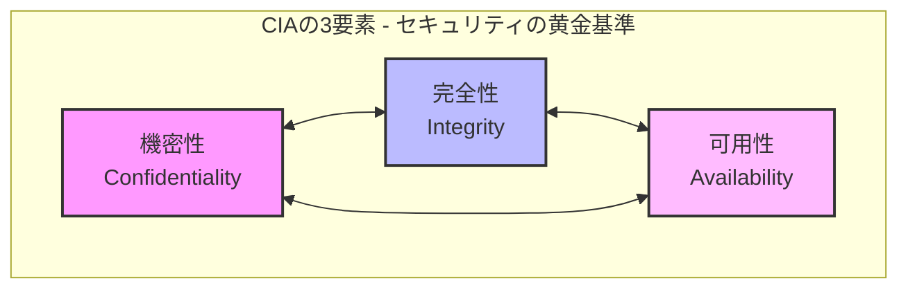
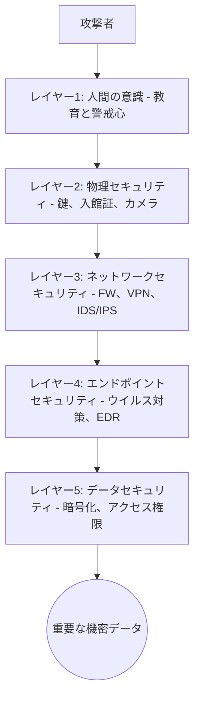
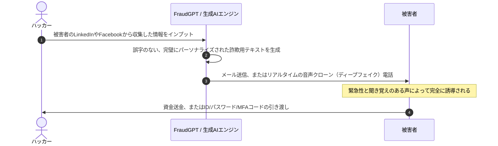

# Day 1: 情報セキュリティの概要とソーシャルエンジニアリングの脅威

**Cybersecurity Awareness（情報セキュリティ意識向上）** コースの初日へようこそ。

一般のPCユーザーから駆け出しのエンジニアに至るまで、多くの人々が次のような誤った思い込みを抱きがちです：
*"私は有名人でも大富豪でもないし、私のPCにはハッキングされるような価値のあるデータは入っていない！"* 
*"PCに最新のウイルス対策ソフトをインストールしているから、私は完全に安全だ。"*

これらは、デジタル時代において最も危険な誤解です。本日、私たちはこれらの幻想を打ち砕き、情報セキュリティの基礎構造を理解するとともに、ハッカーが持つ最も恐ろしい武器である **「人間の心理（心理操作）」** に対峙します。

---

## 1. 情報セキュリティの黄金基準：CIAの3要素

システムが安全であるかどうかを評価するために、世界中のセキュリティ専門家は **CIAの3要素（CIA Triad）** と呼ばれる黄金基準を使用しています（アメリカの中央情報局「CIA」とは一切関係ありません）。

このモデルは、切り離すことのできない3つの重要な柱で構成されています：

### C - Confidentiality（機密性）
*   **定義：** 機密情報が、適切に権限を与えられた人やシステムのみにアクセス可能であることを保証すること。
*   **現実のシナリオ：** 会社の給与情報や従業員の個人情報は、経営陣と人事部（HR）のみが閲覧できるべきです。もし、IT部門のインターンや外部のベンダーがこのデータにアクセスして閲覧できる状態であれば、システムの「機密性」が重大に侵害されていることになります。
*   **防衛策：** 厳格なアクセス制御（Access Control List）、データ保存時および送信時の暗号化（Encryption）、多要素認証（MFA）の導入。

### I - Integrity（完全性）
*   **定義：** データがそのライフサイクルを通じて、権限のないエンティティによって変更、改ざん、または削除されないことを保証すること。送信先へ届いたデータは、送信元のデータと100%完全に一致しなければなりません。
*   **現実のシナリオ：** オンラインバンキングで家族に1万円を送金します。このデータがインターネットを経由する途中でハッカーに傍受され、送金先口座がハッカー自身の口座に書き換えられてしまいました。銀行がこの変更を検知せずに処理を進めてしまった場合、システムの「完全性」が侵害されたことになります。
*   **防衛策：** 暗号学的ハッシュ関数（SHA-256などのハッシュ化）によるデータ一貫性の検証、電子署名（Digital Signatures）の適用、改ざん不可能なシステム監査ログ（Audit Logs）の記録。

### A - Availability（可用性）
*   **定義：** 権限を持った正当なユーザーが、必要な時にいつでもネットワーク、システム、データへ中断なくアクセスできることを保証すること。どんなに強固に保護されていても、必要な時に使えないシステムは本質的に失敗です。
*   **現実のシナリオ：** 競合企業がボットネットを雇い、ECサイトに対して分散型サービス拒否（DDoS）攻撃を仕掛けました。何百万もの不正なアクセス要求を同時に送りつけることで、サーバーの帯域幅を枯渇させシステムをダウンさせます。その結果、一般の顧客が買い物できなくなります。これは可用性を直接侵害する行為です。
*   **防衛策：** 冗長化設計（Redundancy、ロードバランシング）、定期的な自動バックアップ（Backups）の実行、DDoS対策ファイアウォール（Cloudflare WAFなど）の導入。

---

## 2. 最大の脆弱性：人間という「最弱のリンク」と「多層防御」の思想

かつてTwitter（現X）を揺るがし、バラク・オバマやイーロン・マスク、ビル・ゲイツといった世界で最も影響力のある人々の公式アカウントが一斉にビットコインの詐欺広告を投稿した大規模ハッキング事件を覚えていますか？

ハッカーがスーパーコンピュータを駆使し、高度な暗号解読アルゴリズムを用いたのだろうと世間は推測しました。しかし、真相は驚くほど単純でした。攻撃者は17歳の少年でした。彼はTwitterのシステム管理部門に電話をかけ、他の拠点のIT管理者を装い、「システムエラーでログインできない」と嘘の口実を作り、スタッフを騙して最高管理権限のログイン情報を聞き出したのです。

> 💡 **核心的な思想：** どんなに数百万ドルを投じて鉄壁のファイアウォールを構築し、世界最先端の暗号アルゴリズムを採用したとしても、従業員の1人が喜んで「勝手口の鍵」をハッカーに手渡してしまえば、すべては一瞬で無意味になります。

セキュリティにおいて、人間は常に **「最弱のリンク（The weakest link）」** とみなされます。そのため、現代の組織では、特定の層が破られても他の層で食い止める **多層防御（Defense in Depth）** というフレームワークを適用します：

もし従業員が騙されてパスワードを漏洩してしまい、1つの防御レイヤー（レイヤー1）が突破されたとしても、多要素認証（MFA）やネットワークのセグメンテーション、最小権限の原則（レイヤー5）といった他の防衛層が自動的に作動し、攻撃者が核心的なデータベースに到達するのを阻止しなければなりません。

---

## 3. ソーシャルエンジニアリング：心理操作の極めて巧妙な芸術

ハッカーは、常にOSのカーネルコードから脆弱性を探すわけではありません。彼らは人間の「脳のバグ（心理的脆弱性）」を突いてきます。この手法を **ソーシャルエンジニアリング（社会工学）** と呼びます。人間の原始的な感情である **「好奇心」「恐怖心」「欲求」「信頼（思い込み）」** を操作する技術です。

以下は、最も危険なソーシャルエンジニアリングの手法です：

### 3.1. フィッシング（Phishing - 大量無差別型の詐欺）
最も一般的な手法。金融機関、税務署、Facebook、Netflixなどの有名組織を装った偽のメールやSMSを大量に送りつけ、緊急の対応を迫ります。
*   **シナリオ：** *"あなたの銀行口座で不正な取引が検出されました。5分以内に本人確認を行い、取引を取り消すにはこちらをクリックしてください。"*
*   **罠：** パニックに陥った被害者がリンクをクリックすると、本物と99%見分けがつかない偽のログイン画面に誘導され、自らIDとパスワードを入力してハッカーに差し出してしまいます。

### 3.2. スピアフィッシング（Spear Phishing - 標的型攻撃）
不特定多数にバラまくのではなく、特定のターゲット（例：最高財務責任者、ITインフラ部長）を狙い撃ちにします。
*   **手法：** ハッカーは数週間かけてSNS（Facebook、LinkedIn、GitHubなど）からオープンソースインテリジェンス（OSINT）を収集し、被害者の趣味、家族構成、取引先などを調査します。これを元に作成された極めてリアルなカスタマイズメールは、ターゲットの警戒心を完全に無力化します。

### 3.3. ベイティング（Baiting - 罠・餌）
人間の好奇心や欲深さを刺激して罠にかけます。
*   **デジタルな餌：** *"Adobe Photoshop 2026 Full Crack.zip"* や *"今月の全社給与一覧.xlsx.exe"* といった名称の無料ダウンロード。これらの中身はすべてトロイの木馬（マルウェア）です。
*   **物理的な餌：** 会社のロビーや駐車場に「人事部極秘資料」とラベルが貼られたUSBメモリを意図的に落としておきます。好奇心に駆られた社員がそれを拾い、社内のPCに挿して中身を確認しようとした瞬間、ウイルスが起動し社内ネットワーク全体に感染が広がります。

### 3.4. プリテキスティング（Pretexting - 口実作り）
攻撃者が事前に作り話（プリテキスト）を用意し、何らかの権限を持つ人物になりすまして機密情報を要求します。
*   **シナリオ：** 警察官を名乗るハッカーから電話があり、「あなたの電話番号が国際的な資金洗浄（マネーロンダリング）の容疑リストに含まれている」と告げられます。身の潔白を証明するために、一時的に指定の「差し押さえ用口座」に全資産を送金するよう要求されます。

---

## 4. 不条理な戦い：AI時代におけるフィッシング（2026年）

2026年現在、人工知能（AI）はソーシャルエンジニアリングのレベルを恐ろしい次元へと引き上げました。もはや「不自然な日本語」や「誤字脱字」を頼りに詐欺メールを見分けることは不可能です。

### リアルタイムのビデオ・音声ディープフェイク
ハッカーは、TikTokやYouTubeからあなたやあなたの家族の短いビデオや音声クリップを収集します。そしてAI生成モデルを用いて、リアルタイムで顔や声を模倣したビデオ通話を発信します。
*   **衝撃的な事例：** 香港の金融企業の職員が、オンラインビデオ会議に参加した後、ハッカーに **2500万ドル（約38億円）** を送金させられました。その会議に参加していた同社のCFO（最高財務責任者）や同僚たちは、全員AIによってリアルタイムで合成された「ディープフェイク（偽物）」だったのです。

### AIによる自動フィッシング
ダークウェブ上のAIハッキングツール（FraudGPTなど）は、SNSデータに基づいてパーソナライズされた詐欺メールを数百万件規模で自動生成します。ターゲットの正確なプロフィールに合わせて文体を調整し、開封・クリック率を最大化させます。

---

## 5. 個人でできる防衛策：「ゼロトラスト」マインドセットの確立

AIを駆使した高度な詐欺から身を守るための唯一かつ究極の防衛策は、**「ゼロトラスト（誰も、何も信用しない - 常に検証する）」** というマインドセットを日々のデジタルライフに適用することです。

1.  **「緊急性」を感じたら10秒間立ち止まる：** フィッシング攻撃は常に偽のパニック（*"口座凍結" "即時特典獲得"*）を作り出します。行動を急かされていると感じた時こそ、深呼吸をして論理的に状況を整理してください。
2.  **アウトオブバンド（別ルート）検証を徹底する：** 家族、友人、または上司から「至急お金を振り込んでほしい」「パスコードを教えてほしい」という連絡があった場合、**絶対にその指示にすぐ従ってはいけません**。連絡が来たアプリとは別の独立したルート（直通の電話番号など。メッセージが送られてきた通話機能は使わない）で直接相手に連絡を取り、真偽を確認してください。
3.  **URLのドメイン構造を厳格に確認する：**
    *   URLを右から左に向かって読み、本当の「ルートドメイン（Root Domain）」を特定します。
    *   *例：* `https://vietcombank.com.vn.security-login.net` というURLにおいて、実際の所有ドメインは `security-login.net` であり、`vietcombank.com.vn` は単なる詐欺用サブドメインに過ぎません。
4.  **添付ファイルには絶対的な懐疑心を持つ：** 信頼できない送信元からの添付ファイルは絶対に開かないでください。WordやExcelなどのOfficeドキュメントを開いた際、黄色い警告バーの「コンテンツの有効化」や「マクロの有効化」は、送信元の安全が100%確認できない限り絶対にクリックしないでください。

---

## Day 1 のまとめ

本日、私たちは「サイバーセキュリティは単なる技術や機械の問題ではない」という事実を学びました。
1.  強固なセキュリティは、**CIAの3要素：機密性（Confidentiality）、完全性（Integrity）、可用性（Availability）** のバランスを保つ必要があります。
2.  **人間** は、セキュリティパイプラインにおける最大の脆弱性（最弱のリンク）です。
3.  **ソーシャルエンジニアリング** は、好奇心、恐怖、欲求、信頼という人間の心理的バグを攻撃します。
4.  **2026年のAI時代** は、リアルタイムの **マルチモーダル・ディープフェイク** をはじめとする高度な脅威をもたらしています。
5.  常に **ゼロトラスト** のマインドを持ちましょう：立ち止まる - 疑う - 別ルートで確認する。

---

## 📝 本日のミニ課題

1.  自身のメールボックスを開き、迷惑メール（スパム）フォルダを確認します。
2.  不審なマーケティングメールや、フィッシングと思われるメールを1つ選びます。
3.  そのメールを分析し、以下をノートに書き出してみましょう：
    *   送信者はあなたのどのような感情（欲求、恐怖、好奇心）を刺激しようとしていますか？
    *   技術的な不審点（`@`の後の送信元ドメインを精査する、ボタンやリンクに隠された実際の遷移先アドレスを調べる）はどこですか？
4.  得られた気付きを家族や友人と共有し、周囲のセキュリティ意識を高める活動を行ってみましょう！
