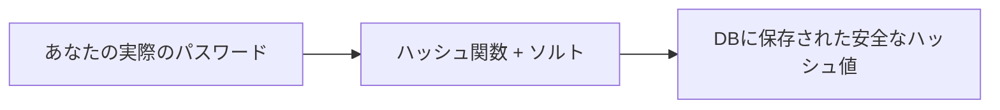
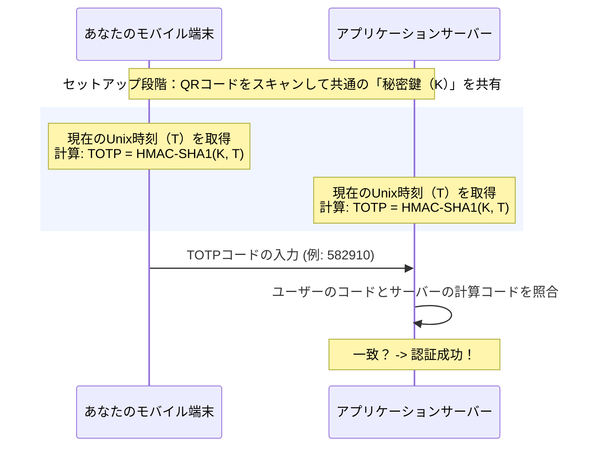
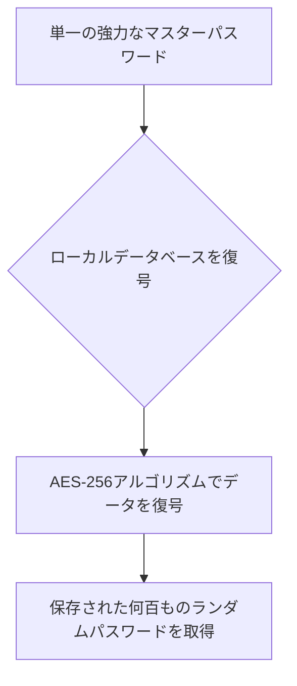
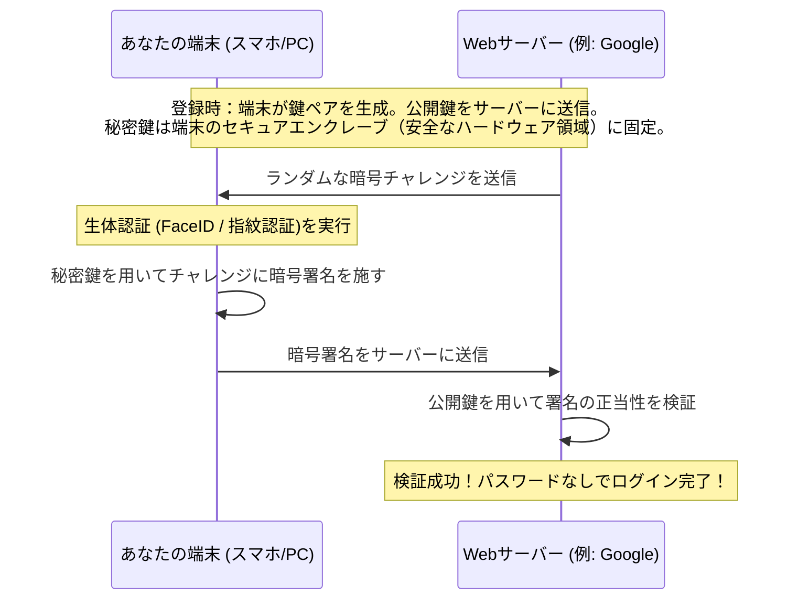

# Day 2: アイデンティティ & アクセス管理（IAM）

おかえりなさい！昨日は「人間こそがセキュリティの最弱のリンクである」ことを学びました。では、ハッカーが私たちを攻撃する際、最も頻繁に利用する「玄関口」はどこでしょうか？その答えは明確です。**「ログイン画面」** です。

2026年現在、`123456` や `password123` のようなパスワードを設定することは、単なる「無知」ではなく、「デジタル社会における自殺行為」に他なりません。本日私たちは、本人確認（認証）の技術的本質、ハッカーの突破手法、そして最新技術を用いて破られない防御陣地を築く方法を深く探求します。

---

## 1. パスワードの本質とハッカーの「解読手法」

技術的な観点から言うと、ウェブサイトでパスワードを入力する際、安全に設計されたサーバーはあなたの実際のパスワード（平文 - Plain text）をそのまま保存することはありません。代わりに、パスワードをハッシュ関数（bcryptやArgon2など）に通して生成された一方向の暗号文字列である **「ハッシュ値」** のみを保存します。

ログインしようとする際、システムは入力されたパスワードを同じ関数でハッシュ化し、データベースに保存されているハッシュ値と比較します。両者が一致すれば、アクセスが許可されます。

しかし、ハッカーはアカウントを乗っ取るために、これらの複雑な暗号数式を解読する必要はありません。彼らはより野蛮で、かつ非常に効率的な攻撃手法を用いてきます。

### 1.1. 総当たり攻撃（ブルートフォース攻撃 - Brute Force）
専用の超高速ハッキングマシンを用いて、可能性のあるすべての文字の組み合わせ（例：aaaa, aaab, aaac...）を片っ端から試す手法です。
*   **2026年の現実：** グラフィックボード（GPU）の並外れた進化と、分散型の量子耐性コンピューティングにより、ハッシュ値の計算速度は毎秒数百億回に達しています。英大文字・小文字・数字が混在した8桁のパスワードであれば、**0.5秒未満** で突破されてしまいます。
*   **防御戦略：** パスワードの長さを12桁に増やすだけで、解読に必要な最小時間は約 **100年** に跳ね上がります。つまり、パスワードにおいては文字の「複雑さ（記号の混在など）」よりも **「長さ」** のほうが圧倒的に重要なのです。

### 1.2. 辞書攻撃（Dictionary Attack）とレインボーテーブル（Rainbow Tables）
ランダムに試す無駄を省くため、ハッカーは過去の漏洩事件から収集された「世界で最も頻繁に使われるパスワード」を網羅した数千万行におよぶ「辞書」リストを使用します。
*   **レインボーテーブル：** 数十億件の一般的なパスワードと、それに対応するハッシュ値をあらかじめペアにして計算・整理した巨大なデータベースです。もし漏洩したデータベースが、ハッシュ化の前に **ソルト（Salt - パスワードにランダムな文字列を付加する処理）** を施していなかった場合、ハッカーはレインボーテーブルを照合するだけで、一瞬にしてハッシュ値を平文パスワードに逆変換できてしまいます。

### 1.3. パスワードリスト攻撃（クレデンシャルスタッフィング - Credential Stuffing）
これは、**「複数のサービスで同じパスワードを使い回す」という悪習慣が生む最悪の連鎖崩壊** です。
1.  ハッカーは、セキュリティの甘い小規模なウェブサイト（例：2018年に登録した趣味のフォーラム）をハッキングし、メールアドレスとパスワードのリストを盗み出します。
2.  自動化ツール（Sentry MBAなど）を用いて、その盗んだアカウント情報のペアを、Gmail、Facebook、Binance、PayPalなどの大手主要サービスに一斉に自動注入（Stuffing）します。
3.  同じパスワードを使い回していた場合、無関係な小規模フォーラムの漏洩が原因で、あなたの全財産や主要なアカウントが芋づる式に乗っ取られます。

---

## 2. 多要素認証（MFA/2FA）：防衛シールドの徹底解剖

従来のパスワードは容易に漏洩するため、第二の防衛線の構築が不可欠です。**多要素認証（MFA）** は、ユーザーに対して以下の3つの要素のうち、少なくとも2つ以上の証拠の提示を求めます：
1.  **知っていること（Knowledge）：** パスワード、PIN、秘密の質問。
2.  **持っていること（Possession）：** ワンタイムパスワード（OTP）を受け取るスマートフォン、物理セキュリティキー。
3.  **あなた自身であること（Inherence）：** 生体情報（指紋、顔認証/FaceID）。

ただし、2FAの手法がすべて同じセキュリティ強度を持っているわけではありません。以下に弱いものから強いものへと順に分析します：

### レベル1：SMS OTP（脆弱 - リスク高）
携帯電話のSMS経由で認証コードを送信する手法。
*   **SIMスワップ（SIM Swap）の脆弱性：** ハッカーはソーシャルエンジニアリングであなたの電話番号、生年月日、身分証明書情報を収集します。その後、携帯キャリアにあなたを装って電話をかけ、「携帯を紛失した」と偽りSIMカードの再発行を申請します。ハッカーの端末で新しいSIMが有効化された瞬間、あなたの本物の端末は電波を失います。以降、銀行からのOTPコードなどはすべてハッカーの端末に転送されることになります。

### レベル2：TOTP（時間ベースワンタイムパスワード - 安全性：中〜高）
Google AuthenticatorやBitwardenなどの専用認証アプリを使用します。

*   **メリット：** コードは、現在の時刻情報と最初に共有した **秘密鍵（Secret Key）** に基づいて、端末上で完全オフラインで計算されます。モバイル通信網の電波を使用しないため、SIMスワップ攻撃に対して完全に無敵です。
*   **脆弱性：** フィッシングサイトに引っかかった場合、TOTPも突破される可能性があります。ユーザーが偽サイトにTOTPコードを入力してしまうと、ハッカーの自動化スクリプトがそのコードを傍受し、30秒の有効期限が切れる前に本物のサイトへ送信してログインされてしまいます。

### レベル3：FIDO2 / 物理セキュリティキー（最強・絶対的な安全）
USBポートに挿入するか、NFCでスマートフォンにかざす物理セキュリティキー（YubiKeyなど）。
*   **WebAuthnの仕組み：** 公開鍵暗号に基づいています。認証時、ブラウザは現在アクセスしているウェブサイトのドメイン（送信元）の情報をセキュリティキーに送信します。キーはこのドメインを自身の安全な領域に保存されている登録情報と照合します。もし偽サイト（例：`facebook.com` ではなく `faceb00k.com`）であることを検知した場合、キーは暗号署名の作成を拒否します。
*   **メリット：** 100%フィッシング耐性があります。ユーザーが偽サイトに騙されて自らログイン情報を差し出そうとしても、物理キーがプロトコル層で処理を自動的に遮断します。

---

## 3. パスワードマネージャー：複雑な管理を機械に任せる

人間は生物学的に、アカウントごとに異なる `*uR8&pA$vW2!pQ` のようなランダムで複雑な文字列を何百個も記憶するようには設計されていません。この仕事は機械に任せましょう。

**1Password** や **Bitwarden**（無料・オープンソース）などの信頼できるアプリケーションは、最も安全なデジタル金庫として機能します：

*   **ゼロナレッジ（知識ゼロ）アーキテクチャ：** あなたの金庫に保存されているすべてのパスワードは、クラウドに同期される前に、軍用レベルの暗号規格 **AES-256** を用いて端末上でローカルに暗号化されます。暗号を解く唯一の鍵は、あなたの頭の中にある **マスターパスワード** のみです。サービスの運営会社のサーバーがハッキングされたとしても、攻撃者が手にするのは解読不可能な単なる暗号化データの塊です。
*   **メリット：** 覚える必要があるのは、1つの強力なマスターパスワードだけです。他のすべてのアカウントには20文字以上のランダムなパスワードを自動生成させ、ログイン時には自動入力（Autofill）させることで、キーロガーによる入力情報の傍受も防ぐことができます。

---

## 4. パスキー（Passkeys）：パスワードレス時代の到来（2026年）

パスワードは、ITの歴史において最悪のデザインの一つです。2026年現在、Apple、Google、Microsoftなどの巨大テック企業とFIDOアライアンスが連携し、従来のパスワードを廃止して **パスキー（Passkeys）** へ完全に移行する動きが進んでいます。

### パスキーの仕組み
パスキーは、**「公開鍵暗号（非対称暗号）」** の基礎に基づいて動作します：

1.  **公開鍵（Public Key）：** ウェブサイトのデータベース側に保存されます。
2.  **秘密鍵（Private Key）：** あなたのスマホやPCに搭載されているセキュリティチップ（セキュアエンクレーブ）に厳重に保存され、いかなる場合も端末の外に出ることはありません。
3.  **摩擦のない認証：** ログイン時は、端末で顔認証（FaceID）や指紋センサーに触れるだけです。秘密鍵がローカルで署名処理を瞬時に行い、一瞬でログインが完了します。

### なぜパスキーが絶対的な保護となるのか？
*   **フィッシング不可能：** 文字を入力する処理が存在しないため、偽のサイトにパスワードを入力してしまうリスクそのものが消滅します。ブラウザが認識したドメインと、登録されている送信元のURLが厳密に一致しない限り、端末は署名を拒否します。
*   **サーバー漏洩への耐性：** FacebookやGoogleのサーバーがハッキングされ、データベースが流出したとしても、ハッカーが入手できるのは公開鍵だけです。これは、あなたの手元にある物理デバイスに保存された秘密鍵がなければ、完全に無価値なデータです。

---

## 5. 必須の「パスワード衛生管理」ルール

世界がパスキーへと移行しつつある過渡期の今も、多くのサイトで従来のパスワードを使用せざるを得ません。以下の衛生ルールを厳格に守りましょう：

1.  **「使い回しゼロ」ルール：** すべてのアカウントに固有のパスワードを設定します。GmailのパスワードをSNSや銀行、その他フォーラムで絶対に使い回してはいけません。
2.  **パスフレーズ（Passphrase）の活用：** `B@0m@t!123` のような覚えにくいパスワードではなく、ランダムな言葉を4つ以上つなぎ合わせたパスフレーズを使用しましょう（例：`water-bench-green-dancing`）。このパスフレーズは長さが26文字もあり、ブルートフォース攻撃での解読に何億年もかかる強度を誇る一方、ビジュアル的に脳内で関連付けやすいため非常に覚えやすい特徴があります。
3.  **情報漏洩の確認：** セキュリティ研究者Troy Hunt氏が運営する安全なサービス `haveibeenpwned.com` に定期的に自分のアドレスを入力し、過去のグローバルな漏洩事件で自身のアカウントが流出していないか確認し、迅速にパスワードを変更しましょう。

---

## Day 2 のまとめ

1.  パスワード強度においては、記号の複雑さよりも **「長さ（パスフレーズ）」** が圧倒的に重要です。
2.  **パスワードリスト攻撃** は、使い回されたパスワードを突いて複数のアカウントを連鎖的に破壊します。
3.  **多要素認証（MFA）** は必須です。**TOTP**（認証アプリ）と **FIDO2**（物理キー）が最も信頼性の高い防御手段です。
4.  **パスワードマネージャー** は、**ゼロナレッジ** 技術を用いて安全にパスワードを自動生成・保管します。
5.  **パスキー** は公開鍵暗号を採用し、パスワードそのものを不要にすることでフィッシングを根絶します。

---

## 📝 本日のミニ課題

1.  スマートフォンまたはPCに **Bitwarden**（無料版）をダウンロードしてインストールします。
2.  **パスフレーズ手法**（ランダムな言葉を4つ以上つなげる）を用いて、非常に強力なマスターパスワードを作成します（例：`teacup-coffee-airplane-beautiful`）。このマスターパスワードは紙のノートに書き留めて安全な場所に保管し、絶対にデジタル端末内に平文で保存しないでください。
3.  自身の重要なアカウントを1つ選び、Bitwardenが自動生成した24文字のランダムパスワードに変更します。
4.  そのアカウントで2要素認証（2FA）を有効にし、認証アプリでQRコードを読み込み、提供される「バックアップコード（回復コード）」を安全に保存します。
