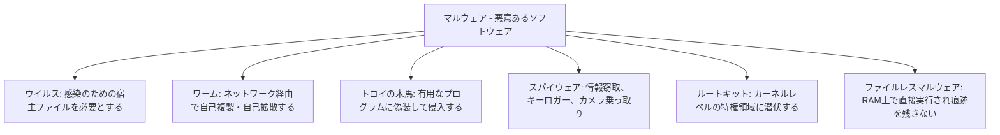
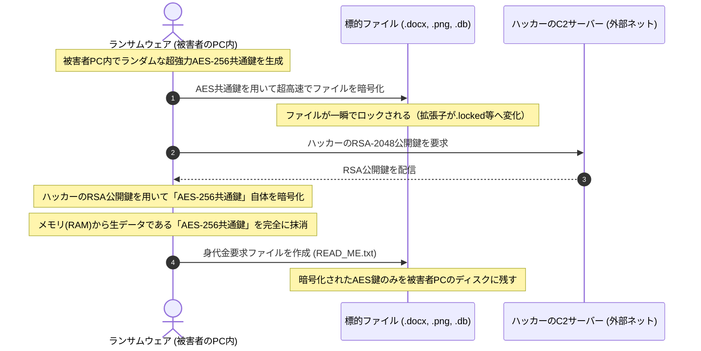
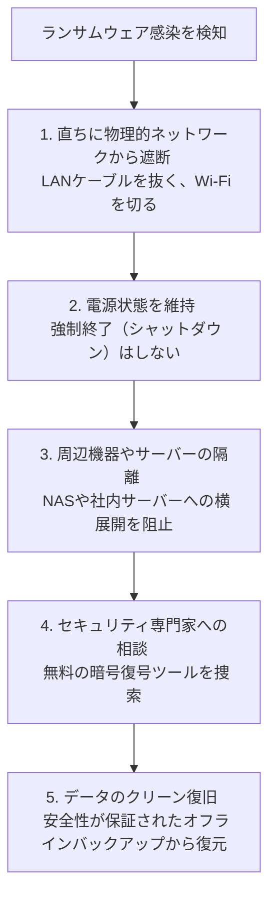

# Day 3: マルウェア & ランサムウェア - デジタル脅迫の大流行

Day 3へようこそ！本日は、攻撃者がデバイスやシステムを標的に直接攻撃を仕掛けるために使用する「デジタル兵器」、**マルウェア（Malware）** について学びます。

現代のデジタル時代において、マルウェアはもはや「PCの動作を遅くする」「ポップアップ広告を乱発する」「愉快犯的にOSを破壊する」といった単純なものではありません。国家レベルの支援を受けた高度なサイバースパイ活動ツールとして進化し、知的財産を盗み出すためにOSのカーネルレベルで隠密動作したり、企業の全データを暗号化して人質に取り、数百万ドル相当の暗号資産（仮想通貨）を要求する巨額の脅迫ビジネスに変貌しています。

---

## 1. マルウェアとは何か？悪意あるプログラムの分類

**マルウェア（Malware）** とは、**Malicious Software（悪意あるソフトウェア）** の略称です。これは、コンピュータ、サーバー、モバイル端末、またはネットワーク全体に対して侵害、妨害、あるいは損害を与えることを目的に設計されたあらゆるプログラム、スクリプト、実行ファイルを指す総称です。

最も危険なマルウェアのカテゴリーを、技術的観点から徹底的に解剖します：

### 1.1. ウイルス（Virus）とワーム（Worm）
*   **ウイルス：** 生存および実行のために「宿主」（`.exe`や`.docx`、`.pdf`などの正常な実行ファイルやドキュメント）を必要とする悪意あるコード片。ユーザー自身が感染ファイルをダブルクリックするなどの「人間のアクション」が引き金となり活性化・拡散します。
*   **ワーム：** ウイルスよりもはるかに危険です。ワームは宿主ファイルを必要としない独立したプログラムであり、ネットワーク上の脆弱性（悪名高い EternalBlue 脆弱性など）を悪用して、LANやWi-Fi経由で他のPCへ自動的に自己複製および横展開（ラテラルムーブメント）します。人間の介入は一切不要です。

### 1.2. トロイの木馬（Trojan Horse）とバックドア（Backdoor）
ギリシャ神話に由来する名の通り、安全で便利なユーティリティツール（ゲームのクラック、無料の動画編集ソフト、偽のPDF請求書など）に偽装して侵入します。実行されると、裏でこっそり **バックドア（勝手口）** を構築し、ハッカーがインターネット経由で端末の管理者権限を遠隔掌握できるようにします。

### 1.3. スパイウェア（Spyware）
被害者に気づかれないよう、システムのバックグラウンドで完全に隠密動作します：
*   **キーロガー（Keylogger）：** キーボードの打鍵ログをすべて記録します。ハッカーはキーロガーを用いて、ブラウザ上で入力されたID、パスワード、クレジットカード番号を正確に窃取します。
*   **カムジャッキング（Cam-jacking）：** デバイスのWebカメラやマイクの制御権を密かに乗っ取り、被害者のプライベートな様子を無断で撮影・録音し、脅迫や諜報活動のために外部へ送信（エクスフィルトレーション）します。

### 1.4. ルートキット（Rootkit）：闇に潜む透明人間
ルートキットは、極めて追跡が困難な最高峰の隠蔽型マルウェアです。OSの心臓部である **「カーネル（Kernel - リング0領域）」** に深くインストールされます。この超特権レイヤーから、自身のプロセス、ファイル、ネットワークポートを隠すようにOS自体のシステムコールを書き換えます。ユーザー空間（User space）で動作する一般のウイルス対策ソフトは、ルートキットを完全に検知し損ねます。

### 1.5. ファイルレスマルウェア（Fileless Malware）
これは近年の標的型攻撃における最も洗練されたトレンドです。従来のマルウェアのようにハードディスクに悪意ある実行ファイルを書き込むのではなく、OSが元から持っている信頼された正規ツール（WindowsのPowerShellやWMIなど）を悪用し、悪意あるコードを直接 **「RAM（メモリ）」** 上へ読み込ませて実行します。ディスクにファイルが残らないため、ファイルのシグネチャ（特徴）に依存する従来のセキュリティ製品を完全にバイパスします。

---

## 2. ランサムウェア：ハイブリッド暗号化と脅迫プロセスの全貌

**ランサムウェア（Ransomware - 身代金要求型ウイルス）** は、今日の個人および企業にとって最大のサイバー財務脅威です。システムへの侵入に成功すると、ローカルのハードディスクや共有ネットワークフォルダをスキャンし、すべての重要なデータ（ドキュメント、データベース、ソースコード、メディア）を暗号化（ロック）して無意味な文字列に書き換えてしまいます。

### 🛠️ 暗号解読を不可能にする「ハイブリッド暗号化（Hybrid Encryption）」の仕組み
なぜランサムウェアは、何テラバイトもの企業のデータを数分で超高速にロックでき、かつ世界中の暗号解読の専門家でさえも身代金を支払わずに復号することができないのでしょうか？それは、非常によく計算された **「ハイブリッド暗号化」** プロセスに秘密があります：

1.  **共通鍵暗号（Symmetric Encryption）による超高速ロック：** ランサムウェアは被害者のPC内で、ランダムな **AES-256共通鍵** を生成します。共通鍵暗号方式は処理が極めて高速であるため、ユーザーがPCのパフォーマンス低下に気づく前に、数百万のファイルを数分でロックできます。
2.  **公開鍵暗号（Asymmetric Encryption）による鍵の完全保護：** 暗号化が完了した後、被害者がメモリ（RAM）から元のAES共通鍵を取り出して復号するのを防ぐため、ハッカーの **RSA-2048公開鍵**（あらかじめマルウェアに埋め込まれているか、外部のC2サーバーから取得したもの）を使用して、AES共通鍵自体を暗号化します。
3.  **痕跡の完全消去：** 生のAES共通鍵は被害者PCのメモリ上から完全に消去されます。暗号化されたAES鍵は、ハッカーの厳重なサーバー上にのみ存在する **RSA秘密鍵** がなければ二度と復号できません。

---

## 3. インシデント対応プレイブック：感染時の緊急初動対応

ある日突然、画面が真っ黒になり、ビットコインでの身代金を要求する警告文が表示された場合、パニックにならず、直ちに以下の緊急インシデント対応プロトコルを実行してください：

1.  **直ちに物理的ネットワークから遮断（LANケーブルを抜く／Wi-FiをOFF）：** これが最も重要な最初のステップです。ランサムウェアはローカルディスクの暗号化を終えると、即座にLAN内を走査してネットワークストレージ（NAS）やドメインコントローラなどへ感染を広げようとします。物理的に遮断することで被害の拡大を防ぎます。
2.  **絶対にPCの電源を強制終了しない：** 多くの人がパニックに陥り、電源ボタンを長押ししてPCを消そうとします。しかし、これを行うとメモリ（RAM）上のデータが完全に消えてしまいます。セキュリティの専門家は、メモリ上に残された「生のAES共通鍵」を抽出するために **「RAMダンプ」** というメモリ解析作業を必要とすることが多いため、電源を切ることは復旧のチャンスを自ら潰すことになります。
3.  **絶対に身代金を支払わない：**
    *   支払ったとしても復号キーが本当に送られてくる保証はありません。
    *   身代金を支払うと、「カモ」として認識され、将来再び攻撃の標的になります。
    *   支払われた資金は、新たなマルウェア開発やサイバー犯罪組織の活動資金として直接使われます。

---

## 4. 災害復旧戦略：3-2-1バックアップルールと不変バックアップ

ランサムウェアによる金銭的脅迫に対して完全に「無敵」でいられる唯一の方法は、科学的に裏付けられたデータ復旧モデル **「3-2-1バックアップルール」** を構築することです。

*   **3（データのコピーを少なくとも3つ保持する）：** アクティブな業務データ1つと、2つの別個のバックアップコピー。
*   **2（バックアップを2種類の異なるメディアに保存する）：** 例えば、1つは外付けSSDに保存し、もう1つはクラウドストレージ（AWS S3やGoogle Cloud Storageなど）に保存して、物理的な機器故障に備えます。
*   **1（少なくとも1つのバックアップを完全に「オフライン（物理隔離 - エアギャップ）」で保持する）：** このオフライン用バックアップは、同期が終わった後はPCやインターネットから完全に物理的に切り離す必要があります。外付けHDDが常にPCに接続されたままになっていると、PCが感染した際にバックアップごと暗号化されてしまいます。
*   **不変バックアップ（Immutable Backup）：** 企業インフラにおいては、クラウドストレージの **WORM（Write Once, Read Many）機能** を導入します。これにより、データが一度バックアップされると、たとえ管理者アカウント（Admin）が乗っ取られたとしても、事前に設定した期間内は誰もそのバックアップデータを変更・上書き・削除することはできなくなります。

---

## Day 3 のまとめ

1.  **マルウェア** は、宿主が必要なウイルス、自己増殖するワーム、無害を装うトロイの木馬、盗聴するスパイウェア、OS深部に潜むルートキット、メモリ上で動くファイルレスなど多岐にわたります。
2.  **ランサムウェア** は、**ハイブリッド暗号化（AES-256 + RSA-2048）** を駆使して高速にデータを暗号化し、復号鍵を完全にハッカーの管理下に置きます。
3.  感染を検知した際の最優先事項は、社内ネットワークやNASを守るための **「迅速なネットワーク物理隔離」** です。
4.  **「3-2-1バックアップルール」** に従い、少なくとも **1つの完全オフライン（エアギャップ）コピー** を持つことが、ランサムウェアに対する唯一の絶対的防衛策です。

---

## 📝 本日のミニ課題

1.  自身の最も大切なデータ（家族の写真、大学の課題、卒業論文、あるいは開発中のソースコードなど）を確認します。
2.  物理的な外部ストレージ（USBメモリ、外付けHDD/SSD）を用意します。
3.  上記の大切なデータを、そのストレージへすべてコピーします。
4.  コピーが完了したら、OS上で安全にハードウェアの取り外し（Eject）を行い、**PCからケーブルを抜いて** 引き出しなどの安全な場所に保管してください。これで、あなたの大切なデジタル資産を守る **「エアギャップ（物理隔離）バックアップ」** が見事に完了しました！
