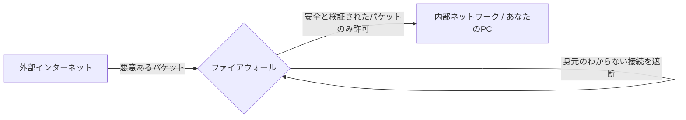
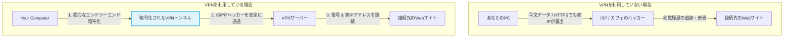

# Day 4: ネットワークセキュリティ & VPN - 通信データの保護

Day 4へようこそ！マルウェアからPCの「内部」を守る方法（Day 3）と、ログイン情報を安全に管理する方法（Day 2）を学んだ私たちは、本日、より広い外部の世界へと一歩を踏み出します。**「インターネット上を流れるデータの保護」** です。

あなたがWebサイトにアクセスしたり、メッセージを送信したり、オンライン決済を行ったりする際、データは目的地へ直接飛んでいくわけではありません。データは細切れの「パケット（Packets）」に分割され、カフェのWi-Fiルーター、インターネットプロバイダー（ISP）の通信設備、そして世界中のルーターなどの数十の中継地点を経由します。強固な通信保護がなければ、データは移動中に簡単に傍受され、改ざんされ、あるいは盗み出されてしまいます。

---

## 1. パブリックWi-Fiの脅威と経路上でのハッキング手法

空港、ホテル、カフェなどで提供される「無料Wi-Fi（公衆無線LAN）」は極めて脆弱な環境であり、ハッカーがデータ傍受の罠を仕掛ける格好の舞台となっています。

### 1.1. 中間者攻撃（Man-in-the-Middle - MitM）
攻撃者があなたのデバイスとインターネットゲートウェイの間に割って入り、通信データを盗み見たり（傍受）、勝手に書き換えたり（改ざん）する攻撃手法です。

```mermaid
graph TD
    User[あなたのモバイル端末] -->|パスワードやカード情報を送信| Hacker[ハッカーのPC <br> 中間者攻撃 - MitM]
    Hacker -->|改ざんしたデータを転送| Web[正規のオンライン銀行Webサーバー]
    Web -->|取引応答を返却| Hacker
    Hacker -->|応答を転送| User
    Note over Hacker: ハッカーは経路上を流れるすべての平文データを読み取る
```

*   **偽アクセスポイント（悪魔の双子 - Rogue Access Point / Evil Twin）：** 攻撃者は自身で用意した偽のWi-Fiルーターを設置し、その店舗のWi-Fiと全く同じ名前（例：`Cafe_Guest_Free`）を割り当てます。あなたが誤ってそのWi-Fiに接続してしまうと、すべてのデータがハッカーのPCを経由してインターネットへ送信されるため、閲覧履歴やCookie、ID・パスワードなどをすべて収集されてしまいます。
*   **ARPスプーフィング（ARPなりすまし攻撃）：** 仮に本物のWi-Fiルーターに接続していたとしても、隣の席に座るハッカーが専用ツールを使い、ネットワーク上に偽のARPパケット（アドレス解決プロトコル）を大量に流すことがあります。これにより、ルーターに対して「ハッカーのPCこそがあなたのPCである」と誤認させます。結果として、あなた宛ての全データがハッカーのPCへとルーティングされてしまいます。

### 1.2. パケットスニッフィング（パケット盗聴）
専用のネットワーク解析ツール（**Wireshark** など）を使用すると、周囲の無線デバイスから空中に放出されている未暗号のデータパケットを傍受・収集することができます。アクセスしているサイトが暗号化されていないプロトコル（HTTPSではなくHTTP）を使用している場合、入力されたID、チャットログ、セッションCookieはすべて平文（Plain text）として表示され、周囲のハッカーに筒抜けになります。

---

## 2. ファイアウォール（防火壁）：ネットワーク境界の門番

**ファイアウォール（Firewall）** は、あなたのシステムやネットワークの境界に立ちはだかる厳格な警備員のように機能し、あらかじめ定義されたセキュリティルールに基づいて、すべての入出力データパケットを厳密に検査します。



ネットワークセキュリティにおいて、主に以下の3つのカテゴリーのファイアウォールが展開されています：
*   **パケットフィルタリング型ファイアウォール：** 最も基本的な階層。パケットのヘッダー情報（送信元IPアドレス、宛先IPアドレス、ポート番号など）を検査します。ブラックリストに登録されたIPアドレスからのパケットは即座に破棄されます。
*   **ステートフルインスペクション型ファイアウォール：** 接続の状態（ステート）を動的に追跡する高度なファイアウォール。内部のPCから開始された接続要求に対する「正当な応答パケット」のみを外部のインターネットから通過させます。
*   **WAF (Webアプリケーションファイアウォール)：** アプリケーションレイヤー（OSI参照モデルの第7層）で動作する専用のファイアウォール。HTTP/HTTPSパケットのペイロード（中身）を詳細に解析し、SQLインジェクションやクロスサイトスクリプティング（XSS）などのWeb特有の脆弱性を突く攻撃を検知・遮断します。

---

## 3. VPN（仮想プライベートネットワーク）：安全な暗号化トンネルの構築

**VPN（Virtual Private Network）** は、パブリックWi-Fiのような信頼できないネットワーク環境を利用せざるを得ない場合において、通信データを保護するための究極のソリューションです。

### ネットワークルーティングの比較：VPNなし vs. VPNあり



VPNを起動すると：
1.  **トンネリング（Tunneling）：** VPNクライアントがVPNサーバーとの間に安全な直通通信路（トンネル）を確立し、データをカプセル化して転送します。
2.  **エンドツーエンド暗号化（End-to-End Encryption）：** 通信データは送信前にあなたの端末上でローカルに暗号化されます。経路上でパケットが盗聴されたり、ISP（プロバイダー）が通信ログを監視したとしても、解読不可能な単なる暗号文字列しか見えません。
3.  **IPアドレスの隠蔽（匿名化）：** パケットがVPNサーバーに到達すると、サーバー側で暗号が解除されて接続先のWebサイトへ転送されます。接続先のサイトには、あなたの実際のIPアドレスや物理的な現在地ではなく、VPNサーバーのIPアドレスとロケーション情報しか見えません。

### 2026年現在の主要なVPNプロトコル：
*   **WireGuard (強く推奨)：** 最新鋭のVPNプロトコル。コードベースが極めて軽量かつシンプル（OpenVPNの10万行以上に対して約4,000行）であるため、非常に高速に動作し、モバイル端末のバッテリー消費を劇的に抑えながら、最新の暗号（Curve25519、ChaCha20）によって鉄壁の安全を提供します。
*   **OpenVPN：** 従来の業界標準プロトコル。極めて柔軟で安全ですが、WireGuardと比較すると動作が非常に重く低速です。
*   **IPsec (IKEv2)：** 多くのモバイルデバイスに標準搭載されており、Wi-Fiからモバイル回線（5G/6G）へと接続が切り替わる際の再接続安定性に優れています。

---

## 4. HTTPS, SSL/TLS & 耐量子暗号（Post-Quantum Cryptography）の時代（2026年）

現在、ほとんどの信頼できるWebサイトでは、アドレスバーの南京錠アイコンで示される安全な **HTTPS** プロトコル（HTTPのセキュア版）の利用が義務付けられています。

HTTPSは、**SSL/TLS** プロトコル（特に最新のTLS 1.3）の上で動作します。接続を開始する際、ブラウザとWebサーバーの間で **「TLSハンドシェイク」** が行われ、デジタル証明書の交換による本人確認、および通信を暗号化するためのユニークな「セッションキー」の生成が安全に行われます。

### 🛡️ 2026年の重大な転換点：耐量子暗号（PQC）
なぜ主要テック企業やグローバルセキュリティ機関は、2026年において従来のHTTPS暗号化アルゴリズム（RSAやECCなど）の置き換えを急いでいるのでしょうか？

*   **量子コンピュータの脅威：** 実用的な「量子コンピュータ（Quantum Computers）」の開発が急速に進んでいます。「ショアのアルゴリズム」を用いることで、十分に強力な量子コンピュータは、現在の公開鍵暗号（RSAやECDH）をわずか数分で破ることができます。
*   **「今収集し、後で解読する（Harvest Now, Decrypt Later）」脅威：** 敵対的な国家やハッカーグループは、政府や金融機関、企業が今日送信している暗号化済みのHTTPSトラフィックを、すでに数テラバイト規模で傍受しアーカイブ保管しています。現時点では解読できなくとも、将来的に量子コンピュータが十分に実用化した段階で、それらをすべて解読しようと企んでいるのです。
*   **Kyber（ML-KEM）による解決：** 2026年現在、主要ブラウザ（Chrome、Firefoxなど）やCDNプロバイダー（Cloudflareなど）は、耐量子暗号アルゴリズムである **「Kyber（ML-KEM）」** を標準のTLSハンドシェイクに標準搭載しました。これにより、今日暗号化された通信データは、将来の量子コンピュータによる解読脅威に対しても永続的な安全性を保証されます。

---

## Day 4 のまとめ

1.  **公衆無線LAN（パブリックWi-Fi）** は、**中間者攻撃（MitM）** やパケット盗聴といった傍受リスクが極めて高い環境です。
2.  **ファイアウォール** はネットワーク境界で悪意ある通信を遮断し、**WAF** はWebアプリケーション層の高度な攻撃からサイトを保護します。
3.  **VPN** は暗号化トンネルを構築して通信データとIPアドレスを保護し、2026年においては **WireGuard** プロトコルが最善の選択肢です。
4.  **Kyber (ML-KEM)** は、ハッカーによる「今収集し、後で解読する」キャンペーンを無力化するための、新しいHTTPS耐量子暗号標準です。

---

## 📝 本日のミニ課題

1.  お使いのブラウザ（Chrome、Edge、Safariなど）を開きます。セキュリティ設定で **「常に安全な接続を使用する（HTTPS）」** または **「HTTPS優先モード」** が有効になっていることを確認・オンに設定します。
2.  VPNサービスを利用したことがない場合は、スイス製の非常に信頼できる無料プランを提供する **ProtonVPN**、あるいは **Mullvad** をダウンロードしてインストールします。
3.  一度VPNをオフにした状態で、IP確認サイト（`whatismyip.com` など）にアクセスし、表示されるパブリックIPアドレスと地域（プロバイダー情報）をメモします。
4.  VPNを起動し、別の国（例：シンガポールや日本）のサーバーに接続します。その後、`whatismyip.com` をリロードし、IPアドレスが完全に切り替わり、実際の物理現在地が隠蔽されていることを確認しましょう！
