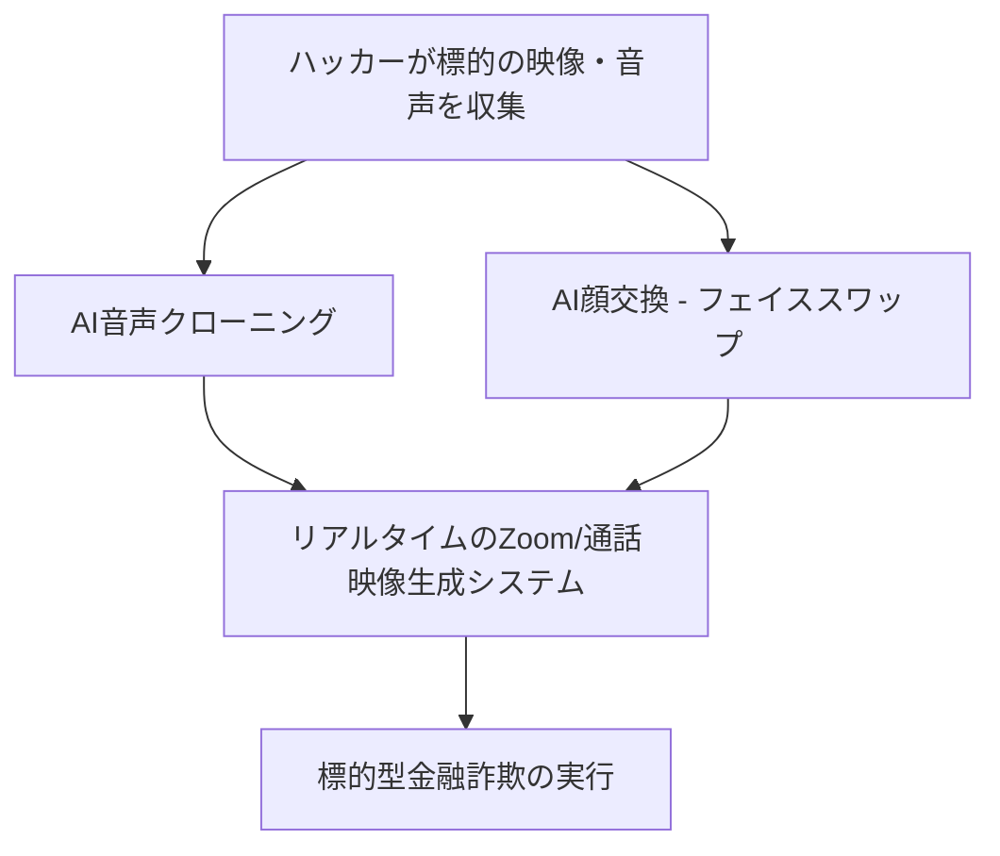
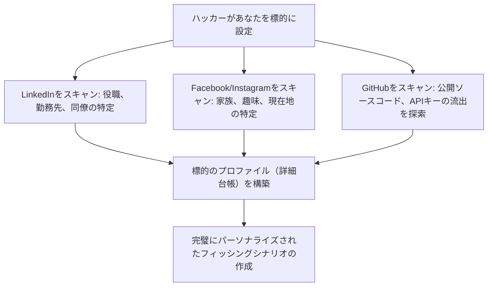
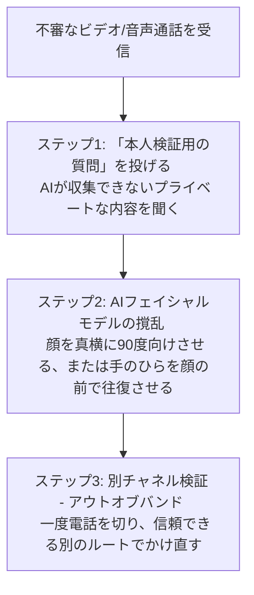

# Day 5: 高度なソーシャルエンジニアリング & AIフィッシング攻撃

Day 5へようこそ！Day 1では、人間の心理を巧みに操る「ソーシャルエンジニアリング」の基本概念を学びました。本日は、より高度で専門的な領域へと進みます。**「ハッカーが人工知能（AI）とオープンソースインテリジェンス（OSINT）を兵器化し、2026年現在、いかに信じられないほど精緻な標的型詐欺攻撃を実行しているか」** について探求します。

現代において、フィッシングメールはもはや不自然な日本語や誤字脱字だらけのものではありません。なりすまし電話も、ぎこちない声真似レベルではありません。攻撃者は、AIを用いてあなたのCEO、家族、または取引先の顔や声のバイオメトリクス（生体特徴）を完璧に模倣し、完璧な罠を仕掛けてくるのです。

---

## 1. リアルタイムAIディープフェイク詐欺の解剖

**ディープフェイク（Deepfake）** 技術（深層学習モデルを用いた生成AI）の進化は、かつてSF映画の中だけのものだった攻撃シナリオを、現実の脅威へと変貌させました。

### 1.1. AI音声クローニング（生体音声複製）
ネット上（TikTok、Instagramリール、YouTube、またはアンケートを装った迷惑電話など）からターゲットの声をわずか3秒から5秒程度抽出するだけで、AIはその人物の声を完全にクローン（複製）できます。
*   **攻撃シナリオ：** ハッカーはこの複製された声を用いて、高齢の親に「子供が事故に遭って急遽お金が必要だ」と電話をかけたり、CEOになりすまして経理担当者に「極秘プロジェクトの資金を至急振り込むように」と指示を出したりします。声のトーン、呼吸音、話すテンポは本物と99%一致します。

### 1.2. リアルタイムビデオジャック（ライブビデオなりすまし）
音声の複製にとどまらず、次世代の生成モデルは、ハッカー自身の顔の上に他人の精緻な3D顔モデルをリアルタイムで重ね合わせる（オーバーレイ）ことができます。これにより、ZoomやMicrosoft Teamsなどのビデオ通話で本人になりすまします。
*   **攻撃シナリオ：** あなたのPCにCEOからビデオ通話がかかってきます。「極秘の予算承認をお願いしたい」と言われ、画面上には確かにCEOが動き、リアルな声であなたに直接語りかけています。あなたは完全に信じ込み、指定口座へ送金します。しかし後になって本物のCEOに確認したところ、ビデオ通話の相手はハッカーが裏で操る「AIパペット（人形）」だったことが判明します。

---

## 2. 組織における高度な標的型フィッシング攻撃

ハッカーは、数億円規模の企業資産を詐取するために、不特定多数へのばらまきメールなどは使いません。組織内で高い権限を持つ特定の人間（ノード）を狙い、緻密にパーソナライズされた手法を展開します。

### 2.1. スピアフィッシング（Spear Phishing - 標的型メール攻撃）
特定の個人を明確な標的とする攻撃。スピアフィッシングメールは、収集された個人情報に基づいて非常に緻密に作成され、あなたが所属する部署の正確な専門用語を使用し、現在進行中の実プロジェクトに直接関連する添付ファイルを装って送られてきます。

### 2.2. ホエーリング（Whaling - 経営幹部を狙った標的型攻撃）
スピアフィッシングの特殊な変種であり、ターゲットを**「ホエール（クジラ）」**、すなわちCEO（最高経営責任者）、CFO（最高財務責任者）、あるいは財務責任者といった組織の最高幹部に絞り込む手法です。
*   **シナリオ：** 攻撃者が政府の監査機関や重大な法的トラブルを装い、CEOに対して「調査協力を怠れば企業の営業停止処分を下す」といった極秘通知を送りつけ、内部の財務データやアクセス権限を要求します。

### 2.3. スミッシング（Smishing）＆ ビッシング（Vishing）
*   **スミッシング（SMS Phishing）：** 携帯電話のSMSやチャットアプリ（LINE、Telegram、WhatsAppなど）を通じて行われる詐欺。銀行の残高変動通知や、親族になりすました「スマホが壊れて一時的にお金を借りたい」といったメッセージが代表例です。
*   **ビッシング（Voice Phishing）：** 電話による音声詐欺。近年では前述のAI音声クローニングと組み合わせて、警察官や知人になりすます高度な手口が急増しています。

---

## 3. OSINT（オープンソースインテリジェンス）：ハッカーの個人情報収集術

ハッカーはなぜ、あなたの好み、現在の旅行先、勤務先などを把握し、これほど完璧なフィッシング詐欺を仕掛けてこられるのでしょうか？それは彼らが **OSINT（Open Source Intelligence）** を駆使しているからです。

OSINTとは、インターネット上に公開されている一般公開情報（SNS、各種フォーラム、企業サイト、メディア記事、政府の公開データなど）を収集・分析し、諜報活動に役立てる手法のことです。

### ハッカーによるOSINTデータ収集フロー：

### 🚨 私たちが無意識のうちにハッカーに提供している情報漏洩：
1.  **写真のメタデータ（EXIFデータ）：** スマートフォンで撮影した写真をそのままrawデータでSNSにアップロードすると、画像ファイル内に「EXIFメタデータ」が埋め込まれたままになります。ここには、カメラの機種や撮影日時のほか、撮影された**「極めて正確なGPS位置情報（緯度・経度）」**が記録されています。ハッカーは画像をダウンロードして解析するだけで、あなたの自宅や職場の正確な住所を特定できます。
2.  **詳細すぎる求人情報：** 企業がエンジニアを募集する際、*"AWS、Kubernetesの構築、PostgreSQLデータベースの実務経験"* と詳細に記載することがあります。これにより企業は、自社の内部システム構成（テックスタック）をハッカーにタダで教えることになり、ハッカーはその技術に特化した脆弱性攻撃を用意しやすくなります。
3.  **社員証や職場のデスク周りの投稿：** 「新しいデスク環境！」といった形で写真を投稿した際、画面上にソースコードやパスワードが書かれた付箋が写り込んでいたり、社員証のバーコードが鮮明に写っていたりするケースです。ハッカーはバーコードをスキャンして偽造カードを作成し、物理的な社内侵入を試みることができます。

---

## 4. 防衛の盾：ディープフェイクとAIフィッシングから身を守る3ステップ検証

2026年におけるハイテクな攻撃手法から身を守るためには、自分自身と家族のために以下の厳格な検証手順を確立する必要があります。

### 📌 ステップ 1：「本人検証用の質問」を投げる
家族や親しい友人から「今すぐお金が必要だ」という緊急の電話があり、声が本人そのものだった場合：SNSから収集できない、二人だけしか知らないプライベートな質問を投げてください（例：*"昨日、お母さんが作ってくれた晩ご飯のおかずは何だった？"*、*"うちで最初に飼ったペットの名前は何？"* など）。ネット上の公開情報を漁るAIディープフェイクには、こうしたオフラインのプライベートな日常を解き明かすことはできません。

### 📌 ステップ 2：AIフェイシャルモデルの処理能力を意図的に撹乱する
ビデオ通話で相手がリアルタイムディープフェイクではないかと疑われる場合：
*   **「顔を真横に90度向けてみて」と頼む：** 現在のリアルタイムAI顔交換アルゴリズムは、真横のプロフィール（横顔）の処理が非常に苦手です。完全に真横を向くと、合成された顔の輪郭が歪んだり、映像がチラついたり、耳や首との境界線に不自然なズレ（アーティファクト）が発生します。
*   **「顔の前で手のひらを左右にパタパタと振ってみて」と頼む：** 手が顔を遮ることで、AIモデルが顔の「特徴点（ランドマーク）」を見失い、合成された顔が一瞬で大きく歪む、あるいは元のハッカーの顔が露出する現象が発生します。

### 📌 ステップ 3：別チャネル検証（アウトオブバンド検証）
*   疑わしい場合は、即座に一度通話を切ります。
*   同じチャットアプリの「折り返し」ボタンは絶対に使わないでください（そのアカウント自体がハッカーに乗っ取られている可能性があるためです）。
*   手動で標準の携帯電話番号（通常のキャリア回線）にダイヤルするか、全く別の信頼できる連絡手段（他のチャットアプリなど）を用いて本人に直接連絡を取り、真偽を確認してください。

---

## Day 5 のまとめ

1.  **AIディープフェイク**は生体音声をクローンし、リアルタイム映像を生成できるため、企業の重要な財務取引において極めて重大な脅威となります。
2.  **OSINT**は公開情報を収集してターゲットの台帳を作り上げる手法であり、日常的な何気ない投稿がハッカーの武器になります。
3.  **GPS位置情報が含まれる写真**をそのままネットに公開したり、自社のシステム構成などの機密情報を過度に開示したりすることは避けましょう。
4.  不審な通話に直面した際は：**「パーソナルな質問」➔「顔を横に向けさせる」➔「別ルートで折り返し確認」**の3ステップで防衛してください。

---

## 📝 本日のミニ課題

1.  スマートフォンのカメラ設定（iOS/Android）を確認してください。カメラアプリの**「位置情報（GPS）権限」をオフ**にし、今後撮影する写真のEXIFメタデータに正確な緯度・経度が自動保存されないように設定します。
2.  過去に撮影した写真を1枚選び、メタデータ表示サイト（`exifdata.com` など）にアップロードしてみましょう。撮影時のカメラ機種、正確な日時、およびGPSによる撮影位置が露出していないか確認してください。
3.  家族（特に両親や高齢のご親族）と短い時間話し合ってください。リアルタイムAIディープフェイク詐欺の危険性を伝え、お金の緊急要請や緊急事態の際に本人確認を行うための**「家族専用の秘密の合言葉（ユニークな言葉）」**を1つ決めておきましょう。
