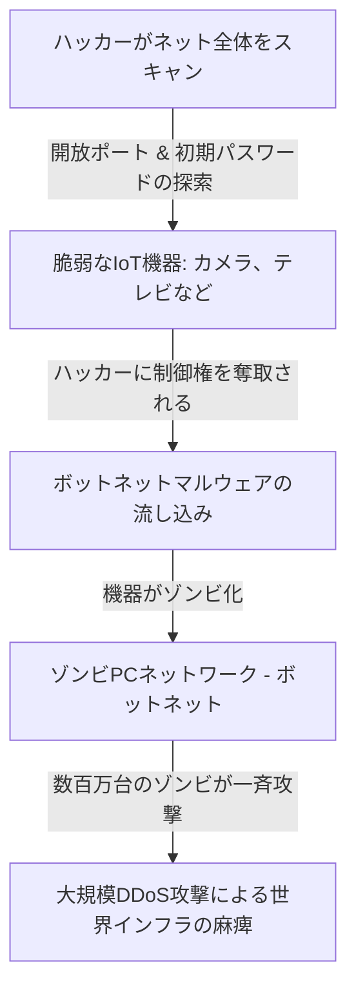
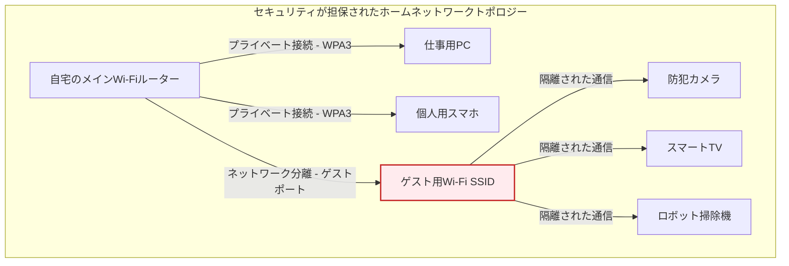

# Day 6: スマートホーム時代におけるモバイル & IoTセキュリティ

Day 6へようこそ！現代において、従来のオフィスと家庭の境界線は完全に消滅しました。私たちはリモートで業務を行い、個人のスマートフォンから社内サーバーに接続し、防犯カメラ、スマート電球、ロボット掃除機などのスマート家電（スマートホーム）がひしめく家庭内ネットワークの中で仕事用のPCを稼働させています。

ハッカーは、強固なセキュリティソフトウェアがインストールされている仕事用のPCを直接ハッキングすることは極めて困難であることを熟知しています。そのため、彼らはよりスマートな迂回ルートを選択します。**「セキュリティ対策が甘い個人のスマートフォンやスマート家電（IoTデバイス）を最初の標的とし、そこを踏み台にして家庭内ネットワークの深部へ侵入する」** という手法です。本日は、これらのセキュリティの「抜け穴」を完全に塞ぐ方法を学びます。

---

## 1. モバイルデバイス（iOS & Android）におけるセキュリティリスク

スマートフォンには、銀行口座アプリ、仕事用のメール、2要素認証（MFA）コードなど、あなたのデジタルライフのすべてが詰まっています。しかし、モバイルOSには特有のセキュリティ脆弱性が存在します。

### 1.1. アプリの権限（App Permissions）の罠
新しいアプリをインストールする際、多くのユーザーは何も考えずに表示されるすべての権限要求に対して「許可（Allow）」をタップしがちです。
*   **懐疑的な視点を持つこと：** なぜ単なる電卓（Calculator）アプリや無料の懐中電灯アプリが、あなたの**「連絡先」「SMS」「バックグラウンドでの位置情報」**へのアクセス権限を必要とするのでしょうか？
*   **潜むリスク：** 過剰な権限を許可してしまうと、悪意あるスパイウェアが裏でSMSの内容（銀行のワンタイムパスワードなど）を勝手に読み取り、外部のハッカーのサーバーへ転送する恐れがあります。

### 1.2. サイドローディング（ストア外からのインストール）の脅威
Android（および特定の市場における近年のiOS）では、公式のアプリストアを経由せず、インターネットから直接アプリファイル（改造された `.apk` や `.ipa` ファイル、海賊版ゲームなど）をダウンロードしてインストールすることができます。
*   **攻撃手法：** ハッカーは人気のモバイルゲームのソースコードを改ざんし、極めて巧妙な**「バンキング型トロイの木馬（例：GoldDiggerマルウェア等）」**を埋め込みます。あなたがこのストア外の非公式アプリをインストールすると、マルウェアはバックグラウンドで自動実行され、金融アプリの入力を監視し、パスワード入力画面のスクリーンショットを撮影し、深夜に自動送金処理を隠密に実行します。

---

## 2. IoT（モノのインターネット）デバイス：家庭内ネットワークの急所

IoTデバイスとは、生活を便利にするためにインターネットに接続された物理的なハードウェア全般を指します（ネットワークカメラ、スマートLED電球、ロボット掃除機、スマートTV、スマートインターホンなど）。

### なぜIoTデバイスのセキュリティは脆弱なのか？
1.  **初期パスワード（デフォルト設定）の放置：** 多くの安価な防犯カメラは、工場出荷時の管理者パスワードが `admin` や `123456`、`password` といった極めて単純な値に設定されています。ユーザーがこれを変更せずにネットワークに接続すると、ハッカーは自動スキャンツールを用いて世界中の何万台もの家庭用カメラに容易にアクセスし、プライベートな映像を盗み見ることができます。
2.  **ファームウェアが更新されない：** 安価なIoTデバイスのメーカーは、製品販売後にサポートやアップデートを打ち切ることが多く、ファームウェアの脆弱性が修正されないまま放置されます。これがハッカーにとって絶好の標的となります。
3.  **破壊的な「ボットネット（Botnet）」の形成：** ハッカーは、あなたのロボット掃除機がどう稼働しているかには興味がありません。彼らの目的は、数百万台の脆弱なIoTデバイスをハッキングして操り人形（**ゾンビ**）に変えることです。これらのゾンビ端末を統合した「ボットネット」（悪名高いMiraiなど）を結成し、世界中の大企業やネットインフラを標的とした大規模なDDoS（分散型サービス拒否）攻撃を仕掛けるための兵器として利用します。

---

## 3. ホームネットワークの要塞化（Home Network Hardening）：リモートワーカーの必須要件

ハッキングされやすい家庭内のスマート家電から仕事用のPCを完全に防御するためには、以下のプロフェッショナルなルールに従って、自宅のWi-Fiルーター設定を「要塞化」する必要があります。

### 📌 ルール 1：隔離された「ゲストネットワーク（Guest Network）」の構築
これが最も重要かつ効果的な防御手法です。ほぼすべての現代的なWi-Fiルーターには、セカンドSSID（ゲストネットワーク機能）を作成する機能が備わっています。
*   **対策：** ゲスト用Wi-Fiネットワークを独立して作成し、家庭内の**すべてのスマート家電（カメラ、電球、ロボット掃除機、スマートTVなど）**をこのゲストWi-Fiにのみ接続させます。仕事用PCや個人のスマートフォンは、メインのWi-Fiネットワークに接続します。
*   **メリット：** ゲストネットワークは「AP隔離（AP Isolation）」によってメインネットワークから完全に分離されています。万が一、スマート電球やカメラがハッキングされてハッカーに乗っ取られたとしても、ハッカーはゲストネットワーク内に閉じ込められ、機密情報やソースコードが保存されているメインネットワークの仕事用PCへアクセスすることは一切できません。

### 📌 ルール 2：WPS機能（Wi-Fi簡単接続）の無効化
WPSは、ルーターのボタンを押すか、8桁の静的PINコードを入力するだけで簡単にWi-Fi接続を行えるようにする機能です。
*   **潜むリスク：** この8桁のWPS PINコードは、モバイル端末用の簡単な自動総当たり（ブルートフォース）ツールを使用すると、わずか数時間で突破されてしまいます。ルーターの管理画面にアクセスし、**「WPS機能を無効（Disable/OFF）」**に設定してください。

### 📌 ルール 3：ルーターの初期管理者用パスワードの変更
プロバイダーが設置したルーターの背面には、設定画面のIPアドレス（例：`192.168.1.1`）と初期のログインID・パスワード（`admin` / `admin` など）が記載されたシールが貼られています。
*   **対策：** 設定画面にアクセスし、この初期管理者パスワードを推測不可能な強力なパスフレーズに変更してください。同時に、Wi-Fiの暗号化規格を古い **WPA2** からより強固な最新の **WPA3**（デバイスが対応している場合）にアップグレードし、外部からのWi-Fiパスワード解読攻撃を防ぎます。

---

## Day 6 のまとめ

1.  **モバイルアプリの権限**は、必要最小限の権限のみを許可する原則を厳格に適用します。非公式ストアからのアプリのインストール（**サイドローディング**）は絶対に避けてください。
2.  **IoTデバイス**は、初期設定の放置やファームウェア更新の欠如により、ハッカーが**ボットネット**（ゾンビネットワーク）を形成するための絶好の標的となっています。
3.  **ネットワークセグメンテーション（分離）**を用いて、すべてのスマート家電を独立した**ゲストネットワーク**へ接続することが、リモートワーク用PCを守る最善の盾となります。
4.  **WPS機能をオフ**にし、ルーターのデフォルト管理者パスワードを変更することで、外部からのWi-Fi侵入経路を完全に遮断します。

---

## 📝 本日のミニ課題

1.  ご自身のスマートフォンを開き、システム設定からアプリの権限設定を確認します。**「位置情報」「マイク」「カメラ」「SMS」**にアクセス可能なアプリのリストを精査し、その機能を果たすために本来不要だと思われるアプリの権限をすべて「オフ（無効化）」にしてください。
2.  自宅のWi-Fiルーターの物理的な背面や底面を確認し、設定用のIPアドレスとデフォルトの管理者パスワードを確認します。
3.  PCまたはスマホのブラウザでルーターの設定画面（通常は `192.168.1.1` や `192.168.0.1`）にアクセスしてログインします。
4.  以下の3つの必須セキュリティ設定を実行しましょう：
    *   デフォルトの管理者（Admin）ログインパスワードを変更する。
    *   設定画面からWPS設定を探し、**「WPSを無効化（OFF）」**にする。
    *   **「ゲストネットワーク（Guest Network）」**機能を有効化し、専用のWi-Fi接続パスワードを設定した上で、スマートTVやロボット掃除機、スマートスピーカーなどの接続先をこの隔離ネットワークへと移行します！
