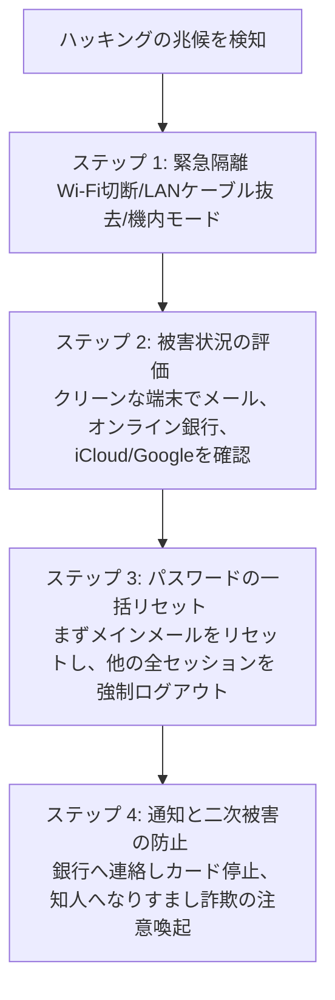

# Day 7: インシデント対応 & セキュリティエンジニアへの道

おめでとうございます！あなたは **Cybersecurity Awareness（情報セキュリティ意識向上）** の最初のステージを無事にクリアしました。これまでの6日間で、日々の巧妙なソーシャルエンジニアリングや技術的詐欺から身を守るための強固な「防衛の盾」を身につけることができたはずです。

基礎編の最終日となる本日は、生死を分ける極めて重要なスキルを学びます。**「万が一ハッキング被害（インシデント）が発生してしまった際、いかに冷静さを保ち、緊急対処するか」** ということです。同時に、明日から始まる「本物のハッカーと対峙し、堅牢なシステムを構築・設計する」ための、本格的な技術セキュリティの世界への扉を開きます！

---

## 1. インシデント対応（Incident Response）緊急マニュアル

サイバーセキュリティには有名な格言があります。*「絶対的に安全なシステムは存在しない。あるのは、まだハッキングされていないシステムだけだ」*。いざ事態が発生した際には、以下のインシデント対応手順に従って、冷静かつ迅速に行動する必要があります。

### 🛡️ ステップ 1：緊急隔離（Isolate）
マルウェア感染やハッカーの侵入が疑われるデバイスのインターネット接続を、**直ちに物理的に遮断**します。LANケーブルを抜き、Wi-Fi接続を切り、スマートフォンは機内モードにします。この初動が最も重要である理由は以下の通りです：
*   **C2（Command & Control）通信の遮断：** あなたのPC内に潜むマルウェアと、ハッカーが操る外部の遠隔操作サーバー（C2サーバー）との接続を断ち切り、さらなる遠隔攻撃コマンドの実行を阻止します。
*   **データ漏洩（エクスフィルトレーション）の即時停止：** マルウェアが裏で静かにあなたの機密ファイル、認証情報、写真、個人情報などを圧縮し、ハッカーのクラウドストレージへ送信（アップロード）する処理を強制的にストップさせます。
*   **ネットワーク内での感染拡大（ラテラルムーブメント）の防止：** 同一の家庭内やオフィスのローカルネットワークに接続されている他のPC、サーバー、スマート家電（IoT機器）へとマルウェアが自己拡散するのを防ぎます。

### 🛡️ ステップ 2：被害状況の評価（Assess）
ハッキングが疑われる汚染されたデバイスから、**絶対にアカウントへのログイン操作を行わないでください**。安全が完全に保証された「クリーンな別デバイス」（例：ストア外アプリを一度もインストールしたことのない別のスマートフォンや、信頼できる家族のタブレットなど）を使用し、重要アカウントの状態を確認します：
1.  **メインのメールアカウント：** これは最優先で防衛すべき最後の砦です。ハッカーがメールアカウントの制御権を握ると、「パスワードを忘れた場合」の機能を使って、あなたのSNSやオンライン銀行、クラウドサービスなどの全パスワードを芋づる式にリセットしてしまいます。
2.  **金融系アカウント：** オンラインバンキング、電子決済アプリ、証券口座、仮想通貨ウォレット。
3.  **クラウドID（Identity）：** 連絡先の同期データ、メッセージ、バックアップ写真が保存されているiCloudやGoogleアカウント。

### 🛡️ ステップ 3：パスワードの一括リセット（Reset）
安全なクリーンデバイス上で、重要アカウントのパスワードを一斉に変更します。
*   **メインメールを最優先：** Day 2で学んだ推測不可能な強力なパスフレーズを用いて、全く新しいパスワードを設定します。
*   **「他のデバイスから強制ログアウト」を有効化する：** パスワードリセットが完了する際、必ず**「他のすべてのアクティブなセッションからサインアウトする（Sign out of all other active sessions）」**を選択し、ハッカーが保持している不正な接続セッションを即座に破棄（キックアウト）します。
*   **緊急ロックの申請：** すでにアカウントのパスワードが変更され、ハッカーが用意した2要素認証（MFA）が設定されてしまっている場合は、各サービスの緊急アカウント復旧リンクから即座にアカウントの一時凍結・ロックを申請してください。

### 🛡️ ステップ 4：通知と二次被害の防止（Notify）
恐怖心やパニック、あるいは恥ずかしさから被害を隠蔽したり、一人で抱え込んだりしてはいけません。対処が遅れれば遅れるほど、被害は拡大します：
*   **知人・友人に警告する：** 別の連絡手段を使うか、家族に代理でSNSなどに投稿してもらい、「自身のアカウントがハッキングされたこと」を周囲に周知します。一時的に自分から送られる金銭要求や不審なリンクを絶対に無視するよう強く呼びかけます。
*   **銀行の窓口・サポートへ即座に連絡：** 利用しているすべての金融機関の緊急ダイヤルに電話し、クレジットカードの利用停止、およびインターネットバンキングの一時停止を申請します。ハッカーによる自動送金処理が実行される前に、あなたの資産を守り抜いてください。

---

## 2. ハッカーの世界地図：ホワイトハット、ブラックハット、グレーハット

技術的なシステム防衛の世界に足を踏み入れるにあたり、サイバー空間という戦場における敵と味方の特性を理解しておく必要があります。

*   **ブラックハットハッカー（Black Hat Hacker）：** 悪意を持ってシステムに不正侵入し、破壊や窃盗を行う犯罪者。主な動機は金銭（ランサムウェアによる脅迫、盗み出した個人情報の売却）、競合の破壊、または国家レベルのスパイ活動です。
*   **ホワイトハッカー（White Hat Hacker）：** 「エシカルハッカー（倫理的ハッカー）」や「セキュリティ専門家」とも呼ばれます。高度なハッキング技術を駆使して企業のシステム脆弱性を調査し、悪意あるハッカーに悪用される前に、企業へ責任を持って報告して修正を促します。デジタル世界をより安全にする味方です。
*   **グレーハットハッカー（Grey Hat Hacker）：** 法律と倫理のグレーゾーンで活動する人物。許可なく企業のシステムに侵入（違法行為）しますが、破壊活動や恐喝は行いません。侵入後に「脆弱性を発見した」と企業に通知し、場合によっては少額のバグ報奨金（Bug Bounty）を要求します。

---

## 3. プロフェッショナル・セキュリティエンジニアへのロードマップ

もしあなたがシステムの仕組みを解き明かしたり、謎を解いたりすることが好きで、IT業界の中でも特に市場価値が高く高収入を得られるセキュリティ職を目指したいのであれば、以下のロードマップを参考にしてください：

*   **技術的な基礎の確立（1〜6ヶ月目）：** コンピュータネットワーク（TCP/IP、DNS、HTTP/HTTPSプロトコル）を極め、**Linux**（特にペネトレーションテスト用のKali Linux）のコマンドライン操作に慣れ、プログラミング言語（PythonまたはGoが最適）を習得します。
*   **実戦的なセキュリティトレーニング（7〜12ヶ月目）：** プロ用のペネトレーションテストツール（Nmap、Burp Suite、Wiresharkなど）の使用方法を学び、CTF（Capture The Flag）と呼ばれるセキュリティ競技に参加し、Bug Bounty（HackerOne、Bugcrowdなど）を通じて実際の企業のバグを発見して報奨金を得る経験を積みます。
*   **市場価値の高い世界的なセキュリティ資格：**
    *   *CompTIA Security+：* 情報セキュリティの基礎知識を網羅した、世界的に認知されているエントリー資格。
    *   *CEH (Certified Ethical Hacker)：* 倫理的ハッキングのツールと実践的手法を学ぶ実技資格。
    *   *OSCP (Offensive Security Certified Professional)：* 24時間の過酷な実技試験を伴う、極めて権威があり、かつ非常に難易度が高い実践型ハッキング資格。

---

## 4. 生涯持ち続けるべき「生と死を分ける」防衛原則

あらゆるデジタル活動において、以下の5つの不変のセキュリティ原則を胸に刻んでおいてください：
1.  **クリックする前に一瞬立ち止まる：** たった1秒の油断クリックが、生涯のデータ喪失につながります。予期せぬリンクには常に健全な懐疑心を持って接してください。
2.  **MFA（多要素認証）は絶対条件：** どんなに強力なパスワードでも、第三者サービスからの漏洩リスクをゼロにはできません。2要素認証こそが、あなたを守る最後の砦です。
3.  **アップデートは生存戦略：** OSやアプリのアップデート通知を絶対に引き延ばさないでください。これらのパッチは、現在進行形でハッカーが悪用している脆弱性を修正するためのものです。
4.  **オフラインバックアップの徹底：** インターネットから物理的に隔離された外付けハードディスク等にデータを複製保存して初めて、データは真にあなたのものと言えます。
5.  **ゼロトラスト（Zero Trust）思考：** 「自分が今接続しているネットワークやデバイスは、すでにハッキングされているかもしれない」という前提で行動してください。信頼する前に、常に検証する姿勢が重要です。

---

## 🚀 新たな扉が開かれます！

一般ユーザー向けの情報セキュリティ意識向上（Awareness）のステージは、ここで終了です。しかし、ソフトウェア開発者やシステムエンジニアであるあなたにとって、最もエキサイティングで技術的な挑戦は、まさにここから始まります！

明日（**Day 8**）から、あなたは受動的な防衛者から、**「強固な要塞を築くアーキテクト」**へと変貌します。私たちは、**「Webアプリケーションセキュリティ（Web Security）の実践」**というディープな技術領域へ足を踏み入れます。次のような体験があなたを待っています：
*   ハッカーがデータベースを完全に破壊する **SQLインジェクション** 攻撃の実際のコード分析。
*   ユーザーアカウントの奪取を防ぐための、**XSS** や **CSRF** に対する堅牢な防衛コードの実装。
*   エンタープライズ規模のID管理を支える **OAuth 2.0** や **JWT** を用いた認証・認可システムの実装。
*   ビルドパイプライン内で脆弱性を自動検知する **DevSecOps** セキュリティスキャンの自動化。

しっかりと休息を取り、エンジニアとしての闘志を燃やしておいてください。明日から、本当のハイテク防衛戦が幕を開けます！ 🛡️💻

---

### 📝 明日に向けた予習課題：
あなたに質問です：**「OWASP Top 10」**という言葉を聞いたことがありますか？もし聞いたことがなければ、現在のWebセキュリティにおいて世界で最も警戒されている3つの主要な脆弱性が何であるか、インターネットで簡単に調べておきましょう！
