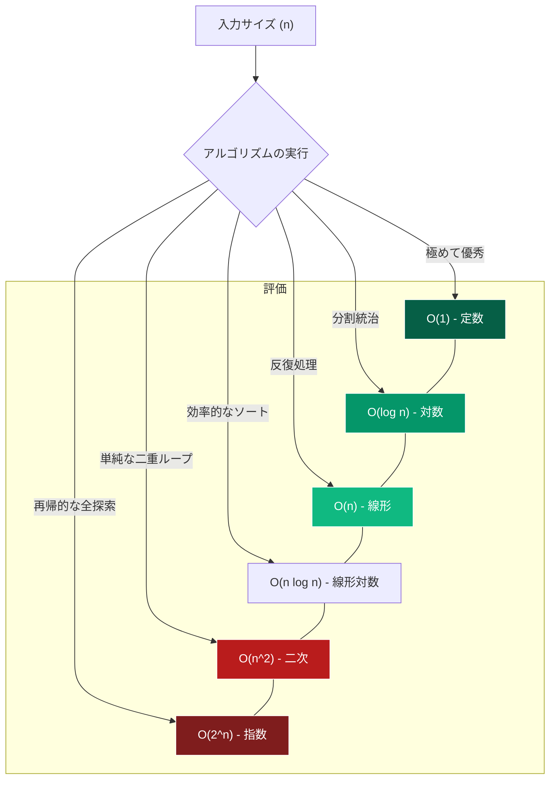

# 成長の禅：Big-O 解析 📊

**データ構造とアルゴリズム**（Data Structure & Algorithm）を征服する旅の初日へようこそ。これは単なるコードに関する学問ではありません。**効率**（Efficiency）と**トレードオフ**（Trade-offs）に関する学問です。ハイレベルなエンジニアの世界では、「このコードは動くか？」ではなく、「入力が100万倍になったとき、このコードはどうスケールするか？」を問いかけます。

---

## 🪝 THE HOOK：「フリーズしたマシン」の惨劇と Knight Capital からの教訓

新進気鋭のソーシャルネットワークのために、ユーザー検索機能を構築していると想像してください。最初の 1,000 人のユーザーに対しては、コードは驚くほどスムーズに動作します。あなたは単純な検索アルゴリズム、つまり一人ずつ順番にチェックする方法を採用しました。

しかし、ある朝目が覚めると、あなたのアプリが世界中でバイラル（拡散）していることに気づきます。ユーザー数は 1,000,000 人に急増しました。突然、検索機能のレスポンスに... 30 秒もかかるようになりました。サーバーは過負荷になり、ログは赤く点滅し、ユーザーはアプリを削除し始めます。

歴史的な実例として、2012 年の **Knight Capital Group** の惨劇があります。そして 2026 年に向けて、私たちは **AI 駆動の複雑性**（AI-driven complexity）にも直面しています。最適化されていないアルゴリズムは、モデルのトレーニング時に GPU/TPU クラスターのエネルギーコストとして数千ドルを浪費する可能性があります。

**💡 2026 年のアップデート:** 現在、**AI 静的解析**ツールは、コードを書き終えた瞬間に Big-O を予測できます。しかし、アーキテクトは、AI がまだ自分で判断できない「トレードオフの決定」を下すために、依然として本質を理解していなければなりません。

---

## 🎭 ANALOGY：ファイル送信、飛行機、そして光速の物語

Big-O を理解するために、少しの間コードのことは忘れてください。1,000km 離れた別の都市に住む友人に、非常に大きなデータファイルを送る必要があるとします。

1. **オプション A（メール/クラウドストレージ）**: ファイルをアップロードしてリンクを送ります。
   - ファイルが 10MB なら、1 分かかります。
   - ファイルが 1GB なら、100 分かかります。
   - **思考**: 時間はファイルサイズに比例します。DSA では、これを**線形時間**（Linear Time）、記号で **O(n)** と呼びます。

2. **オプション B（物理的に飛行機で運ぶ）**: ファイルをハードディスクにコピーし、飛行機に乗って友人の家まで直接届けます。
   - ファイルが 1GB であろうと 10TB であろうと、時間は 2 時間の飛行 ＋ 1 時間の移動のままです。
   - **思考**: ファイルサイズに関わらず時間は一定です。これを**定数時間**（Constant Time）、記号で **O(1)** と呼びます。

**重要なポイント**: ファイルが十分に大きい場合（例：100 PB）、飛行機で運ぶ方が、世界最速の光ファイバーケーブルで送るよりも速くなります。Big-O は、あるアルゴリズムが別のアルゴリズムよりも優位に立ち始める「クロスオーバーポイント」を特定するのに役立ちます。

---

## ⚙️ UNDER THE HOOD：計算複雑性へのディープダイブ

なぜ「秒」や「ミリ秒」で測定しないのでしょうか？ それは、速度が新しい世代の CPU か古いものか、RAM が速いか遅いか、さらには周囲の温度にさえ依存するからです。**計算量解析**（Complexity Analysis）は、入力 `n` が増加したときの操作数の**増加率**（Growth Rate）に焦点を当てます。

### 1. **時間計算量**（Time Complexity）
すべてのコード行を数えるのではなく、代入、比較、四則演算などの**基本操作**（Elementary Operations）を数えます。特に「ループ」（繰り返し）に注目します。なぜなら、そこが操作が最も増殖する場所だからです。

### 2. **空間計算量**（Space Complexity）
アルゴリズムが問題を解決するために必要とする追加の**メモリ**（Memory）の量を測定します。
- 結果を保存するためにサイズ `n` の新しい配列を宣言する場合 -> **O(n)** 空間。
- 計算のために 2〜3 個の補助変数しか使わない場合 -> **O(1)** 空間。

### 3. **償却解析**（Amortized Analysis）
これは、**動的配列**（Dynamic Array）を扱うときによく遭遇する高度な概念です。通常は非常に速い（O(1)）操作でも、たまに非常に遅い（O(n)）操作が発生することがあります。しかし、数千回の実行で平均化すると、依然として非常に効率的です。これを **償却 O(1)** と呼びます。

---

## 🗺️ ARCHITECTURE & FLOW：Big-O のパノラマ

以下は、さまざまな Big-O レベルの「激しさ」を比較した図です。データが増えるにつれて曲線がどのように爆発するかに注目してください：



### 詳細な「執行者」レベル：
- **O(log n)**: 最も神がかったレベル。10 億個の要素があっても、最大で 30 回の比較ステップしかかかりません。なぜなら、`2^30 ≈ 10 億` だからです。これが「半分にする」力です。
- **O(n log n)**: ソート問題における「スイートスポット」。現代のほとんどのソートエンジン（V8, C++, Java）はこのしきい値を目指しています。
- **O(n^2)**: 通常、最適化されていないロジックの兆候です。ウェブサイトに 10 万人のユーザーがいて、処理に O(n^2) のアルゴリズムを使用すると、コンピュータは `10^10` 回の操作を実行しなければなりません。これは、通常の CPU が数秒でこなせる能力を超えています。

---

## 💻 LOGIC & PSEUDO-CODE：解析の実践

ソートされたリストの中から数値 `x` を見つける 2 つのアルゴリズムを、顕微鏡で詳しく見てみましょう。

### アルゴリズム 1：線形探索 (Linear Search - O(n))
```javascript
/**
 * 要素を一つずつ順番にチェックする
 * @param {Array} arr 
 * @param {number} x 
 */
function linearSearch(arr, x) {
    for (let i = 0; i < arr.length; i++) { // n 回のループ
        if (arr[i] === x) return i;       // 1 回の比較
    }
    return -1;
}
```
**深い分析**: 
- **最善のケース（Best Case）**: `x` がインデックス 0 にある -> O(1)。
- **最悪のケース（Worst Case）**: `x` が最後にある、または配列内に存在しない -> O(n)。
- **注意**: エンジニアリングでは、システムがそれ以上に悪化しないことを保証するために、常に**最悪のケース**を基準にします。

### アルゴリズム 2：二分探索 (Binary Search - O(log n))
```javascript
/**
 * 「半分にする」スタイルでの探索
 */
function binarySearch(arr, x) {
    let low = 0, high = arr.length - 1;
    while (low <= high) {
        let mid = Math.floor((low + high) / 2); // 中間点を見つける
        if (arr[mid] === x) return mid;         // 見つかった！
        if (arr[mid] < x) low = mid + 1;        // 左半分を捨てる
        else high = mid - 1;                   // 右半分を捨てる
    }
    return -1;
}
```
**秘密のロジック**: なぜ対数（Log）なのか？ それは、各ステップで探索範囲が 2 分の 1 に絞り込まれるからです。実行されるステップ数は、`n` を 2 で何回割れば 1 になるかという数です。これこそが、底を 2 とする対数の定義です。

---

## 🧠 LEETCODE STRATEGY：問題を「読み解く」ための 3 つの黄金律

LeetCode の問題を開いたとき、すぐにコーディングを始めないでください。**制約**（Constraints）を見てください：

1. **n ≈ 10 - 20**: **指数時間**（Exponential）の O(2^n) や O(n!) のアルゴリズムが使えます。通常、組み合わせ問題やバックトラッキング問題です。
2. **n ≈ 1000**: O(n^2) が許容範囲内です。二重ループが使えます。
3. **n ≈ 10^5 - 10^6**: 最も一般的なしきい値です。解法は必ず **O(n log n)** または **O(n)** でなければなりません。それより悪いものは **TLE**（Time Limit Exceeded：時間切れ）エラーになります。
4. **n > 10^9**: アルゴリズムは **O(log n)** または **O(1)** である必要があります。通常、数学や答えに対する二分探索が関係します。

**ケーススタディ例**: 問題 #1 Two Sum。
- **アプローチ 1**: ペアを見つけるための二重ループ -> O(n^2)。動きますが遅いです。
- **アプローチ 2**: 保存のためにハッシュマップを使用 -> O(n)。爆速ですが、追加の O(n) 空間コストがかかります。
- **結果**: これこそが**「空間を犠牲にして時間を買う（Trade Space for Time）」**ことの最も明確な証拠です。

---

## 🎯 EXAM & INTERVIEW LOGIC：面接官を「唸らせる」ヒント

Big Tech（Google, Meta）や日本企業（**科目 B** 標準）の面接において：

- **単に O(n) と言うだけではいけない**: **最悪**（Worst case）、**平均**（Average case）、**最善**（Best case）を分析してください。
- **聞かれる前に空間計算量を分析する**: これは、常にシステムリソースを気にかけるプロフェッショナルなエンジニアであることを示します。
- **「大きな定数」の罠**: 時として、非常に大きな定数（例：`1,000,000 * n`）を持つ O(n) アルゴリズムは、小さい `n` に対して O(n^2) よりも遅く走ることがあります。このことに言及して、鋭さを見せましょう。
- **日本語の用語**: 日本で面接を受ける場合は、Complexity のことを「**計算量**」という用語を使って話しましょう。

---

## 💼 PROFESSIONAL CONTEXT：なぜシニアエンジニアは Big-O に執着するのか？

Big-O の最適化は、面接に合格するためだけではありません。現実には：
- **クラウドコストの削減**: O(n^2) の代わりに O(n) のアルゴリズムを使うことで、CPU 負荷を減らし、毎月の AWS 請求額を数万ドル節約できる可能性があります。
- **モバイルユーザー体験**: バッテリー容量が少なく CPU が遅いデバイスでは、非効率なアルゴリズムは携帯電話を熱くさせ、ラグ（遅延）を引き起こします。
- **分散システム**: **分散システム**（Distributed Systems）を扱う場合、ネットワーク経由のデータ送信の Big-O（ネットワークレイテンシ）は死活問題となります。

---

## 📝 QUICK QUIZ

1. **ソートされた `n` 個の要素を持つ配列があります。合計が `X` になる 2 つの数字を見つけたいです。二重ループを使った解法の計算量は何ですか？**
   - A. O(1)
   - B. O(n)
   - C. O(n^2)
   - D. O(log n)

2. **あるアルゴリズムが n=100 で 1 秒かかるとします。それが O(n^2) の場合、n=1000 ではどれくらい時間がかかりますか？**
   - A. 10 秒
   - B. 100 秒
   - C. 1000 秒

3. **「空間と時間のトレードオフ（Space-Time Trade-off）」とはどのような戦略ですか？**
   - A. 常に空間と時間の両方を同時に削減しようと試みる。
   - B. アルゴリズムをより速く動かすために、より多くの RAM を使うことを受け入れる。
   - C. RAM を減らし、コードが遅くなることを受け入れる。

---
📊 文字数: ~4500文字
