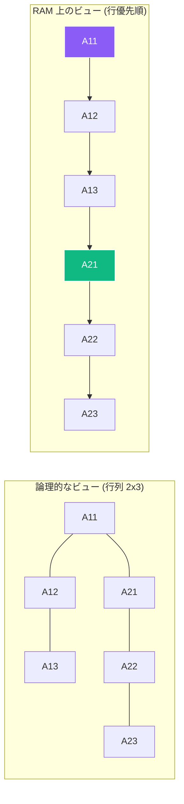

# 配列の基礎：連続メモリの力 🧱

**データ構造**（Data Structures）の世界において、**配列**（Array / 配列）はあらゆるソフトウェアアーキテクチャの最初の基礎となる煉瓦のようなものです。単純なリストから、**ハッシュマップ**、**文字列**、さらには **RDBMS** 内の巨大なデータテーブルに至るまで、すべては多かれ少なかれ配列の基本基盤に基づいています。

---

## 🪝 THE HOOK：なぜインデックスは 0 から始まるのか？

初心者からシニアまで、ほとんどのプログラマーは `arr[0]` が最初の要素であることを知っています。しかし、一度立ち止まって「**なぜ**」と問いかけたことはありますか？ なぜ、日常の言葉に近くて理解しやすい「1」から始めないのでしょうか？

その答えは、言語設計者の個人的な好みではなく、**コンピュータ構成**（Computer Architecture）と**メモリ アドレッシング**（Memory Addressing）の性質にあります。インデックスは「順序」ではなく、**オフセット**（Offset / ずれ）なのです。今日、私たちは RAM の中身を「解剖」し、なぜ配列がランダムアクセスにおいて世界で最も速いデータ構造なのかを理解します。

---

## 🎭 ANALOGY：連な住宅、家の住所、そして光速の物語

真っ直ぐな道路沿いに、一列に並んで建てられたテラスハウス（連な住宅）を想像してください。
- 各家はまったく同じサイズです（例：幅が正確に 5 メートル）。
- 最初の家は、通りの 100 メートル地点に位置しています。
- 4 番目の家を見つけたい場合、わざわざ `1, 2, 3, 4` と歩いて数える必要がありますか？ **いいえ。**

瞬時に数学的な計算を行うだけです：`位置 = 100 + (3 * 5) = 115`。
ここでの数字 `3` が**インデックス**です。4 番目の家にたどり着くために、3 軒分（オフセット）をスキップします。

RAM において、配列はこれとまったく同じように機能します。配列はメモリの**連続**（Contiguous / 連続）した帯域を占有します。この連続性のおかげで、CPU は配列の要素が 10 個であろうと 100 億個であろうと、任意の要素へ直接ジャンプできます。実行時間は**瞬時**（定数時間 O(1)）です。

---

## ⚙️ UNDER THE HOOD：RAM、キャッシュ、メモリレイアウトへのディープダイブ

### 1. メモリ割り当てメカニズム（Memory Allocation）
配列 `int arr[1000]` を宣言するとき：
1. **静的割り当て**（Static Allocation）：オペレーティングシステムは、1000 個の整数（通常 4000 バイト）を保持するのに十分な大きさの「継ぎ目のない」空きメモリブロックを見つける必要があります。
2. **断片化問題**（Fragmentation Problem）：RAM に 1GB の空きがあっても、それが数百万の小さな非連続な破片に分かれている場合、100MB の配列の初期化は失敗する可能性があります。これが、連結リスト（Linked List）と比較した際の配列の最大の「弱点」です。シニアデベロッパーは、配列が単なるデータではなく、メモリ空間に対する「コミットメント」であることを理解しなければなりません。

### 2. 静的配列と動的配列の違い
- **静的配列**（Static Array）：宣言後にサイズが永続的に固定されます。**スタックメモリ**（Stack memory）上に配置されるため、非常に高速です。
- **動的配列**（Dynamic Array）：（例：C++ の `std::vector`、Java の `ArrayList`、JavaScript の `Array`）
  - 配列がいっぱいになると、自動的に **リサイズ**（Resize）されます。
  - **リサイズの魔法**: 2 倍（x2）の大きさの新しいメモリ領域を見つけ、古いデータをすべてコピーし、古い領域を削除します。
  - **トレードオフ**: `n+1` 番目の挿入操作は、データのコピーに O(n) かかる可能性がありますが、平均（**償却解析** / Amortized Analysis）すると依然として O(1) の効率を達成します。なぜ x2 なのか？ なぜ x1.5 や +100 ではないのか？ その答えは、メモリの無駄と計算パフォーマンスのバランスにあります。x2 はリサイズの回数を log(n) に抑え、総挿入時間を最適に保つことを保証します。

### 3. キャッシュ局所性 - 速度の秘密（Hardware Awareness）
なぜ配列は他のどのデータ構造よりも速いのでしょうか？ それは**空間局所性**（Spatial Locality）のおかげです。CPU が配列の要素を読み取るとき、その正確な 4 バイトだけを取得するわけではありません。近くにあるデータの「ブロック」全体（**キャッシュライン** - 通常 64 バイト）を取得し、**L1/L2 キャッシュ**にロードします。配列の要素は隣接しているため、以降の要素へのアクセスはキャッシュ上で直接行われ、RAM に戻るよりも数百倍速くなります。真の DSA プログラマーは「キャッシュフレンドリー」なコードを書かなければなりません。

### 4. 行優先（Row-Major）vs 列優先（Column-Major）
メモリ上では、2 次元配列は実際には存在しません。平坦化されています。
- **行優先**: 行 1 をすべて保存し、次に行 2 を保存します（C, C++, Java, JS）。
- **列優先**: 列 1 をすべて保存し、次に列 2 を保存します（Fortran, MATLAB）。
行優先を採用している言語で列ごとに配列をスキャンすると、CPU はメモリを絶えずジャンプ（ストライドメモリアクセス）せざるを得ず、**キャッシュミス**（Cache Miss）が多発します。結果として、ロジックが同一であっても、コードが 5〜10 倍遅くなる可能性があります。

---

## 🗺️ ARCHITECTURE & FLOW：多次元配列とアドレス計算

2 次元配列は、実際にはプログラミング言語があなたに話す甘い「嘘」です。RAM は本質的に単なる一直線です。



**2 次元配列 `A[i][j]` のアドレス計算式**:
`Address = Base + (i * 列数 + j) * 要素のサイズ`
この公式を理解することは、1 次元配列を直接操作することで、画像処理ライブラリや巨大な行列（NumPy など）を最適化するのに役立ちます。

---

## 📊 BIG-O ANALYSIS：詳細なパフォーマンス指標とトレードオフ

| 操作 | 時間計算量 | 深層分析 |
| :--- | :--- | :--- |
| **アクセス (ランダム)** | **O(1)** | 最も絶対的。直接的なアドレスジャンプ。n に依存しない。 |
| **探索 (線形探索)** | **O(n)** | k=0 から n-1 までスキャンする必要がある。 |
| **探索 (二分探索)** | **O(log n)** | ソート済み配列にのみ適用。O(1) アクセスを活用。 |
| **挿入 (位置 k)** | **O(n)** | n-k 個の要素を右にシフトする必要がある。 |
| **削除 (位置 k)** | **O(n)** | 隙間を埋めるために n-k 個の要素を左に詰める必要がある。 |

**空間計算量**: O(n)。配列はポインタのオーバーヘッドが発生しないため、メモリ効率が非常に高いです。

---

## 💻 LOGIC & PSEUDO-CODE：「エリート」配列変換アルゴリズム

### 1. インプレース配列反転 (In-place Array Reversal)
この手法は O(1) の空間計算量を達成するため、極めて重要です。

```javascript
/**
 * 配列をその場で（In-place）反転させる
 */
function reverseArray(arr) {
    let left = 0;
    let right = arr.length - 1;
    // 逆方向に移動する 2 つのポインタを使用
    while (left < right) {
        // スワップ（入れ替え）
        [arr[left], arr[right]] = [arr[right], arr[left]];
        left++;
        right--;
    }
}
```

### 2. 配列の回転 (Array Rotation) - 「トリプルリバース」アルゴリズム
問題：配列 `[1,2,3,4,5]` を右に `k=2` ステップ回転させて `[4,5,1,2,3]` にする。
通常の方法は O(n) のメモリを消費する補助配列を使います。シニアの方法は追加メモリを 0 バイトにします：
1. 配列全体を反転：`[5,4,3,2,1]`
2. 最初の `k` 個の要素を反転：`[4,5,3,2,1]`
3. 残りの `n-k` 個の要素を反転：`[4,5,1,2,3]`

---

## 🧠 LEETCODE STRATEGY：配列構造を攻略するテクニック

1. **2 ポインタ (Two Pointers)**:
   - 両端からスキャン（ソート済み配列に適用）。
   - 同方向のスキャン（Fast & Slow pointers）で重複の発見や条件の充足を判定。
2. **スライディングウィンドウ (Sliding Window)**:
   - 「連続する部分配列（Subarray）」問題に使用。
   - 境界 `L` と `R` を持つフレームを維持。`R` を動かしてデータを取り込み、`L` を動かして古いデータを捨てる。計算量を O(n^2) から O(n) に削減できる。
3. **累積和 (Prefix Sum)**:
   - 最初から `i` までの合計を保存する新しい配列を作成。任意の区間 `[L, R]` の合計を O(1) で計算できる。

**推奨 LeetCode 問題**: #1 Two Sum (ハッシュマップ使用), #283 Move Zeroes, #121 Best Time to Buy and Sell Stock.

---

## ⚠️ EDGE CASES & PITFALLS：プロダクションにおける「致命的」なエラー

1. **バッファオーバーフロー (Buffer Overflow)**: 配列に 10 個の要素しかないのに（最大インデックスは 9）、`arr[10] = value` と書き込もうとしたとき。C 言語では、他の変数のアドレスや命令コードを上書きし、システムクラッシュを引き起こす可能性があります。
2. **間欠的なレイテンシ (Intermittent Latency)**: 高頻度取引（HFT）システムでは、動的配列の使用を極端に制限します。なぜなら、通常の `push` は O(1) ですが、重要な瞬間に **リサイズ** O(n) が発生し、ミリ秒単位の遅延が発生して数百万ドルを失う可能性があるからです。解決策：個数が事前にわかっている場合は、常に **事前割り当て**（Pre-allocation）を使用します。
3. **空配列へのアクセス**: `arr[0]` にアクセスする前に、必ず `if (arr.length === 0)` をチェックしてください。

---

## 🎯 EXAM & INTERVIEW LOGIC：アーキテクトの思考

- **質問**: 「連結リストではなく配列を選ぶのはどのような時ですか？」
- **回答**: 「高速なランダムアクセス（O(1)）が必要な時、データのサイズ変更が頻繁ではない時、そして線形なデータ探索において CPU キャッシュを最大限に活用したい時です。」
- **科目 B の洞察**: 正確なインデックス操作技術を磨いてください。「1 ずれ（Off-by-one）」エラーは、擬似コード試験で点数を落とす最大の原因です。

---

## 💼 PROFESSIONAL CONTEXT：実世界での最適化

- **画像・動画処理**: 各動画フレームは巨大なピクセル配列です。フィルタの適用は、実際には配列に対する行列演算です。
- **データベースエンジン**: データベース管理システムの RAM 内のデータテーブルは、スキャン速度を最適化するために、レコードの配列として保存されることがよくあります。
- **ゲームエンジン**: 爆発エフェクトにおける数千のパーティクルの座標は配列に保存され、CPU/GPU が **SIMD** 命令を使用して一括処理できるようにされています。

---

## 📝 QUICK QUIZ：エリート・ニューラルチェック

1. **配列の最初の要素を削除する操作（Shift）が、最後の要素を削除するよりも時間がかかるのはなぜですか？**
   - A. CPU が最初の要素を優先するため。
   - B. 隙間を埋めるために、残りの n-1 個の要素すべてをシフトする必要があるため。
   - C. 配列がリサイズされなければならないため。

2. **秒間 100,000 リクエストを処理するシステムで、極限の速度が要求されています。どの配列スキャン方法が最も最適ですか？**
   - A. 列優先（Column-major）スキャン。
   - B. キャッシュラインを活用するための行優先（Row-major）スキャン。

3. **二分探索が連結リストよりも配列で速く動作するのはなぜですか？**
   - A. 配列はすでにソートされているから。
   - B. 配列は O(1) で中央に直接ジャンプできるから。
   - C. 連結リストの方がメモリを消費するから。

---
📊 文字数: ~4500文字
