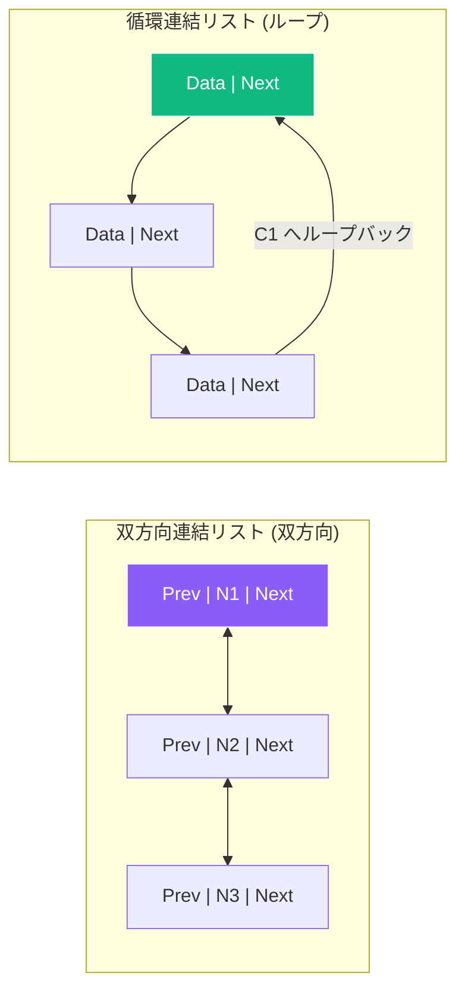

# 双方向 & 循環連結リスト：構造の進化 🔄

前回のレッスンでは、**単方向連結リスト**（Singly Linked List）が配列の限界をどのように打破するかを見ました。しかし、それには致命的な弱点があります。それは「引き返せない」ということです。もしあなたがノード 100 にいてノード 99 を見たいと思ったら、再び **Head** からやり直さなければなりません。柔軟性が不可欠な現代のソフトウェアエンジニアリングにおいて、私たちは構造的により強力な「進化」を必要としています。

今日は、**双方向連結リスト**（Doubly Linked List / 双方向連結リスト）と**循環連結リスト**（Circular Linked List / 循環連結リスト）について学びます。

---

## 🪝 THE HOOK：「戻る」ボタンと無限のプレイリスト

スマートフォンの音楽プレーヤー（Spotify など）を想像してください：
1. 「次へ」ボタンを押して次の曲に進む -> **単方向連結リスト**で十分に実現可能です。
2. しかし、「前へ」を押したらどうなるでしょうか？ 単方向連結リストを使っている場合、アプリは最初の曲（Head）からトラバースして、直前の曲を見つけ出さなければなりません。もしプレイリストに 10,000 曲あったら、「戻る」を押すたびにパフォーマンスの惨劇が発生します！
3. そして「全曲リピート」モードをオンにすると、最後の曲から最初の曲へ自動的かつシームレスに切り替わります。

これこそが、連結リストの高度なバリエーションが必要な理由です。シニアエンジニアは単に基礎を使うだけではありません。エンドユーザーの体験を最適化するために、現実の問題に**最も適した**ものを選びます。

---

## 🎭 ANALOGY：両端運転の列車とスマートなキーリング

1. **双方向連結リスト**: 現代的な列車のようです。古い列車が一方向にしか進めないのに対し、この列車は各車両の前後両方に連結ドアと運転室があります。車掌や乗客は、何の障害もなく自由に進んだり戻ったりできます。これは、データ探索における絶対的な自由を意味します。
2. **循環連結リスト**: 円形のキーリング（キーホルダー）のようなものです。物理的な意味での「最初」や「最後」の鍵は存在せず、最後の鍵の次はまた最初の鍵に戻ります。`NULL` という終点に突き当たることなく、永遠に回転し続けることができます。

---

## ⚙️ UNDER THE HOOD：双方向ノードの解剖学と循環ロジックへのディープダイブ

### 1. 「諸刃の剣」ノード構造
**双方向連結リスト**では、各ノードに 2 つ目のポインタが装備され、真の「ナビゲーションハブ」となります：
- **データ（Data）**: 格納される値。
- **次へのポインタ（Next Pointer）**: 後ろのノードを指します。
- **前へのポインタ（Prev Pointer）**: 前のノードを指します。

**自由の代償**: 64 ビットシステムでは、各ポインタは 8 バイトを消費します。`prev` ポインタを追加することで、各ノードは大幅に「肥大化」します。100 万個のノードがある場合、`prev` ポインタのためだけに約 8MB の RAM を余計に消費します。これは DSA における古典的なトレードオフです：**メモリを使って速度と柔軟性を買う**。

### 2. 循環ロジック - 終焉の法則を打ち破る
**循環連結リスト**では、最後のノード（Tail）が `NULL` という虚無を指す代わりに、`Head` を指し戻します。
- **最高のメリット**: **どの**ノードからでもリスト全体にアクセスできます。一方の端で「行き止まり」になることはありません。
- **潜伏する危険**: トラバースする際、**無限ループ**に細心の注意を払ってください。一周したときに停止できるよう、開始ノード（通常はメモリアドレスの比較による）を覚えておく必要があります。

### 3. 番兵ノード（Sentinel Nodes） - クリーンなアルゴリズム
シニアエンジニアのエリートなテクニックとして、**番兵ノード**（Dummy Head と Dummy Tail）の使用があります。これにより、連結リストには常に少なくとも 2 つの「ダミー」要素が存在することになります。
- **利点**: `if (head == null)` や `if (curr.next == null)` といった煩わしい境界条件のチェックが不要になります。すべての挿入・削除操作が統一され、ロジックエラーが極めて少なくなります。

---

## 🗺️ ARCHITECTURE & FLOW：多次元的な接続関係

以下の図は、2 つの高度な連結リストのアーキテクチャの違いを示しています：



### なぜ双方向は単方向よりもノードの削除が速いのか？
今、あなたの手元にノード `B` があり、それを削除したいと想像してください：
- **単方向**: `Head` に戻り、誰が `B` を指しているか（それは `A` です）を見つけるために一歩ずつ進まなければなりません。これには **O(n)** かかります。
- **双方向**: `B.prev` ポインタを見れば、すぐに `A` が分かります。`B.next` を見れば、すぐに `C` が分かります。あとは `A` を `C` に繋ぎ変えるだけです。完了！ プロセス全体が **O(1)** で行われます。

---

## 📊 BIG-O ANALYSIS：Prev ポインタの力とトレードオフ

| 操作 | 単方向 | 双方向 | なぜ？ |
| :--- | :--- | :--- | :--- |
| **現在のノードを削除** | **O(n)** | **O(1)** | 双方向は即座に前のノードを知り、繋ぎ変えることができる。 |
| **後ろに戻る** | **不可能**| **O(1)** | `prev` のおかげで瞬時に逆戻りできる。 |
| **末尾への挿入** | **O(1)** | **O(1)** | （便利な Tail ポインタを持つ設計の場合）。 |
| **メモリオーバーヘッド**| **低い** | **高い** | 双方向は逆方向ポインタのために 1 ノードあたり 8 バイト余計にかかる。 |

---

## 💻 LOGIC & PSEUDO-CODE：ハードコアな双方向連結リストの実装

双方向連結リストでのノード削除は、「橋渡し」とクリーンアップの芸術です：

```javascript
/**
 * 双方向連結リスト内の特定のノードを削除する
 */
function deleteNode(targetNode) {
    if (!targetNode) return;

    let prevNode = targetNode.prev;
    let nextNode = targetNode.next;

    // ステップ 1: 前の人が targetNode をバイパスして後ろの人を指す
    if (prevNode) {
        prevNode.next = nextNode;
    } else {
        this.head = nextNode; // Head を削除する場合、新しい Head を更新
    }

    // ステップ 2: 後ろの人が振り返って前の人を指す
    if (nextNode) {
        nextNode.prev = prevNode;
    }

    // ステップ 3: targetNode のすべての接続を断つ（メモリリーク防止）
    targetNode.next = null;
    targetNode.prev = null;
    // 孤立したノードはガベージコレクタによって回収される
}
```

---

## 🧠 LEETCODE STRATEGY：シニアのための古典的問題

1. **LRU Cache (#146)**: 大手企業（MAANG）を目指すなら必須の問題です。`get` と `put` の両方で O(1) を達成するには、**ハッシュマップ**と**双方向連結リスト**の組み合わせが不可欠です。
2. **Design Browser History (#1472)**: ブラウザの「戻る/進む」アクションのシミュレーション。各 URL を双方向連結リストのノードとして扱います。
3. **Double-Ended Queue (Deque)**: 両端キューの設計。双方向連結リストは、両端での操作を O(1) で行うための第一候補です。

---

## ⚠️ PITFALLS & DEBUGGING：ポインタの「迷宮」

1. **4 ポインタ・ルール**: A と C の間に新しいノードを挿入するとき、合計 **4 つのポインタ**（A の Next、C の Prev、そして新しいノードの Next と Prev）を更新しなければなりません。1 つでも忘れると、リストは「絡まり」、深刻なロジックエラーを引き起こします。
2. **Null Pointer Exception**: プロパティにアクセスする前に、必ず `if(prevNode)` や `if(nextNode)` をチェックしてください。これらのエラーはリストの先頭や末尾でよく発生します。
3. **無限トラバース**: 循環リストにおいて `while(curr != null)` ループを使うと、プログラムは決して止まりません。`while(curr != head)` を使うか、サイズカウンターを使用してください。

---

## 🎯 EXAM & INTERVIEW LOGIC：ヨセフスの問題とシステム思考

- **ヨセフスの問題 (Josephus Problem)**: 円状に並んだ人々から `k` 番目ごとに脱落させていき、最後に残るのは誰か。これは日本の **基本情報技術者試験（科目 B）** でも非常に一般的な問題です。最も速い解決策は **循環連結リスト** によるシミュレーションです。
- **面接のプロ技**: メモリ最適化について聞かれたら、**XOR 連結リスト**（ビット演算の XOR を使って、1 つのポインタで Next と Prev の両方を保持する超難関テクニック）に言及してください。低レイヤーの最適化に精通していることを証明できます。

---

## 💼 PROFESSIONAL CONTEXT：実世界での最適化

- **OS タスクスケジューラ**: オペレーティングシステムのカーネルは、実行待ちのプロセスリストを循環双方向連結リストで管理し、CPU 割り当て（ラウンドロビン）を継続的かつ公平に行います。
- **Redo/Undo 履歴**: Photoshop などのグラフィックソフトは、古い状態を双方向連結リストに保存し、ユーザーがスムーズに元に戻したり（Undo）、やり直したり（Redo）できるようにしています。
- **バッファ管理**: 動画ストリーミングにおいて、ネットワークが不安定な時でも再生が途切れないよう、データは循環バッファ（Circular Buffer）にロードされます。

---

## 📝 QUICK QUIZ：エリート・ニューラルチェック

1. **なぜ双方向連結リストは単方向よりも RAM を多く消費するのですか？**
   - A. 内部に保持するデータ量が多いため。
   - B. 各ノードで `prev` ポインタのための追加メモリが必要なため。
   - C. 高速に動作するため、処理に多くの RAM を必要とするため。

2. **「プレイリストのシャッフル & リピート」問題に最も適した構造はどれですか？**
   - A. 配列。
   - B. 循環双方向連結リスト。
   - C. 単方向連結リスト。

3. **双方向連結リストの操作のうち、O(1) の計算量を達成するものはどれですか？**
   - A. 任意の値の探索。
   - B. アドレスが分かっているノードの削除。
   - C. リストのソート。

---
📊 文字数: ~4500文字
