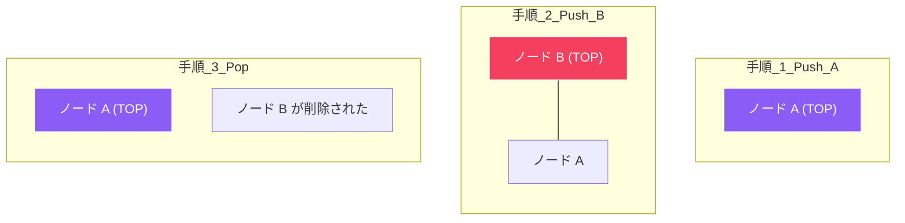

# スタックの極意：LIFO 原則 📚

`Ctrl + Z` を押したとき、なぜ「最後に行った」アクションが最初に元に戻されるのか、不思議に思ったことはありませんか？ あるいは、ある関数が別の関数を呼び出したとき、コンピュータはなぜ迷うことなく元の場所を正確に覚えていて、処理を続行できるのでしょうか？

これらすべての不思議は、**スタック**（Stack / スタック）のおかげです。スタックは極めて洗練されたデータ構造であり、現代のオペレーティングシステムやプログラミング言語の実行メカニズム全体を支配しています。あなたが今使っているウェブブラウザから、Linux カーネルの内部に至るまで、スタックはあらゆる場所に存在します。

---

## 🪝 THE HOOK：「スタックオーバーフロー」の惨劇と再帰の爆発

プロフェッショナルなプログラマーであれば、このエラーを少なくとも一度は目にしたことがあるはずです。再帰関数を書いたものの停止条件（Base case）を忘れてしまったり、問題が巨大すぎてメモリ容量を超えてしまったりしたとき。突然、アプリは真っ赤な文字とともにクラッシュします：**スタックオーバーフロー**（Stack Overflow / スタックオーバーフロー）。

「そのスタック」は、コンピュータのどこにあるのか？ なぜ「溢れる」のか？ そして、なぜその名前が世界最大のソフトウェア開発者向けフォーラムに付けられるほど重要なのか、考えたことはありますか？ 今日は、シニア DSA の視点から、システムの皮を剥いでスタックを理解していきます。

---

## 🎭 ANALOGY：レストランの皿の山と Undo の「タイムマシン」

スタックを、非常に分かりやすい現実世界の例でイメージしてみましょう：

1. **清潔な皿の山**: 定食屋の皿の山を想像してください。
   - 新しい皿が来たら、店員はそれを**一番上**に置きます（Push / プッシュ）。
   - 客に提供するために皿が必要なときも、**一番上**から取ります（Pop / ポップ）。
   - **最後**に置かれた皿が、**最初**に取り出されます。途中の皿を抜き取ろうとすれば、山全体が崩れてしまいます。

2. **Undo/Redo システム**: あなたが行うすべてのアクション（文字を打つ、色を変える、段落を消す）はコンピュータに記録され、スタックに放り込まれます。「Undo（元に戻す）」を押すと、コンピュータはスタックの頂上にあるアクションを単に「持ち上げ」、その逆の命令を実行します。

この原理は **LIFO**（Last-In, First-Out / 後入れ先出し）と呼ばれます。これがスタックにおける唯一の黄金律です。

---

## ⚙️ UNDER THE HOOD：コールスタック、メモリ、アーキテクチャへのディープダイブ

スタックは**抽象データ型**（Abstract Data Type / 抽象データ型）です。物理的にどう保存するかは規定されておらず（配列でもリストでも可）、**相互作用のルール**のみを規定します。

### 1. コールスタック（Call Stack） - CPU の心臓
CPU が `call functionA()` という命令を実行するとき、元の場所に戻るための準備が必要です。手順は以下の通りです：
1. 現在の命令のアドレス（Return Address / 戻り先アドレス）をスタックに保存する。
2. 親関数の引数やローカル変数をスタックに保存する。
3. `functionA` のソースコードへジャンプして実行する。
4. `functionA` が終了（`return`）すると、CPU は `pop` 命令を実行して古いアドレスを取り出し、中断していた作業を続行する。

**スタックがなければ**、関数の入れ子（ネスト）も、ローカル変数も存在できず、プログラミングの世界は `goto` 命令の石器時代へと崩壊してしまいます。

### 2. スタック・ランタイム・メモリ vs ヒープ・メモリ
プロセスのメモリ構造において：
- **スタックメモリ**: CPU によって極めて厳格に管理されます。CPU には専用のレジスタ（`SP` - スタックポインタ）があるため、アクセス速度は驚異的に速いです。ただし、サイズに制限があります（通常数 MB 程度）。
- **ヒープメモリ**: 自由で広大な領域ですが低速です。`new` 命令で作成される巨大なオブジェクトなどが配置されます。
再帰呼び出しが深すぎると、呼び出しのたびに関数の枠組み（Stack Frame）のためにスタック上の RAM を消費します。限界を超えると -> **スタックオーバーフロー**。

---

## 🗺️ ARCHITECTURE & FLOW：LIFO データの動き

以下は、各操作によるスタックの状態変化をシミュレーションした図です：



**ハードウェアの真実**: ほとんどのコンピュータアーキテクチャ（x86 など）において、スタックは「逆向き」に成長します。つまり、高いメモリアドレスから始まり、データをプッシュするたびにアドレスが減少していきます。

---

## 📊 BIG-O ANALYSIS：絶対定数速度の王者

スタックは、最もパフォーマンスの予測がしやすく、かつ高速なデータ構造の一つです：

| 操作 | 時間計算量 | なぜ？ |
| :--- | :--- | :--- |
| **Push** (追加) | **O(1)** | 常に頂上（Top）の位置を知っており、誰かをトラバースする必要がない。 |
| **Pop** (取り出し) | **O(1)** | 常に頂上から取り出す。 |
| **Peek** (覗き見) | **O(1)** | 頂上の隙間を覗くだけ。 |
| **探索 (Search)** | **O(n)** | スタックは探索のために作られていない。探すには構造全体を破壊しなければならない。 |

**空間計算量**: `n` 個の要素を保存するために O(n)。固定配列を使えば極めて最適です。

---

## 💻 LOGIC & PSEUDO-CODE：操車場アルゴリズムと数式の評価

コンピュータは、`(3 + 4) * 5 / (2 - 1)` のような複雑な数式をどうやって計算しているのでしょうか？ スタックを使って **RPN**（逆ポーランド記法）に変換しています。

### 1. 後置記法（Postfix）の評価アルゴリズム
数式 `3 4 + 5 *` （`(3+4)*5` に相当）があるとします：
```javascript
function evaluatePostfix(tokens) {
    let stack = [];
    tokens.forEach(token => {
        if (isNumber(token)) {
            stack.push(token);
        } else {
            // 計算のために 2 つの数値を取り出す
            let b = stack.pop();
            let a = stack.pop();
            let result = applyOp(a, b, token);
            stack.push(result); // 結果をスタックに戻す
        }
    });
    return stack.pop();
}
```

### 2. 操車場アルゴリズム（Shunting-yard Algorithm）
優先度に基づいて演算子（+, -, *, /）を一時的に保持するためにスタックを使います。強い演算子（*, /）は、スタック内の弱い演算子を先に結果待ちキューへ追い出します。

---

## 🧠 LEETCODE STRATEGY：あらゆる相手を圧倒するテクニック

1. **括弧の整合性 (#20)**: 古典的な問題です。開き括弧 `(`, `[`, `{` に出会ったら Push し、閉じ括弧に出会ったら Pop して照合します。一致しなければ False。
2. **Min Stack (#155)**: スタック内の最小値を O(1) で取得するには？ 2 つのスタックを並行して使います。補助スタックには、常にその時点での最小値を保存しておきます。
3. **単調スタック (Monotonic Stack)**: シニア向けの「上級」テクニックです。スタック内の要素が常に増加、または常に減少するように維持します。
   - 応用：次に大きい要素（Next Greater Element）を O(n) で見つける。

**推奨 LeetCode 問題**: #20 Valid Parentheses, #150 Evaluate Reverse Polish Notation, #739 Daily Temperatures.

---

## ⚠️ PITFALLS：致命的なミス

1. **スタックアンダーフロー (Stack Underflow)**: 空のスタックから `pop()` しようとすること。常に `if (!stack.isEmpty())` をチェックしてください。
2. **無限再帰 (Infinite Recursion)**: 再帰の停止条件を書き忘れ、`Maximum call stack size exceeded` を引き起こすこと。
3. **配列ベースのスタック・パディング**: 配列を使っている場合、過度な挿入はリサイズの負荷を招きます。可能であれば最初から十分なサイズを割り当ててください。

---

## 🎯 EXAM & INTERVIEW LOGIC：システム思考と科目 B

- **基本情報技術者試験（科目 B）**: 複雑な PUSH/POP 命令の連続を通じて、スタックのデータフローをシミュレーションさせることがよくあります。状態遷移表をステップごとに描きましょう。
- **面接のプロ技**: DFS（深さ優先探索）について聞かれたら、再帰は本質的にシステムのスタックを使っているのだと説明しましょう。巨大なグラフでスタックオーバーフローを避けたい場合は、手動でスタックを実装（反復的 DFS）する必要があります。

---

## 💼 PROFESSIONAL CONTEXT：スタックが実世界を支配する場所

- **ウェブブラウザのコンテキスト**: リンクをクリックすると古いページが Back Stack にプッシュされます。「戻る」ボタンを押すと、ブラウザはそれをポップします。
- **コンパイラ設計**: コンパイラは、あなたのソースコードの構文解析（Parsing）にスタックを使います。
- **ガベージコレクション・アルゴリズム**: Mark-and-Sweep などのアルゴリズムは、スタックを使ってオブジェクトツリーをトラバースし、何がまだ使われているかを探します。
- **テキストエディタ**: Word, VS Code, Photoshop におけるあらゆる Undo/Redo 機能はスタックが基盤です。

---

## 🛡️ セキュリティとリスク：スタックベースのバッファオーバーフロー

シニアエンジニアとして、スタックを使うだけでなく、それを守る方法も知っておく必要があります。
**スタックオーバーフロー**は単なる再帰エラーではなく、ハッカーにとっての「扉」なのです。

### 1. 「バッファオーバーフロー」攻撃の仕組み
C/C++ などで書かれたプログラムが、長さのチェックをせずにユーザーからデータを受け取ると、ハッカーは極端に長い文字列を送りつけることができます。この文字列はローカル変数の領域から溢れ出し、スタック上のすぐ上にある**戻り先アドレス**（Return Address）を書き換えてしまいます。
関数が終了したとき、CPU は安全な場所に戻る代わりに、ハッカーがデータ文字列の中に仕込んだ悪意のあるコード（シェルコード）へ直接ジャンプしてしまいます。

### 2. 現代の防御策
- **スタックカナリア (Stack Canaries)**: OS は、戻り先アドレスの直前に「ランダムな値（カナリア）」を置きます。関数終了時にこの値が変わっていれば、攻撃があったと判断して即座にプログラムを停止させます。
- **ASLR (Address Space Layout Randomization)**: メモリアドレスをランダム化し、ハッカーが攻撃すべきスタックの場所を特定できないようにします。
- **Non-Executable Stack (NX bit)**: スタック領域を「データ専用」としてマークし、コードの実行を禁止します。

---

## 📝 QUICK QUIZ：エリート・ニューラルチェック

1. **なぜスタックメモリはヒープメモリよりも速いのですか？**
   - A. CPU により近い場所にあるから。
   - B. LIFO の割り当てメカニズムが極めて単純で、CPU レジスタによって直接サポートされているから。
   - C. 消費容量が少ないから。

2. **数式 `(A + B) * C` を後置記法に変換すると、正しい順序はどれですか？**
   - A. `A B + C *`
   - B. `* + A B C`
   - C. `A B C + *`

3. **スタックの操作のうち、O(1) の計算量を達成しないものはどれですか？**
   - A. スタック内に 99 という数字があるか探す。
   - B. 頂上の要素を取り出す。
   - C. 新しい要素を頂上に追加する。

---
📊 文字数: ~4500文字
