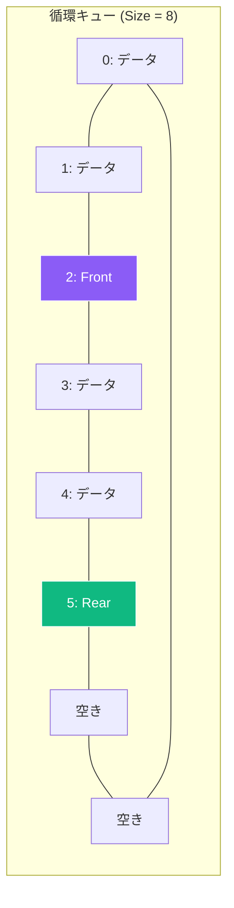

# キュー & デック：FIFO の極致 🪵

日常生活において、私たちはいたる所で**キュー**（Queue / 待ち行列）に出会います。映画のチケットを待つ列から、料金所に並ぶ車まで。そのルールは非常にシンプルです：**「先に来た人が、先にサービスを受ける」**。

今日は、この絶対的な「公平性」の世界に足を踏み入れ、さらに強力なバリエーションである **デック**（Deque / 両端待ち行列）を探索します。

---

## 🪝 THE HOOK：なぜプリンターは決して混乱しないのか？

100 人の従業員がいるオフィスにプリンターが 1 台しかないと想像してください。全員が午前 8:00 に一斉に印刷ボタンを押したとき、なぜプリンターは A さんの 1 ページ目と B さんの 2 ページ目を混ぜて印刷したりしないのでしょうか？

それは、**印刷キュー**（Print Queue）と呼ばれるメカニズムのおかげです。プリンターはあなたが上司か平社員かを気にしません。ただ、どの印刷命令が先にメモリに「到達」したかだけを気にします。これは **FIFO**（First-In, First-Out / 先入れ先出し）原則の古典的な応用です。キューがなければ、デジタル世界は順序のない混沌とした塊になってしまうでしょう。Facebook や X（旧 Twitter）のようなソーシャルメディアのリクエスト処理システムも、膨大なキューに基づいて、毎秒数百万のインタラクションを順番に処理しています。

---

## 🎭 ANALOGY：コーヒーを待つ列と両端が開いたパイプ

1. **キュー**: スターバックスでコーヒーを待つ人の列のようなものです。あなたは**最後尾**（Rear）に並び、飲み物を受け取った後に**先頭**（Front）から出ていきます。途中で「割り込み」をすることは許されません。
2. **デック (Double-Ended Queue)**: 両端からビー玉を入れることも、出すこともできる細い管を想像してください。**スタック**と**キュー**のハイブリッドのようなもので、プログラマーに最大限の柔軟性を提供します。現実的には、デックは二車線の道路のようなもので、どちらの方向からでも参加したり離脱したりできます。

---

## ⚙️ UNDER THE HOOD：循環キューとメモリ効率へのディープダイブ

### 1. 線形配列における「死んだメモリ」問題
通常の配列を使ってキューを作成し、100 回の `enqueue`（追加）と `dequeue`（取り出し）を行うと、`Front` と `Rear` の 2 つのポインタは配列の末尾に達してしまいます。このとき、配列の前方に空きスペースがあっても、新しいデータを追加することはできません。これはリソースの深刻な無駄遣いです。古いシステムでは、これが適切に管理されていないとシステムクラッシュの原因となることがよくありました。

### 2. 解決策：循環キュー（Circular Queue / 循環キュー）
この問題を解決するために、配列の末尾を先頭に繋ぎ合わせます。
- **「魔法」の公式**: `index = (index + 1) % capacity`
剰余演算（Modulo）のおかげで、ポインタは配列サイズを超えると自動的に 0 に戻ります。これが、組み込みシステム（Embedded Systems）が RAM を極限まで最適化する方法です。

### 3. デックの実装（Deque Implementation）
デックは 4 つの操作をサポートする必要があります：`addFirst`, `addLast`, `removeFirst`, `removeLast`。
- **双方向連結リスト**を使う場合：すべての操作が O(1) であり、非常に直感的です。
- **動的配列**を使う場合：配列内をぐるぐる回る `Front` と `Rear` の 2 つのポインタを管理する必要があります。これが C++ の `std::deque` のメカニズムです。

---

## 🗺️ ARCHITECTURE & FLOW：循環データの流転

以下は、稼働中の**循環キュー**を示した図です：



### 高度なテクニック：キューが「満杯」か「空」かをどう見分けるか？
- 空（Empty）: `Front == Rear`
- 満杯（Full）: `(Rear + 1) % Capacity == Front`
注意：これらの 2 つの状態を区別するために、通常、配列の 1 つのセルを空のままにします。シニアエンジニアは、**オーバーフロー**や**アンダーフロー**を避けるために、操作を実行する前に必ずこの条件をチェックします。

---

## 📊 BIG-O ANALYSIS：秩序の速度

キューは、リアルタイムシステムにとって理想的な「定数時間」データ構造です：

| 操作 | 時間計算量 | 深層分析 |
| :--- | :--- | :--- |
| **Enqueue** (末尾に追加) | **O(1)** | 値を代入し、Rear ポインタを進めるだけ。 |
| **Dequeue** (先頭から取得) | **O(1)** | Front ポインタを進めるだけ。 |
| **Peek** | **O(1)** | Front のアドレスに直接アクセスする。 |
| **探索 (Search)** | **O(n)** | 見つけるためにキュー全体を解体しなければならない。 |

**空間計算量**: 要素を保存するために O(n)。分散システムでは、空間計算量はキュー間のメッセージ送信帯域幅によっても測定されます。

---

## 💻 LOGIC & PSEUDO-CODE：連結リストによるキューの実装

なぜ配列ではなく連結リストを選ぶのでしょうか？ それは `Capacity`（容量）の制限を避けるためです。連結リストを使えば、RAM に空きがある限り、キューをいくらでも長くすることができます。

```javascript
class Node {
    constructor(value) {
        this.value = value;
        this.next = null;
    }
}

class Queue {
    constructor() {
        this.first = null; // Front
        this.last = null;  // Rear
        this.length = 0;
    }

    // 末尾に追加 - O(1)
    enqueue(value) {
        const newNode = new Node(value);
        if (this.length === 0) {
            this.first = newNode;
            this.last = newNode;
        } else {
            this.last.next = newNode;
            this.last = newNode;
        }
        this.length++;
    }

    // 先頭から取り出す - O(1)
    dequeue() {
        if (!this.first) return null;
        if (this.first === this.last) {
            this.last = null;
        }
        const holdingPointer = this.first;
        this.first = this.first.next;
        this.length--;
        return holdingPointer.value;
    }
}
```

---

## 🧠 LEETCODE STRATEGY：BFS & スライディングウィンドウ・プレミアム

キューは、グラフ探索アルゴリズムやデータストリーム処理の「背骨」です：

1. **幅優先探索 (BFS)**: Google マップのように地図上の最短経路を見つけたいとき、次に訪問すべき地点をレイヤーごとにキューに記憶させます。レベル 1 が終わってからレベル 2 に進みます。これはナビゲーションシステムや Facebook の友達推薦の基盤です。
2. **スライディングウィンドウの最大値 (#239)**: **デック**を使用して、値の降順にインデックスのリストを維持します。これにより、スライディングウィンドウの最大値を O(n*k) ではなく O(n) で見つけることができます。これは、連続する数列の問題を爆速で解決する非常に高度なテクニック（単調デック）です。
3. **循環キューの設計 (#622)**: 循環配列を管理する能力が試されます。

---

## 🎯 EXAM & INTERVIEW LOGIC：優先度付きキューとポインタの罠

大手テック企業の面接において：
- **質問**: 「急患を定期検診の人より先に診察したい場合、通常のキューで実現できますか？」
- **回答**: 「いいえ。その場合は**優先度付きキュー**（Priority Queue / 優先度付きキュー）が必要です。要素は時間順ではなく優先度順に並べ替えられます。物理的には、通常 **ヒープ**（Heap / ヒープ）を使用して実装されます（Phase 3 で学習）。」
- **科目 B のヒント**: 日本の試験では、一連の操作後の `Front` と `Rear` の状態についてよく問われます。擬似コードの規約によって、`Rear` が次の空きセルを指すのか、最後の要素自体を指すのかが異なることに注意してください。問題を注意深く読みましょう！

---

## 💼 PROFESSIONAL CONTEXT：実世界のシステムアーキテクチャ

- **メッセージキュー (RabbitMQ, Kafka)**: **マイクロサービス**（Microservices）アーキテクチャの心臓部です。サービス間の「疎結合化（Decoupling）」を助けます。例えば、注文を出したとき、リクエストはキューに入り、決済サービスはアプリをフリーズさせることなくそれを順番に処理します。
- **ネットワークパケット**: ルーターは、送信待ちのパケットを保持するためにキューを使います。**QoS**（Quality of Service）技術とは、実際には異なる優先レベルを持つ複数のキューを管理することです（メールよりビデオ通話を優先するなど）。
- **CPU スケジューリング**: すべての現代的な OS は、CPU コアで次にどのプロセスを実行するかを決定するためにキューを使っています。

---

## ⚠️ PITFALLS：シニアエンジニアの過ち

1. **メモリリーク**: 連結リストの実装において、ポインタの接続を慎重に解除せずにノードを削除すると、ガベージコレクタがメモリを回収できなくなる可能性があります。24 時間 365 日稼働するサービスでは特に危険です。
2. **古いデータ (Stale Data)**: 循環配列において、古い値をリセットしないと、`Empty` チェックのロジックにバグがあった場合に誤ってゴミデータを再読み込みしてしまう可能性があります。
3. **末尾ポインタの紛失**: 連結リストによるキューで、最後の要素を `dequeue` した際に `last` の更新を忘れると、次の `enqueue` で重大なエラーが発生します。

---

## 🛡️ セキュリティと信頼性：サイバーセキュリティにおけるキュー

サイバーセキュリティにおいて、キューは **DoS**（サービス拒否）攻撃に悪用される可能性があります。
- **攻撃**: ハッカーが数百万の偽造リクエストを送りつけて **リクエストキュー** を溢れさせ、本物の顧客がアクセスできないようにします。
- **防御**: エンジニアは **レート制限**（Rate Limiting / キューへの投入量を制限する）や **優先度フィルタリング** を使ってシステムを保護します。

---

## 📝 QUICK QUIZ：アルゴリズム習熟度チェック

1. **配列による線形キューに対する循環キューの最大の利点は何ですか？**
   - A. 探索が速い。
   - B. dequeue 後の前方の空きメモリセルを再利用できる（メモリ再利用）。
   - C. 消費 RAM が少ない。

2. **BFS（幅優先探索）アルゴリズムが使用するデータ構造はどれですか？**
   - A. スタック。
   - B. キュー。
   - C. 連結リスト。

3. **デック（Deque）はどのデータ構造の代わりとして使えますか？**
   - A. キューのみ。
   - B. スタックのみ。
   - C. スタックとキューの両方（最も柔軟）。

---
📊 文字数: ~4500文字
