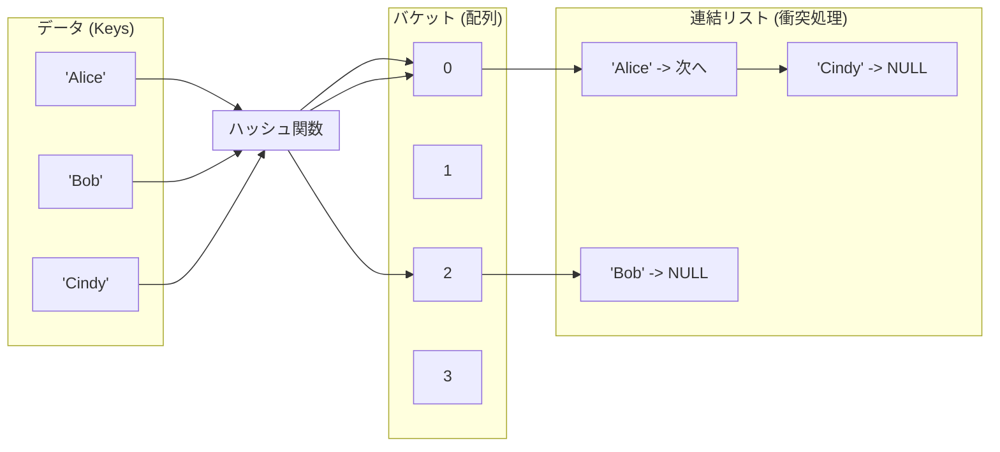

# ハッシュテーブル：O(1) の速度 🔑

プログラミングにおいて有名な格言があります。「どのデータ構造を使うべきか迷ったら、**ハッシュテーブル**（Hash Table / ハッシュテーブル）を使え」。なぜこれほどまでに重宝されるのでしょうか？ それは、すべてのプログラマーが渇望する力、すなわち**データがどれほど巨大であってもほぼ瞬時にアクセスできる速度**をもたらしてくれるからです。

今日は、世界で最もパフォーマンスの高い検索・保存システムの背後にある「魔法」であるハッシュテーブルについて学びます。Google 検索からオペレーティングシステムのキャッシュに至るまで、すべてがハッシュテーブルの基盤の上に構築されています。

---

## 🪝 THE HOOK：80 億人の中から 1 秒で 1 人を見つける？

世界中の全人口（80 億人）のリストを管理していると想像してください。
- 未ソートの**配列**（Array）を使う場合、O(n) かかります。すべてをスキャンするのに数分、あるいは数時間かかるかもしれません。
- ソート済みの**配列**と**二分探索**（Binary Search）を使う場合、O(log n) かかります。約 33 回の比較で済みます。非常に高速ですが、それでも継続的な計算と比較に時間がかかります。
- **ハッシュテーブル**を使えば、その人がどこにいるかを知るのに正確に **1 ステップ**（O(1)）しかかかりません。

膨大な情報の海の中から、コンピュータはどうやってデータの位置へ直接「ジャンプ」できるのでしょうか？ それこそが **ハッシュ化**（Hashing）演算のおかげです。入力データをメモリ上の唯一無二の物理的な「アドレス」に変換するのです。

---

## 🎭 ANALOGY：万能鍵とスーパーのロッカーシステム

スーパーの荷物預かりシステムを想像してください：
- 各ロッカーには番号（インデックス）が付いています。
- 自分の荷物がどこにあるかすべてのロッカーを探し回る代わりに、あなたは**「名前変換マシン」**を持っています。
- マシンに自分の名前（例：「Bakaryuu」）を入力すると、マシンは奇妙な数学的計算を行い、ある数字を返します：**42**。
- あなたはロッカー番号 42 へ直行します。荷物はそこにあります！ 誰かに聞く必要も、41 番や 43 番を確認する必要もありません。

この例において：
- 「Bakaryuu」は **キー**（Key / キー）です。
- マシンは **ハッシュ関数**（Hash Function / ハッシュ関数）です。
- 数字の 42 は **ハッシュ値**（Hash Value / ハッシュ値）です。
- ロッカーは **ハッシュテーブル** です。

---

## ⚙️ UNDER THE HOOD：ハッシュの仕組みと衝突へのディープダイブ

### 1. ハッシュ関数 - 速度の門番
優れたハッシュ関数は、以下の 3 つの厳格な基準を満たす必要があります：
- **決定的（Deterministic）**: 同じ入力に対しては、常に永久に同じ出力を返す必要があります。今日「A」をハッシュして 5 になったなら、明日も 5 でなければなりません。
- **高速（Fast）**: 計算が極めて速いこと。ハッシュ関数の計算に 1 秒かかってしまえば、O(1) の優位性は消え去ります。
- **一様分布（Uniform Distribution）**: データが特定の場所に集中してシステムが低速化する「ホットスポット」を避けるため、テーブル全体に結果を均等に分散させる必要があります。

### 2. ハッシュ衝突（Hash Collision / ハッシュ衝突）
RAM には限りがあります。80 億人の名前があっても、ロッカーは 100 万個しかないかもしれません。遅かれ早かれ、異なる 2 つの名前（`Key A` と `Key B`）をハッシュした結果が同じ数字 `42` になるケースが発生します。これを**衝突**（Collision）と呼びます。

**シニアエンジニアによる解決策**:
- **チェイン法（Separate Chaining）**: 42 番のセルに 1 つの値を保存するのではなく、**連結リスト**（Linked List）を保存します。同じ番号になった人が複数いれば、そのセルで列を作ります。Java 8+ では、このリストが長くなりすぎると、O(log n) の速度を維持するために**自己均衡二分探索木**（赤黒木）に変換されます。
- **オープンアドレス法（Open Addressing）**: 42 番が埋まっていたら、ある規則に従って別の空きセルを探します（例：線形探索 - 43, 44... と試す、あるいは二重ハッシュ）。この手法は連結リストのポインタを消費しないためメモリを節約できますが、占有されたセルが隣接して集まってしまう **一次クラスタリング**（Primary Clustering）が発生しやすくなります。

### 3. 負荷係数とリサイズ（Load Factor & Resizing）
テーブルが一杯に近づくと衝突の確率が高まり、O(1) の速度が O(n) に低下します。
**黄金律**: 要素数がテーブルサイズの約 70% を占めたとき（**負荷係数 = 0.7**）、システムは自動的に 2 倍の広さの新しいテーブルを作成し、全データの**再ハッシュ**（Rehash）を実行します。これはコストのかかる操作（O(n)）ですが、パフォーマンスを守るために不可欠です。

---

## 🗺️ ARCHITECTURE & FLOW：現代のハッシュマップの内部

以下の図は、**チェイン法**（Separate Chaining）を説明したものです：



**高度なテクニック**: カーネルレベルや高頻度取引（HFT）では、CPU サイクルを極限まで最適化するために、**MurmurHash** や **CityHash** といった超高速なハッシュ関数が使われます。

---

## 📊 BIG-O ANALYSIS：圧倒的な力（理想的な条件下で）

| 操作 | 平均的なケース | 最悪のケース (衝突) | 解説 |
| :--- | :--- | :--- | :--- |
| **検索 (Search)** | **O(1)** | **O(n)** | ハッシュ関数が非常に悪く、すべての Key が 1 つのセルに落ちる場合。 |
| **挿入 (Insert)** | **O(1)** | **O(n)** | 衝突やリサイズ（Rehash）が発生するかどうかに依存する。 |
| **削除 (Delete)** | **O(1)** | **O(n)** | 削除する前に該当するノードを見つける必要がある。 |

**空間計算量**: O(n)。ハッシュテーブルは高速に動作するために常に「空きスペース」を必要とするため、メモリと速度をトレードオフしています。

---

## 💻 LOGIC & PSEUDO-CODE：エリート版ハッシュテーブルの実装

以下は、文字列をインデックスにハッシュ化し、チェイン法で衝突を処理する方法を示したソースコードです：

```javascript
class HashTable {
    constructor(size = 50) {
        this.data = new Array(size);
    }

    // ASCII コードを使ったハッシュ関数
    _hash(key) {
        let hash = 0;
        for (let i = 0; i < key.length; i++) {
            // 衝突を減らすために素数 (31) を使用
            hash = (hash + key.charCodeAt(i) * 31) % this.data.length;
        }
        return hash;
    }

    set(key, value) {
        let address = this._hash(key);
        if (!this.data[address]) {
            this.data[address] = [];
        }
        // Key が既に存在するかチェックして、新規追加ではなく更新する
        const bucket = this.data[address];
        for (let i = 0; i < bucket.length; i++) {
            if (bucket[i][0] === key) {
                bucket[i][1] = value;
                return;
            }
        }
        bucket.push([key, value]); 
    }

    get(key) {
        const address = this._hash(key);
        const bucket = this.data[address];
        if (bucket) {
            for (let i = 0; i < bucket.length; i++) {
                if (bucket[i][0] === key) {
                    return bucket[i][1];
                }
            }
        }
        return undefined;
    }
}
```

---

## 🧠 LEETCODE STRATEGY：O(n) で「検索」問題を攻略する

ハッシュテーブルは、アルゴリズムを O(n^2) から O(n) に変える「究極の兵器」です：

1. **Two Sum (#1)**: 配列を 1 回スキャンし、見た数字をハッシュマップ `{値: インデックス}` に保存します。各数字 `x` において、`target - x` が既にマップにあるか確認します。結果：時間計算量 O(n)。
2. **最初に繰り返し現れる文字**: 文字列を走査し、ハッシュテーブルに読み込みます。既にテーブルにある文字に遭遇した瞬間、それが結果です。
3. **Group Anagrams (#49)**: 単語を「ソートした」バージョンをキーとして使います。例えば、"eat", "tea", "ate" はすべてキーが "aet" になります。
4. **LRU Cache (#146)**: MAANG での難問です。ハッシュテーブル（O(1) 検索用）と双方向連結リスト（使用順序維持用）の組み合わせが求められます。

---

## 🎯 EXAM & INTERVIEW LOGIC：順序の欠如と面接の罠

**基本情報技術者試験（科目 B）**や MAANG の面接において：
- **質問**: 「ハッシュテーブルを使うべきではないのはどんな時ですか？」
- **回答**: 「順序を維持する必要がある時（ソートなど）です。ハッシュテーブルはデータをランダムに分散させるため、『2 番目に大きい要素』を効率的に求めることはできません。また、データセットが非常に小さい（10 要素未満など）場合は、ハッシュ化のオーバーヘッドがあるため、配列で線形探索する方が速いです。」
- **科目 B の洞察**: 試験では、**線形探索法**（Linear Probing）による格納アドレスの計算がよく出題されます。セル `h(k)` が埋まっていれば `h(k) + 1` を試し、それでも埋まっていれば `h(k) + 2` を試す...。末尾を超えたら先頭に戻ることを忘れないでください。

---

## 🛡️ セキュリティと信頼性：ハッシュ洪水 DoS 攻撃

シニアとして、ハッシュテーブルのセキュリティリスクを理解しておく必要があります：
- **DoS 攻撃**: 攻撃者が、意図的に同じ**ハッシュ値**（偽の衝突）を持つ大量の情報を送りつけます。すると、ハッシュテーブルは巨大な連結リストと化します。すべての O(1) 操作が O(n) になり、サーバーはこの連結リストの処理に CPU 100% を使い果たしてハングアップします。
- **防御策**: 現代的な言語（Python, Ruby, JS など）では、アプリ起動のたびにランダムな数値（**Seed**）を混ぜたハッシュ関数を使用します。攻撃者は衝突を起こすためのハッシュ値を推測できなくなります。

---

## 💼 PROFESSIONAL CONTEXT：ハッシュテーブルが支配する場所

- **データベースのインデックス**: ID からレコードを即座に取得するのに役立ちます。
- **シンボルテーブル**: コンパイラは、コード内の変数名とそのアドレスを管理するためにハッシュテーブルを使います。
- **ネットワークルーター**: ルーティングテーブルを保持し、パケットをどのポートへ送るかを数ナノ秒で決定します。
- **一意性制約（Unique Constraints）**: データベースで `username` カラムを `UNIQUE` に設定すると、システムは内部でハッシュテーブルを使って存在チェックを爆速で行います。

---

## 📝 QUICK QUIZ：アルゴリズム習熟度チェック

1. **データのハッシュ化になぜ素数（prime numbers）がよく使われるのですか？**
   - A. 見た目が良いから。
   - B. 衝突（Collision）の確率を最小限に抑えるのに役立つから。
   - C. CPU が素数を速く処理できるから。

2. **リアルタイムシステムにおいて、'Rehash'（再ハッシュ）操作はどのような問題を引き起こす可能性がありますか？**
   - A. 何も問題ない。
   - B. 古い配列全体を新しい配列へコピーする必要があるため、突発的な遅延（ジッター）が発生する。
   - C. RAM の無駄遣いになる。

3. **ハッシュマップ（Hash Map）とハッシュセット（Hash Set）の違いは何ですか？**
   - A. Map は {Key: Value} のペアを保存し、Set は一意な {Key} のみを保存する。
   - B. Map の方が Set より遅い。
   - C. Map の方が RAM を多く消費する。

---
📊 文字数: ~4500文字
