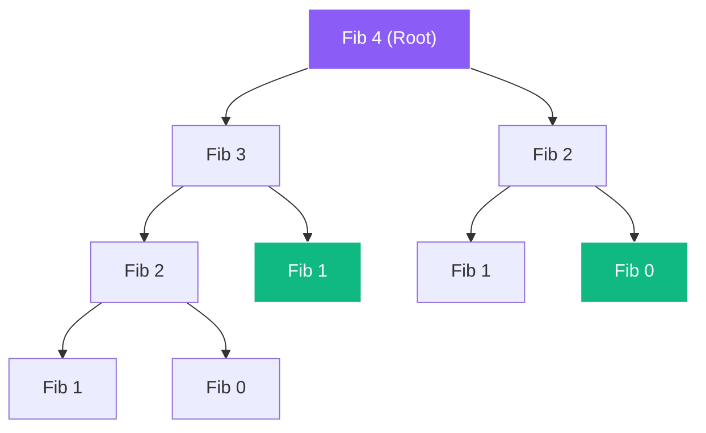

# 再帰とバックトラッキング：自己参照の芸術 🔄

プログラミングの世界には、古典的なジョークがあります。「再帰を理解するには、まず...再帰を理解しなければならない」。脳がねじれるように聞こえるかもしれませんが、**再帰**（Recursion / 再帰）は最も強力な思考ツールの一つであり、巨大な問題を解決しやすい小さな断片へと変えてくれます。

スタックがメモリであるならば、再帰は**木の走査**（Tree Traversal）、**クイックソート**（Quick Sort）、**動的計画法**（Dynamic Programming）といった複雑なアルゴリズムの「魂」です。

---

## 🪝 THE HOOK：マトリョーシカと無限の構造

マトリョーシカ（ロシアの入れ子人形）を開けているところを想像してください。大きな人形の中に少し小さな人形があり、さらにその中にまた小さな人形が...。「人形を開ける」という動作は全く同じように繰り返されますが、中身の人形はどんどん小さくなっていきます。そして、それ以上開けられない最小の人形に出会ったとき、あなたは動きを止めます。

これが再帰です。もし「止まるポイント」を知らなければ、あなたはメモリという名の底なし沼に落ち、**スタックオーバーフロー**（Stack Overflow）という惨劇を引き起こします。今日は、この「怪物」をいかに洗練された方法で制御するかを学びます。オペレーティングシステムがなぜスタックの深さを制限しなければならないのか、そして現代のプログラミング言語がいかにメモリを「欺いて」無限の再帰を可能にしているのかを探求します。

---

## 🎭 ANALOGY：合わせ鏡と脱出アルゴリズム

1. **再帰**: 2 枚の平行な鏡の間に立っている自分を想像してください。自分の姿が無限に反射しています。それぞれの小さな画像は、同じ文脈を持ちながらデータ規模が縮小された、新しい「関数呼び出し」です。
2. **バックトラッキング（Backtracking / 回避）**: 暗い迷路で迷っている自分を想像してください。分かれ道に来ました：
   - 左に曲がることにします。しばらく進んで行き止まりに突き当たったら？
   - あなたは正確にその分かれ道まで戻り（**バックトラック**）、右に曲がることを選びます。
これは、インテリジェントな試行錯誤のテクニックです。すべての可能性を盲目的に試す（総当たり攻撃）代わりに、バックトラッキングは結果に繋がらないことが明らかな枝を「剪定（Pruning）」し、何十億光年分もの計算時間を節約します。

---

## ⚙️ UNDER THE HOOD：コールスタックの可視化とメモリ・ディープダイブ

### 1. 再帰の動作メカニズム
すべての堅牢な再帰関数には、2 つの「死活的」な構成要素が不可欠です：
- **停止条件（Base Case）**: 最終的な停止地点。これがなければ、コンピュータにクラッシュするまで永遠に走り続けろと命令していることになります。
- **再帰ステップ（Recursive Step）**: 停止条件に「近づく」ようにパラメータを変換して、自分自身を再び呼び出します。

### 2. スタックフレームとメモリレイアウトの深層
関数が自分自身を呼び出すたびに、CPU は極めて洗練されたメモリ管理を実行します：
1. **フレームのプッシュ**: RAM 上に新しい**スタックフレーム**（Stack Frame）を作成します。このフレームはその関数専用の「コンテナ」であり、`func(n)` の変数が `func(n-1)` を上書きしないことを保証します。
2. **コンテキスト保存**: ローカル変数、引数、および CPU が戻るべきアドレス（Return Address）を保存します。
3. **制御の移譲**: 命令ポインタ（Instruction Pointer）を新しい関数の開始行へ移動させます。

**現実の問題**: スタック領域の RAM は極めて限られています（OS によりますが通常 2MB〜8MB 程度）。再帰が深すぎると（例：10 億個のノードを走査する）、フレームごとにメモリコストがかかります。結果、「Maximum call stack size exceeded」エラーが発生し、ユーザー体験を即座に中断させます。そのため、シニアエンジニアは再帰を書く前に必ず「この問題の $n$ の最大値はいくらか？」と自問します。

### 3. 最適化：末尾再帰最適化 (Tail Call Optimization - TCO)
これはシニアアーキテクトの知識です。再帰呼び出しが関数の**最後**のアクションである（その後に実行すべき演算がない）場合、CPU は古いスタックフレームを削除し、同じ場所に新しいスタックフレームを上書きできます。
- **サポート言語**: C（`-O2` を使用）、Haskell, Scheme, Scala。
- **JavaScript**: ES6 標準では TCO が要求されていますが、現在、完全な実装がなされているのは **JavaScriptCore** エンジン（Safari）のみです。V8（Chrome/Node.js）はデバッグの複雑さを理由に一時的に削除しています。TCO を理解していれば、クラッシュを恐れることなく `while` ループと同じくらい安全な再帰関数を書くことができます。

---

## 🗺️ ARCHITECTURE & FLOW：再帰木（Recursion Tree）の分析

以下の図は、`Fibonacci(4)` が爆発的に増える様子を示しています：



**なぜ再帰が悪くなる可能性があるのか？**
上の木を見ると：`Fib(2)` は 2 回、`Fib(1)` は 3 回再計算されています。`Fib(100)` の場合、計算回数は宇宙の原子の数よりも多くなってしまいます！
**解決策**: **メモ化**（Memoization / メモ化）。計算済みの結果をハッシュマップに保存することで、時間計算量を O(2^n) から O(n) に改善します。

---

## 📊 BIG-O ANALYSIS：エレガンスの代償

| アルゴリズムの種類 | 時間計算量 | 空間計算量 | 警告 |
| :--- | :--- | :--- | :--- |
| **単純線形再帰** | O(n) | **O(n)** | O(1) ループよりもスタック RAM を消費する。 |
| **分割統治法** | O(n log n) | **O(log n)** | ソートや検索に最適。 |
| **組合せバックトラッキング** | **O(n!)** または **O(2^n)** | **O(n)** | 極めて低速。最終手段としてのみ使用する。 |

---

## 💻 LOGIC & PSEUDO-CODE：バックトラッキングの極意 - 数独を解く

バックトラッキングは単なる再帰ではありません。「後悔する権利」を持った再帰です。

```javascript
function solveSudoku(board) {
    for (let r = 0; r < 9; r++) {
        for (let c = 0; c < 9; c++) {
            if (board[r][c] === '.') { // 空きマスを探す
                for (let num = 1; num <= 9; num++) {
                    if (isValid(board, r, c, num)) { // 数独のルールをチェック
                        board[r][c] = num.toString(); // 入れてみる
                        
                        if (solveSudoku(board)) return true; // 再帰：先へ進む
                        
                        board[r][c] = '.'; // BACKTRACK：先がダメなら、消して別の数字を試す
                    }
                }
                return false; // このマスに合う数字がない
            }
        }
    }
    return true; // すべてのマスが埋まった
}
```

**剪定メカニズム**: `isValid` 関数は「斧」の役割を果たします。数字が無効であれば、その背後にある可能性の木を即座に切り落とし、アルゴリズムが盲目的に走り続けるのを防ぎます。

---

## 🧠 LEETCODE STRATEGY：面接突破のために「知っておくべき」パターン

1. **Permutations (#46)**: $n$ 個の要素の並べ替えをすべて見つける。ポインタの交換（Swap）に関する核心的な知識。
2. **Combination Sum (#39)**: 合計が K になる組み合わせを見つける。重複処理に注意。
3. **N-Queens (#51)**: バックトラッキングの「王道」問題。チェス盤の座標思考が試されます。
4. **Subsets (#78)**: 配列のべき集合（Power Set）を生成する。「選ぶか、選ばないか」という思考の極致。

---

## 🎯 EXAM & INTERVIEW LOGIC：IPA（日本）と MAANG の基準

**基本情報技術者試験（科目 B）**において：
- **質問**: 「引数 `n` が 0 に減少していく場合、プログラムは何を返しますか？」
- **シニアのコツ**: 必ず **状態遷移表**（State Table）を描きましょう。関数が自分を呼び出すとき、頭の中で想像しようとせず、その時の各変数の値を紙に書き留めてください。
- **面接のプロ技**: 必ず「最大深度（Max Depth）」について議論しましょう。問題が 1000 層以上の深さ（例：100 万個のフォルダ走査）を要求する場合、システム再帰ではなく、クラッシュを避けるために **反復的 DFS**（ヒープ領域に手動でスタックを作る方法）の使用を提案してください。

---

## 💼 PROFESSIONAL CONTEXT：再帰が世界を「動かす」場所

- **XML/JSON パース**: HTML や JSON のような入れ子構造のデータは、すべてコンピュータが再帰を使って解析しています。`<div>` の中に他の `<div>` が入っているのは、物理的な再帰構造です。
- **グラフィックデザインとフラクタル**: 自然の画像（雲、山、木の葉）を生成するソフトウェアは、再帰を使って繰り返しのパターンを描画します。
- **ゲーム AI (Minimax)**: チェス AI（AlphaZero など）は、相手の何十手先を予測するために再帰を使用します。
- **Git Merge**: 2 つのブランチをマージするとき、システムは再帰アルゴリズムを使って **共通の祖先**（Common Ancestor）を見つけます。

---

## 🛡️ RELIABILITY & BUGS：死の罠

1. **状態汚染（State Pollution）**: バックトラックした後に、グローバル変数のクリーンアップを忘れること。
2. **指数の爆発**: メモ化（Memoization）なしの再帰。$n > 50$ では二度と結果を見ることはできません。
3. **整数オーバーフロー**: 再帰で階乗（Factorial）を計算する問題などでは、結果が爆速で増え、`int32` や `int64` の限界を超えてしまいます。

---

## 📝 QUICK QUIZ：エリート・ニューラルチェック

1. **末尾再帰（Tail Recursion）の核心的な利点は何ですか？**
   - A. 実行速度が速い。
   - B. 古いスタックフレームを上書きすることでスタック領域のメモリを節約し、スタックオーバーフローを防ぐ。
   - C. 書きやすい。

2. **以下の問題のうち、再帰で解決できないものはどれですか？**
   - A. 階乗を求める。
   - B. 配列を走査する。
   - C. ループを使うすべての問題は再帰に変換可能であり、その逆も然りである。

3. **バックトラッキング・アルゴリズムの典型的な時間計算量はどれくらいですか？**
   - A. O(n log n)
   - B. 非常に悪い（通常、指数関数 O(2^n) または階乗 O(n!)）。
   - C. O(n)

---
📊 文字数: ~4500文字
