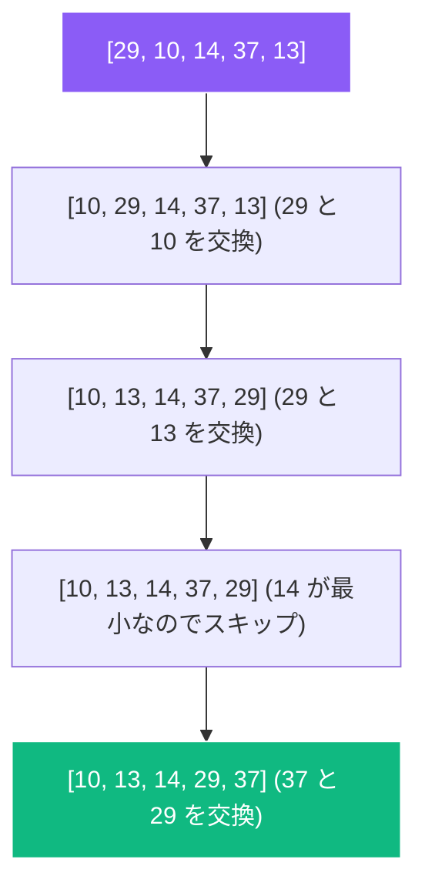

# 基本ソート：基盤 📉

ソート（Sorting / 並べ替え）は、人類の CPU リソースを最も消費する活動の一つです。Amazon の商品リストの並べ替えから、Google の検索順位の最適化まで、ソートはデジタル世界のあらゆる場所に存在しています。

多くの人がこう尋ねます。「2026 年にもなって、なぜ**バブルソート**のような『遅い』アルゴリズムを学ばなければならないのか？」。その答えは単なる試験のためだけではありません。**ハードウェアの最適化**（Hardware Optimization）、**メモリ管理**（Memory Management）、そしてデータの**安定性**（Stability）に関する基本的な思考にあります。

---

## 🪝 THE HOOK：なぜ「最悪」のアルゴリズムがシステムを救うのか？

メモリが極端に小さく、CPU も非力なスマートウォッチのコードを書いていると想像してください。ソートすべき 10 個の数字のリストがあります。もしここで「最速」とされる**クイックソート**（Quick Sort）を使えば、再帰のためのスタックメモリと複雑なロジックが必要になります。

しかし、**挿入ソート**（Insertion Sort）を使えば、ソースコードはわずか数行で済み、補助メモリのための RAM も 1 バイトも追加消費しません。そして驚くべきことに、少量のデータに対してはクイックソートよりも速く動くのです！ 真のシニアエンジニアは決して「弱者」を軽んじません。彼らは適切な規模に対して適切なツールを使う方法を知っています。これはソフトウェアエンジニアリングにおける「実利主義」のレッスンです。

---

## 🎭 ANALOGY：トランプの並べ替えと背の順の列

1. **選択ソート (Selection Sort)**: 鍵の束を持っているところを想像してください。全体を一度見て、一番小さいものを選んで左に置きます。残りの山に対しても同じことを繰り返します。常に「最小のもの」を探して正しい場所に置く。生のリストから最高の候補者を選び出すようなものです。
2. **バブルソート (Bubble Sort)**: 水中の気泡（バブル）を想像してください。大きな気泡は、隣同士の比較を繰り返しながら、小さな気泡よりも上に「浮いて」いきます。1 周すると、最大の要素が最後尾に「浮上」します。すべてが整うまで繰り返される「隣接ペアの対決」アプローチです。
3. **挿入ソート (Insertion Sort)**: トランプを手元で並べ替えるときと全く同じです。新しいカードを 1 枚取り、既に並んでいるカードの中の正しい位置に「挿入」します。常に、既にソートが終わっている配列の一部に対して作業を行います。

---

## ⚙️ UNDER THE HOOD：安定性、インプレース、キャッシュ意識へのディープダイブ

### 1. 安定ソート（Stable Sort）とは？
既に「名前」順にソートされている学生リストがあるとします。今度はこれを「成績」順にソートしたいとします。
- **安定ソート**: 成績が同じ二人の場合、以前のソート結果である「名前順」が維持されます。
- **不安定ソート**: 成績が同じ二人の名前順が、バラバラにシャッフルされてしまう可能性があります。
**挿入ソート**と**バブルソート**は、以前のソート努力を保存する優れた安定アルゴリズムです。

### 2. インプレース・ソート（In-place Sorting）とメモリ効率
これらの基本アルゴリズムは、メモリ効率において 10 点満点です。補助的な配列（Extra Space）を作ることなく、元の配列上で直接交換（Swap）を行います。空間計算量は **O(1)** です。レガシーシステムや組み込みシステムにおいて、これは最も重要な基準です。

### 3. 「ほぼソート済みデータ」の威力
これはシニアとして重要なポイントです：配列が既にほぼ順序通りである場合、**挿入ソート**は **O(n)** の速度に達します。クイックソートやマージソートがどんなに速くても、このシナリオで挿入ソートに勝つことはできません。Java や Python で使われている **Timsort** アルゴリズムが、マージソートと挿入ソートを組み合わせて、既にある程度ソートされた部分配列を利用して最高性能を発揮するのはそのためです。

### 4. ハードウェア意識：CPU キャッシュの活用
CPU は RAM から 1 バイトずつ読み込むわけではありません。**キャッシュライン**（通常 64 バイト）単位で読み込みます。バブルソートや挿入ソートは配列を連続的な線形順序で走査するため、キャッシュに対して極めてフレンドリーです。これにより、小さなデータセットでは理論上の O(n^2) よりもはるかに高速に動作します。

---

## 🗺️ ARCHITECTURE & FLOW：選択ソートの動き

以下の図は、最小値（MIN）の探索と交換のプロセスを示しています：



**選択の戦略**: 配列がどんなに「綺麗」であっても、選択ソートは愚かにも $n$ 回 MIN を探しに行きます。配列が既に完成していることを認識する能力がありません。そのため、選択ソートは完全にソート済みの配列に対しても、常に O(n^2) の時間を要します。

---

## 📊 BIG-O ANALYSIS：3 つのアルゴリズムの詳細比較

| アルゴリズム | 最良時間 | 平均時間 | 最悪時間 | 空間 | 安定？ |
| :--- | :--- | :--- | :--- | :--- | :--- |
| **バブル** | **O(n)** | O(n^2) | O(n^2) | O(1) | **Yes** |
| **選択** | O(n^2) | O(n^2) | O(n^2) | O(1) | No |
| **挿入** | **O(n)** | O(n^2) | O(n^2) | O(1) | **Yes** |

**注意**: バブルソートが O(n) になるのは、交換が必要なペアがなくなった時点で早期終了する `isSwapped` フラグを適用した場合のみです。このフラグがない場合は O(n^2) のままです。

---

## 💻 LOGIC & PSEUDO-CODE：クリーンで最適化された挿入ソート

これは O(n^2) グループの中で最も重要であり、実用性が極めて高いため暗記しておくべきアルゴリズムです：

```javascript
function insertionSort(arr) {
    for (let i = 1; i < arr.length; i++) {
        let current = arr[i];
        let j = i - 1;
        
        // current より大きい要素を右に 1 つずらす
        // 新しい要素のための「スペース」を作る
        while (j >= 0 && arr[j] > current) {
            arr[j + 1] = arr[j];
            j--;
        }
        // 作成された「穴」に値を挿入する
        arr[j + 1] = current;
    }
    return arr;
}
```

**なぜ速いのか？** 配列をずらす操作 `arr[j+1] = arr[j]` は、CPU のキャッシュと RAM 上で極めて高速に行われ、アトミックに近い動作をするからです。

---

## 🧠 LEETCODE STRATEGY：基本アルゴリズムをいつ使うか？

この知識は、面接の「ひっかけ」質問を乗り越えるのに役立ちます：
1. **少量のデータ (n < 50)**: クイックソートやマージソートの再帰のオーバーヘッドの方が、それらがもたらす利益よりも大きいため、常に挿入ソートを優先します。
2. **組み込みシステム**: RAM の 1KB すら貴重な場合。
3. **ほぼソート済みのデータストリーム**: ネットワーク遅延などで 1〜2 個の要素だけ順序が狂っている場合。
4. **Sort Linked List (#147)**: 連結リスト上では、配列のような「ずらす（Shift）」操作が不要で、ポインタの付け替えを O(1) で行えるため、挿入ソートは非常に効率的です。

---

## 🎯 EXAM & INTERVIEW LOGIC：「安定性」の罠と科目 B

- **基本情報技術者試験（科目 B）**: バブルソートの交換（Swap）回数についてよく問われます。**「1 回の交換は、配列の『転倒数（Inversion）』を 1 つ減らすこと」**だと覚えておきましょう。また、二重ループ内の `i` と `j` の動きを明確に区別してください。
- **面接のプロ技**: 「最悪のアルゴリズムはどれか？」と聞かれたら、すぐにバブルソートと答えないでください。「最悪か最良かは **Constraints**（制約）に依存します。バブルソートは、配列がソート済みかどうかをわずか 1 回の走査（O(n)）で検出するのに極めて効率的です」と答えましょう。

---

## 💼 PROFESSIONAL CONTEXT：2026 年にもこれらが輝く場所

- **ハイブリッド・ソート (Timsort)**: Python の `sort()` や Java の `Arrays.sort()` のデフォルトアルゴリズムです。小さな断片（32〜64 要素）の処理に挿入ソートを使い、それらをマージソートで結合します。
- **コンピュータグラフィックスの Z バッファ**: カメラが少しだけ動いたとき（データがほぼソート済み）に、オブジェクトを奥行き順に並べ替える。
- **データベースのクエリ最適化**: クイックソートの初期化コストが高すぎるため、極めて小さな TOP-K 結果セットに対して選択ソートを優先することがあります。

---

## 🛡️ セキュリティと安定性：不安定なソートのリスク

なぜセキュリティにおいて**安定性**（Stability）が重要なのでしょうか？
金融のログシステムにおいて、不安定なソートは同じミリ秒内に発生した取引の順序を変えてしまう可能性があります。これは照合（Reconciliation）の不一致を引き起こし、**リプレイアタック**（Replay Attacks）の隙を作ることになりかねません。そのため、シニアエンジニアは時間的感度の高いシステムには必ず**安定（Stable）**アルゴリズムを選択します。

---

## 📝 QUICK QUIZ：エリート・ニューラルチェック

1. **なぜ Timsort のような複雑なアルゴリズムで挿入ソートが使われるのですか？**
   - A. コードが書きやすいから。
   - B. 小さな配列（<64）に対して極めて高速であり、安定性を維持できるから。
   - C. クイックソートよりもメモリ消費が少ないから。

2. **100 万個の要素があるが、完全に昇順でソートされている配列があります。最適化されたバブルソート（フラグ付き）は何回の比較を行いますか？**
   - A. 100 万回（完了を知るために 1 周する）。
   - B. 1 兆回 (n^2)。
   - C. 0 回。

3. **以下のアルゴリズムのうち、不安定（Unstable）なものはどれですか？**
   - A. バブルソート。
   - B. 選択ソート（遠くの要素との Swap が相対的な順序を壊す可能性がある）。
   - C. 挿入ソート。

---
📊 文字数: ~4500文字
