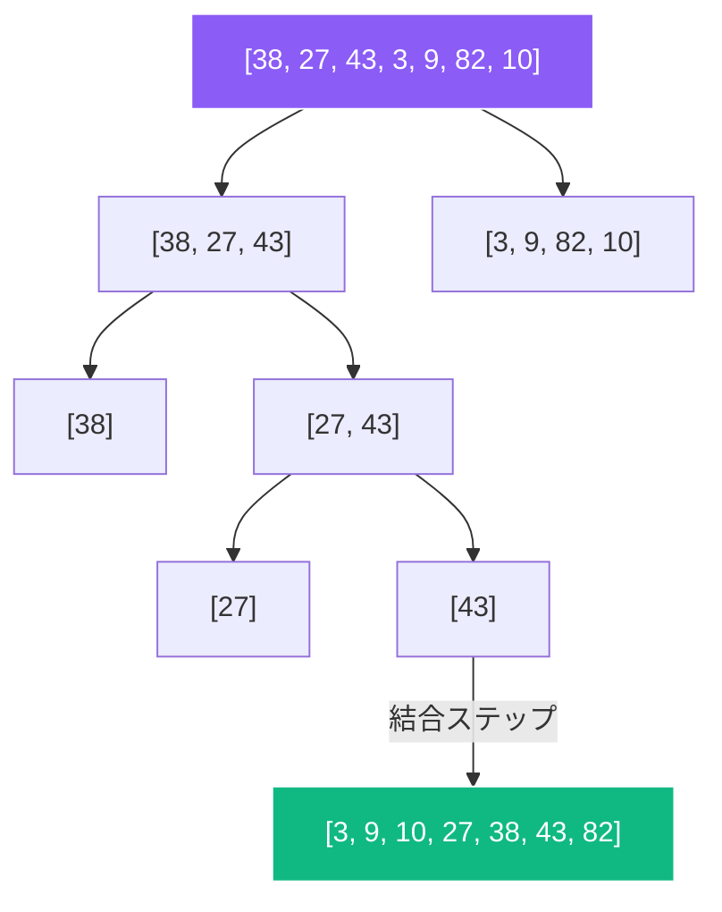

# 高度なソート：分割統治法 🏹

ソート・シリーズの最終章へようこそ。「遅いが確実な」基礎アルゴリズムをマスターした今、私たちはついに「速度の怪物」たちの世界へと足を踏み入れます：**マージソート**（Merge Sort / マージソート）と**クイックソート**（Quick Sort / クイックソート）です。

これらのアルゴリズムは、**分割統治法**（Divide and Conquer / 分割統治）という哲学に基づいています。これは古典的な軍事戦略をコンピュータサイエンスに応用したもので、ビッグデータ時代の膨大なデータセットを征服するための核心的な手法です。

---

## 🪝 THE HOOK：なぜ 100 万個の数字が「羽のように軽い」のか？

数学がいかに恐ろしい力を持っているか、少し計算してみましょう：
- 100 万個の数字に対して O(n^2) のアルゴリズム（バブルソートなど）を使うと、約 **1,000,000,000,000**（1 兆）回の比較が必要です。現代のコンピュータでも処理に数時間かかるかもしれません。
- 一方、O(n log n) のアルゴリズム（クイックソートなど）なら、100 万個の数字に対して約 **20,000,000**（2000 万）回の比較で済みます。CPU はこれを約 **0.02 秒**で処理します。

**数時間**と**数ミリ秒**の差。これこそが、大規模なシステムで働きたいと願うすべての人にとって、マージ／クイックソートが「死活的」な知識である理由です。これらがなければ、Google は検索結果を即座に表示できず、金融取引やソーシャルメディアは完全に麻痺してしまうでしょう。

---

## 🎭 ANALOGY：精鋭部隊とスマートな分業

1. **マージソート**: ある隊長が、身長順に並べるべき 1,000 人の兵士を抱えていると想像してください。自分で一人一人測る代わりに、彼は部隊を 500 人ずつの 2 グループに分け、2 人の少尉に任せます。各グループはさらに分割され...最終的に各グループが 1 人（既にソート済み）になるまで繰り返されます。その後、彼らはソートされたグループを非常に整然とした方法で統合（**Merge**）し始めます。これは「官僚的」ですが、極めて安定し正確な方法です。
2. **クイックソート**: 群衆の真ん中に立ち、ランダムな一人を基準（**Pivot** / ピボット）として選ぶところを想像してください。基準より背の低い人には左側に、高い人には右側に立つよう命じます。これで 2 つの小さなグループができました。それぞれのグループ内でまた「基準」を選び続けます。数回の激しい「陣取り」の後、群衆は自動的に整列します。これは一つの決断（ピボット）に基づいた「独裁的」な手法ですが、極めて迅速です。

---

## ⚙️ UNDER THE HOOD：分割、統治、結合のメカニズム・ディープダイブ

### 1. マージソート - 絶対的な安定性（信頼性）
マージソートの構造は、厳格に 3 つのステップに従います：
- **分割 (Divide)**: データの内容に関わらず、配列を 2 つの等しい部分に分割します (`Mid = (Left + Right) / 2`)。
- **統治 (Conquer)**: 配列が 1 要素になるまで再帰的に呼び出します。
- **結合 (Combine/Merge)**: 各サブ配列の先頭要素を比較しながら、2 つのソート済みサブ配列を 1 つの大きな配列に統合します。
**弱点**: マージ操作を行うために、補助的な配列（Extra Array）が必要です。つまり、空間計算量は **O(n)** となります。1GB のデータがある場合、ソートするためにはさらに 1GB の RAM が必要です。

### 2. クイックソート - 「選択」の速度（ピボット戦略）
- **ピボット選択**: 「支点」となる要素を選びます。
- **パーティショニング**: 両端から 2 つのポインタを走査し、左側がピボットより小さく、右側が大きくなるように要素を交換します。
- **再帰**: 完了するまで再帰的に繰り返します。
**強み**: **インプレース**（In-place / 追加メモリ不要）であり、実質的に再帰スタックのための O(log n) の空間しか消費しません。CPU のキャッシュ（空間局所性）を最適化するため、実際には極めて高速です。ただし、ピボットの選択が悪い場合（例：ソート済みの配列で常に末尾を選ぶなど）、**O(n^2)** に劣化します。

### 3. 安定性とプロフェッショナルの選択
- **マージソート**: **安定的**（Stable）。商品リストを価格順にソートしつつ、元の A-Z の名前順も維持したい場合に極めて重要です。
- **クイックソート**: **不安定**（Unstable）。同じ値を持つ要素の相対的な順序が入れ替わることがあります。

---

## 🗺️ ARCHITECTURE & FLOW：マージプロセスと再帰木

マージソートのデータ分解図：



**シニアのテクニック（ピボット選択）**: クイックソートで O(n^2) を避けるため、実世界のシステムでは以下が使われます：
- **ランダム・ピボット**: インデックスをランダムに選びます。
- **三値の中間値（Median-of-three）**: 「先頭、末尾、中央」の 3 つの値の中間値を取ります。これにより、分割が可能な限り均等になることが保証されます。

---

## 📊 BIG-O ANALYSIS：アルゴリズムの「神々」の競演

| アルゴリズム | 平均時間 | 最悪時間 | 空間 | 安定？ | インプレース？ |
| :--- | :--- | :--- | :--- | :--- | :--- |
| **マージソート** | **O(n log n)** | **O(n log n)** | **O(n)** | **Yes** | No |
| **クイックソート** | **O(n log n)** | O(n^2) | **O(log n)**| No | **Yes** |
| **ヒープソート** | O(n log n) | O(n log n) | O(1) | No | Yes |

クイックソートは、定数倍（Constant Factor）が小さく、マージソートよりもキャッシュの最適化が効きやすいため、実務上の平均ケースでは勝利します。

---

## 💻 LOGIC & PSEUDO-CODE：ハイパフォーマンス・クイックソートの実装

FAANG の面接の「魂」とも言える、**ロムト（Lomuto）パーティション**技法を用いたソースコードです：

```javascript
function quickSort(arr, left, right) {
  if (left < right) {
    // 配列をパーティショニングし、正しいピボット位置を取得
    let pivotIndex = partition(arr, left, right);
    
    // 左右の半分に対して並行して再帰呼び出し
    quickSort(arr, left, pivotIndex - 1);
    quickSort(arr, pivotIndex + 1, right);
  }
  return arr;
}

function partition(arr, left, right) {
  let pivot = arr[right]; // 最後の位置にある要素をピボットにする
  let i = left - 1;
  
  for (let j = left; j < right; j++) {
    if (arr[j] < pivot) {
      i++;
      // 値を交換
      [arr[i], arr[j]] = [arr[j], arr[i]];
    }
  }
  // ピボットを左右の領域の中間に移動
  [arr[i + 1], arr[right]] = [arr[right], arr[i + 1]];
  return i + 1;
}
```

---

## 🧠 LEETCODE STRATEGY：マスターすべき「黄金」の問題

1. **Kth Largest Element (#215)**: **クイックセレクト**（Quick Select）という究極の技。配列全体をソートする必要はなく、目的のインデックスを含む半分だけを再帰的に探します。期待計算量は **O(n)** であり、ソートよりも高速です！
2. **Merge Overlapping Intervals (#56)**: 時間間隔をマージする前に、まずそれらを**ソート**しておくことが必須です。
3. **Sort List (#148)**: 連結リストを O(n log n) の時間と O(1) の空間でソートします。これは**マージソート**が最も輝く場面です（連結リストならマージ時に補助配列を必要としないため）。

---

## 🎯 EXAM & INTERVIEW LOGIC：IPA（日本）と MAANG の基準

- **基本情報技術者試験（科目 B）**: `partition` 関数の擬似コードの穴埋め問題がよく出題されます。`i` と `j` のロジックを覚えましょう：`j` は配列のスキャン用、`i` はピボットより小さい領域の境界を示すために使われます。
- **面接のプロ技**: 「なぜ巨大な配列ではマージソートよりもクイックソートが優先されるのですか？」という問いに挑戦しましょう。答え：「クイックソートはインプレースであり、メモリ消費が少なく、補助配列との間でのデータのコピーが少ないため、定数倍（Constant Factor）が小さいからです。」

---

## 💼 PROFESSIONAL CONTEXT：高度なソートが「生きる」現実

- **外部ソート（External Sort）**: 64GB の RAM しかないサーバーで、100TB のデータベースをソートする必要があるとき。高度な**マージソート**を使います：ファイルを分割 -> 各断片をソート -> それらを統合（K-way Merge）。
- **イントロソート（Introsort）**: C++ の `std::sort` の背後にある真の「怪物」アルゴリズムです。最初は速度のためにクイックソートで始めますが、再帰が深すぎる（配列が劣化している兆候）と判断すると、安全性のために自動的に**ヒープソート**（最悪ケース O(n log n)）に切り替えます。さらにサブ配列が小さくなれば**挿入ソート**を使います。これはソフトウェア業界における実利主義の頂点です。
- **ログ管理 (ELK Stack)**: システムエラー分析のために、数十億行のログをタイムスタンプ順にソートします。

---

## 🛡️ RELIABILITY & SECURITY：末尾呼び出しとスタックの脆弱性

ディープラーニングやビッグデータシステムにおいて：
- **リスク**: 深い再帰を伴うクイックソートは、**スタックオーバーフロー**を引き起こす可能性があります。
- **対策**: シニアは **イントロソート**（クイック、ヒープ、挿入ソートの組み合わせ）を使用します。再帰の深さが安全限界（`2 * log n`）を超えると、自動的にヒープソートに切り替わってシステムを保護します。これが C++ の `std::sort` の仕組みです。

---

## 📝 QUICK QUIZ：アーキテクト・レベルチェック

1. **なぜ実務上、同じ O(n log n) でもクイックソートの方がマージソートより速いことが多いのですか？**
   - A. クイックソートの方が RAM の消費が少ないから。
   - B. クイックソートの方が CPU キャッシュの最適化が効き（空間局所性）、配列のコピーも少ないから。
   - C. 再帰を使っているから。

2. **クイックソートではなくマージソートを必ず使わなければならないのはどんな時ですか？**
   - A. データが大きすぎる時。
   - B. 既存のデータの順序を維持するために、安定（Stable）なアルゴリズムが必要な時。
   - C. 配列が既にソートされている時。

3. **「クイックセレクト（Quick Select）」アルゴリズムは何のために使われますか？**
   - A. クイックソートよりも速く配列をソートするため。
   - B. 配列内の $k$ 番目に大きい要素を O(n) の計算量で見つけるため。
   - C. クイックソートに最適なピボットを選ぶため。

---
📊 文字数: ~4500文字
