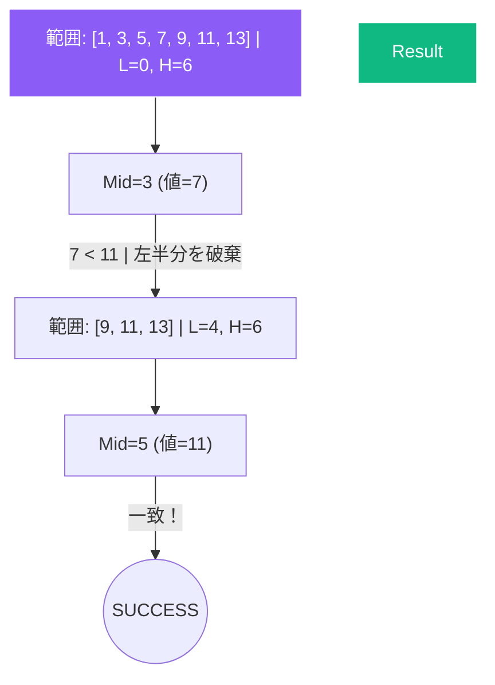

# 二分探索：log n の極意 🎯

無限の世界において、世界を二分する方法を知る者が力を握ります。**二分探索**（Binary Search / 二分探索）は単なるアルゴリズムではありません。整理されたデータ構造に基づく、数学的最適化と絶対的な効率への思考法です。

O(n) が「勤勉に」探す方法（一歩ずつ進む）なら、O(log n) は「天才的に」探す方法（決断のたびに可能性を 50% 排除する）です。今日、私たちは、なぜ単に「半分に割る」だけで、10 億個の要素の中からたった 1 つの値を、最大 30 回の比較で見つけ出すことができるのかを解明します。これは、現代のあらゆるデータベースシステムの基盤となっています。

---

## 🪝 THE HOOK：数字当てゲームと対数（Log）の魔法

私が 1 から 10 億までの秘密の数字を一つ選んだと想像してください。
- 線形探索（Linear Search）で当てる場合：「1 ですか？ 2 ですか？ 3 ですか？...」。1 秒に 1 回答えたとしても、10 億個の数字をすべてスキャンするには一生かかるか、少なくとも 11 日間かかります (O(n))。
- 二分探索（Binary Search）を使う場合：「5 億より大きいですか？ 7 億 5000 万より大きいですか？...」。最大でも **30 回の質問** で正確な答えに到達します。

10 億の 2 進対数（log2）は約 29.89 です。これが「指数的減衰（Exponential Decay）」の力です。入力データが 2 倍になっても、処理時間はわずか **1 単位時間** しか増えません。これは、大規模データを扱うすべてのエンジニアにとっての「聖杯（Scalability）」です。

---

## 🎭 ANALOGY：辞書と暗闇での家探し

厚さ 2000 ページの辞書で "Supernova" という単語を探していると想像してください：
- あなたは決して、最初のページから盲目的に 1 枚ずつめくることはありません。
- 適当に真ん中のページを開きます。例えば、"M" で始まる単語が見えたとします。"S" は "M" より後にあるため、最初の 1000 ページを完全に捨て去ります。
- 残りの 1000 ページをまた半分に割ります。このようにして、探索空間は極めて速く収束し、最終的に目的の単語が含まれるたった 1 ページだけが残ります。

これが二分探索の魂です。この奇跡が起こるための唯一の条件は？ 辞書がアルファベット順に **ソート（Sorted）** されていることです。もしページがランダムにシャッフルされていたら、二分探索は全く役に立たず、O(n) に戻るしかありません。

---

## ⚙️ UNDER THE HOOD：範囲、中間点、収束へのディープダイブ

### 1. 前提条件：秩序ある宇宙
二分探索は、データが **単調性（Monotonic）** を持っていることを要求します。最も一般的なのは、昇順または降順にソートされた配列です。しかし、**エリート・マスター** レベルになると、二分探索が「バイナリな性質（ある点 X が正解なら、X より大きい値もすべて正解、あるいはその逆）」を持つあらゆる空間に適用できることに気づくでしょう。これが **答えの空間に対する二分探索（Search on Answer Space）** への扉を開きます。

### 2. 3 つの死活的な変数：Low, High, Mid
- **Low (L)**: 探索範囲（Search Space）の左端の境界。
- **High (H)**: 探索範囲の右端の境界。
- **Mid (M)**: 戦略的な中間チェックポイント。
**シニアの公式**: 致命的なバグを避けるために、以下を使用してください：
`Mid = Low + Math.floor((High - Low) / 2)`
*なぜ (Low + High) / 2 を使わないのか？* Java、C#、C++ などのメモリ管理が厳格な言語では、`Low` と `High` が共に大きな整数（20 億に近い値）である場合、`Low + High` の加算で **整数オーバーフロー（Integer Overflow）** が発生し、正の数が奇妙な負の数に変わり、プログラムがクラッシュします。真のエンジニアは、最も基本的な公式からリスク耐性のあるコードを書きます。

### 3. 収束（Convergence）と終了
各ステップで、`Mid` の値と `Target`（目的の値）を比較します：
- `arr[Mid] == Target` の場合：成功！ インデックスを返します。
- `arr[Mid] < Target` の場合：ターゲットは確実に右半分にある -> 境界を狭める：`Low = Mid + 1`。
- `arr[Mid] > Target` の場合：ターゲットは確実に左半分にある -> 境界を狭める：`High = Mid - 1`。
探索範囲は、繰り返しのたびに正確に 50% 縮小します。境界 `Low` が `High` を超えたとき、そのターゲットは配列内に存在しないという数学的な証明が得られたことになります。

---

## 🗺️ ARCHITECTURE & FLOW：探索空間を「一刀両断」する図

以下の図は、ソート済み配列から数字 `11` を探すプロセスを示しています：



**高度なテクニック：Left-bound & Right-bound Search**
実際には、配列に重複する要素が含まれることがあります（例：`[1, 2, 2, 2, 3]`）。純粋な二分探索は、どの `2` のインデックスを返すか分かりません。**最初**の出現位置（Leftmost）を見つけるには、`Target` が見つかっても停止せず、さらに境界を追い込みます：`High = Mid - 1` とし、それまでに見つかった最良の結果を記録し続けます。これは、特定の要素の「範囲」を探す問題を解く鍵となります。

---

## 📊 BIG-O ANALYSIS：対数の力とトレードオフ

| ケース | 計算量 | 数学的分析 |
| :--- | :--- | :--- |
| **最良ケース** | **O(1)** | 最初の試行で要素がちょうど真ん中にあった場合。 |
| **平均ケース** | **O(log n)** | 平均して log2(n) 回の比較で 1 要素に収束します。 |
| **最悪ケース** | **O(log n)** | 要素が存在しない場合でも、log n の時間しかかかりません。 |
| **空間計算量** | **O(1)** | ループ版（Iterative）は変数を 3 つ使うだけで、RAM を極めて節約します。 |

**実例比較**:
`n = 1,000,000,000`（10 億）の場合：
- 線形探索：約 10 億回の比較。
- 二分探索：約 30 回の比較。
速度差は **3300 万倍** 以上です。もし 1 つの計算に 1ms かかるとすると、線形探索は 11 日かかりますが、二分探索は 0.03 秒で終わります。

---

## 💻 LOGIC & PSEUDO-CODE：プロダクション・レディな「エリート」実装

境界の問題やデータ型を適切に処理する、最適化された JavaScript バージョンです：

```javascript
/**
 * エリート標準二分探索
 * @param {number[]} arr - 昇順にソートされた配列
 * @param {number} target - 探したい値
 * @returns {number} - ターゲットのインデックス、見つからない場合は -1
 */
function binarySearch(arr, target) {
    let low = 0;
    let high = arr.length - 1;

    // low == high の時に最後の要素を見逃さないよう <= を使用
    while (low <= high) {
        // 整数オーバーフローを防ぐ最適化 (Integer Overflow Safe)
        let mid = low + Math.floor((high - low) / 2);
        
        let midVal = arr[mid];

        if (midVal === target) {
            return mid; 
        } else if (midVal < target) {
            // ターゲットは右側にあるため、左半分と mid をスキップ
            low = mid + 1; 
        } else {
            // ターゲットは左側にあるため、右半分と mid をスキップ
            high = mid - 1; 
        }
    }
    
    return -1; 
}
```

---

## 🧠 LEETCODE STRATEGY：二分探索の真髄「答えの空間」

なぜ二分探索が LeetCode で「Hard」なテクニックとされるのでしょうか？ それは **答えの空間に対する二分探索 (Binary Search on Answer)** という手法があるからです。

1. **最適解の探索**: 「時間 T 内に仕事 X を終わらせるための最小速度を求めよ」という問題を想像してください。探索すべき配列はどこにもありません。
2. **アプローチ**:
   - 答えは `[最小速度, 最大速度]` の範囲内にあります。これが「仮想的な配列」です。
   - 速度 `Mid` を試します。もし `Mid` で仕事が間に合うなら、答えはもっと小さい可能性がある -> `High = Mid - 1`。
   - 間に合わないなら、速度を上げる必要がある -> `Low = Mid + 1`。
3. **古典的な問題**:
   - **Koko Eating Bananas (#875)**: 最小の食事速度を求める。
   - **Split Array Largest Sum (#410)**: 分割された区間の最大合計を最小化する。
   - **Search in Rotated Sorted Array (#33)**: 二分探索と空間変化のロジックを組み合わせる。

---

## 🎯 EXAM & INTERVIEW LOGIC：IPA（日本）とシニアの秘密

- **基本情報技術者試験（科目 B）**: 変数 `Low`, `High` がループごとにどう変化するかを問う問題が非常によく出ます。よくある間違いは `+1` や `-1` を忘れることで、`Low` と `High` が隣り合った時に無限ループに陥ります。収束を確実にするために「1 上げる、1 下げる」を常に意識してください。
- **面接のプロ技**: 「入力配列に重複はありますか？」と自ら質問しましょう。ある場合は、単に「どこか」を見つけるのではなく、`First Occurrence`（最初の位置）を見つける解法を提案してください。これはデータベースのインデックス設計のような、実戦的なシステム設計思考を示します。
- **数学的洞察**: 二分探索は本質的に、順序を **2 進数（Base 2）** で表現していることに他なりません。比較のたびに、正解の 1 ビット（0 または 1）を確定させているのです。

---

## 💼 PROFESSIONAL CONTEXT：テクノロジー・インフラの心臓

二分探索は教科書の中だけではありません。24 時間 365 日、世界を動かしています：
- **データベースの B-Tree**: Postgres や MySQL でユーザー ID を検索する際、システムは B-Tree（二分探索木の発展形）を使用して、数マイクロ秒でそのレコードが含まれるデータページを特定します。
- **Git Bisect**: コードに致命的なバグが見つかったが、過去 10,000 個のコミットのうちどれが原因か分からない？ `git bisect` は自動的に中間地点のコミットへ飛び、バグがあるか確認し、二分探索を使ってわずか 13 回程度のチェックで「犯人」のコミットを突き止めます。
- **ゲームエンジン（物理演算）**: 高速で動く 2 つの物体の衝突の正確な瞬間を、時間の区間を二分することで特定します。
- **コンパイラのシンボルテーブル**: コンパイラはソートされたシンボルテーブルから変数のアドレスを検索します。

---

## 🛡️ RELIABILITY & BUGS：致命的な罠（Pitfalls）

1. **無限ループ**: 最も多いバグは `while (low < high)` を使いつつ、内部で `low = mid` と更新することです。配列が残り 2 要素になった時、`mid` は常に `low` と等しくなり、ループが永遠に回り続けてアプリがフリーズします。
2. **ソートされていない悪夢**: ソートされていない生データに二分探索を適用すること。結果は全く無意味になりますが、エラーは出ない（Silent Bug）ため、非常に危険です。
3. **計算オーバーフロー**: 繰り返しになりますが、`Low + (High - Low) / 2` の公式を忘れないでください。数十億規模の数字を侮ってはいけません。

---

## 📝 QUICK QUIZ：ニューラル・マスターチェック

1. **なぜ大規模システムで `mid = (low + high) / 2` を使うべきではないのですか？**
   - A. CPU リソースをより多く消費するから。
   - B. 配列が大きすぎると整数オーバーフロー（Integer Overflow）を引き起こす可能性があるから。
   - C. 正確な中間要素を取得できないから。

2. **100 万個の要素がある配列で、二分探索が行う最大比較回数はいくつですか？**
   - A. 1,000,000 回。
   - B. 20 回（2^20 が約 100 万であるため）。
   - C. 1,000 回。

3. **「答えの空間に対する二分探索」は、通常の配列探索と何が違いますか？**
   - A. 速度は遅いが正確である。
   - B. 配列内の既存の要素を探すのではなく、可能な結果の値の範囲に対して探索を行う。
   - C. ソートされたデータを必要としない。

---
📊 文字数: ~4500文字
