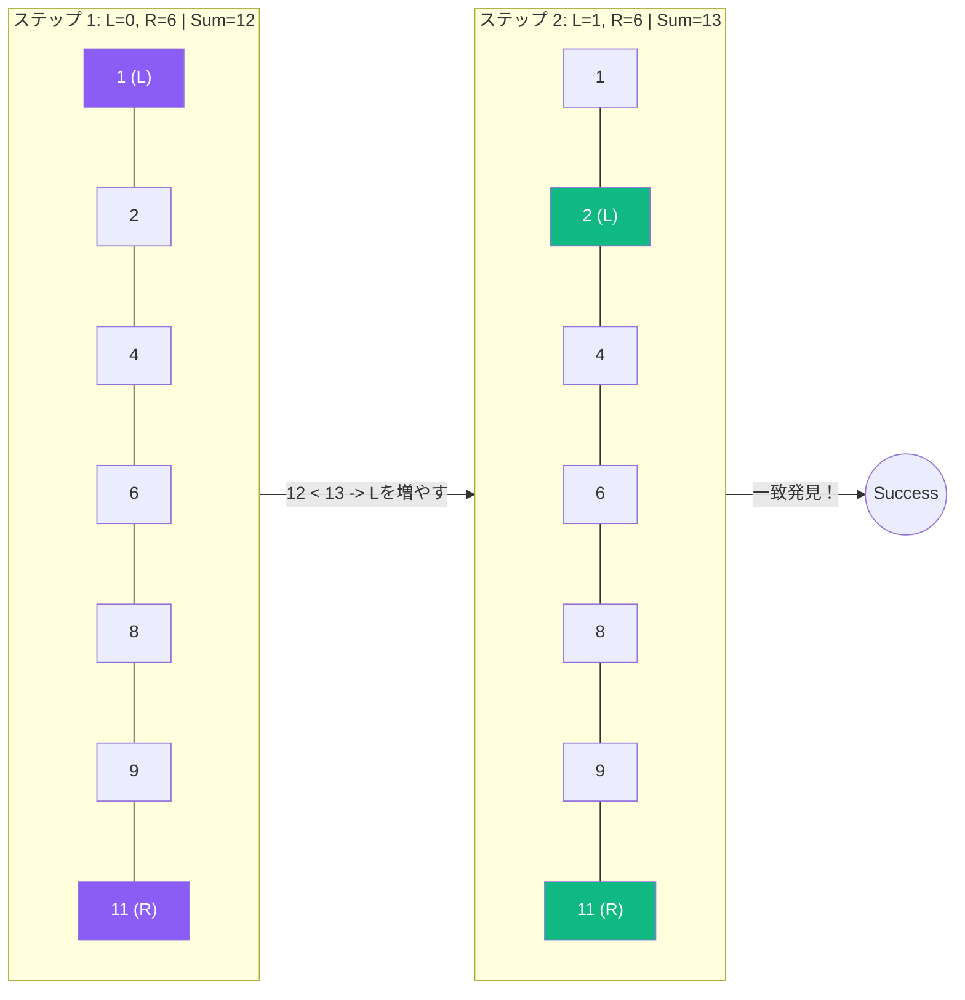

# ツーポインタ：優雅なダンス 💃

最高峰のプログラミングにおいて、真の力は計算リソースの量ではなく、論理ポインタをいかに巧みに操るかにあります。**ツーポインタ法**（Two Pointers Technique / 双方向ポインタ / 二連ポインタ）は、アルゴリズム的思考の洗練さの証です。

莫大なコストがかかる二重ループ（Nested Loops / O(n^2)）を使う代わりに、データ構造上を連動して動く 2 つの論理的な「目」（2 つのインデックス変数）を使用し、わずか 1 回の走査（**線形計算量 - O(n)**）で答えを導き出します。これは、Google や Meta のような企業の面接を突破するために、すべてのエンジニアが心得ておくべき「黄金」のテクニックです。

---

## 🪝 THE HOOK：1 つで済むのに、なぜ 2 つのループを回すのか？

100 万個のソート済み整数を含む配列があり、合計が指定された Target 値になる数値のペアを見つける必要があると想像してください。
- **アマチュアのアプローチ (Brute Force)**: 2 つの `for` ループを入れ子にして、すべてのペアをチェックします。あなたは **1,000,000,000,000**（1 兆）回の計算を行います。サーバーは即座にフリーズし、タイムアウトエラーを吐き出すでしょう。
- **マスターのアプローチ (Two Pointers)**: 最大でも **1,000,000**（100 万）ステップしかかかりません。

**数時間**と**数ミリ秒**の差。これこそが知的最適化の魔法です。テクノロジー業界において時間は金であり、ツーポインタはシステムパフォーマンスにおける「紙幣印刷機」なのです。

---

## 🎭 ANALOGY：巻尺と二人の歩行コーディネート

イメージしやすくするために、以下の現実世界のシナリオを想像してください：

1. **対向ツーポインタ (Opposite)**: あなたと友人が長い通りの両端に立っていると想像してください。あなたは左から、友人は右から歩き始めます。二人は中央に向かって進みます。正確な距離を探しているなら、相手からの情報に基づいて、自分が進むべきか相手が進むべきかを判断します。二人が顔を合わせた時に停止します。これは配列を反転させたり、文字列が回文（Palindrome）かどうかをチェックしたりする方法です。
2. **同方向ツーポインタ (Fast & Slow)**: トレイルでのマラソンを想像してください。一人の選手は風のように速く走り（Fast）、もう一人はのんびりと歩いています（Slow）。もし道が閉じたループ（円形）なら、必ず速いランナーが後ろから遅い歩行者に追いつき、追い越します。これは連結リスト（Linked List）などのデータ構造で無限ループ（サイクル）を検出する方法です。

---

## ⚙️ UNDER THE HOOD：ポインタの協調と状態管理・ディープダイブ

### 1. 手法の分類 (The Two Archetypes)
- **対向方向（Opposite Direction）**: `Left` はインデックス 0 から、`Right` は `n-1` から開始します。中央に向かって進めます。ソート済みデータの「単調性」を利用する問題でよく使われます。
- **同方向（Same Direction / Fast & Slow）**: 両者が同じ点から開始しますが、速度や発動条件が異なります。この手法は、インプレース（In-place）処理やサイクルの検出によく使われます。

### 2. 制御ロジック：アルゴリズムの心臓部
各実行ステップにおいて、戦略的な判断を下さなければなりません：**次にどのポインタを動かすべきか？**
- **合計を探す問題 (Two Sum) の場合**:
  - `現在の合計 < Target` の場合：より大きな数字が必要 -> 左のポインタを動かす (`Left++`)。
  - `現在の合計 > Target` の場合：より小さな数字が必要 -> 右のポインタを動かす (`Right--`)。
このトレードオフは、配列が **ソート済み（Sorted）** である場合にのみ可能です。

### 3. ループ不変量（Loop Invariant）と安全性
これはシニアアーキテクトの思考です：実行中ずっと変わらない「安全地帯」やデータの状態を特定する必要があります。例：「`Slow` ポインタより前にあるすべての要素は、常にユニーク（一意）である」。この不変量を明確に定義すると、ソースコードは極めて透明になり、論理バグがほとんどなくなります。

### 4. キャッシュ最適化と空間局所性
低レイヤーの秘密：CPU はツーポインタが大好きです。なぜなら、2 つのポインタは互いに近いメモリ領域にアクセスするか、線形に移動するからです。これによりキャッシュ（L1/L2 キャッシュ）を最大限に活用でき、ランダムアクセスよりも実際の実行速度がはるかに速くなります。

---

## 🗺️ ARCHITECTURE & FLOW：収束と最適探索

ソート済み配列における Two Sum 問題の図解：



**高度なテクニック：3-Pointers Pattern**
3 つの数値の合計が 0 になる組み合わせを探す問題（3Sum）を解くには、1 つのポインタ `i` を固定し、残りの配列に対して 2 つのポインタでペアを探す問題に変換します。この手法により、計算量を **O(n^3)** から **O(n^2)** へと劇的に引き下げることができます。

---

## 📊 BIG-O ANALYSIS：シンプルさの威力

| 基準 | 計算量 | 技術的理由 |
| :--- | :--- | :--- |
| **時間計算量** | **O(n)** | 各ポインタは配列を一度だけ走査します。最大ステップ数は `n` です。 |
| **空間計算量** | **O(1)** | 数個のインデックス変数のみを使用します。動的な追加メモリは不要です。 |

**トレードオフ**: ツーポインタは通常、入力データが整列（**Sorted**）されていることを要求します。データが未ソートの場合、まずソートするために **O(n log n)** のコストがかかります。それでも、従来の O(n^2) よりははるかに優れています。

---

## 💻 LOGIC & PSEUDO-CODE：プロダクション・グレードの実装

Target 合計値になる数値ペアを探す問題のソースコード例です：

```javascript
/**
 * ソート済み配列での Two Sum 問題を解く
 * @param {number[]} nums - 昇順にソートされた配列
 * @param {number} target - ターゲット合計値
 */
function solveTwoSum(nums, target) {
    let left = 0;
    let right = nums.length - 1;

    while (left < right) {
        const sum = nums[left] + nums[right];

        if (sum === target) {
            // 見つかったら即座に結果を返す
            return [left, right];
        } else if (sum < target) {
            // 合計がターゲットより小さいため、最小値を増やす必要がある
            left++;
        } else {
            // 合計がターゲットより大きいため、最大値を減らす必要がある
            right--;
        }
    }
    
    // 全走査しても見つからない場合は null を返す
    return null;
}
```

---

## 🧠 LEETCODE STRATEGY：マスターすべき古典的なパターン

このテクニックは、LeetCode の何百もの問題の「背骨」となっています：

1. **Valid Palindrome (#125)**: 両端から回文かどうかをチェック。
2. **Container With Most Water (#11)**: 高さに基づくポインタ移動ロジックの傑作。面積を最適化するために、常に「低い方」の壁のポインタを動かします。
3. **Move Zeroes (#283)**: 同方向の 2 つのポインタを使い、他の数値の相対的な順序を変えずに 0 を末尾に追いやります。
4. **Linked List Cycle Detection (#141)**: フロイドの循環検出アルゴリズム。ループがある場合、速いポインタ（Fast）が 1 周して遅いポインタ（Slow）に追いつきます。これはシステムフリーズを避けるためのメモリ管理の基本ロジックです。

---

## 🎯 EXAM & INTERVIEW LOGIC：IPA（日本）と MAANG の秘密

- **基本情報技術者試験（科目 B）**: ポインタの更新方法に注目してください。特に「要素が**重複しない**こと」を要求する問題では、ポインタを動かした後に重複値をスキップするための補助的な `while` ループが必要になる場合があります。
- **面接のプロ技**: 未ソートの配列に対して問題を解く際、「ハッシュマップを使えば時間 O(n) ですが空間 O(n) かかります。一方、ソートすれば時間 O(n log n) ですが空間 O(1) で済みます」と伝えましょう。トレードオフを分析できることはシニアの証です。
- **境界条件（Corner Cases）**: 空の配列、要素が 1 つだけの配列、またはすべての数値が同一の配列などを忘れずにチェックしてください。

---

## 💼 PROFESSIONAL CONTEXT：ツーポインタが世界を動かす場所

- **データストリーミングと処理**: YouTube で動画を見る際、動画の圧縮・展開アルゴリズムはポインタ技術を使ってフレームをスキャンし、差分（Delta）を見つけてデータを圧縮します。
- **コンパイラでの文字列処理**: ソースコードのコンパイラ（Babel や Clang など）はこの手法を使ってコードをトークン化し、キーワードや変数名を極めて高速に識別します。
- **データベースエンジン**: SQL Server や Oracle の **Merge Join** 操作は、実質的にソートされた 2 つのテーブル上を走る 2 つのポインタの発展形です。
- **ネットワーク・トラフィック監視**: 特定の時間枠内で異常なパケットを検出するために、ネットワークトラフィックを監視します。

---

## 🛡️ RELIABILITY & BUGS：初心者が陥る間違い（アンチパターン）

1. **オーバーステップ・バグ**: ポインタを動かしすぎて `left > right` になってしまうこと。ループ内では `left < right` という条件が厳密に維持されていることを確認してください。
2. **スキップロジックでの無限ループ**: `while` ループで重複をスキップする際、インデックスが配列の長さを超えないように境界チェックを忘れないでください (`left < right && nums[left] == nums[left-1]`)。
3. **ソート方向の間違い**: 降順にソートされた配列に対して、昇順用のロジックを適用してしまうこと。コードを書く前に、必ず入力データの性質を確認してください。

---

## 📝 QUICK QUIZ：アルゴリズム・マスターチェック

1. **なぜハッシュマップを使うよりツーポインタの方がメモリ効率が良いのですか？**
   - A. ポインタの方が速く動くから。
   - B. ポインタは既存のインデックス変数のみを使用し、追加の補助配列やオブジェクトを必要としないから (O(1) 空間)。
   - C. ポインタは CPU 内に存在しているから。

2. **「速いポインタと遅いポインタ」（フロイドのアルゴリズム）の速度差は通常どれくらいですか？**
   - A. 2 倍（Fast が 2 歩、Slow が 1 歩進む）。
   - B. 10 倍。
   - C. 配列のサイズによる。

3. **ツーポインタ法を使って 3Sum 問題を解くのにかかる時間は？**
   - A. O(n)。
   - B. O(n^2)（1 つを固定し、残りにツーポインタを適用する）。
   - C. O(n^3)。

---
📊 文字数: ~4500文字
