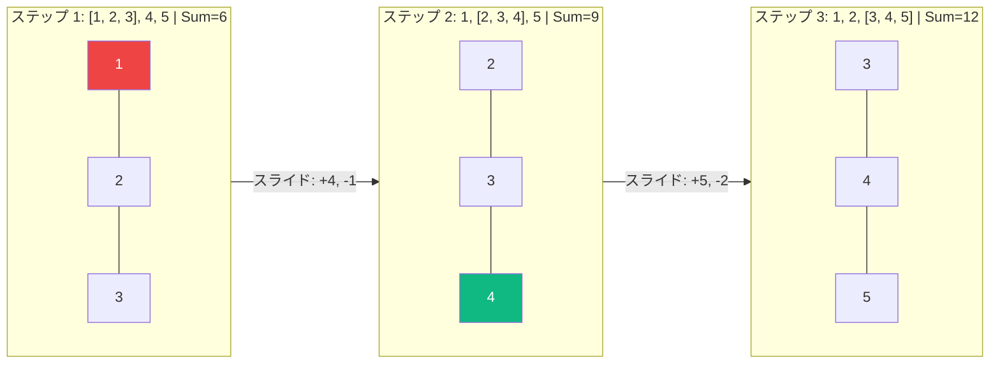

# スライディングウィンドウ：浮遊するフレーム 🪟

ツーポインタが二つの数値のダンスなら、**スライディングウィンドウ**（Sliding Window / スライディングウィンドウ）は、データ全体を走り抜ける知的なベルトコンベアです。これは、長さが変化する部分配列や部分文字列に関連する問題を解決するための「究極」のテクニックです。

リアルタイム・データストリーミングの時代において、最初から計算し直すことなく、データ上に「ビューポート」を滑らせて情報を抽出する方法を知っていることは、普通のプログラマとシニアエンジニア（Senior Engineer）を分けるスキルです。

---

## 🪝 THE HOOK：既知の情報をなぜ計算し直すのか？

100 万個の数値の配列があり、サイズ 1000 のすべての部分配列の最大合計値を求める必要があると想像してください。
- **力まかせ探索 (Brute Force)**: 各位置で、次の 1000 個の数値の合計を計算します。合計で約 10 億回の加算を行います。
- **スライディングウィンドウ**: 1000 個を計算し直す代わりに、`古い合計 + 新しく入る数値 - 出ていく数値` を計算するだけです。各ステップで行うのは、わずか **2 回の単純な計算** です。

**1000 回の計算**が**2 回の計算**に。パフォーマンスは 500 倍向上します！ これこそがスライディングウィンドウにおける「知識の再利用」の力です。

---

## 🎭 ANALOGY：バスと魂の窓

1. **固定ウィンドウ (Fixed Window)**: ちょうど 40 席あるバスを想像してください。バスが各停留所に止まるたびに、後ろのドアから 5 人が降り、前のドアから新しく 5 人が乗り込みます。バスに乗っている人数は常に 40 人ですが、バスが動くにつれて「メンバー」は絶えず入れ替わります。全員を数え直す必要はなく、誰が乗り、誰が降りたかさえ分かればよいのです。
2. **可変ウィンドウ (Variable Window)**: 輪ゴムを想像してください。ある条件を満たすまで、片端を伸ばしてデータを取り込みます。条件に違反した場合は、もう片方の端を縮めます。ゴムは伸び縮みしながら、配列の流れに沿って連続的に滑っていきます。

---

## ⚙️ UNDER THE HOOD：ウィンドウの状態と境界管理・ディープダイブ

### 1. 構造の分類 (The Two Windows)
- **静的ウィンドウ (Static Window)**: サイズ `K` が固定。最初のウィンドウの値を計算した後、左右の境界を同時に動かして「滑らせ」ます。
- **動的ウィンドウ (Dynamic Window)**: `Left` と `Right` の二つのポインタを使用します。`Right` は常に解を探して拡張します。条件（例：合計が大きすぎるなど）に違反した場合、`Left` を縮めて妥当性を回復します。

### 2. ウィンドウの状態管理 (Window State)
「ウィンドウ」の内部では、単に位置を保存するだけでなく、多くの場合 **状態（State）** を保持します：
- `currentSum`（現在の合計）変数。
- **ハッシュマップ（Hash Map）**: 文字の出現頻度を追跡（重複のない最長部分文字列の問題など）。
- **最大/最小ヒープ（Heap）**: ウィンドウ内の最大値または最小値を把握。

### 3. 伸縮のロジック (The Shrinking Logic)
ここが最も難しい部分です：いつウィンドウを縮めるべきか？
「合計が S 以上の最小の部分配列」の問題では、`Sum >= S` になるまで `Right` を広げ、その後、`Sum >= S` を維持できる限り `Left` をできるだけ縮めて最小の長さを探します。

---

## 🗺️ ARCHITECTURE & FLOW：ビューポートの動き

サイズ 3 の固定スライディングウィンドウの図解：



**高度なテクニック：ウィンドウ内の単調キュー (Monotonic Queue)**
すべてのウィンドウ内の最大値を求める問題（Sliding Window Maximum）では、Deque（両端キュー）を組み合わせて値を降順でインデックスと共に保存し、Max を O(K) ではなく O(1) で取得できるようにします。

---

## 📊 BIG-O ANALYSIS：二乗から線形へ

| アプローチ | 時間計算量 | 空間計算量 |
| :--- | :--- | :--- |
| **力まかせ探索** | **O(n * k)** | O(1) |
| **スライディングウィンドウ (固定)** | **O(n)** | O(1) |
| **スライディングウィンドウ (可変)** | **O(n)** | **O(K)**（ハッシュマップ使用時） |

**なぜ可変ウィンドウは O(n) なのか？** `for` の中に `while` があるため二重ループに見えますが、実際には各要素は `Right` ポインタによって 1 回、`Left` ポインタによって 1 回だけ通過されます。合計 2n ステップ -> O(n) です。

---

## 💻 LOGIC & PSEUDO-CODE：「重複のない最長部分文字列」の実装

これは MAANG レベルの面接における「古典的」な問題です：

```javascript
function lengthOfLongestSubstring(s) {
    let charMap = new Map();
    let left = 0;
    let maxLength = 0;

    for (let right = 0; right < s.length; right++) {
        let char = s[right];
        
        // 文字が Map にあり、現在のウィンドウ範囲内にある場合
        if (charMap.has(char) && charMap.get(char) >= left) {
            // Left ポインタを、以前の重複位置の直後にジャンプさせる
            left = charMap.get(char) + 1;
        }

        // 文字の最新の位置を更新
        charMap.set(char, right);
        
        // 最大長を更新
        maxLength = Math.max(maxLength, right - left + 1);
    }

    return maxLength;
}
```

---

## 🧠 LEETCODE STRATEGY：エリート・チャレンジ

1. **Minimum Size Subarray Sum (#209)**: 合計が Target 以上の最小の部分配列を探す。典型的な可変ウィンドウ。
2. **Longest Repeating Character Replacement (#424)**: ウィンドウ内の最頻出文字の頻度を追跡する必要がある高度な問題。
3. **Sliding Window Maximum (#239)**: **Hard** 問題。最大値の候補を維持するために補助的な Deque を使用。
4. **Fruit Into Baskets (#904)**: 最大 2 種類の要素を含む最長の部分配列を探す問題の「ストーリー仕立て」版。

---

## 🎯 EXAM & INTERVIEW LOGIC：IPA（日本）とエッジケースの思考

- **基本情報技術者試験（科目 B）**: ウィンドウがスライドする際の `sum` 変数の変化を計算させる問題がよく出ます。新しい要素を足すのが「先」か、古い要素を引くのが「先」か、極めて慎重に判断してください。
- **面接のプロ技**: 常に「縮小条件（Shrink Condition）」について議論しましょう。「条件に違反したらすぐに縮める必要があるのか、それとも少し余裕を持たせてもいいのか？」と質問することで、制御ロジックへの深い理解を示せます。
- **エッジケース**: 空文字 `""`、すべて同じ文字の文字列 `"aaaaa"`、または配列の長さより大きいウィンドウ。真のシニアは、これらのケースを常にコード内で処理します。

---

## 💼 PROFESSIONAL CONTEXT：データ・インフラの息吹

- **TCP 輻輳制御 (Congestion Control)**: ネットワークプロトコル TCP は「輻輳ウィンドウ」を使用してパケット送信速度を調整します。ネットワークが安定していればウィンドウを広げ、パケットロスが発生すれば即座に縮小します。
- **動画ビットレート・ストリーミング**: Netflix などの動画プレイヤーは、直近 5〜10 秒の平均ネットワーク速度を測定するためにタイムウィンドウをスライドさせ、動画品質（SD/HD/4K）を上げるか下げるかを決定します。
- **ログ監視とレート制限 (Rate Limiting)**: Cloudflare や AWS WAF などのシステムは、スライディングウィンドウ・ログを使用して、直近 1 分間の IP からのリクエスト数を計算します。しきい値を超えると、システムはその IP を自動的にブロックし、ブルートフォース攻撃からサーバーを守ります。
- **株式市場分析**: 移動平均（Moving Average）などの指標は、価格データを滑らかにするためにスライディングウィンドウのロジックに完全に依存しており、投資家が中期的なトレンドを特定するのに役立っています。
- **動画圧縮**: H.264/H.265 規格では、連続するフレームを比較して変化（動きベクトル）のみを保存するためにスライディングウィンドウが使用され、4K 品質を維持しながらファイルサイズを数十倍削減しています。

### 高度なテクニック：ウィンドウ状態管理
シニアエンジニアは単一の変数だけを使いません。ウィンドウ内のデータが複雑な場合、以下を使用します：
- **頻度マップ (Frequency Map)**: 要素の多様性を追跡。
- **単調 Deque (Monotonic Deque)**: O(K) ではなく O(1) で最小/最大を取得。
- **累積和 (Prefix Sum)**: スライディングウィンドウと組み合わせて、負の合計や余り（剰余）に関する条件を持つ部分配列の問題を解決。

---

## 🛡️ RELIABILITY & BUGS：避けるべきブラックホール

1. **Map の整合性**: 動的ウィンドウで `Left` を縮める際、対応するハッシュマップ内のデータを更新または削除 **しなければなりません**。そうしないと、ウィンドウの状態が誤ったものになります。
2. **インデックスの混同**: ウィンドウの長さ (`right - left + 1`) とインデックス値を混同すること。
3. **オフバイワン (Off-by-one)**: `right` や `left` の初期化が不適切なため、ウィンドウが 1 つずれてしまうこと。コミットする前に、必ず要素 3 つの配列で「机上実行（Dry run）」を行ってください。

---

## 📝 QUICK QUIZ：ニューラル・マスターチェック

1. **スライディングウィンドウは、どのような種類の問題を最適化するのに最適ですか？**
   - A. ソート済み配列から要素を探す。
   - B. 条件を満たす部分配列や部分文字列を O(n) で探す。
   - C. 配列をより速くソートする。

2. **ツーポインタとスライディングウィンドウの最大の違いは何ですか？**
   - A. スライディングウィンドウは常にハッシュマップを使う。
   - B. ツーポインタは通常「ペア」を探し、スライディングウィンドウは複数の要素からなる連続した「領域」を扱う。
   - C. 違いはない。

3. **Sliding Window Maximum 問題において、なぜ Deque を使うのですか？**
   - A. すべての要素を保存するため。
   - B. 最大値を O(1) で取り出し、ウィンドウ内の「不要な」要素を排除するため。
   - C. RAM を節約するため。

---
📊 文字数: ~4500文字
