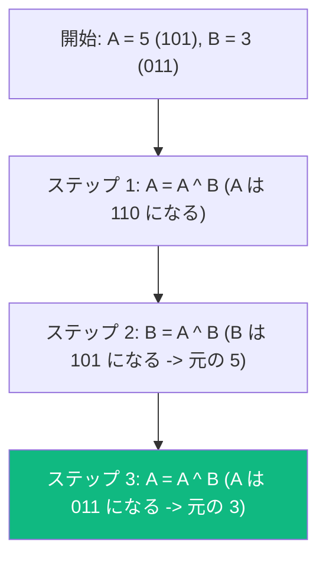

# ビット演算：0と1の魔法 ⚡

JavaScript、Python、Javaといった華やかなプログラミング言語の層の下で、コンピュータは実際には「ON (1)」と「OFF (0)」という2つの基本状態しか理解していません。**ビット演算**（Bit Manipulation / ビット操作）は、ハードウェアと直接対話するための芸術であり、通常の演算では決して到達できない最適なパフォーマンスを実現するために、データの各ビットを制御します。

日本における IPA 試験（基本情報・応用情報）や、世界のトップテック企業（Google、NVIDIA、Intel）の面接では、ビット演算の能力は、プログラマが「コンピュータの本質」と最低レイヤーのデータ構造を真に理解しているかを評価するために頻繁に用いられます。

---

## 🪝 THE HOOK：光速の処理と極限のメモリ・トレードオフ

8 つのデバイスの状態（ON/OFF）を保存する必要があると想像してください。
- **一般的なアプローチ**: Boolean 配列を使用すると 8 つの要素が必要になり、言語にもよりますが、各要素に少なくとも 1〜4 バイトの RAM を消費します。
- **マスターのアプローチ**: ビット演算を使用すれば、わずか **1 バイト**（8 ビット）で済みます。

さらに、ビット演算（Bitwise operations）は CPU 内部の論理演算ユニット（ALU）によって、わずか **1 マシンサイクル**（Single CPU Cycle）で直接実行されます。数十サイクルを要する除算（Division）や剰余（Modulo）といった複雑な算術演算と比較して、ビット演算は何十倍も高速です。高頻度取引（HFT）システムにおいて、これは優位性を保つための鍵となります。

---

## 🎭 ANALOGY：スイッチ盤とモールス信号

イメージしやすくするために、各ビットを電球と考えてみましょう：
1. **論理積 AND (&)**: ちょうど 2 つの鍵を必要とするセキュリティゲートのようなものです。両方の鍵が ON (1) のときだけ電球が点灯します。どちらかが 0 なら、結果は常に 0 です。
2. **論理和 OR (|)**: 並列につながれた 2 つの照明スイッチがある部屋のようなものです。少なくとも 1 つがオンになれば、部屋は明るくなります。
3. **排他的論理和 XOR (^)**: 二人の友人が議論しているようなものです。両者が同意すれば（両方 0 または両方 1）、新しいものは何も生まれません（結果 0）。意見が異なるときだけ（一方が 0 でもう一方が 1）、火花が散ります（結果 1）。XOR は「繰り上がりのない加算」とも呼ばれます。
4. **シフト (Shift)**: 横一列に並んだ椅子の全員を左または右に押し動かすようなものです。端の人は外に落ち、空いた席には「新しい人」（0）が座ります。

---

## ⚙️ UNDER THE HOOD：バイナリ表現と 2 の補数・ディープダイブ

### 1. 2 進数（Binary）と 2 の補数（2's Complement）
コンピュータは **2 の補数** という技術を使って負の数を保存します。
- `-5` を表現するために、コンピュータは `5` の 2 進数を取り、すべてのビットを反転させ（1 を 0 に、0 を 1 に）、最後に正確に `1` を加算します。
- なぜこんなに複雑なのか？ それは、減算（`A - B`）を実際には加算（`A + (-B)`）として実行できるようにするためです。この設計により、CPU は減算専用の回路を持つ必要がなくなり、コンピュータはより高速に、そして発熱を抑えて動作できるようになります。

### 2. 「強力な」ビット演算子 (Power Operators)
- **AND (&)**: マスキング（Masking）に使用し、特定のビットが ON になっているかを確認します。例：`n & 1` は奇数かどうかをチェックします。
- **OR (|)**: 隣接するビットに影響を与えずに、特定のビットを ON（セット）にするために使用します。
- **XOR (^)**: `A ^ A = 0` および `A ^ 0 = A` という性質を持つ魔法の演算です。ペアの中で 1 つだけ存在する数値を見つけるための究極の武器です。
- **NOT (~)**: すべてのビットを反転させます。

### 3. 左シフト (<<) と右シフト (>>)
- `x << n` は実質的に高速な乗算です：`x * 2^n`。
- `x >> n` は実質的に高速な整数除算です：`x / 2^n`。
CPU は、これらのビットシフトを通常の乗除算よりも何十倍も速く実行します。なぜなら、それは単なる電気信号の物理的な移動に過ぎないからです。

---

## 🗺️ ARCHITECTURE & FLOW：原子レベルの論理演算

一時変数を使わずに 2 つの数値を入れ替える XOR 交換アルゴリズム（The XOR Swap Algorithm）の図解：



**高度なテクニック：実戦でのビットマスキング**
ゲームエンジンの開発やオペレーティングシステム（カーネル）では、数十もの論理状態（例：プレイヤーはジャンプ可能か？ 射撃可能か？ 回復中か？...）を単一の 32 ビット整数に保存することがよくあります。各ビットが 1 つの属性を表します。状態のチェックにかかるコストは、超高速な演算 1 回だけです：`if (status & CAN_JUMP)`。

---

## 📊 BIG-O ANALYSIS：原子レベルのパフォーマンス

| 演算 | 計算量 | 実際の性能 |
| :--- | :--- | :--- |
| **ビット単位 AND/OR/XOR/NOT** | **O(1)** | 1 CPU サイクル (極めて高速) |
| **ビットシフト** | **O(1)** | 1 CPU サイクル |
| **ビットカウント (1 の数を数える)** | O(bits) | ブライアン・カーニハン法で最適化可能 |

---

## 💻 LOGIC & PSEUDO-CODE：シニアが心得ておくべき「エリート」テクニック

コードをプロフェッショナルに見せ、パフォーマンスを最大化するためのビット演算ハックを紹介します：

```javascript
// 1. 最後のビットを使って偶数/奇数をチェック (% を使うより強力)
const isEven = (n) => (n & 1) === 0;

// 2. 数値が 2 の累乗（Power of 2）かどうかをチェック
// 素晴らしい裏技：n が 2 の累乗なら、n & (n-1) は常に 0 になります。
const isPowerOfTwo = (n) => n > 0 && (n & (n - 1)) === 0;

// 3. 立っているビット (1) の数を数える (Hamming Weight) - ブライアン・カーニハン法
// このアルゴリズムは 32 ビットすべてを走査するのではなく、1 のビットの数だけ実行されます。
function countSetBits(n) {
    let count = 0;
    while (n > 0) {
        n &= (n - 1); // 右端の 1 のビットを削除
        count++;
    }
    return count;
}

// 4. 重複ペアがある配列の中で、1回だけ出現する数値を見つける
function findUnique(arr) {
    return arr.reduce((acc, current) => acc ^ current, 0);
}
```

---

## 🧠 LEETCODE STRATEGY：数値の世界をハックする

1. **Number of 1 Bits (#191)**: 最高速を実現するために上記のブライアン・カーニハン法を適用します。
2. **Single Number (#136)**: XOR の性質を利用して、O(n) の時間と O(1) のメモリですべての重複ペアを打ち消します。
3. **Subsets (#78)**: `0` から `2^n - 1` までの数値をマスク（Mask）として使用し、すべての部分集合を体系的に生成します。
4. **Reverse Bits (#190)**: 各ビットを低い位置から高い位置へ移動させる思考を鍛えます。

---

## 🎯 EXAM & INTERVIEW LOGIC：日本 IPA 試験とシニア・アーキテクトの秘密

- **IPA 科目 B (日本)**: **論理シフト**（符号なし）と**算術シフト**（符号あり）に関する問題です。覚えておいてください：算術シフトは、負の値を維持するために符号ビット（Sign bit）を保持します。これは非常によく出る「罠」の問題です。
- **面接のプロ技**: **エンディアン**（ビッグエンディアン vs リトルエンディアン）—コンピュータが RAM 内でバイト順をどのように保存するか—について自分から議論しましょう。これは、システムアーキテクチャに関する強固な基礎知識を持っていることの証明になります。
- **16 進数 (Hexadecimal)**: 2 進数から 16 進数への素早い変換を練習してください。これは、CSS の色（`#3498db`）、ハッシュ値、またはデバッグ中のメモリアドレスを扱う際に非常に役立ちます。

---

## 💼 PROFESSIONAL CONTEXT：ビット演算が現実世界を支配する場所

- **動画圧縮**: H.264 や H.265 といった現代の圧縮規格では、フレーム間の差分をエンコードするエントロピー符号化にビット演算が使用され、数 GB のデータを数 MB に削減しています。
- **グラフィックスとゲーム開発**: RGB カラーは、実際には 3 バイトが結合されて 1 つの数値になっています。赤色（Red）を抽出するために、プログラマは `color >> 16 & 0xFF` を使用します。これが画面上の何百万ピクセルを毎秒処理する唯一の方法です。
- **組み込みセキュリティ**: ビット演算を使用してデバイスの **フィンガープリント** を実装し、チップの物理的特性に基づいてハードウェアを識別し、安全な決済システムでのデバイス偽装を防ぎます。
- **AI とニューラルネットワークの量子化**: 現在の AI 時代において、モバイルデバイスで大規模言語モデル（LLM）を実行するために、エンジニアは **量子化（Quantization）** 技術を使用します。重み（Weights）を 32 ビットの浮動小数点から 4 ビットや 1 ビットに圧縮します。ビット演算により推論（Inference）が数十倍加速され、巨大なサーバーなしで AI が即座に応答できるようになります。

---

## 🛡️ RELIABILITY & BUGS：死の落とし穴 (Pitfalls)

1. **演算子の優先順位**: `&` や `|` は加減算よりも優先順位が低いです。`1 + 2 & 3` は `(1 + 2) & 3` として計算されます。論理が意図通りに動くように、常に **括弧** を使用してください。
2. **符号拡張 (Sign Extension)**: JavaScript で負の数に対して右ビットシフトを行う際は注意してください。符号ビットが干渉してほしくない場合は、符号なし右シフト `>>>` を使用してください。
3. **JavaScript のビット演算制限**: JS では、ビット演算はデフォルトで 32 ビット整数に対して動作します。2^31 より大きい数値を操作すると、結果が不正確になる可能性があります。極端に大きな数値を扱う場合は `BigInt` を使用してください。

---

## 📝 QUICK QUIZ：ニューラル・マスターチェック

1. **`n & (n-1)` という操作は、どのような技術的アクションを実行しますか？**
   - A. 数値 n を高速に 2 倍にする。
   - B. 数値 n の右端にある 1 のビットを削除する。ブライアン・カーニハン法の基礎。
   - C. 数値 n が偶数か奇数かをチェックする。

2. **なぜ XOR (^) を使うと、一時変数を使わずに 2 つの数値を入れ替えることができるのですか？**
   - A. XOR が CPU で最も高速な演算だから。
   - B. XOR には自己消去性 (A ^ A = 0) と恒等保存性 (A ^ 0 = A) があるから。
   - C. XOR はキャッシュリソースを消費しないから。

3. **コンピュータにおいて「2 の補数」が使われる目的は何ですか？**
   - A. 標準的な記憶容量を超える整数を扱うため。
   - B. 2 進数において負の整数を統一的かつ効率的に表現し、演算するため。
   - C. バイナリデータをより安全な形式に暗号化するため。

---
📊 文字数: ~4500文字
