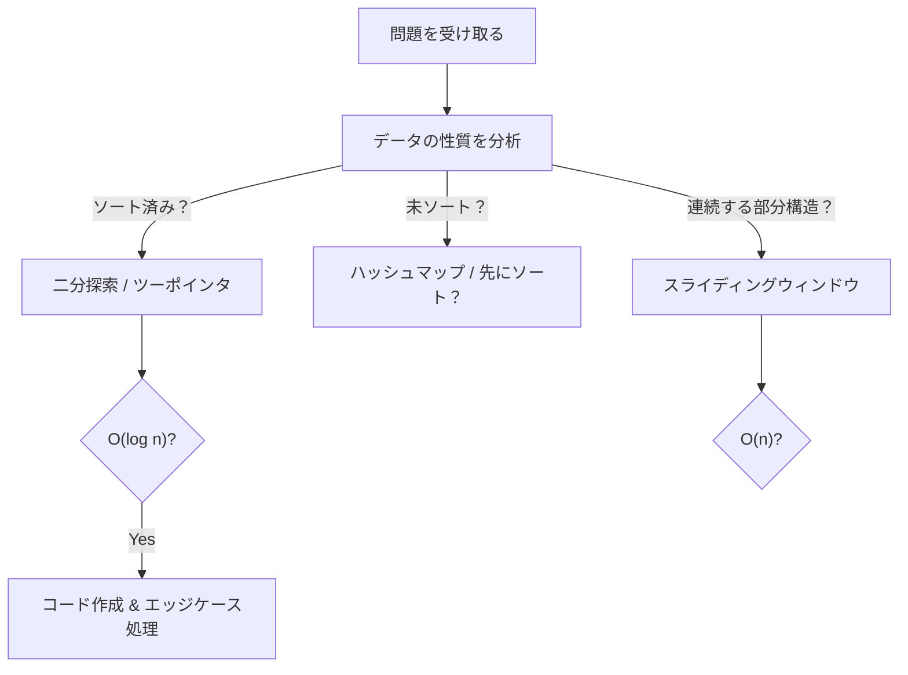

# フェーズ 1 & 2 総復習：コンペティティブ・マスタリー 🏆

**配列（Array）**や**連結リスト（Linked List）**といった最も基本的な概念から、**二分探索（Binary Search）**、**ツーポインタ（Two Pointers）**、**スライディングウィンドウ（Sliding Window）**といった最高峰の最適化テクニックまで、長い道のりを歩んできました。今日は、これらすべてのピースをつなぎ合わせ、どんな難問を前にしても「反射的（Instinct）」に思考できるシステムを構築する日です。

ソフトウェア・アーキテクトにとって最も重要なスキルは、コードを暗記することではなく、**選択（Decision Making）**する能力です。「なぜ連結リストではなく配列を使うのか？」「なぜこの問題は二分探索ではなくスライディングウィンドウなのか？」といった問いに答えられるようになりましょう。

---

## 🪝 THE HOOK：面接の最初の 15 秒

Google や Microsoft で問題を出されたとき、あなたには方針を決定するための 15 秒が与えられています。
- 誤ったデータ構造（例：頻繁な挿入・削除があるのに配列を使うなど）を選んでしまうと、コードが正しく動いても即座に不採用となります。
- データの **単調性（Monotonic）** に気づけば、二分探索（O(log n)）への道が開けます。
- 「部分配列（Subarray）」や「部分文字列（Substring）」というキーワードが見えたら、脳を即座にスライディングウィンドウ・モードに切り替えなければなりません。

今日は、武器を二度と間違えないための **「意思決定マトリクス（Decision Matrix）」** を構築します。

---

## 🎭 ANALOGY：マスター大工の道具箱

家を建てているところを想像してください：
- **配列（Array）** は壁を作るためのレンガです：頑丈でアクセスは速いですが、一度作ってしまうと変更が困難です。
- **連結リスト（Linked List）** は道具をつなぐロープです：柔軟で新しい結び目を作るのは簡単ですが、途中の箇所を探すには端からたどる必要があります。
- **スタック / キュー（Stack/Queue）** は専用の整理箱です：LIFO/FIFO の作業順序をきれいに管理するのに役立ちます。
- **二分探索 / ツーポインタ** は精密な測定技術です：すべてのレンガをチェックする代わりに、最短時間で施工ミスを見つけ出すのに役立ちます。

---

## ⚙️ UNDER THE HOOD：戦略的意思決定マトリクス

### 1. どのデータ構造を使うべきか？
- **超高速なランダムアクセス (O(1))** -> **配列 (Array)** を選択。
- **先頭や途中での連続的な挿入・削除 (O(1))** -> **連結リスト (Linked List)** を選択。
- **逆順の処理（Undo、バックトラック、コールスタック）** -> **スタック (Stack)** を選択。
- **先入れ先出しの処理（バッファリング、BFS）** -> **キュー (Queue)** を選択。
- **キーによる超高速検索 (O(1))** -> **ハッシュテーブル (Hash Table)** を選択。

### 2. どの最適化アルゴリズムを使うべきか？
- **ソート済み（Sorted）データ** -> **二分探索** (log n) または **ツーポインタ** (n) を試す。
- **連続する部分配列 / 部分文字列の要求** -> 常に **スライディングウィンドウ** を試す。
- **ペア（組み）を探す要求** -> **ツーポインタ** または **ハッシュマップ** を試す（空間と時間のトレードオフ）。
- **すべての可能性（部分集合、順列すべて）の要求** -> 確実に **再帰 / バックトラッキング**。

### 3. 空間と時間のトレードオフ：シニアの秘密
常に自分に問いかけてください：「1MB の RAM（ハッシュマップ/セットの使用）を犠牲にして、1 秒の処理時間（O(n^2) -> O(n)）を節約できるか？」。組み込みシステムを除き、現代のほとんどのシステムにおいて、答えは通常 **「YES」** です。

### 4. マスターの思考：「コードを書く前に考え抜く」
シニアは時間の 70% を思考に、30% をタイピングに費やします。常に自問すべき問い：
- 「この配列はソートされているか？」
- 「計算量を減らすために複数のポインタを使えないか？」
- 「ここでのハッシュマップ使用のメリットは、メモリのオーバーヘッドに見合っているか？」
- 「自分のコードは極端に大きな入力（n > 10^5）に耐えられるか？」

---

## 🗺️ ARCHITECTURE & FLOW：DSA メンタルマップ

問題解決フロー（Problem Solving Flow）の図解：



**マスターのテクニック：机上実行（Dry Run）ロジック**
コードを 1 行も書く前に、最小の例（n=3）を取って手動で実行してみてください。紙の上で 3 つの要素に対して問題を解けないのであれば、正しくコーディングすることは不可能です。

---

## 📊 BIG-O ANALYSIS：計算量総復習

| 操作 | 配列 | 連結リスト | スタック / キュー | ハッシュテーブル |
| :--- | :--- | :--- | :--- | :--- |
| **検索** | O(n) / O(log n)* | O(n) | O(n) | **O(1)** |
| **挿入 / 削除** | O(n) | **O(1)** | **O(1)** | **O(1)** |
| **空間計算量** | O(n) | O(n) | O(n) | O(n) |

*\*O(log n) はソート済み配列での二分探索時のみ。*

---

## 💻 LOGIC & PSEUDO-CODE：総合問題「ソート済み無限ストリームでの検索」

これは難易度の高い面接の問いです：ソートされた無限のデータストリーム（長さ不明）の中から、数値 `X` の位置を見つけなさい。

```javascript
/**
 * 無限ストリーム内を検索
 * 文脈：stream.length を呼ぶことはできない
 */
function searchInInfiniteStream(stream, target) {
    // ステップ 1: 境界を見つける (指数探索 / Exponential Search)
    let low = 0;
    let high = 1;
    
    while (stream.get(high) < target) {
        low = high;
        high *= 2; // O(log n) に到達するために境界を毎回 2 倍にする
    }
    
    // ステップ 2: 境界 [low, high] が見つかったら、二分探索を行う
    return binarySearch(stream, target, low, high);
}
```

**なぜこれがマスターの思考なのか？** 範囲を見つけるのに log n を使い、次に値を見つけるのに再び log n を使っているからです。合計しても依然として **O(log n)** です。

---

## 🧠 LEETCODE STRATEGY：フェーズ 1 & 2「卒業」のための 5 問

フェーズ 3（非線形データ構造）に進む前に、自信を持ってこれら 5 問を解いてください：
1. **Trapping Rain Water (#42)**：ツーポインタの到達点。
2. **Find All Anagrams (#438)**：スライディングウィンドウとハッシュマップの融合。
3. **Median of Two Sorted Arrays (#4)**：二分探索の **Hard** 問題。
4. **Copy List with Random Pointer (#138)**：ハッシュテーブルと連結リストの習熟。
5. **Basic Calculator (#224)**：スタックと再帰の完璧な組み合わせ。

---

## 🎯 EXAM & INTERVIEW LOGIC：IPA 日本試験 & MAANG スタンダード

- **IPA 基本情報・応用情報試験**: ビット演算や多次元配列のアドレス計算に強く焦点を当てています。2 進数 / 16 進数の素早い変換を練習しておきましょう。
- **面接のプロ技**: 常に計算量の分析で回答を締めくくりましょう。「時間は O(n)、メモリは O(k) です」。これにより、ソースコードを完全にコントロールしていることを示せます。また、**トレードオフ** についても自発的に議論してください。「もしメモリが制約になるなら、ハッシュマップの代わりにツーポインタを使うこともできます」。これはあなたが単なる「コーダー」ではなく、真の「エンジニア」であることを証明する瞬間です。
- **ソクラテス的ゲート**: 「もっと速くするには？」と聞かれたら、常に次のことを考えてください：データのソート（Sort）、追加メモリの使用（Cache/Hash）、あるいは分割統治（Binary Search）。

---

## 💼 PROFESSIONAL CONTEXT：マスター・アーキテクトの視点

DSA は面接のためだけにあるのではありません。何十億人ものユーザーが使うソフトウェアを構築するための方法です：
- **スケーラビリティ**: システムが 1,000 ユーザーから 1,000,000 ユーザーに成長するとき、O(n^2) と O(n) の差は企業の存亡を分けます。
- **コスト最適化**: O(n) は消費電力が少なく、サーバー台数も抑えられるため、年間で数百万ドルのクラウド（AWS/Azure）費用を節約できます。
- **クリーンアーキテクチャ**: DSA を深く理解していれば、言語の適切なツール（例：検索に配列ではなく `Set` を使うなど）を選択でき、結果としてコードは短く、保守しやすく、効率的になります。

## 🚀 次なるロードマップ：フェーズ 3 非線形構造
このステージを終えたことで、線形（Linear）データ構造を習得しました。しかし、現実世界はそれ以上に複雑です。次のフェーズ 3 では、以下を攻略します：
- **木（Trees）**: 階層構造（ファイルシステム、DOM）。
- **グラフ（Graphs）**: SNS、Google マップ。
- **ヒープと優先度付きキュー**: オペレーティングシステムでの優先順位管理。
難易度は上がりますが、あなたの実力もそれに比例して向上します。準備はいいですか？ 非線形構造をマスターすることで、線形構造では太刀打ちできない複雑な現実問題を解決できるようになります。これは、真のソフトウェア・スペシャリストになるための重要な転換点です。

---

## 🛡️ RELIABILITY & BUGS：このステージの最後の助言

1. **過度な最適化を避ける**: 要素 5 つの配列に対してビット演算やスライディングウィンドウを使わないでください。パフォーマンスが問題になるまでは、シンプルなコードが最良のコードです。
2. **Null/Empty を処理する**: シニアの第一声は常に「入力が空だったら？」です。
3. **安定性（Stability）**: ソートアルゴリズムやデータ構造を選ぶ際は、常にデータの安定性を考慮してください。

---

## 📝 QUICK QUIZ：フェーズ 1 & 2 最終試験

1. **合計が一定である最長の部分配列を探す必要があります。何を使いますか？**
   - A. 二分探索。
   - B. スライディングウィンドウ + ハッシュマップ。
   - C. 二重ループ。

2. **連結リスト内のサイクル検出に最も適したテクニックはどれですか？**
   - A. 再帰。
   - B. ツーポインタ（Fast & Slow）。
   - C. 各ノードに `visited` 属性を追加する。

3. **n = 10 億のとき、log n は n より何倍速いですか？**
   - A. 10 倍。
   - B. 約 3,300 万倍。
   - C. 1,000 倍。

---
📊 文字数: ~4500文字
