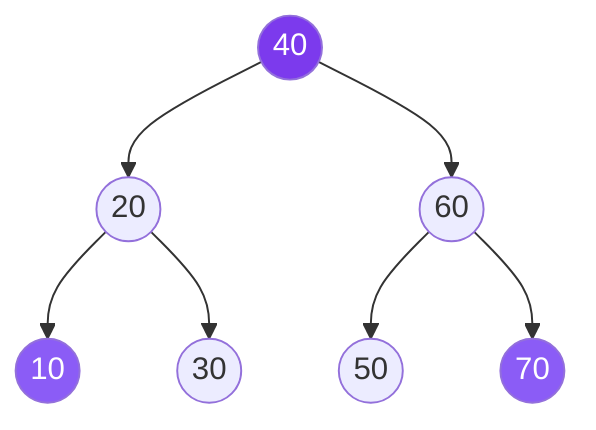

# 二分木と二分探索木：論理の階層構造 🌳

DSA Masterの旅、フェーズ3へようこそ。これまでは、**配列**（Array）や**連結リスト**（Linked List）といった線形（Linear）データ構造を扱ってきました。しかし、現実世界のデータは多くの場合、階層的（Hierarchical）です。

**二分木**（Binary Tree）と**二分探索木**（Binary Search Tree - BST）は、現代のファイル管理システム、コンパイラ、データベースの「バックボーン」となる構造です。今日は、プロフェッショナルな「木登り」の方法を学びましょう。

---

## 🪝 THE HOOK：なぜリストではなく「木」を使うのか？

100万件の従業員レコードを管理することを想像してください。
- **連結リスト**に保存した場合、特定の人物を探すのに平均50万ステップ（O(n)）かかります。遅すぎます！
- **ソート済み配列**に保存した場合、**二分探索**（O(log n)）で高速に検索できますが、新しい従業員が加わった際、挿入のために数十万の要素をずらす必要があります（O(n)）。

ソート済み配列のような**「高速な検索」**と、連結リストのような**「高速な挿入・削除」**を両立するデータ構造が必要です。それが **BST** が誕生した理由です。BSTでは、検索、挿入、削除の3つの操作すべてが **O(log n)** で行えます。これは、動的な変化と効率性の完璧なバランスです。

---

## 🎭 ANALOGY：家系図と会社の組織図

1. **二分木（Binary Tree）**: 各夫婦が最大2人の子供（「左の子」と「右の子」）を持つ家族を想像してください。一番上にいるのが「根（Root）」、子供がいない人が「葉（Leaf）」です。
2. **二分探索木（BST）**: 非常に「ルールに厳しい」家族を想像してください。左の子は常に親より値（資産や年齢）が小さく、右の子は常に親より値が大きいか等しいというルールが、すべての階層に適用されます。この体系的な「区別」により、1ステップごとに探索範囲を50%絞り込むことができます。

---

## ⚙️ UNDER THE HOOD：ノードの解剖学とメモリ配置

木の中の各要素を**ノード**（Node）と呼びます。二分木のノードは通常、メモリ内で3つの主要コンポーネントを持ちます：
1. **Data**: 保存される値。
2. **Left Pointer**: 左の子ノードへのアドレス。
3. **Right Pointer**: 右の子ノードへのアドレス。

### メモリ表現
RAM上では、木のノードは配列のように隣接していません。それらは分散しており、**ポインタ**（Pointers）を通じて連結されています。これにより、最初から巨大な連続メモリ領域を確保することなく、木を柔軟に「成長」させることができます。



### 重要な概念：
- **根（Root）**: 親を持たない、最上位のノード。
- **親 / 子（Parent / Child）**: 2つの階層間の直接的な関係。
- **葉（Leaf）**: 子供を持たないノード。
- **高さ（Height）**: ルートから葉までの最長のエッジ数。
- **深さ（Depth）**: ルートから現在のノードまでのエッジ数。

### 特殊な二分木
マスターになるには、以下の概念を明確に区別する必要があります：
1. **フル二分木（Full Binary Tree）**: すべてのノードが0個または2個の子を持つ。
2. **完全二分木（Complete Binary Tree）**: 最後のレベルを除き、すべてのレベルが満たされており、最後は左から順に埋まっている。配列表現（Array Representation）に理想的。
3. **完全二分木（Perfect Binary Tree）**: すべての中間ノードが2つの子を持ち、すべての葉が同じレベルにある。
4. **平衡二分木（Balanced Binary Tree）**: 任意のノードの左枝と右枝の高さの差が1以下の木。O(log n)パフォーマンスの「聖杯」です。

---

## 📊 BIG-O ANALYSIS：バランスの力

二分木のパフォーマンスは、その**形状（Shape）**に完全に依存します。

| 操作 | 平均（平衡時） | 最悪（偏った木） | 解説 |
| :--- | :--- | :--- | :--- |
| **検索** | **O(log n)** | O(n) | 平衡時はO(log n)、木が連結リスト化した時はO(n)。 |
| **挿入** | **O(log n)** | O(n) | 挿入位置を探すために検索と同様のコストがかかる。 |
| **削除** | **O(log n)** | O(n) | 検索とポインタの再構築を含む。 |
| **空間** | **O(n)** | O(n) | 各要素にノードが必要。 |

**プロのコツ:** 「平衡木であること」という条件を付けずに、BSTの検索をO(log n)と言ってはいけません。これがジュニアとシニアを分ける回答です。

---

## 💻 LOGIC & PSEUDO-CODE：木巡回の芸術（Tree Traversal）

巡回は最も基本的な操作です。主に4つの方法（DFS & BFS）があります：

### 1. 間順巡回（In-order Traversal: 左 -> 根 -> 右）
BSTにおける特筆すべき点：間順巡回を行うと、**昇順にソートされた**配列が返されます。

```javascript
function inOrder(node) {
    if (node === null) return;
    inOrder(node.left);   // 左
    console.log(node.val); // 根
    inOrder(node.right);  // 右
}
```

### 2. 前順巡回（Pre-order: 根 -> 左 -> 右）
木のコピー（Clone）を作成する際によく使われます。

### 3. 後順巡回（Post-order: 左 -> 右 -> 根）
木の削除や、数式の計算（逆ポーランド記法）によく使われます。

### 4. レベル順巡回（Level-order: BFS）
**キュー（Queue）**を使用して、上の階層から順に走査します。

---

## 🧠 LEETCODE STRATEGY：定番のパターン

1. **Validate Binary Search Tree (#98)**: 単にノードを直接の子と比較するだけでは不十分です。左の枝のすべてのノードが親より小さく、右が大きくなければなりません（`[min, max]`の範囲を使用）。
2. **Maximum Depth of Binary Tree (#104)**: 基本的な再帰問題。`depth = 1 + max(left_depth, right_depth)`。
3. **Lowest Common Ancestor (#235)**: BSTでは、2つの対象ノードの間の値を持つ最初のノードが共通の祖先になります。

---

## 🎯 EXAM & INTERVIEW LOGIC：IPA試験とMAANGの罠

- **IPA 基本情報（科目B）**: 日本の試験では「配列からの木の構築」が非常によく出ます。ルールを覚えましょう：位置 `i` のノードに対し、左の子は `2i+1`、右の子は `2i+2`（0オリジン配列の場合）です。
- **面接のプロ技**: 「この木は平衡（Balanced）ですか？」と必ず質問しましょう。不明な場合は、O(log n)を維持するために**平衡二分探索木**（AVL木や赤黒木）を提案しましょう。
- **深い再帰**: 木が偏っている（Skewed）場合、**スタックオーバーフロー**に注意してください。本番環境では、自前のスタックを用いたループ（Iterative）による巡回を検討すべきです。

---

## 💼 PROFESSIONAL CONTEXT：インフラを支配する「木」

- **ファイルシステム**: Windows/Linuxのディレクトリ構造は木構造（ディレクトリツリー）です。
- **DOMツリー**: ウェブページ全体がブラウザ内で木として表現されます。React/Vueの「Diffing」は、木を巡回して変更点を探しています。
- **データベースインデックス**: 高速検索のために、DBはB-Tree（BSTの進化系）を使用してハードディスク上のインデックスを保存します。
- **コンパイラ設計**: コンパイラはソースコードを**抽象構文木（AST）**に変換し、実行前に文法分析を行います。

---

## 🛡️ RELIABILITY & BUGS：コーダーの過ち

1. **ルートの紛失**: 回転や削除の操作後にルートノードのアドレスを保存し忘れること。ルートを失うことは木全体を失うこと（メモリリーク）を意味します。
2. **無限再帰**: 停止条件（`node === null`）の欠如。
3. **BST特性の違反**: 削除操作時に、BSTの特性を維持できないノードで置き換えてしまうこと。

---

## 📝 QUICK QUIZ：ニューラル・マスターチェック

1. **BSTにおいて、昇順ソートされた配列を返す巡回方法はどれですか？**
   - A. 前順（Pre-order）。
   - B. 間順（In-order）。
   - C. 後順（Post-order）。

2. **平衡二分木に1023個のノードがある場合、高さはいくつですか？**
   - A. 10（2^10 - 1 = 1023）。
   - B. 512。
   - C. 1023。

3. **偏った木（Skewed Tree）において最もコストのかかる操作はどれですか？**
   - A. 検索。
   - B. 挿入。
   - C. すべてO(n)かかる。

---
📊 文字数: ~4500文字
