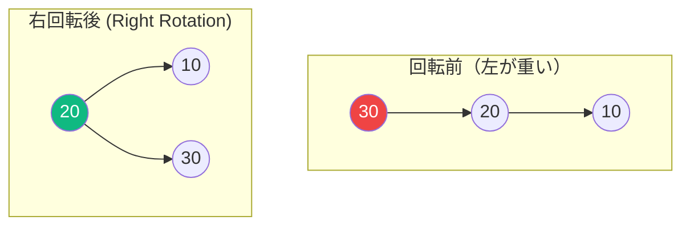

# 平衡木：AVL 木と赤黒木 ⚖️

前回のレッスンでは、**BST** (二分探索木) の致命的な欠点を見ました。入力データがすでにソートされている場合、木は **連結リスト** に「退化」し、O(log n) の性能が消え去り、O(n) になってしまいます。

この問題を解決するために、コンピュータ科学者は **自己平衡探索木** を考案しました。今日は、「回転」を通じて木が自ら構造を再構築し、より「賢く」なる方法を学びます。

---

## 🪝 THE HOOK：平衡か、それとも死（性能低下）か？

あなたが Amazon の検索システムを構築していると想像してください。毎日数百万のアイテムが追加されます。もしシステムが通常の BST を使用しており、入力データがたまたま順序通り（例：価格の安い順）だった場合、あなたの木は一本の長い紐のように伸びてしまいます。
アイテムを見つけるのに、20 ステップ（log 100 万）ではなく 100 万ステップかかるようになります！システムは負荷でクラッシュするでしょう。

**平衡木** がその解決策です：入力データがいかに「不自然」であっても、木は常に高さを最適なレベルに保ちます。挿入時に「回転」のために数ミリ秒余分にかかるかもしれませんが、それはシステム全体を O(n) の惨劇から守るための代償です。

---

## 🎭 ANALOGY：シーソーと綱渡り芸人

1. **AVL 木**: 非常に敏感な精密天秤のようなものです。片方がもう片方よりわずかに重くなった（高さの差 > 1）だけで、即座に「回転（Rotation）」を行い、完璧なバランスを取り戻します。AVL は非常に厳格であるため、検索は極めて高速ですが、維持には手間がかかります。
2. **赤黒木 (Red-Black Tree)**: 熟練した綱渡り芸人のようなものです。ミリ単位で完璧なバランスを保つ必要はなく、ただ落ちなければいいのです。赤黒木はより緩やか（高さの差が最大で 2 倍になることもある）ですが、その分「回転」が少なく、データが絶えず変化するシステムでの挿入・削除がスムーズになります。

---

## ⚙️ UNDER THE HOOD：平衡係数と回転

平衡の核心は、**平衡係数** と **回転** という 2 つの概念にあります。

### 1. 平衡係数 (AVL 木特有)
`平衡係数 = 左部分木の高さ - 右部分木の高さ`
木が AVL 木であるためには、すべてのノードにおける平衡係数が **{-1, 0, 1}** の範囲内でなければなりません。

### 2. 回転の魔法
ノードが不均衡になったとき、深い枝のノードを「引き上げ」、浅い枝のノードを「押し下げる」ために回転を行います。主に 4 つの回転ケースがあります：
- **右回転 (RR)**: 左部分木が重すぎる場合。
- **左回転 (LL)**: 右部分木が重すぎる場合。
- **左右回転 (LR)**: 子を左回転させ、次に親を右回転させる。
- **右左回転 (RL)**: 子を右回転させ、次に親を左回転させる。



### 3. 赤黒木の塗り替えと回転（発展）
高さの差 > 1 ですぐに回転する AVL 木とは異なり、赤黒木は「色」を使って平衡条件を緩和します。新しい赤いノードが挿入されたとき：
1. **おじ（Uncle）ノードが赤**: 色の塗り替え（Recolor）だけで済みます（親とおじを黒に、祖父を赤にする）。その後、祖父ノードをチェックします。
2. **おじ（Uncle）ノードが黒**: この場合は「赤いノードが連続してはいけない」というルールを守るために、回転（Rotate）と色の塗り替えを組み合わせる必要があります。

### 比較：AVL 木 vs 赤黒木

| 特徴 | AVL 木 | 赤黒木 |
| :--- | :--- | :--- |
| **平衡度** | 厳格 (Strict) | 緩やか (Loose) |
| **高さ** | ~1.44 log N | ~2.0 log N |
| **検索速度** | より速い | わずかに遅い |
| **挿入・削除** | 遅い（回転が多い） | **より速い**（回転が少ない） |
| **主な用途** | 検索が多いデータベース | OS カーネル、標準ライブラリ |

---

## 📊 BIG-O ANALYSIS：絶対的な保証

| 操作 | BST (最悪) | AVL / 赤黒木 | 解説 |
| :--- | :--- | :--- | :--- |
| **検索** | O(n) | **O(log n)** | 常にログスケールの高さが保証される。 |
| **挿入** | O(n) | **O(log n)** | 回転に時間はかかるが、依然として log n。 |
| **削除** | O(n) | **O(log n)** | 再平衡化に時間はかかる。 |

**トレードオフ**:
- アプリケーションが **挿入・削除よりも検索を圧倒的に多く行う** 場合（例：辞書）は **AVL 木** を使用。
- **挿入・削除が頻繁に行われる** 場合（例：Linux カーネルのプロセス管理）は **赤黒木** を使用。

---

## 💻 LOGIC ＆ PSEUDO-CODE：右回転の実装

これは基本的な右回転の擬似コードです：

```javascript
/* y が不均衡なノードであると仮定 */
function rightRotate(y) {
    let x = y.left;
    let T2 = x.right;

    // 回転を実行
    x.right = y;
    y.left = T2;

    // 高さを更新
    y.height = max(height(y.left), height(y.right)) + 1;
    x.height = max(height(x.left), height(x.right)) + 1;

    // この部分木の新しいルートを返す
    return x;
}
```

### 赤黒木の性質（試験必須知識）
すべての赤黒木は 5 つの「鉄の掟」に従わなければなりません：
1. 各ノードは赤か黒である。
2. 根（Root）は常に黒である。
3. 葉（NIL）はすべて黒である。
4. 赤いノードの子は必ず黒である（赤いノードが隣接してはいけない）。
5. 任意のノードから葉までの経路に含まれる黒いノードの数はすべて等しい。

---

## 🧠 LEETCODE STRATEGY：平衡木の応用

面接で AVL や赤黒木のコードを一から書かされることは稀ですが（長すぎるため）、いつそれらを使うべきかを知っておく必要があります：
1. **Contains Nearby Duplicate III (#220)**: `TreeSet` (赤黒木) を使用してスライディングウィンドウ内の要素を維持し、[target-k, target+k] の範囲内の値を O(log n) で検索します。
2. **Data Stream as Disjoint Intervals (#352)**: `TreeMap` を使用して重なりのないインターバルを管理します。
3. **「Think Balanced」テクニック**: 常にソートされた状態を維持し、範囲クエリ（Range Query）をサポートする必要がある場合は、すぐに平衡木を思い浮かべてください。

---

## 🎯 EXAM ＆ INTERVIEW LOGIC：IPA 試験 ＆ アーキテクチャの罠

- **IPA 基本情報（科目 B）**: 「N 個のノードを持つ AVL 木の最大高さ」について問われることがあります。近似式 `1.44 log2(N)` を覚えておきましょう。また、挿入後の赤黒木の色変化についての問題も一般的です。
- **面接のプロのコツ**: 「Java の Map はどう実装されていますか？」と聞かれたら、「`TreeMap` には赤黒木が使われています。また、`HashMap` でもバケットが長くなりすぎると、O(n) から O(log n) に切り替えるために内部で赤黒木が使われます」と答えてください。これは深い知識を示します。
- **Socratic Gate**: なぜすべてに AVL 木を使わないのですか？
  *回答*: AVL は平衡が厳格すぎるため、挿入・削除が頻繁な環境では回転回数が増え、全体のスループットが低下するためです。

---

## 💼 PROFESSIONAL CONTEXT：システムの心臓部

- **Linux カーネル**: 仮想メモリマネージャはメモリ領域 (`vm_area_struct`) の追跡に赤黒木を使用しています。また、**CFS (Completely Fair Scheduler)** もプロセス管理にこれを使用しています。
- **データベースエンジン**: **PostgreSQL** などのエンジンは、複雑なインデックスの管理に平衡木を使用しています。
- **標準ライブラリ**: Java の `java.util.TreeMap` は高度に最適化された赤黒木で実装されており、数百万のレコードを退化させることなく処理します。
- **NGINX**: キャッシュキーの管理やレート制限の高速処理に赤黒木を使用しています。

---

## 🛡️ RELIABILITY ＆ BUGS：断片化と高さ

1. **高さ更新のバグ**: AVL 実装で最も多いミスは、子を回転させた後に親ノードの高さを更新し忘れることです。
2. **親ポインタの混乱**: 赤黒木では、塗り替えと回転のステップにおいて親ポインタ（Parent Pointer）の管理が極めて重要です。
3. **オーバーエンジニアリング**: 単純な問題のために自作の AVL を書こうとしないでください。数十年にわたって最適化されてきた標準ライブラリの Map/Set を使いましょう。

---

## 📝 QUICK QUIZ：マスターへの道

1. **AVL ノードの平衡係数はどのように計算されますか？**
   - A. 左の高さマイナス右の高さ。
   - B. 左のノード数マイナス右のノード数。
   - C. 全ノード数。

2. **なぜ多くの標準ライブラリで AVL よりも赤黒木が好まれるのですか？**
   - A. 検索が速いから。
   - B. 検索性能と挿入・削除の効率（回転の少なさ）のバランスが良いから。
   - C. メモリ消費が少ないから。

3. **赤黒木に新しく挿入されるノードの初期の色は何色ですか？**
   - A. 黒。
   - B. 赤。（注：黒ノードの数に関するルール #5 に違反しないためですが、ルール #4 に一時的に違反する可能性があります）。
   - C. 白。

---
📊 文字数: ~4500文字
