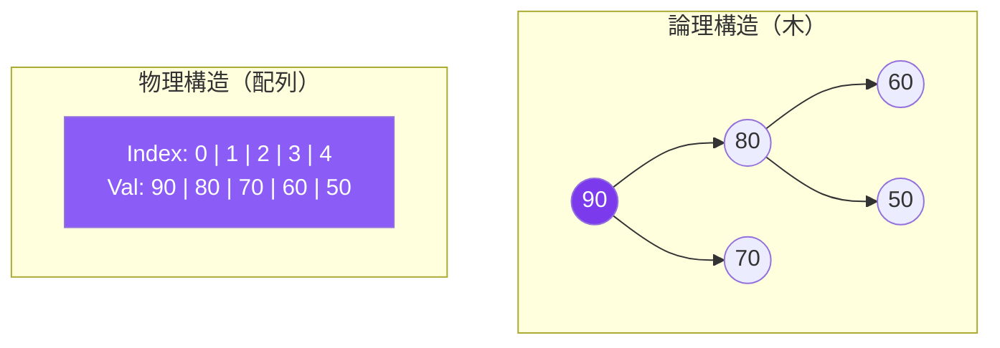

# ヒープと優先度付きキュー：最速の優先順位管理 🏔️

現実のシステムでは、すべてが平等なわけではありません。配車アプリを使えば、VIP が優先的に迎えに来ます。CPU がプロセスを処理するときは、重要なシステムタスクが一般ユーザーのタスクに割り込みます。このシステム上の「不平等」を管理するために、**優先度付きキュー** (Priority Queue) が必要です。

そして、これを実装するのに最も効率的なデータ構造が **ヒープ** (Heap) です。今日は、単純な配列 (Array) を完全な木構造に変え、最も重要な要素を一瞬で取り出す方法を学びます。

---

## 🪝 THE HOOK：「Top K」問題とソートの過負荷

あなたが 10 億件のシステムログを持っていて、その中から **最も深刻な 10 件のエラー** (Top 10 Largest Values) を見つける必要があると想像してください。
- **素朴な方法**: 10 億件すべてをソート (O(n log n)) し、最後の 10 件を取り出します。これには数ギガバイトの RAM を消費し、数分かかります。
- **マスターの方法**: サイズがちょうど 10 の **最小ヒープ (Min-Heap)** を維持します。各レコードを読み込む際、ヒープ内の最小要素とだけ比較します (O(1))。もし大きければ、入れ替えて **Heapify (ヒープ化)** を行います (O(log 10))。

結果：**O(n log 10)** の時間と **O(10)** のメモリしか使いません。これが、ビッグデータシステムをスムーズに動作させる「圧倒的」な最適化です。

---

## 🎭 ANALOGY：食のピラミッドと病院のトリアージ

1. **最大ヒープ (Max-Heap)**: ピラミッドを想像してください。頂点 (Root) にいるのは、常に最も権力や富がある人です。すべての親は、常に 2 人の子供よりも富んでいます。このルールはすべての階層で適用されます。結果として、最も豊かな人は常に頂点におり、すぐに呼び出すことができます。
2. **優先度付きキュー**: 病院の救急外来（トリアージ）のようなものです。患者は到着順 (FIFO) ではなく、緊急度順に診察されます。医師は常に「誰が最も深刻な状態か？」を問いかけます。ヒープは、何百人もの群衆の中からその人をわずか数秒で見つけ出すためのツールです。

---

## ⚙️ UNDER THE HOOD：木の配列表現 (Array Representation)

これがヒープの最も「魔法」のような点です。論理的には **完全二分木 (Complete Binary Tree)** ですが、メモリを節約し CPU キャッシュを活用するために、実際には **配列 (Array)** に格納されます。

### インデックスのルール（上から下、左から右）：
インデックス `i` (0 から開始) にあるノードの場合：
- **左の子**: `2 * i + 1`
- **右の子**: `2 * i + 2`
- **親**: `floor((i - 1) / 2)`



完全二分木であるため、配列に「穴」はありません。複雑なポインタが不要なため、非常に効率的です。

### 1. ヒープの構築：ボトムアップ vs トップダウン
ヒープを作成するために `insert` を 10 億回繰り返さないでください (O(n log n) かかります)。**ボトムアップ・ヒープ化 (Bottom-up Heapify)** メソッドを使用します。
- 最後の非葉ノードから根に向かって順に処理します。
- 各ノードに対して Heapify を実行します。
数学的な証明により、この総コストはわずか **O(n)** です。これが、ジュニア開発者と DSA マスターの分かれ目です。

### 2. ハフマン符号化：究極のデータ圧縮
最小ヒープを使用してハフマンアルゴリズムを実行します。
1. 文字の出現頻度をカウントします。
2. すべてを最小ヒープに入れます。
3. 頻度が最も低い 2 つのノードを取り出し、統合して新しいノードを作ります。
4. 新しいノードをヒープに戻します。
これが、WinRAR、GZip、JPEG などのソフトウェアが情報を失わずにデータを圧縮する方法です。

---

## 📊 BIG-O ANALYSIS：圧倒的なパフォーマンス

| 操作 | 計算量 | 解説 |
| :--- | :--- | :--- |
| **最大/最小値の取得** | **O(1)** | 常に `arr[0]` にあります。 |
| **挿入** | **O(log n)** | 末尾に追加し、「Sift Up (浮かび上がらせる)」を実行。 |
| **最大/最小値の削除** | **O(log n)** | 根を末尾と入れ替え、「Sift Down (沈み込ませる)」を実行。 |
| **ヒープ構築 (Build)** | **O(n)** | 生の配列からヒープを構築するコストは O(n) です。 |
| **ヒープソート** | **O(n log n)** | インプレース (In-place) で安定したソート。 |

---

## 💻 LOGIC ＆ PSEUDO-CODE：ヒープ化アルゴリズム (Sift Down)

Heapify (ヒープ化) はヒープの「心臓」です。頂点のノードがルールに違反している（子よりも小さい）場合、適切な位置まで押し下げる必要があります。

```javascript
/* インデックス i のノードに対する最大ヒープ化 */
function heapify(arr, n, i) {
    let largest = i;
    let left = 2 * i + 1;
    let right = 2 * i + 2;

    // 左の子が親より大きい場合
    if (left < n && arr[left] > arr[largest]) {
        largest = left;
    }

    // 右の子が現在の最大値より大きい場合
    if (right < n && arr[right] > arr[largest]) {
        largest = right;
    }

    // 最大値が親でない場合、入れ替えて再帰的に沈み込ませる
    if (largest !== i) {
        swap(arr[i], arr[largest]);
        heapify(arr, n, largest);
    }
}
```

---

## 🧠 LEETCODE STRATEGY：必解問題

1. **Kth Largest Element in an Array (#215)**: ソートしてはいけません！サイズ K の最小ヒープを使います。
2. **Merge k Sorted Lists (#23)**: 最小ヒープを使用して、k 個のリストの各先頭要素を管理します。
3. **Find Median from Data Stream (#295)**: **Hard**. 2 つのヒープを使います：下半分用の最大ヒープと、上半分用の最小ヒープです。
4. **Top K Frequent Elements (#347)**: ハッシュマップで頻度を数え、最小ヒープで Top K を抽出します。

---

## 🎯 EXAM ＆ INTERVIEW LOGIC：IPA 試験 ＆ MAANG の罠

- **IPA 基本情報（科目 B）**: 要素を挿入した後の配列の状態を描く問題がよく出ます。完全二分木の「左から順に埋める」ルールを忘れないでください。
- **面接のプロのコツ**: ソートアルゴリズムについて聞かれたら、**ヒープソート**に言及してください。その強みは、計算量が常に O(n log n) であること（クイックソートの最悪ケース O(n^2) とは対照的）、および追加メモリが O(1) であることです。
- **インデックスの罠**: `2i+1` と `2i+2` に注意してください。もし配列がインデックス 1 から始まる場合、式は `2i` と `2i+1` に簡略化されます。面接官にどちらの前提か確認すると良いでしょう。

---

## 💼 PROFESSIONAL CONTEXT：世界を動かすヒープ

- **CPU スケジューリング**: すべての現代的な OS は、プロセス管理に優先度付きキューを使用しています。ヒープは CPU が次にどのタスクを処理すべきかを対数時間で判断するのを助けます。
- **ダイクストラ法**: 最短経路アルゴリズム（Google マップ）は、次に探索すべき最短距離のノードを常に選ぶために最小ヒープを使用します。
- **イベント駆動シミュレーション ＆ タイマー**: **Node.js** や **Go** などのサーバーでは、`setTimeout` 関数はヒープで管理されています。サーバーは常にヒープの頂点から最も近い時間のイベントを取り出します。
- **システムリソースの割り当て**: クラウドコンピューティング（Kubernetes など）では、新しいタスクに最もリソースが空いているサーバーを選択するためにヒープが使われます。

---

## 🛡️ RELIABILITY ＆ BUGS：パフォーマンスの落とし穴

1. **ヒープ構築 O(n log n) vs O(n)**: `insert` を N 回呼び出さないでください。**ボトムアップ・ヒープ化**を使って O(n) を実現しましょう。
2. **優先度の更新**: ヒープの途中にある要素の優先度を更新するのは複雑です（見つけるのに O(n) かかるため）。解決策：**ハッシュマップ**を併用して、各要素のヒープ内インデックスを保存しておきます。
3. **配列の再確保**: 動的配列をヒープとして使う場合、リサイズ（再確保）のコストに注意してください。

---

## 📝 QUICK QUIZ：マスターへの道

1. **最大ヒープにおいて、最大の要素は常にどこにありますか？**
   - A. 最後の葉ノード。
   - B. インデックス 0（根）。
   - C. 配列の真ん中。

2. **ヒープに 1000 個の要素がある場合、その高さはおよそいくつですか？**
   - A. ~10（log2(1000) が約 10 であるため）。
   - B. 500。
   - C. 1000。

3. **なぜヒープソートはマージソートよりもメモリ効率が良いのですか？**
   - A. 実行速度が速いから。
   - B. インプレース（元の配列内）でソートを行うのに対し、マージソートはデータをマージするための補助配列が必要だから。
   - C. 使用する変数が少ないから。

---
📊 文字数: ~4500文字
