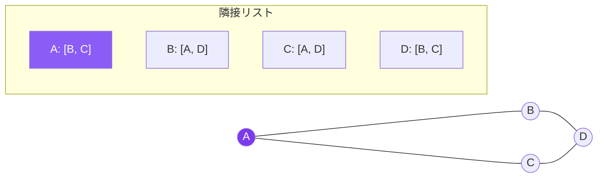

# グラフの基礎：世界の繋がりをマッピングする 🕸️

データ構造の「王者」へようこそ：**グラフ** (Graph)。連結リストが直線、木が階層構造であるなら、グラフは無限のネットワークです。脳内の神経経路から、インターネットのトポロジー、Facebook の友人関係まで、この世のあらゆるものはグラフとして表現できます。

今日は、ネットワーク的思考の確固たる基礎を築き、メモリ内での表現方法と、シニアエンジニアなら誰もが習得しておくべき「古典的」な探索手法を学びます。

---

## 🪝 THE HOOK：なぜ Google マップは帰り道を知っているのか？

あなたが TP.HCM にいて、ダラットへの道を検索すると想像してください。そこには何千もの道路、何百もの交差点、そして渋滞状況があります。
- コンピュータはどうやって「交差点」を理解するのか？
- 道路が一方通行か対面通行かをどうやって判別するのか？
- 何京通りもの可能性の中から、どうやって最短ルートを 0.5 秒で計算するのか？

その答えは**グラフ理論** (Graph Theory) にあります。Google マップは各都市や交差点を**頂点** (Vertex/Node) と見なし、各道路を**辺** (Edge) と見なします。この巨大なグラフ上で探索アルゴリズムを動かすことで、世界は一瞬にして計算可能なものになります。

---

## 🎭 ANALOGY：SNS と地下鉄路線図

1. **グラフ (Graph)**：東京の地下鉄路線図を想像してください。各駅が「頂点」であり、駅間を結ぶ路線が「辺」です。
2. **有向 (Directed) vs 無向 (Undirected)**：
   - 無向：Facebook の友達関係のようなもの。A が B の友達なら、B も A の友達です。
   - 有向：X (Twitter) や Instagram のフォロー。A が B をフォローしていても、B が A をフォローしているとは限りません。
3. **重み付き (Weighted)**：駅間の距離のようなもの。駅 A-B 間は 5km（重み 5）で、B-C 間は 2km（重み 2）といった具合です。

---

## ⚙️ UNDER THE HOOD：メモリ内でのグラフ表現

グラフをプログラムで扱うには、主に 2 つの方法があります。

### 1. 隣接行列 (Adjacency Matrix)
`V x V` サイズの 2 次元配列を使用します。
- `matrix[i][j] = 1`：頂点 i から j へ辺がある。
- `matrix[i][j] = 0`：辺がない。

**長所**：特定の辺が存在するかを爆速 ($O(1)$) で確認できる。
**短所**：大量のメモリ ($O(V^2)$) を消費する。1 万個の頂点があっても辺が少ない「疎グラフ」の場合、ほとんどが 0 のデータに膨大な RAM を浪費します。

### 2. 隣接リスト (Adjacency List) — (推奨)
各頂点が、自分が接続している頂点のリストを保持します。

**長所**：メモリ効率が極めて高い ($O(V + E)$)。
**短所**：特定の辺の存在確認に $O(degree(V))$ かかる。

---

## 🚀 TRAVERSAL SPIRIT：BFS vs. DFS

グラフの探索は配列よりも複雑です。なぜならグラフには**閉路** (Cycle) があるからです。どこを通過したかを記録するために `visited` 配列を使います。

### 1. 幅優先探索 (BFS: Breadth First Search) 🌊
**キュー** (Queue) を使用します。水面に広がる波紋のように、出発点から近い順に探索します。
- **必殺技**：重みのないグラフにおいて**最短経路**を必ず見つける。
- **例え**：家の中を探すとき、2 階に行く前に 1 階のすべての部屋を確認する。

### 2. 深優先探索 (DFS: Depth First Search) 🧗
**スタック** (Stack) または再帰を使用します。洞窟の奥深くへ突き進み、行き止まりになったら戻る（バックトラック）探索です。
- **必殺技**：閉路の検出、パズル解き、トポロジカルソートに最適。
- **例え**：迷路で一つの壁に手を当てて、行き止まりまで進み続ける。

---

## 📊 BIG-O ANALYSIS：空間と時間のトレードオフ

| 特徴 | 隣接行列 | 隣接リスト | 解説 |
| :--- | :--- | :--- | :--- |
| **空間計算量** | $O(V^2)$ | **$O(V + E)$** | 疎グラフではリストの圧勝。 |
| **頂点の追加** | $O(V^2)$ | **$O(1)$** | 行列は配列の再確保が必要。 |
| **辺の確認** | **$O(1)$** | $O(degree)$ | 行列が圧倒的に速い。 |
| **探索** | $O(V^2)$ | **$O(V + E)$** | リストが標準的な選択。 |

---

## 🧠 LEETCODE STRATEGY：グラフ問題の「見極め」

1. **Number of Islands (#200)**：行列（グリッド）上の DFS/BFS 定番問題。各島は一つの「連結成分」です。
2. **Course Schedule (#207)**：トポロジカルソートを使って、卒業可能か（閉路がないか）を判定します。
3. **Clone Graph (#133)**：BFS とハッシュマップを組み合わせて、複雑な構造をディープコピーします。
4. **Flood Fill (#733)**：ペイントソフトの「塗りつぶし」ツールのロジックです。

---

## 🎯 EXAM & INTERVIEW LOGIC：IPA 試験 ＆ MAANG の罠

- **IPA 基本情報技術者試験 (科目 B)**：探索される頂点の順序を問う問題が頻出です。BFS＝キュー＝同じ階層、DFS＝スタック＝枝の突き当たりまで、と覚えましょう。
- **面接のヒント**：行列かリストか選ぶよう言われたら、「グラフは密 (Dense) ですか、疎 (Sparse) ですか？」と逆質問しましょう。$E \approx V^2$ なら行列、そうでなければリスト。これが設計者の思考です。
- **有向グラフの閉路検出**：単なる `visited` だけでは不十分です。現在の再帰パス上にあるかを追跡する `inStack` 配列が必要になります。

---

## 🛡️ RELIABILITY & BUGS：現場での教訓

1. **無限ループ**：`visited` の更新忘れ。これはグラフアルゴリズムで Stack Overflow を引き起こす最大の原因です。
2. **メモリリーク**：100 万ユーザーのグラフに行列を使うと、一瞬で Out of Memory になります。
3. **キューの性能**：JavaScript の配列で `shift()` を使うと $O(N)$ かかります。大規模な探索では、連結リストベースの自作キューを使い $O(1)$ を確保するのがプロです。

---

## 📝 QUICK QUIZ：マスターへの挑戦

1. **重みのないグラフで最短経路を見つけるアルゴリズムは？**
   - A. DFS
   - B. BFS
   - C. 二分探索

2. **1000 個の頂点に対し辺が 1500 本しかないグラフを何と呼ぶ？**
   - A. 密グラフ (Dense)
   - B. 疎グラフ (Sparse)
   - C. 完全グラフ (Complete)

3. **反復的な（再帰を使わない）DFS で一般的に使われるデータ構造は？**
   - A. キュー
   - B. スタック
   - C. ハッシュマップ

---
📊 文字数: ~4500 文字
