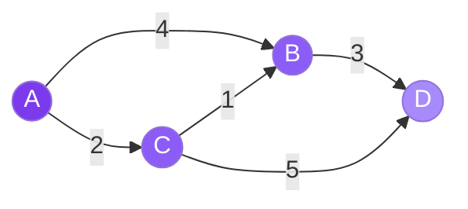

# ダイクストラ法：最短経路の禅 🧭

昨日は、グラフの構造（解剖学）をマスターしました。今日は、コンピュータサイエンス史上最も有名なアルゴリズムの一つ、**ダイクストラ法 (Dijkstra's Algorithm)** を使って、そのグラフに命を吹き込みましょう。

伝説的なエドガー・ダイクストラによって考案されたこのアルゴリズムは、GPS が大陸を横断するルートをミリ秒単位で計算できる理由そのものです。重み付きグラフにおいて、あるノードから他のノードへの最短経路を見つけるための「黄金律」とされています。

---

## 🪝 THE HOOK： 「貪欲な」ナビゲーター

あなたは東京の忙しい交差点（頂点 A）に立っていて、新宿にある特定のラーメン屋（頂点 Z）に行きたいと考えていると想像してください。
- 数百の道（辺）があります。
- 各道路には異なる所要時間（重み）があります。
- 高速だが遠回りの道もあれば、短距離だが渋滞している道もあります。

各交差点でどちらに曲がるべきか、どう判断しますか？
ダイクストラの論理はシンプルですが強力です：**「常に、まだ探索していない中で最も近い場所へ進む」**。この「貪欲（Greedy）」な選択を繰り返すことで、最終的にグローバルな最適解、つまり絶対的な最短経路に到達できることをダイクストラは証明しました。

---

## 🎭 ANALOGY：火とパイプ

グラフを水道管のネットワークだと考えてみましょう。
1. 出発地点（始点）のパイプに赤い染料を流し込みます。
2. 染料はすべてのパイプを一定の速度で流れていきます。
3. 接合点（頂点）に到達する時間は、パイプの長さ（重み）に依存します。
4. **ある接合点に初めて赤い染料が到達した瞬間、それがその接合点への最短経路です。**

ダイクストラ法は、この流れをシミュレートし、常に「染料が最初に到達する」接合点から順番に処理を行っていきます。

---

## ⚙️ UNDER THE HOOD：緩和 (Relaxation) という魔法

ダイクストラ法は `dist` 配列を保持します。`dist[v]` は始点から頂点 `v` への現在の最短距離です。初期状態では、始点は `0`、それ以外はすべて $\infty$（無限大）です。

### アルゴリズムの核心ループ：
1. **選択 (Pick)**：未訪問の頂点の中で、`dist[u]` が最小の頂点 `u` を選びます。
2. **緩和 (Relax)**：`u` に隣接するすべての頂点 `v` について：
   - `new_dist = dist[u] + weight(u, v)` を計算します。
   - もし `new_dist < dist[v]` なら、`dist[v] = new_dist` を更新します。
3. **反復 (Repeat)**：`u` を訪問済みとし、すべてのノードを処理するまで繰り返します。

*このグラフでは、A -> B へ行く際、ダイクストラは最初に経路 4 を見つけますが、その後 C 経由の経路 3 (2+1) で「緩和」し、最短距離を更新します。*

---

## 🚀 パフォーマンスの秘訣：優先度付きキュー

素朴な実装では、最小の距離を持つノードを探すために毎回配列全体をスキャンするため、$O(V^2)$ の時間がかかります。
**エリートエンジニア**は、**最小ヒープ (Min-Heap / Priority Queue)** を使用して `(距離, 頂点)` のペアを管理します。これにより、次のノードを $O(\log V)$ で見つけることができます。

**最終的な計算量**：$O((V + E) \log V)$
これにより、数百万の辺を持つグラフでも実用的な速度で動作します。

---

## 📊 BIG-O ANALYSIS

| 処理 | 計算量 | ロジック |
| :--- | :--- | :--- |
| **初期化** | $O(V)$ | 距離を $\infty$ に設定。 |
| **最小値の取り出し** | $O(V \log V)$ | 各頂点をヒープから 1 回ずつ取り出す。 |
| **辺の緩和** | $O(E \log V)$ | 各辺を 1 回ずつ確認し、ヒープを更新する。 |
| **合計** | **$O(E \log V)$** | 疎なグラフでは辺の処理が支配的になります。 |

---

## 🧠 LEETCODE 戦略：ダイクストラ問題を見極める

1. **ネットワークの最短遅延 (#743 Network Delay Time)**：典型的なダイクストラ問題。信号が全ノードに届く時間を求めます。
2. **最小の努力を要する経路 (#1631 Path with Minimum Effort)**：「重み」が高さの最大差になる変形バージョン。
3. **K 回以内の乗り継ぎで最も安い航空券 (#787)**：注意！標準的なダイクストラは「K 回以内」という制約を扱うのが苦手です。BFS やベルマンフォード法が必要になる場合があります。

---

## 🛡️ RELIABILITY & BUGS： 「負の重み」という致命的な欠陥

> [!CAUTION]
> **ダイクストラ法は、負の重みを持つ辺があるグラフでは正しく動作しません。**
> なぜなら、あるノードを「訪問済み」として最短距離を確定させた後、後から出てくる負の辺によってその距離がさらに短くなる可能性を考慮しないからです（一度決めたら振り返らない貪欲法のため）。負の重みがある場合は、**ベルマンフォード法**を使う必要があります。

---

## 🎯 試験 ＆ 面接のポイント：IPA とメガベンチャー

- **IPA 試験 (科目B)**：`dist` 配列の推移を追跡する問題がよく出ます。表を書いて、一歩ずつ値を更新する練習をしましょう。
- **システムデザイン**： 「地球規模の巨大なグラフで最短経路を求めるには？」と聞かれたら、ダイクストラ法を最適化した **Contraction Hierarchies** や **A* 探索**（ダイクストラ ＋ ヒューリスティクス）に言及すると高評価です。

---

## 📝 クイッククイズ

1. **ダイクストラ法を $O(E \log V)$ に最適化するために使うデータ構造は？**
   - A. スタック
   - B. 最小ヒープ (Min-Heap)
   - C. ハッシュマップ

2. **辺の重みに -5 が含まれる場合、ダイクストラ法で最短経路が見つかりますか？**
   - A. はい
   - B. いいえ

3. **始点ノードの初期距離はいくつに設定しますか？**
   - A. $\infty$
   - B. 0
   - C. 1

---
📊 文字数: ~4500 文字
