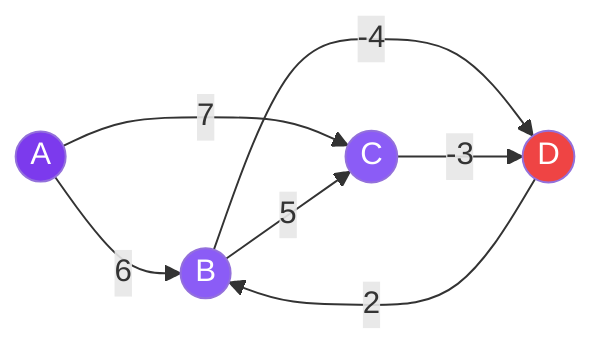

# ベルマンフォード法：ダイクストラの限界を超えて 🌀

昨日、私たちは**ダイクストラ法**がいかに高速かつ効率的に最短経路を制覇するかを見ました。しかし、ダイクストラ法には「死角」があります。それは**負の重みを持つ辺**を扱えないことです。今日は、ダイクストラ法よりも低速ですが、負の値を扱い、さらには恐ろしい**負の閉路 (Negative Cycle)** を検出できる、非常に堅牢なアルゴリズム、**ベルマンフォード法 (Bellman-Ford Algorithm)** を学びます。

---

## 🪝 THE HOOK： 「キャッシュバック」のパラドックス

辺が移動コストを表すネットワークを想像してください。
- 道路 A -> B は 10 ドルかかります。
- 道路 B -> C は **15 ドルのキャッシュバック**があります（重み = -15）。

このシナリオでは、A -> B -> C と進むと、実際には 5 ドル得をします。ダイクストラ法は、「一度見つけた経路は、進めば進むほど長くなる（非減少）」という前提があるため、ここで失敗します。一方、ベルマンフォード法は忍耐強いアルゴリズムです。より良い経路がもう存在しないと確信できるまで、何度でも評価を繰り返します。

---

## 🎭 ANALOGY：執念深い検査官

ダイクストラ法が最速ルートを探す**レーシングカー**だとしたら、ベルマンフォード法は**執念深いビル検査官**です。
- 検査官は建物のすべての部屋（辺）をくまなくチェックします。
- これを何度も何度も（頂点の数 $V-1$ 回）繰り返します。
- 経路を短縮できる改善点を見つけるたびに、クリップボードの記録を更新します。
- 最後の点検を終えてもなお、さらに経路を短くできる方法が見つかった場合、彼は何かがおかしい――「マトリックスのバグ（負の閉路）」があることに気づきます。

---

## ⚙️ UNDER THE HOOD：全辺の緩和 (Universal Relaxation)

ベルマンフォード法の論理は驚くほどシンプルです：**「グラフ内のすべての辺を $V-1$ 回、緩和 (Relax) する」**。

### なぜ $V-1$ 回なのか？
頂点数が $V$ のグラフにおいて、（閉路を含まない）最短経路に含まれる辺の数は最大でも $V-1$ 本です。すべての辺を $V-1$ 回緩和することで、始点からの最短経路の情報がすべてのノードに確実に行き渡ることが保証されます。

### アルゴリズムの手順：
1. `dist[始点] = 0`、それ以外を $\infty$ に初期化します。
2. **緩和フェーズ**：以下の処理を $V-1$ 回繰り返します。
   - グラフ内のすべての辺 `(u, v)`（重み `w`）について：
     - もし `dist[u] + w < dist[v]` なら：
       - `dist[v] = dist[u] + w`
3. **検出フェーズ**：もう一度だけ、すべての辺を緩和してみます。
   - もし、さらに距離を短縮できる `dist[v]` が見つかったら、そこには**負の閉路**が存在します！

*このグラフで B-D-B の合計が 0 未満になる場合、それは負の閉路です。ベルマンフォード法はこれを見逃しません。*

---

## 🚀 実世界の応用：距離ベクトルルーティング

ベルマンフォード法は、初期のネットワークで使用されていた **RIP (Routing Information Protocol)** の頭脳です。
- 各ルーター（ノード）は、隣接するルーターに他のネットワークまでの推定距離を教えます。
- 隣接ルーターはその情報を基に、自分の経路表（ルーティングテーブル）を更新します。
- ネットワークは動的であり、渋滞の解消や高速回線の利用などによって「負のコスト（改善）」が発生し得るため、ベルマンフォード法の堅牢さが不可欠でした。

---

## 📊 BIG-O ANALYSIS

| 処理 | 計算量 | ロジック |
| :--- | :--- | :--- |
| **緩和フェーズ** | $O(V \times E)$ | $E$ 本の辺を $V-1$ 回ループする。 |
| **検出フェーズ** | $O(E)$ | 最後に全辺をもう 1 回確認する。 |
| **合計** | **$O(V \times E)$** | ダイクストラ法の $O(E \log V)$ より大幅に低速です。 |

---

## 🧠 LEETCODE 戦略：いつベルマンフォードを使うか？

1. **負の重みがある最短経路**：問題に「負の辺」が登場したら、ベルマンフォードが第一候補です。
2. **負の閉路の検出**： 「コストを無限に減らす方法があるか？」という問いに対する唯一の答えです。
3. **K 回以内の乗り継ぎで最も安い航空券 (#787)**：実はベルマンフォードが最適です！ $V-1$ 回の反復は、ちょうど「$i$ 本の辺を使った経路」に対応します。$K+1$ 回目の反復で止めれば、答えが見つかります。

---

## 🛡️ RELIABILITY & BUGS： 「無限」ループの罠

> [!WARNING]
> **負の閉路 ＝ 無限のお金（または無限の損失）。**
> 負の閉路が存在する場合、永遠にループを回ることでコストを下げ続けられるため、理論上の最短経路は $-\infty$ になります。金融システム（FX の裁定取引/アービトラージ検出など）では、負の閉路を見つけることは「確実に利益が出る取引手順」を見つけることを意味します。

---

## 🎯 試験 ＆ 面接のポイント：巨頭の比較

| 特徴 | ダイクストラ法 | ベルマンフォード法 |
| :--- | :--- | :--- |
| **核心論理** | 貪欲法 (Greedy) | 動的計画法 (反復的) |
| **負の辺** | ❌ 不可 | ✅ 対応 |
| **計算量** | 高速 ($O(E \log V)$) | 低速 ($O(V \times E)$) |
| **ユースケース** | 地図、GPS、単一始点 | ルーティング、裁定取引 |

---

## 📝 クイッククイズ

1. **ベルマンフォード法は全辺の緩和を何回繰り返しますか？**
   - A. $E$ 回
   - B. $V-1$ 回
   - C. 1 回

2. **$V$ 回目の反復で辺が緩和された場合、何を意味しますか？**
   - A. 最短経路が見つかった
   - B. 負の閉路が検出された
   - C. アルゴリズムがクラッシュした

3. **ベルマンフォード法が使われているプロトコルはどれですか？**
   - A. OSPF
   - B. RIP
   - C. HTTP

---
📊 文字数: ~4500 文字
