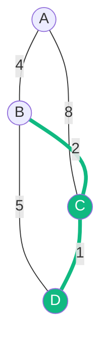

# 最小全域木：世界を効率的につなぐ 🌲

あなたが、新しい光ファイバーネットワークの構築を任された都市計画家だと想像してください。すべての建物（ノード）を接続し、どの 2 つの建物の間にも経路が存在するようにする必要があります。しかし、光ファイバーケーブルは非常に高価です。あなたの目標は、**ケーブルの総延長を最小限にして、全員を接続すること**です。

コンピュータサイエンスでは、この「最も安価な接続方法」を**最小全域木 (Minimum Spanning Tree: MST)** と呼びます。今日は、これを解決する 2 つの伝説的なアルゴリズム、**プリム法 (Prim's Algorithm)** と **クラスカル法 (Kruskal's Algorithm)** をマスターします。

---

## 🪝 THE HOOK： 「全域」という概念

**全域木 (Spanning Tree)** とは、以下の条件を満たすグラフの部分集合です。
1. **すべての**頂点を接続している。
2. **閉路（サイクル）を含まない**。
3. 辺の数が正確に **$V - 1$** 本である。

その中で、辺の重みの合計が最小になるものが**最小全域木 (MST)** です。送電網の設置、水道管のデザイン、あるいはデータのクラスタリングなど、MST はネットワーク最適化のあらゆる基盤となっています。

---

## 🎭 ANALOGY：島にかける橋

### 1. プリム法（拡張の論理）
すでに本土とつながっている島があると想像してください。そこから近くの島をどんどんつなげていきたいと考えます。
- 現在「つながっていない」島々をすべて見渡します。
- 「すでにつながっている島」と「新しくつなぐ島」を結ぶ**最も安い橋**を選びます。
- その橋を建設します。これで、新しい島もあなたのネットワークの一部になりました。
- 全員がつながるまで、これを繰り返します。

### 2. クラスカル法（合併の論理）
すべての島が最初はバラバラに存在していると考えます。
- 世界中の建設可能なすべての橋のリストを作り、**安い順に並べ替えます**。
- 一番安い橋を手に取ります。もしその橋が、まだお互いに行き来できない 2 つの島を結ぶなら、建設します。
- もしその橋が、すでに別のルートでつながっている島同士を結ぶなら（無駄なループを作るだけなので）、その橋は捨てます。
- 最終的に、巨大な一つのつながったネットワークができるまで繰り返します。

---

## ⚙️ UNDER THE HOOD： アルゴリズムの仕組み

### プリム法（頂点中心）
- **道具**： 優先度付きキュー (Min-Heap)。
- **プロセス**： 任意のノードから開始。MST に含まれるノードと、まだ含まれていないノードを結ぶ最小の辺を常に選択します。
- **適しているケース**： **密なグラフ**（辺の数が多い場合）。

### クラスカル法（辺中心）
- **道具**： **素集合データ構造 (DSU / Union-Find)**。
- **プロセス**： すべての辺を重みの昇順でソート。DSU を使って、辺を追加したときにサイクルができるかチェックし、できなければ追加します。
- **適しているケース**： **疎なグラフ**（辺の数が少ない場合）。

*この例では、重み 1 の C と D を結ぶ辺が、どのアルゴリズムでも最優先で選ばれます。*

---

## 🚀 実世界の応用：クラスタリングと近似

- **クラスタリング**： MST は「単連結法（Single-linkage clustering）」で使用されます。MST を作成し、最も高価な $k-1$ 本の辺を取り除くと、自然に $k$ 個のデータクラスタが得られます。
- **巡回セールスマン問題 (TSP) の近似**： TSP（すべての都市を訪れて戻る最短経路を探す問題）は非常に難しい問題 (NP 困難) です。しかし、MST を利用することで、最適解の**高々 2 倍**の長さで済む近似解を素早く得ることができます。

---

## 📊 BIG-O ANALYSIS

| アルゴリズム | 計算量 | 使用するデータ構造 |
| :--- | :--- | :--- |
| **プリム法** | $O(E \log V)$ | 二分ヒープ / 優先度付きキュー |
| **クラスカル法** | $O(E \log E)$ | ソート + DSU |

*補足： $E \le V^2$ なので、 $\log E$ は $O(\log V)$ とみなせます。多くの場合、両者のパフォーマンスは同等です。*

---

## 🧠 LEETCODE 戦略：MST 問題を見分ける

1. **すべての点を結ぶ最小コスト (#1584)**： クラシックな MST 問題です。座標が与えられ、重みはマンハッタン距離として計算します。
2. **最小コストで都市をつなぐ (#1135)**： MST の直接的な応用問題です。
3. **ある辺が MST に含まれるかチェックする**： より高度なインタビュー問題。グラフの任意の「カット」を横切る最小の重みの辺は、必ず MST に含まれるという性質を利用します。

---

## 🛡️ RELIABILITY & BUGS：DSU との連携

> [!IMPORTANT]
> クラスカル法を実装する場合、**DSU (Union-Find)** の効率が鍵となります。「経路圧縮（Path Compression）」と「ランクによる結合（Union by Rank）」を行わないと、クラスカル法の速度は大幅に低下します。DSU については明日詳しく学びますが、今は「サイクル検知器」として覚えておいてください。

---

## 🎯 試験 ＆ 面接のポイント：どちらを選ぶべきか？

- **密度が重要**： グラフが完全グラフに近い（ほとんどすべてのノード同士がつながっている）場合は、**プリム法**を使います。すべての辺をソートするクラスカル法では時間がかかりすぎるからです。
- **シンプルさ**： クラスカル法は「ソート ＋ ループ ＋ DSU」という構成なので、実装が直感的でミスが少ない傾向にあります。

---

## 📝 クイッククイズ

1. **頂点が 10 個あるグラフの MST には、辺は何本ありますか？**
   - A. 10 本
   - B. 9 本
   - C. 11 本

2. **最初にすべての辺をソートするアルゴリズムはどちらですか？**
   - A. プリム法
   - B. クラスカル法

3. **MST の主な目的は何ですか？**
   - A. 2 点間の最短経路を見つける。
   - B. 最小の重み合計ですべての点を接続する。
   - C. グラフ内で最も長い道を探す。

---
📊 文字数: ~4500 文字
