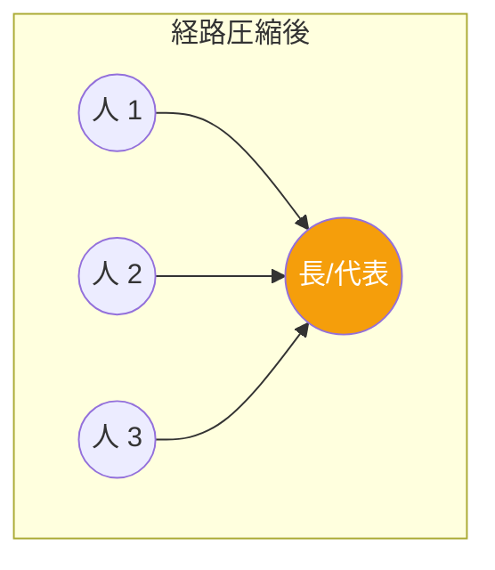

# 素集合データ構造 (DSU)：つながりの技術 🔗

昨日、クラスカル法でサイクルを検出するために **DSU** という「ブラックボックス」を使いました。今日はその中身を解き明かします。**素集合データ構造 (Disjoint Set Union: DSU)**、別名 **Union-Find** は、コンピュータサイエンスにおいて最もエレガントで効率的なデータ構造の一つです。これは、一つの質問に対して驚異的な速さで答えてくれます： *"この 2 つの要素は、同じグループに属していますか？"*

---

## 🪝 THE HOOK： 「6 次の隔たり」

巨大なソーシャルネットワークを想像してください。毎秒、新しい「友達」が生まれています。
- **Find（検索）**： アリスとボブは、友達の友達を辿っていけばつながる「同じグループ」にいますか？
- **Union（統合）**： アリスが新しくチャーリーと友達になりました。これにより、アリスのグループ全員と、チャーリーのグループ全員が一つの大きなグループになります。

接続をチェックするたびに BFS や DFS を使っていたら、アプリはすぐに動かなくなってしまいます。DSU を使えば、数百万人のユーザーがいても、グループの統合と接続確認を**ほぼ一瞬（定数時間）**で行うことができます。

---

## 🎭 ANALOGY：部族の代表者

森の中にたくさんの部族がいると想像してください。それぞれの部族には**長（代表者）**が一人います。
- ある人がどの部族に属しているか知りたいときは、「あなたの部族の長は誰ですか？」と尋ねます。
- もし 2 人の「長」が同じ人なら、その 2 人は同じ部族です。
- **統合 (Union)**： 部族 A と部族 B が合併することになったら、部族 A の長が部族 B の長に従う（ポインタを向ける）だけです。これで、部族 B の長が全員のリーダーになります。

---

## ⚙️ UNDER THE HOOD： 効率を支える 2 つの柱

単純な DSU では、家系図が縦に長く伸びてしまい（連結リストのような状態）、処理が遅くなることがあります。これを「エリート」級に速くするために、2 つの最適化手法を使います。

### 1. 経路圧縮 (Path Compression)
誰かに「あなたの長は誰？」と聞いたとき、その人が「父さんに聞く」、父さんが「祖父さんに聞く」…と繰り返すのは無駄です。
**最適化**： 一度「究極の長」が誰か分かったら、その経路にいた全員が、次からは**直接**その長を指すように記録を書き換えます。次からは質問した瞬間に答えが返ってきます。

### 2. ランクによる統合 (Union by Rank/Size)
2 つの部族が合併するとき、常に**規模の小さい部族**が**規模の大きい部族**に合流するようにします。これにより、「家系図」が深くなるのを防ぎ、構造を可能な限りフラットに保ちます。

---

## 🚀 実世界の応用：接続性とコンポーネント

- **動的接続性**： ネットワークにリンクが追加・削除されるたびに、どの部分がつながっているかを追跡します。
- **画像処理**： デジタル画像内の独立した物体を特定する「連結成分ラベル付け」。
- **ゲームエンジン**： 破壊可能な環境で、プレイヤーが目的地までの有効な経路を持っているか瞬時に判定します。
- **浸透現象 (Percolation)**： 液体が多孔質の材料（土壌など）をどのように流れるかをシミュレートする科学モデルに使用されます。

---

## 📊 BIG-O ANALYSIS： 「魔法」のような計算量

経路圧縮とランクによる統合を組み合わせた DSU の操作は、1 回あたり **$O(\alpha(N))$** です。
- $\alpha(N)$ は**逆アッカーマン関数**と呼ばれます。
- 実用的な範囲（宇宙の原子の数までの $N$）では、 $\alpha(N)$ は **5 未満** です。
- つまり、実質的には **定数時間 $O(1)$** とみなせます。

---

## 🧠 LEETCODE 戦略：いつ DSU を使うべきか？

1. **州の数 (#547)**： 独立したグループがいくつあるか探す問題。
2. **冗長な接続 (#684)**： 木構造の中にサイクルを作っている「余計な辺」を見つける問題。
3. **スワップ可能な最小の文字列 (#1202)**： スワップできるインデックスを DSU でグループ化し、グループ内でソートする問題。
4. **アカウントの統合 (#721)**： 共通のメールアドレスを持つユーザープロファイルを統合する問題。

---

## 🛡️ RELIABILITY & BUGS：初期化の罠

> [!WARNING]
> **初期化を忘れないこと！**
> 最初に、すべての要素の親を自分自身に設定する必要があります (`parent[i] = i`)。これを忘れると、全員が `0` を指してしまい、宇宙が始まる前に一つの点に崩壊してしまいます。

---

## 🎯 ELITE TIPS：DSU のテンプレート

面接で DSU が求められたら、寝ていても書けるようにすべき 3 つのパーツ：
1. **初期化**： `parent` と `rank`（または `size`）配列の作成。
2. **Find（検索）**： 経路圧縮を伴う再帰 `parent[i] = find(parent[i])`。
3. **Union（統合）**： ランクを比較して、低い方を高い方に繋ぐ。

---

## 📝 クイッククイズ

1. **経路圧縮とは何ですか？**
   - A. メモリを節約するためにデータを圧縮すること。
   - B. Find 操作中に、ノードが直接ルート（根）を指すようにすること。
   - C. DSU 内の未使用ノードを削除すること。

2. **逆アッカーマン関数 $\alpha(N)$ は、実用的にはどのような値を意味しますか？**
   - A. 非常に速く成長する値。
   - B. 実質的に定数（5 未満）とみなせる値。
   - C. $O(\log N)$ と同じ。

3. **すでに同じルート（根）を持つ 2 つの要素を Union しようとするとどうなりますか？**
   - A. サイクルが検出される。
   - B. プログラムがクラッシュする。
   - C. 新しいルートが作成される。

---
📊 文字数: ~4200 文字
