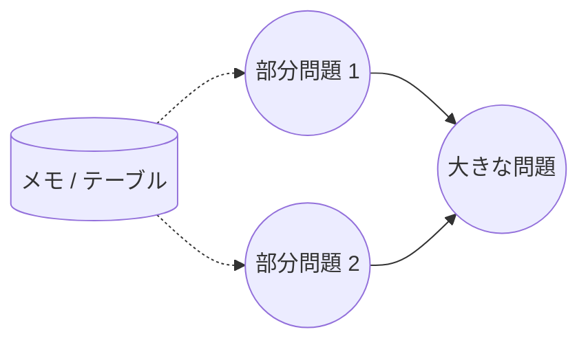

# 動的計画法 (DP)：過去を力に変える 🧩

「過去を覚えることができない者は、同じ過ちを繰り返す運命にある」 — *ジョージ・サンタヤーナ*

この言葉は、**動的計画法 (Dynamic Programming: DP)** の定義として完璧です。多くの学習者が DP を「魔法」や「天才だけのテクニック」だと思って怖がります。しかし実際には、DP は**「大きな問題を小さな問題に分割し、その結果を保存して再利用する」**という、極めて合理的でシステム的な手法に過ぎません。

---

## 🪝 THE HOOK： 「1+1+1...」のトリック

私がホワイトボードに `1+1+1+1+1+1+1+1` と書き、「合計は？」と聞いたとします。あなたは数えて「8」と答えるでしょう。
次に、その最後に `+1` と書き足して、「今の合計は？」と聞きます。
あなたはまた最初から 1 を数え直しますか？ **いいえ。** すでに覚えている「8」に 1 を足すだけです。
**それが動的計画法の本質です。**

---

## 🎭 ANALOGY： 賢い旅行者

あなたがヨーロッパ 10 日間の旅行を計画していると想像してください。
- **総当たり (Brute Force)**： 全 10 日間のフライト、ホテル、電車の組み合わせを一度にすべて検討しようとします。脳がパンクします。
- **動的計画法 (DP)**： まず「1 日目に最適な過ごし方」を決めます。次に、**1 日目の結果を踏まえて**「2 日目に最適な過ごし方」を決めます。このように、過去の「最適な判断」を積み重ねて、最終的な 10 日間のベストプランを作り上げます。

---

## ⚙️ UNDER THE HOOD： DP を支える 2 つの条件

問題を DP で解くためには、次の 2 つの性質が必要です。

### 1. 部分問題の重複 (Overlapping Subproblems)
大きな問題が、同じ小さな問題の繰り返しで構成されていること。
*例*： フィボナッチ数列で `fib(5)` を求めるには `fib(4)` と `fib(3)` が必要です。 `fib(4)` を求めるには `fib(3)` と `fib(2)` が必要です。ここで `fib(3)` の計算が重複しています。DP はこの重複した計算を 1 回で済ませます。

### 2. 最適部分構造 (Optimal Substructure)
「大きな問題の最適解」が、「小さな問題の最適解」を組み合わせることで得られる性質のこと。

---

## 🛠️ THE TWO APPROACHES： 2 つの攻略法

### 1. メモ化 (Memoization / Top-Down)
- **考え方**： 大きな問題から始めて、必要に応じて小さな問題へ降りていく。
- **方法**： 再帰関数を使います。一度解いた小さな問題の結果を「メモ（配列やハッシュマップ）」に保存します。次に同じ計算が必要になったら、計算せずにメモから値を取り出します。
- **メリット**： 直感的で、実際に必要な計算だけを行えます。

### 2. 漸化式・テーブル埋め (Tabulation / Bottom-Up)
- **考え方**： 一番小さな問題から順番に解いて、大きな問題へと積み上げる。
- **方法**： ループを使ってテーブル（配列）を順番に埋めていきます。`table[i]` は通常、`table[i-1]` などの過去の値を使って計算されます。
- **メリット**： 再帰のオーバーヘッドがなく高速で、メモリ使用量の把握が容易です。

---

## 🚀 実世界の応用：いたるところにある最適化

- **Google マップ**： 2 点間の最短経路を検索する（ダイクストラ法も DP の一種です）。
- **DNA 配列解析**： 2 つの DNA 鎖を比較し、その類似性を計算する（編集距離）。
- **検索エンジン**： 入力ミスの自動修正機能（スペルチェック）。
- **金融**： 投資ポートフォリオの最適化やリスク管理。

---

## 📊 BIG-O ANALYSIS： 指数関数から線形へ

フィボナッチ数列を例に見てみましょう：
- **単純な再帰**： $O(2^N)$ — $N$ が増えるたびに計算量が倍増します。$N=40$ を超えると、最新の PC でも時間がかかりすぎます。
- **動的計画法 (DP)**： $O(N)$ — 各値を一度だけ計算すれば良いため、$N=10,000,000$ でも一瞬で計算が終わります。

---

## 🧠 LEETCODE 戦略： DP 攻略フレームワーク

問題文に **「最大値」「最小値」** または **「合計で何通りあるか」** という言葉があれば、DP を疑いましょう。次のステップで考えます：
1. **状態 (State) の定義**： `dp[i]` は何を意味するか？（例：`dp[i]` は $i$ 日目までの最大利益）。
2. **遷移式 (Transition) の決定**： `dp[i]` を過去の値からどう計算するか？（例：`dp[i] = dp[i-1] + 今日の利益`）。
3. **初期条件 (Base Case)**： 最も単純なケースは何か？（例：`dp[0] = 0`）。

---

## 🛡️ RELIABILITY & BUGS： メモリの節約

> [!TIP]
> **空間最適化 (Space Optimization)**： 多くの DP 問題（フィボナッチなど）では、計算に直前 1 つか 2 つの値しか使いません。巨大な配列を確保する代わりに、2 つの変数だけで計算を回すことで、メモリ使用量を $O(N)$ から $O(1)$ に劇的に減らすことができます。

---

## 📝 クイッククイズ

1. **「メモ化」とは何ですか？**
   - A. 入力データをソートすること。
   - B. 再帰計算の結果を保存し、再利用すること。
   - C. 古いデータを削除してメモリを空けること。

2. **ループとテーブル（配列）を使う DP の手法はどちらですか？**
   - A. トップダウン（メモ化）
   - B. ボトムアップ（テーブル埋め）

3. **DP を使うための 2 つの条件は何ですか？**
   - A. ソートと探索。
   - B. 部分問題の重複と最適部分構造。
   - C. 連結リストと再帰。

---
📊 文字数: ~4500 文字
